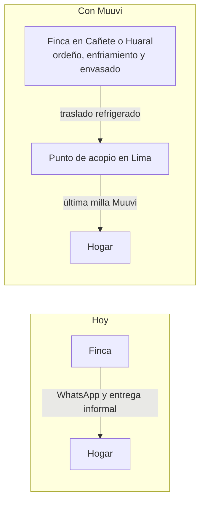

# Project Brief — Muuvi
**Versión:** 1.0.0
**Fecha:** 11/11/2026
**Autor:** Agente Analyst (BMAD), a partir de 5 rondas de descubrimiento con el emprendedor fundador
**Estado:** Pendiente de revisión humana
**Documento previo obligatorio:** [`00-constitucion.md`](00-constitucion.md)

> **Leyenda de confianza**
> - ✅ **Confirmado:** dato entregado por el fundador.
> - 📌 **Supuesto:** hipótesis sin validar con clientes o fincas.
> - ❓ **Pendiente:** dato todavía no definido.

---

## Índice
1. [Problema y oportunidad](#1-problema-y-oportunidad)
2. [Usuarios y segmentos objetivo](#2-usuarios-y-segmentos-objetivo)
3. [Propuesta de valor](#3-propuesta-de-valor)
4. [Modelo de negocio preliminar](#4-modelo-de-negocio-preliminar)
5. [Métricas de éxito (KPIs medibles)](#5-métricas-de-éxito-kpis-medibles)
6. [Riesgos identificados y supuestos](#6-riesgos-identificados-y-supuestos)
7. [Restricciones conocidas](#7-restricciones-conocidas)
8. [Pendientes antes de pasar al Product Manager](#8-pendientes-antes-de-pasar-al-product-manager)

---

## 1. Problema y oportunidad

### 1.1 Problema
**Del lado del hogar (prioridad):**
- ✅ Hoy los hogares de Lima que quieren leche fresca de pastoreo la piden **directamente a las fincas por WhatsApp**, a un precio de **S/ 3.50 – S/ 6.00 por litro**.
- 📌 El dolor principal, según la hipótesis del fundador, es que **no encuentran dónde comprarla cerca** y que **se olvidan de comprarla**. No se ha validado con entrevistas.
- ❓ No sabemos todavía cuánto pierde el hogar con la situación actual (tiempo, dinero, leche desperdiciada, desconfianza en lo "orgánico").

**Del lado de la finca:**
- ✅ Las fincas **no quieren hacerse cargo de la logística de envío** ni de **atender los pedidos** de cada cliente.

### 1.2 Oportunidad
- **Hay oferta cerca de Lima.** La región Lima es la segunda cuenca lechera del Perú, con el 16.1 % de la producción nacional en 2024, solo detrás de Cajamarca (Midagri).
- **La leche diferenciada puede pagar mejor al productor.** La gran industria paga en promedio alrededor de S/ 1.22 por kilo de leche cruda (estudio PUCP), y en algunas regiones el precio en chacra ronda los S/ 2.80 por litro en 2026. El canal directo por WhatsApp (S/ 3.50 – S/ 6.00) ya muestra que existe un consumidor que paga más por leche de finca.
- **Hay un hueco entre los dos lados:** fincas certificadas que no quieren distribuir y hogares de alto poder adquisitivo que no tienen un acceso cómodo y recurrente.

### 1.3 Cadena actual frente a la cadena propuesta

---

## 2. Usuarios y segmentos objetivo

| Prioridad | Segmento | Estado | Por qué |
|---|---|---|---|
| 1 | **Hogares** de Miraflores, San Isidro y La Molina | ✅ Segmento de lanzamiento | Alto poder adquisitivo y densidad de entregas en tres distritos |
| 2 | **Personas fitness o con dietas específicas** | ✅ Segunda fase | Valoran origen, pureza y regularidad del consumo |
| 3 | **Cafeterías, pastelerías y otros negocios** | ✅ Fase posterior | Compran en volumen; modelo B2B con otra lógica de pedido |
| — | Familias con niños y adultos mayores | 📌 Subsegmentos dentro de "hogares" | Mencionados por el fundador; falta priorizarlos dentro del segmento 1 |

### 2.1 Usuario del otro lado: la finca proveedora
- ✅ Fincas con **certificación SENASA** ubicadas en **Cañete y Huaral** (región Lima, a unas 2 o 3 horas de la ciudad).
- ✅ La finca **ordeña, enfría y envasa** en botella de vidrio, y **lleva la leche hasta un punto en Lima**.
- ❓ Número de fincas comprometidas y litros diarios disponibles: sin definir.

### 2.2 Expansión geográfica prevista
| Fase | Distritos |
|---|---|
| Lanzamiento (meses 1–3) | Miraflores, San Isidro, La Molina |
| Consolidación (mes 6) | + San Borja, Surco, Barranco |

---

## 3. Propuesta de valor

### 3.1 Para el hogar
> **Leche fresca de vacas en libre pastoreo, de fincas con certificación SENASA, que llega en botella de vidrio a casa de forma recurrente y sin romper la cadena de frío. El hogar no tiene que acordarse de pedir ni buscar dónde comprarla.**

Los cuatro diferenciadores que, según el fundador, justifican el precio adicional:
1. **Certificación SENASA garantizada.**
2. **Botella de vidrio retornable.**
3. **Trazabilidad** de la finca y del bienestar del ganado.
4. **Cadena de frío** garantizada hasta la puerta.

Además: **comodidad**, porque la compra pasa a ser recurrente y ya no depende de recordar ni de buscar un proveedor.

### 3.2 Para la finca
> **Vende a hogares urbanos de alto valor sin montar su propia logística de reparto ni atender cliente por cliente.**

### 3.3 Frente a las alternativas actuales
| Alternativa | Qué ofrece | Qué le falta frente a Muuvi |
|---|---|---|
| Finca directa por WhatsApp | Precio bajo (S/ 3.50 – S/ 6.00) | Recurrencia, comodidad y cadena de frío garantizada 📌 |
| Sección premium de Wong o Vivanda | Disponibilidad y confianza en la marca | Origen directo de finca, botella retornable y trazabilidad por finca 📌 |
| Otras marcas de leche fresca con delivery | Entrega a domicilio | ❓ Falta el análisis competitivo (precios, cobertura, propuesta) |

---

## 4. Modelo de negocio preliminar

### 4.1 Ingresos
- ✅ **Suscripción** semanal o mensual.
- ✅ **Pago por pedido** (compra puntual).
- ✅ Precio al consumidor: **S/ 13.50 – S/ 16.00 por litro**.

### 4.2 Costos principales (identificados, sin cuantificar)
- ❓ Compra de leche a la finca, a un precio por litro todavía sin definir.
- ❓ Operación del punto de acopio refrigerado en Lima.
- ❓ Última milla propia refrigerada (personal, vehículos, cadena de frío).
- ❓ Reposición de las botellas que no vuelven.
- ❓ Comisiones de las pasarelas de pago (ver constitución, PRINCIPIO-002).

### 4.3 Margen bruto por litro (escenario ilustrativo)
📌 Este cálculo **supone** que Muuvi le paga a la finca el mismo precio que hoy cobra por WhatsApp. El fundador no lo ha confirmado.

| Escenario | Precio de venta | Costo de la leche | Margen bruto antes de logística |
|---|---|---|---|
| Pesimista | S/ 13.50 | S/ 6.00 | **S/ 7.50** |
| Optimista | S/ 16.00 | S/ 3.50 | **S/ 12.50** |

### 4.4 Botella retornable
- ✅ Botella de vidrio con meta de retorno ≥ 90 %.
- ❓ Monto del depósito o garantía por botella: sin definir.

### 4.5 Capital inicial
- ❓ Sin definir.

---

## 5. Métricas de éxito (KPIs medibles)

> Los meses se cuentan desde el lanzamiento comercial (fecha ❓ por definir).

### 5.1 Crecimiento
| KPI | Mes 3 (validación / PMV) | Mes 6 (consolidación) | Mes 12 (escala inicial) | Origen |
|---|---|---|---|---|
| Suscriptores activos | **50** | **200** | **600** | ✅ Fundador |
| Distritos con servicio | 3 | 6 | ❓ | ✅ Fundador |

### 5.2 Retención y operación
| KPI | Meta | Cómo se mide | Origen |
|---|---|---|---|
| Retención de suscriptores a 3 meses | **≥ 60 %** | Suscriptores activos al día 90 ÷ suscriptores de la misma cohorte al día 0 | ✅ Fundador |
| Tasa de retorno de botellas | **≥ 90 %** | Botellas devueltas ÷ botellas entregadas, por mes | ✅ Fundador |
| Entregas sin rotura de cadena de frío | **100 %** en la fase PMV | Entregas dentro del rango de temperatura ÷ entregas totales | ✅ Objetivo del fundador; 📌 el rango de temperatura lo debe fijar un especialista sanitario |
| Cumplimiento de abastecimiento de las fincas | 📌 **≥ 95 %** (propuesto) | Litros entregados ÷ litros comprometidos, por semana | 📌 Propuesto para medir el riesgo R2 |

### 5.3 Validación del problema (antes o durante el PMV)
| KPI | Meta propuesta 📌 | Cómo se mide |
|---|---|---|
| Entrevistas a hogares objetivo | **≥ 20** en Miraflores, San Isidro y La Molina | Conteo de entrevistas registradas |
| Hogares que confirman el dolor ("no la encuentro cerca" o "me olvido de comprar") | **≥ 60 %** de los entrevistados | Respuestas codificadas en las entrevistas |
| Disposición a pagar ≥ S/ 13.50 por litro | **≥ 40 %** de los entrevistados | Pregunta de precio en la entrevista |

---

## 6. Riesgos identificados y supuestos

### 6.1 Riesgos
| ID | Riesgo | Probabilidad | Impacto | Origen |
|---|---|---|---|---|
| R1 | **No hay suficientes clientes al precio de S/ 13.50 – S/ 16.00**, entre 2.3 y 4.6 veces lo que se paga hoy por WhatsApp | Alta | Crítico | ✅ Fundador |
| R2 | **Las fincas entregan menos leche de la acordada** | Media | Alto | ✅ Fundador |
| R3 | Rotura de la cadena de frío en el traslado de Cañete o Huaral a Lima (2 a 3 horas) o en la última milla | Media | Crítico (sanitario y reputacional) | 📌 Analista |
| R4 | Las botellas no vuelven en la proporción esperada, lo que eleva el costo por litro | Media | Medio | 📌 Analista |
| R5 | El cliente se salta a Muuvi y le compra directo a la finca por WhatsApp | Media | Alto | 📌 Analista |
| R6 | La densidad de clientes por distrito no alcanza para rentabilizar la última milla propia | Media | Alto | ✅ Objetivo del mes 12 del fundador |
| R7 | Una finca pierde o deja vencer su certificación SENASA o su registro DIGESA | Baja | Alto (no se puede vender ni rotular como orgánico) | 📌 Analista, a partir de la constitución |

### 6.2 Supuestos por validar
| ID | Supuesto | Cómo validarlo |
|---|---|---|
| S1 | El dolor principal del hogar es "no la encuentra cerca" o "se olvida de comprar" | Entrevistas (KPI 5.3) |
| S2 | Certificación, vidrio, trazabilidad y cadena de frío justifican pagar unos S/ 10 más por litro | Pregunta de disposición a pagar y preventa |
| S3 | Muuvi le compra a la finca a S/ 3.50 – S/ 6.00 por litro | Negociación con las fincas |
| S4 | Las fincas de Cañete y Huaral tienen volumen suficiente para 600 suscriptores al mes 12 | Inventario de litros diarios por finca |
| S5 | Las fincas aceptan llevar la leche hasta un punto en Lima por su cuenta | Acuerdo firmado con cada finca |
| S6 | Los hogares devuelven ≥ 90 % de las botellas | Medición en la fase PMV |

---

## 7. Restricciones conocidas

### 7.1 Legales, sanitarias y tributarias (según `00-constitucion.md`)
- **Datos personales:** cumplir la Ley N.° 29733 y el D.S. 016-2024-JUS. Esto incluye inscribir los bancos de datos ante la ANPDP, aceptar solo a mayores de 18 años, pedir consentimiento expreso y eliminar los datos en un plazo máximo de 30 días tras la baja (PRINCIPIO-005).
- **Producto:** cada producto debe tener **registro sanitario DIGESA** antes de publicarse, y solo se puede rotular como "orgánico" con **certificación SENASA vigente** (PRINCIPIO-006). Como la finca envasa, estos registros dependen de ella.
- **Tributaria:** cada pago confirmado debe emitir su **boleta o factura electrónica SUNAT** (PRINCIPIO-006).
- **Consumidor:** **Libro de Reclamaciones virtual** (Ley 29571) y, cuando corresponda, **advertencias octogonales** (Ley 30021).
- **Pagos:** el sistema no puede recibir ni guardar datos de tarjeta (PCI-DSS SAQ-A, PRINCIPIO-004).

### 7.2 Operativas
- **Cobertura inicial:** solo Miraflores, San Isidro y La Molina.
- **Abastecimiento:** solo fincas de Cañete y Huaral, a 2 o 3 horas de Lima.
- **Envasado:** lo hace la finca. Muuvi no manipula el producto, solo lo recibe y lo distribuye.
- **Comunicaciones al cliente:** solo entre las **09:00 y las 20:00, hora de Lima** (PRINCIPIO-008).

### 7.3 Del proyecto
- El **stack tecnológico** y las **pasarelas de pago** ya están definidos en la constitución (PRINCIPIO-002). El Product Manager trabaja dentro de ese marco.
- Fundador único, emprendedor independiente; el proyecto parte desde cero.
- ❓ Capital inicial y fecha de lanzamiento sin definir.

---

## 8. Pendientes antes de pasar al Product Manager
1. ❓ Precio por litro que Muuvi pagará a la finca (cierra el margen de la sección 4.3).
2. ❓ Monto del depósito por botella.
3. ❓ Rango de capital inicial.
4. ❓ Número de fincas comprometidas y litros diarios disponibles.
5. ❓ Fecha estimada de lanzamiento comercial.
6. ❓ Análisis de la competencia directa (marcas de leche fresca con delivery en Lima).
7. 📌 Hacer las ≥ 20 entrevistas de validación (KPI 5.3).
8. ⚠️ Corregir el nombre "Muuvi" a "Muuvi" en `00-constitucion.md`. Lo tiene que hacer un humano, porque el PRINCIPIO-008.10 prohíbe que un agente lo edite.

---

## Fuentes
- [Midagri: en Perú existen más de 452 mil productores de leche — Agraria.pe (30/05/2025)](https://agraria.pe/noticias/midagri-en-peru-existen-mas-de-452-mil-productores-de-leche-39615)
- [Estudio sobre el mercado de leche cruda en el Perú — Repositorio PUCP](https://repositorio.pucp.edu.pe/bitstreams/bf05f38a-1c40-422e-839b-c9051206ea9a/download)
- [Piura produjo más de 51 millones de litros de leche en el 2025 — Agraria.pe (01/04/2026)](https://agraria.pe/noticias/piura-produjo-mas-de-51-millones-de-litros-de-leche-en-el-20-41971)
