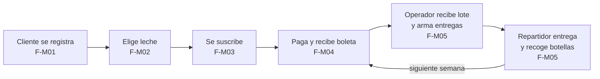

# Alcance del Producto — Muuvi
**Versión:** 1.0.0
**Fecha:** 12/11/2026
**Autor:** Agente PM (BMAD), a partir de `01-project-brief.md` v0.1.0
**Estado:** Aprobado por el fundador; ADR-001, 002 y 003 firmados. Solo queda pendiente la validación sanitaria del umbral de 4.5 °C.
**Cambios en v0.2.0:** se incorporan las 6 decisiones del fundador (precio, pasarelas, corte y franja, idioma, aprobaciones y temperatura).
**Cambios en v0.2.1:** el fundador confirma S12 (lotes antes de las 07:00) y S13 (cobro recurrente automático con Yape y Plin), y decide no modificar los principios de la constitución.
**Cambios en v0.3.0:** el fundador firma los ADR-001, 002 y 003 y suma Mercado Pago a la fase de escala.
**Documentos previos obligatorios:** [`00-constitucion.md`](00-constitucion.md) · [`01-project-brief.md`](01-project-brief.md)

> **Criterio rector del PMV:** probar con **50 suscriptores activos en Miraflores, San Isidro y La Molina** que un hogar paga **S/ 13.50 – S/ 16.00 por litro** por leche de finca recurrente y que la operación funciona sin romper la cadena de frío (Brief, §5.1 y riesgo R1). Todo lo que no ayude a probar eso queda fuera del PMV.

---

## Índice
1. [IN-SCOPE](#1-in-scope)
2. [OUT-OF-SCOPE](#2-out-of-scope)
3. [MVP](#3-mvp)
4. [Supuestos](#4-supuestos)
5. [Restricciones](#5-restricciones)
6. [Dependencias](#6-dependencias)
7. [Decisiones humanas pendientes](#7-decisiones-humanas-pendientes)

---

## 1. IN-SCOPE

### Usuarios del sistema en esta versión
| Rol | Quién es |
|---|---|
| **Cliente** | Hogar suscrito en uno de los 3 distritos de lanzamiento |
| **Operador** | El fundador o una persona de Muuvi que gestiona fincas, lotes, entregas y clientes |
| **Repartidor** | Personal de última milla de Muuvi |

> La **finca no usa el sistema** en esta versión. El operador registra sus datos.

### 1.1 Must have (6)
| ID | Funcionalidad | Descripción | Principios que aplica |
|---|---|---|---|
| **F-M01** | Registro y cuenta del cliente | El cliente crea su cuenta con fecha de nacimiento (solo mayores de 18), consentimientos separados y sin premarcar, y una dirección dentro de los 3 distritos atendidos. También puede pedir la baja de su cuenta. | 003, 005 |
| **F-M02** | Catálogo de leche con finca de origen | Muestra la leche fresca disponible con precio en soles y una ficha de la finca de origen (nombre, provincia, certificación SENASA). Un producto no se publica si falta su registro DIGESA. | 006, 011 |
| **F-M03** | Suscripción semanal | El cliente elige cantidad de litros y día de entrega a **S/ 14.50 por litro**, con **franja única de 07:00 a 10:00**, y puede pausar o cancelar su suscripción hasta las **18:00 del día previo** a la entrega (hora de Lima). | 008.9, 011 |
| **F-M04** | Cobro y comprobante electrónico | Cobra cada ciclo de la suscripción mediante **Culqi** (tarjetas) y las billeteras **Yape** y **Plin**, todas detrás del módulo `pagos`, y emite la boleta o factura electrónica SUNAT de cada pago confirmado. | 002, 004, 006 |
| **F-M05** | Panel de operación diaria | El operador registra cada lote recibido de la finca (litros comprometidos frente a recibidos y temperatura de recepción), genera la lista de entregas del día y ve cuántas botellas tiene cada cliente. El repartidor marca cada entrega (entregada o fallida), las botellas devueltas y la temperatura de entrega. **Una lectura mayor de 4.5 °C en el acopio o en la entrega genera una alerta crítica e invalida el lote.** | 003, 008.2 |
| **F-M06** | Libro de Reclamaciones virtual | Acceso desde el menú principal para registrar quejas y reclamos, conforme a la Ley 29571. | 006 |

> **Por qué estos 6 y no otros:** F-M01 a F-M04 son el mínimo para que alguien pague una suscripción de forma legal. F-M05 es el mínimo para entregar la leche y **medir** los KPIs del Brief: abastecimiento de fincas (R2), cadena de frío (R3) y retorno de botellas (S6). F-M06 es obligación legal.

### 1.2 Should have (5)
| ID | Funcionalidad | Descripción | Por qué no es Must |
|---|---|---|---|
| **F-S01** | Pedido puntual y plan mensual | Compra de una sola vez y suscripción con cobro mensual, además de la semanal. | La métrica del PMV es "suscriptores activos"; una sola modalidad basta para validar. |
| **F-S02** | Avisos de entrega y renovación | Aviso de próxima entrega, cobro y pausa por WhatsApp o push, **solo entre las 09:00 y las 20:00, hora de Lima**. | Con 50 clientes, el operador puede avisar manualmente; la suscripción ya resuelve el "me olvido de comprar". |
| **F-S03** | Trazabilidad por lote | El cliente ve de qué finca, lote y fecha de ordeño viene su leche y qué temperatura tuvo en la recepción. | La ficha estática de finca (F-M02) cubre el diferenciador mínimo; requiere que F-M05 ya acumule datos. |
| **F-S04** | Depósito de garantía por botella | Cobro y devolución de una garantía por botella, con saldo visible para el cliente. | El monto todavía no está definido (Brief §4.4) y cambiar la lógica de cobro requiere revisión humana (008.9). En el PMV solo se **cuentan** las botellas. |
| **F-S05** | Pasarelas adicionales | Agregar **Niubiz**, **Izipay** y **Mercado Pago** detrás del módulo `pagos` en la fase de escala. | Culqi, Yape y Plin bastan para validar la disposición a pagar (ADR-001). |

### 1.3 Could have (4)
| ID | Funcionalidad | Descripción |
|---|---|---|
| **F-C01** | Portal de la finca | La finca registra sus litros comprometidos, lotes y certificados por su cuenta. |
| **F-C02** | Programa de referidos | Beneficio para el cliente que trae a otro hogar de su distrito. |
| **F-C03** | Contenido de bienestar animal | Fotos y videos de la finca y del ganado en pastoreo. |
| **F-C04** | Encuesta de satisfacción por entrega | Calificación corta después de cada entrega. |

---

## 2. OUT-OF-SCOPE

### 2.1 Won't have en esta versión
| ID | Funcionalidad | Razón por la que está fuera |
|---|---|---|
| **F-W01** | **Lácteos artesanales** (yogurt, queso, mantequilla) | Cada producto suma su propio registro DIGESA y, posiblemente, advertencias octogonales (Ley 30021). Primero hay que validar la leche, que es el producto central. |
| **F-W02** | **Segmentos fitness y B2B** (cafeterías, pastelerías) | El Brief los ubica en fases posteriores. El B2B necesita facturación, volúmenes y crédito distintos. |
| **F-W03** | **Distritos fuera de Miraflores, San Isidro y La Molina** | La densidad de entregas por distrito es el riesgo R6. San Borja, Surco y Barranco entran en el mes 6. |
| **F-W04** | **App nativa** iOS o Android | La constitución fija una PWA en React (PRINCIPIO-002). |
| **F-W05** | **Funciones con IA** (recomendaciones, chatbot, predicción de demanda) | Exigen consentimiento de envío a terceros y que el proveedor figure en `docs/proveedores-datos.md` (PRINCIPIO-005.3 y 005.4). No aportan a validar R1. |
| **F-W06** | **Sensores IoT de temperatura en tiempo real** | Hardware y costo sin capital definido. En el PMV, la temperatura se registra manualmente en F-M05. |
| **F-W07** | **Optimización automática de rutas** | Con 50 clientes en 3 distritos, la ruta se arma a mano. Se revisa con 200 suscriptores o más. |
| **F-W08** | **Pago contra entrega en efectivo** | Exige manejo de caja por el repartidor y complica la emisión de comprobantes SUNAT. |
| **F-W09** | **Marketplace donde el cliente elige finca o precio por finca** | Muuvi vende una sola leche con un precio fijado por un humano (PRINCIPIO-008.9). Es otro modelo de negocio. |
| **F-W10** | **Fidelización por puntos o descuentos automáticos** | Afecta precios y descuentos, que requieren revisión humana (PRINCIPIO-008.3 y 008.9). |

---

## 3. MVP

**Con el MVP, un hogar de Miraflores, San Isidro o La Molina puede** crear su cuenta, si es mayor de 18 años y da sus consentimientos; ver la leche fresca disponible, su precio en soles y la finca certificada de la que viene; suscribirse a S/ 14.50 por litro para recibir cierta cantidad de litros cada semana, el día que elija, entre las 07:00 y las 10:00; pagar con tarjeta (Culqi), Yape o Plin y recibir su boleta electrónica; pausar o cancelar hasta las 18:00 del día previo, y registrar un reclamo en el Libro de Reclamaciones. La interfaz está solo en español (es-PE). **Del lado de Muuvi**, el operador registra cada lote que llega de Cañete o Huaral (litros y temperatura), obtiene la lista de entregas del día y sabe cuántas botellas tiene cada cliente. El repartidor confirma cada entrega, la temperatura y las botellas que recoge. Si una lectura pasa de 4.5 °C, el lote se invalida. Todo esto basta para conseguir y retener a los primeros 50 suscriptores y para medir los KPIs del Brief: suscriptores activos, retención a 3 meses, retorno de botellas, cumplimiento de las fincas y cadena de frío.

---

## 4. Supuestos

### 4.1 Heredados del Brief (sin validar)
| ID | Supuesto |
|---|---|
| S1 | El dolor principal del hogar es "no la encuentra cerca" o "se olvida de comprar". |
| S2 | Certificación, botella de vidrio, trazabilidad y cadena de frío justifican pagar unos S/ 10 más por litro. |
| S3 | Muuvi le compra a la finca a S/ 3.50 – S/ 6.00 por litro. |
| S4 | Las fincas de Cañete y Huaral tienen volumen para 600 suscriptores al mes 12. |
| S5 | Las fincas llevan la leche hasta un punto en Lima por su cuenta. |
| S6 | Los hogares devuelven ≥ 90 % de las botellas. |

### 4.2 Nuevos, propios del alcance
| ID | Supuesto | Si resulta falso… |
|---|---|---|
| S7 | Culqi, Yape y Plin bastan para no perder clientes en el PMV. | Niubiz o Izipay (F-S05) suben a Must. |
| S8 | El hogar acepta una suscripción **semanal** como única modalidad al inicio. | F-S01 sube a Must. |
| S9 | Con 50 suscriptores, un solo operador puede gestionar lotes, entregas y avisos sin automatizar. | F-S02 sube a Must. |
| S10 | Cada finca proveedora tiene registro sanitario DIGESA vigente para su leche envasada. | No se puede publicar el producto (PRINCIPIO-006); el lanzamiento se bloquea. |
| S11 | Los repartidores tienen un smartphone Android 9+ o iOS 15+ con datos móviles. | F-M05 necesita otra forma de registrar las entregas. |
| S12 | ✅ **Confirmado por el fundador (12/11/2026):** los lotes llegan al punto de acopio en Lima **antes de las 07:00**. La finca sale hacia las 04:00. | Hay que mover la franja de 07:00–10:00 o cambiar el horario de ordeño y despacho. |
| S13 | ✅ **Confirmado por el fundador (12/11/2026):** Yape y Plin permiten cobrar la suscripción semanal de forma **automática y recurrente**. | El cobro con billetera pasa a ser manual por ciclo, o la suscripción con billetera queda fuera del PMV. |
| S14 | El corte a las 18:00 del día previo deja tiempo para avisar a la finca cuántos litros despachar esa madrugada. | Hay que adelantar el corte. |
| S15 | Un margen bruto de **S/ 9.00 por litro** (S/ 14.50 − S/ 5.50) cubre la logística y las comisiones de pago. | Hay que revisar el precio (posible subida a S/ 15.00 o S/ 16.00). |

---

## 5. Restricciones

### 5.1 Técnicas (constitución)
- **Stack fijo:** PWA en React 18+, Node.js 20+ con Express y PostgreSQL 16+. Cualquier cambio requiere un ADR aprobado por un humano (PRINCIPIO-002).
- **Pagos:** todas las pasarelas pasan por el módulo `pagos`; el backend nunca recibe número de tarjeta, CVV ni vencimiento (PRINCIPIO-004).
- **Datos personales:** se cifran con AES-256-GCM a nivel de campo, con claves en un KMS; las comunicaciones usan TLS 1.3, y los logs no contienen datos personales (PRINCIPIO-003).
- **Interfaz solo en es-PE en el MVP**, por excepción al PRINCIPIO-001 (ADR-002). Los textos **siguen cargándose desde archivos de traducción** (`es-PE.json`), así que agregar `en.json` después no obliga a reescribir componentes.
- **Accesibilidad:** WCAG 2.1 AA, áreas táctiles de 48×48 px, compatibilidad con TalkBack y VoiceOver, Android 9+ y iOS 15+ (PRINCIPIO-007).
- **Formatos:** montos como `S/ 1,250.50`, fechas `DD/MM/AAAA`, zona horaria `America/Lima`, montos `NUMERIC(12,2)` y timestamps en UTC (PRINCIPIO-011).
- **Calidad:** cobertura ≥ 80 % en reglas de negocio y ≥ 60 % general, E2E de registro, suscripción, pago y entrega, y **1 aprobación humana por PR durante la etapa inicial**, por excepción al PRINCIPIO-009 (ADR-003). Se vuelve a 2 aprobaciones cuando se incorpore el primer desarrollador o cofundador técnico.
- **Documentación:** OpenAPI 3.x validado en el CI, ADR y diagramas en Mermaid (PRINCIPIO-010).

### 5.2 Legales y regulatorias
- Ley N.° 29733 y D.S. 016-2024-JUS: bancos de datos inscritos ante la ANPDP **antes** de salir a producción, solo mayores de 18 años, consentimientos separados y eliminación de datos en un máximo de 30 días tras la baja.
- SUNAT: comprobante electrónico por cada pago confirmado.
- DIGESA: registro sanitario por producto. SENASA: certificación vigente para usar la palabra "orgánico".
- Ley 29571: Libro de Reclamaciones virtual.
- Avisos al cliente solo entre las 09:00 y las 20:00, hora de Lima (PRINCIPIO-008.4).

### 5.3 De negocio y recursos
- Fundador único; el capital inicial y la fecha de lanzamiento no están definidos.
- Cobertura solo en Miraflores, San Isidro y La Molina, y abastecimiento solo de Cañete y Huaral.
- **Ningún agente de IA fija ni cambia precios, cobros, tarifas o textos legales** (PRINCIPIO-008.9). El precio por litro lo configura un humano en el sistema. Para el PMV, el fundador fijó **S/ 14.50** al cliente y **S/ 5.50** a la finca.

---

## 6. Dependencias

| ID | Dependencia | Tipo | La usa | ¿Bloquea el MVP? |
|---|---|---|---|---|
| D1 | **Culqi** (tarjetas) y las billeteras **Yape** y **Plin** (ADR-001) | Servicio externo | F-M04 | Sí |
| D2 | **Proveedor de facturación electrónica** (OSE o PSE autorizado por SUNAT) | Servicio externo | F-M04 | Sí |
| D3 | **Gestor de secretos (KMS)** | Infraestructura | F-M01, F-M04 | Sí |
| D4 | **Hosting** con TLS 1.3 y PostgreSQL 16+ | Infraestructura | Todas | Sí |
| D5 | **Proveedor de correo transaccional** (verificación de cuenta y envío de comprobantes) | Servicio externo | F-M01, F-M04 | Sí |
| D6 | **Inscripción del banco de datos ante la ANPDP** | Trámite legal | F-M01 | Sí |
| D7 | **Fincas proveedoras** con certificación SENASA y registro DIGESA vigentes | Operativa | F-M02, F-M05 | Sí |
| D8 | **Transporte refrigerado** de la finca al punto de acopio en Lima | Operativa (a cargo de la finca, S5) | F-M05 | Sí |
| D9 | **Punto de acopio refrigerado en Lima** | Operativa | F-M05 | Sí |
| D10 | **WhatsApp Business API** o un servicio de push | Servicio externo | F-S02 | No (Should) |

---

## 7. Decisiones humanas
Estas decisiones las tomó el fundador el 12/11/2026. Ningún agente puede cambiarlas (PRINCIPIO-008).

| # | Tema | Decisión | Dónde queda registrada | Estado |
|---|---|---|---|---|
| 1 | Precio | **S/ 14.50 por litro** al cliente y **S/ 5.50 por litro** a la finca en el PMV. Margen bruto de **S/ 9.00** antes de logística. Se evaluará subir a S/ 15.00 o S/ 16.00 según la tracción de las entrevistas de validación. | Este documento (§5.3) | ✅ Decidido |
| 2 | Pasarelas del MVP | **Culqi + Yape + Plin**. Niubiz, Izipay y Mercado Pago pasan a la fase de escala. | [ADR-001](adr/ADR-001-pasarelas-mvp.md) | ✅ ADR firmado |
| 3 | Corte y franja | Corte a las **18:00 del día previo** y franja única de **07:00 a 10:00** en los 3 distritos de lanzamiento. | F-M03 | ✅ Decidido |
| 4 | Idioma | **Solo es-PE en el MVP**, como excepción al PRINCIPIO-001. | [ADR-002](adr/ADR-002-excepcion-idioma-mvp.md) | ✅ ADR firmado |
| 5 | Aprobaciones por PR | **1 aprobación humana** en la etapa inicial; se vuelve a 2 con el primer desarrollador o cofundador técnico. | [ADR-003](adr/ADR-003-excepcion-aprobaciones-pr.md) | ✅ ADR firmado |
| 6 | Cadena de frío | Una lectura **mayor de 4.5 °C** en el acopio o en la entrega es una **alerta crítica** de rotura de la cadena de frío e **invalida el lote**. | F-M05 | ⚠️ Falta la validación de un especialista sanitario |

### 7.1 Acciones que quedan en manos humanas
1. ✅ **ADR-001, 002 y 003:** firmados por el fundador el 12/11/2026.
2. ✅ **Constitución:** el fundador decidió **no modificar** los PRINCIPIOS 001 y 009. Los ADR-002 y 003 quedan como **excepciones temporales** con fecha de término, y `00-constitucion.md` no cambia.
3. ⏳ **Umbral de 4.5 °C:** el fundador acordó que lo validará un especialista sanitario. Hasta entonces, el umbral se aplica tal como está.
4. ✅ **Cobro recurrente con Yape y Plin:** confirmado por el fundador (S13).
5. ✅ **Llegada de los lotes antes de las 07:00:** confirmada por el fundador (S12).
6. ✅ **Mercado Pago:** entra en la fase de escala (F-S05), junto con Niubiz e Izipay.
