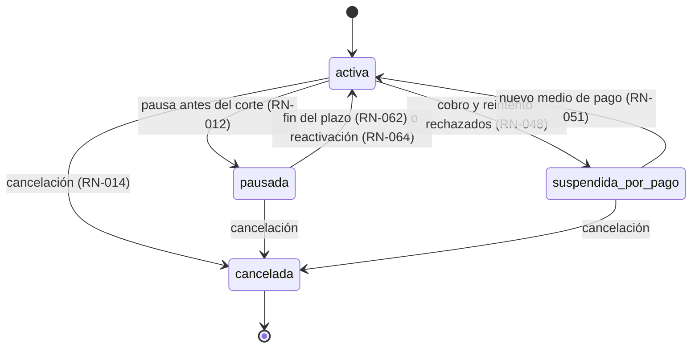
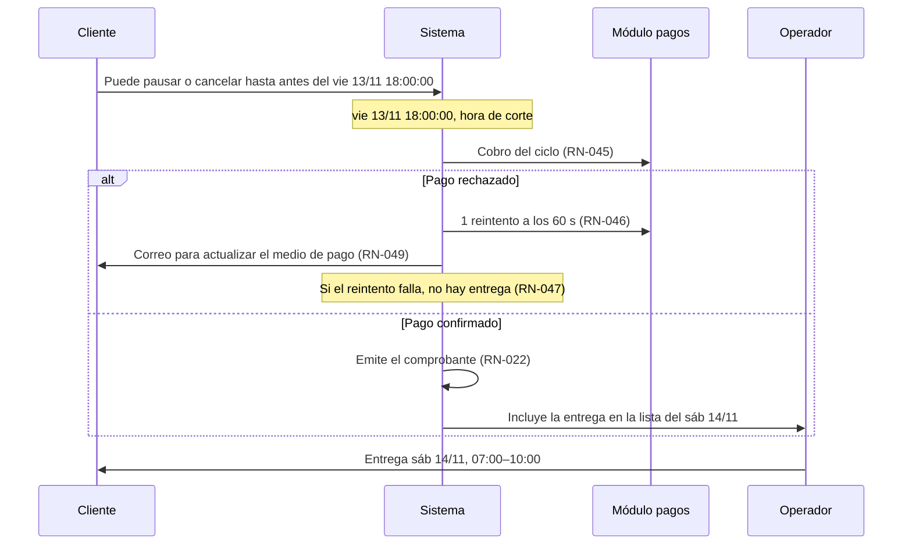
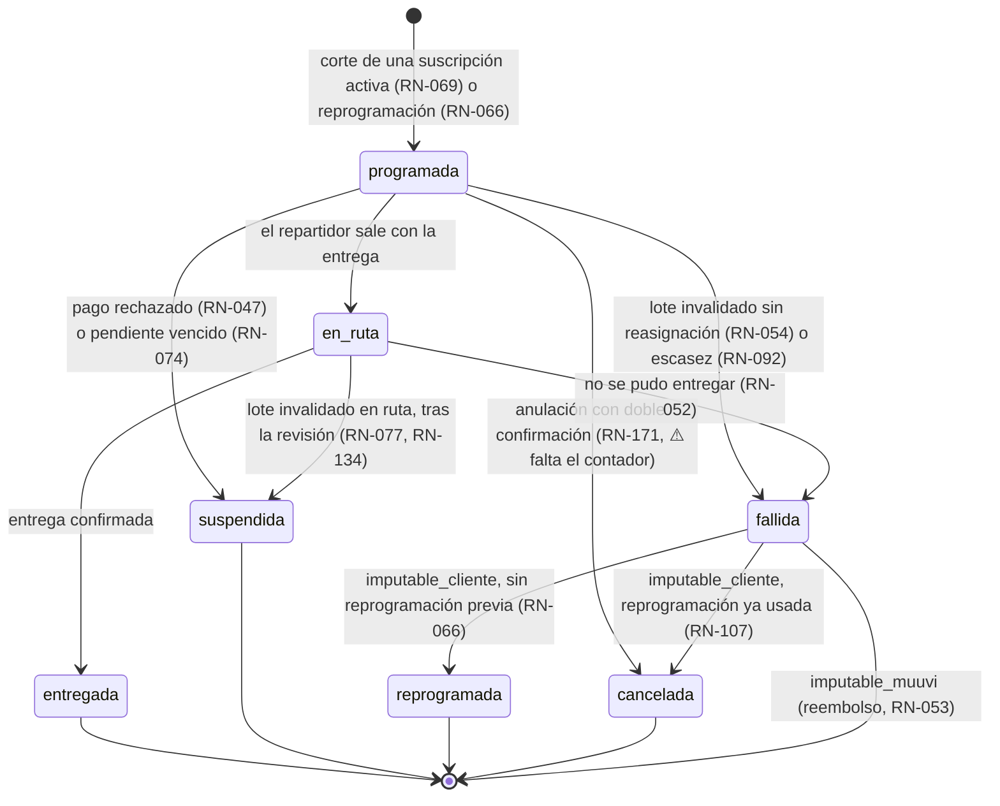
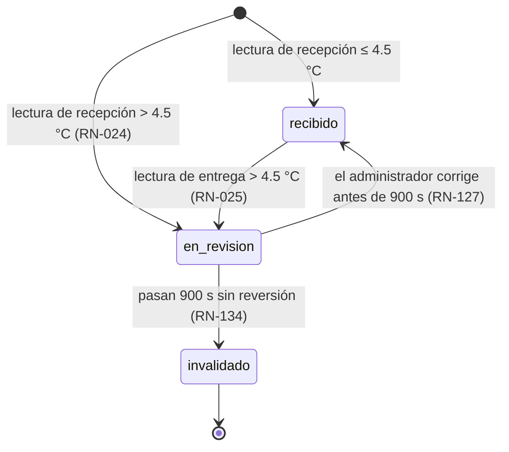

# Reglas de Negocio — Muuvi
**Versión:** 0.9.1 (borrador)
**Fecha:** 14/11/2026
**Autor:** Agente Business Analyst (BMAD)
**Estado:** Reglas antes marcadas como pendientes de aprobación, aprobadas por el fundador el 14/11/2026 (QA-007). Pendientes: preguntas P14 y P23 a P25 y el conflicto K10 (K8 y K9 resueltos el 14/11/2026, RN-185 y RN-155). Las reglas de v0.9.0 están aprobadas; RN-168 a RN-172 esperan además la validación del contador. Los conflictos K1 a K5 están resueltos.
**Documentos previos obligatorios:** [`00-constitucion.md`](00-constitucion.md) · [`01-project-brief.md`](01-project-brief.md) · [`02-alcance.md`](02-alcance.md) · [`04-glosario.md`](04-glosario.md)
**Cambios en v0.2.0:** se incorporan las respuestas del fundador a las preguntas P1 a P8. Se agregan RN-045 a RN-065, se ajustan RN-012 a RN-017, se aprueban los valores de RN-026 y RN-036, y los ejemplos pasan a los días de reparto (martes, jueves y sábado).
**Cambios en v0.2.1:** el fundador responde P9 (la entrega fallida por causa del cliente se reprograma). Se agregan RN-066 a RN-068.
**Cambios en v0.3.0:** se incorporan las decisiones del fundador sobre la auditoría QA (`05-auditoria-qa.md`, 14/11/2026). Se agregan RN-069 a RN-113, se modifican RN-008, 011, 013, 017, 019, 021, 032, 033, 034, 040, 046, 047, 048, 054, 056, 062 y 068, y se agregan el ciclo de vida de la entrega, la matriz de permisos y las excepciones constitucionales vigentes.
**Cambios en v0.3.1:** el fundador aprueba todas las reglas marcadas como pendientes y la matriz de permisos (14/11/2026); se retira la marca.
**Cambios en v0.3.2:** el fundador confirma K1 (la doble confirmación aplica a toda la lista del PRINCIPIO-008.2, más precios y límites de crédito) y resuelve K5 (las botellas sin devolver y el saldo a favor ya no bloquean la baja; RN-098 modificada).
**Cambios en v0.3.3:** el fundador confirma K2 (1 solo reintento a los 60 s), K3 (la corrección de temperatura es un registro nuevo) y K4 (`fallida` es un estado de entrega). Todos los conflictos K quedan resueltos.
**Cambios en v0.4.0:** se resuelve QA-006 (14/11/2026): la pasarela, las billeteras, el OSE/PSE y el proveedor de correo son **encargados de tratamiento**, no terceros. Se modifican RN-003 y RN-004 y se agregan RN-114 a RN-118.
**Cambios en v0.5.0:** el fundador responde P11 (C), P12 (A), P13 (C), P15 (A), P16 (A) y P17 (B) el 14/11/2026. Se agregan RN-119 a RN-128 y se ajustan RN-075, RN-089, RN-092, RN-097, RN-098 y RN-101.
**Cambios en v0.6.0:** el fundador responde P21 y P22 (14/11/2026): el cliente elige entre reembolso y saldo a favor en toda falla de Muuvi y en todo pago tardío, con reembolso automático a las 72 h si no elige; un lote con lectura alta pasa 15 minutos `en_revision`, con sus entregas retenidas, antes de invalidarse; un pago tardío reactiva la suscripción. Se agregan RN-129 a RN-134 y se modifican RN-024, 025, 026, 053, 055, 076, 079, 119, 120, 121 y 127.
**Cambios en v0.9.1:** el fundador aprueba el 14/11/2026 todas las reglas propuestas de v0.9.0 (RN-156 a RN-159, RN-161 a RN-163 y RN-166 a RN-185), la lista cerrada de RN-145 y los valores propuestos de RN-165. Con RN-185 queda resuelto K8. RN-168 a RN-172 siguen esperando la validación del contador (PRINCIPIO-008.9).
**Cambios en v0.9.0:** validación del prototipo (`10-validation-log.md`, 14/11/2026). Decisiones del fundador: K9 se resuelve con hoja de ruta impresa (RN-155), recuperación de contraseña por correo (RN-165), aprobación de Yape y Plin en cada ciclo (RN-164) y varias suscripciones por cliente (RN-160). Se agregan RN-155 a RN-185 (las marcadas ⏳ son propuestas pendientes de aprobación; RN-168 a RN-172 también esperan al contador), se modifica RN-145 y se agregan dos filas a la matriz de permisos y una transición al ciclo de vida de la entrega.
**Cambios en v0.7.0:** decisiones del 14/11/2026 sobre la QA funcional: ADR-004 (alertas internas a cualquier hora), SR-09 (pago `en_verificacion`), SR-12 (reprogramación en feriado), SR-13 (cierres sin conexión) y respuesta al reclamo (HU-016). Se agregan RN-135 a RN-150 y se aclara RN-042.

> **Cómo usar este documento**
> - Cada regla es **atómica** y se escribe en notación **EARS** con **DEBE**, **NO DEBE** o **PUEDE**.
> - Cada regla tiene al menos un test unitario cuyo nombre cita su ID, por ejemplo `test_RN012_pausar_suscripcion_antes_del_corte` (PRINCIPIO-009).
> - Las horas de reloj se expresan en hora de Lima (`America/Lima`, UTC-5). Las duraciones se expresan en segundos. Los plazos legales en días hábiles se dejan en días hábiles.
> - Las interpretaciones y valores propuestos por el agente, antes marcados como pendientes, fueron **aprobados por el fundador el 14/11/2026** (QA-007). Un agente no puede cambiarlos sin una nueva aprobación humana.
> - Ningún agente puede cambiar las reglas de precio, cobro o textos legales sin revisión humana (PRINCIPIO-008.9).

### Excepciones constitucionales vigentes (QA-001)
Estas excepciones forman parte obligatoria del Spec Pack. Un agente que vea una diferencia entre la constitución y estas reglas **en los puntos listados** no debe detenerse: la excepción está aprobada. En cualquier otro punto prevalece la constitución.

| ADR | Principio exceptuado | Excepción | Reglas que la citan | Vigencia |
|---|---|---|---|---|
| [ADR-001](adr/ADR-001-pasarelas-mvp.md) | PRINCIPIO-002 (no es excepción: elige un subconjunto) | Solo Culqi, Yape y Plin en el PMV | RN-019 | Hasta la fase de escala |
| [ADR-002](adr/ADR-002-excepcion-idioma-mvp.md) | PRINCIPIO-001 (interfaz bilingüe) | Interfaz solo en es-PE | RN-041 | Hasta salir del PMV |
| [ADR-003](adr/ADR-003-excepcion-aprobaciones-pr.md) | PRINCIPIO-009 (2 aprobaciones por PR) | 1 aprobación humana por PR | Proceso de desarrollo; no genera una regla de producto | Hasta incorporar al primer desarrollador o cofundador técnico |
| [ADR-004](adr/ADR-004-excepcion-horaria-operaciones.md) | PRINCIPIO-008.4 (ventana de 09:00 a 20:00) | Las alertas internas de operación pueden enviarse a cualquier hora | RN-150 | Indefinida |

### Patrones EARS usados
| Patrón | Plantilla |
|---|---|
| Ubiquitous | El sistema DEBE … |
| Event-driven | CUANDO \<evento\>, el sistema DEBE … |
| State-driven | MIENTRAS \<estado\>, el sistema DEBE … |
| Unwanted | SI \<condición no deseada\>, ENTONCES el sistema DEBE … |
| Optional | DONDE \<funcionalidad\> esté habilitada, el sistema DEBE … |

### Estados de una suscripción

### Ciclo semanal (ejemplo: entrega el sábado 14/11/2026)

### Índice por funcionalidad
| Funcionalidad | Reglas |
|---|---|
| F-M01 Registro y cuenta | RN-001 a RN-008, RN-098, RN-111, RN-114 a RN-118, RN-124, RN-154, RN-165 a RN-167 |
| F-M02 Catálogo y precio | RN-009 a RN-011, RN-102, RN-103, RN-153, RN-163, RN-177, RN-178 |
| F-M03 Suscripción semanal | RN-012 a RN-018, RN-061 a RN-065, RN-081 a RN-084, RN-123, RN-160, RN-161, RN-170, RN-179, RN-180, RN-184 |
| F-M04 Cobro, comprobante y reembolso | RN-019 a RN-023, RN-045 a RN-060, RN-072 a RN-075, RN-079, RN-080, RN-094 a RN-097, RN-104 a RN-106, RN-108, RN-119 a RN-121, RN-125, RN-126, RN-129 a RN-131, RN-135 a RN-138, RN-162, RN-164, RN-168, RN-169, RN-181 |
| F-M05 Operación diaria | RN-024 a RN-032, RN-066 a RN-071, RN-076 a RN-078, RN-085 a RN-093, RN-107, RN-113, RN-122, RN-127, RN-128, RN-132 a RN-134, RN-139 a RN-145, RN-155 a RN-159, RN-171, RN-182, RN-183, RN-185 |
| F-M06 Libro de Reclamaciones | RN-033 a RN-036, RN-109, RN-112, RN-146 a RN-149 |
| Transversales (localización, idioma, permisos, feriados, alertas y doble confirmación) | RN-037 a RN-041, RN-099 a RN-101, RN-110, RN-150 a RN-152, RN-172 a RN-176 |
| F-S02 y F-S03 (Should) | RN-042 a RN-044 |

---

## F-M01 · Registro y cuenta del cliente

---
**RN-001** | Categoría: Registro | Prioridad: MUST
Patrón EARS: Unwanted

SI la fecha de nacimiento ingresada corresponde a una edad menor de 18 años a la fecha del registro, ENTONCES el sistema DEBE rechazar el registro.

✅ Ejemplo: El 12/11/2026, una persona nacida el 12/11/2008 (18 años cumplidos ese día) completa el registro.
❌ Contraejemplo: El 12/11/2026, el sistema crea la cuenta de una persona nacida el 13/11/2008 (17 años).
---

---
**RN-002** | Categoría: Registro | Prioridad: MUST
Patrón EARS: Ubiquitous

El sistema NO DEBE crear una cuenta de cliente sin una fecha de nacimiento registrada.

✅ Ejemplo: El formulario no se envía mientras el campo de fecha de nacimiento está vacío.
❌ Contraejemplo: Se crea la cuenta con `fecha_nacimiento = NULL` porque el cliente se saltó el campo.
---

---
**RN-003** | Categoría: Consentimiento | Prioridad: MUST
Patrón EARS: Ubiquitous

El sistema DEBE mostrar la casilla del consentimiento principal (tratamiento de datos para ejecutar el servicio, incluidos los encargados de tratamiento) desmarcada por defecto.

✅ Ejemplo: Al abrir el formulario, la casilla "Acepto el tratamiento de mis datos personales para la prestación del servicio" aparece vacía y el cliente la marca.
❌ Contraejemplo: La casilla aparece marcada al cargar el formulario.
---

---
**RN-004** | Categoría: Consentimiento | Prioridad: MUST
Patrón EARS: Ubiquitous

El sistema DEBE pedir el consentimiento para el envío de datos a terceros en una casilla distinta de la del consentimiento principal. Los encargados de tratamiento (RN-115) **no** son terceros (QA-006).

✅ Ejemplo: El formulario tiene una casilla obligatoria para el consentimiento principal y otra, separada y opcional, para el envío a terceros.
❌ Contraejemplo: Una sola casilla dice "Acepto el tratamiento de mis datos y su envío a terceros".
---

---
**RN-005** | Categoría: Cobertura | Prioridad: MUST
Patrón EARS: Unwanted

SI la dirección de entrega no está en Miraflores, San Isidro o La Molina, ENTONCES el sistema DEBE rechazar esa dirección.

✅ Ejemplo: El sistema acepta una dirección en el distrito de San Isidro.
❌ Contraejemplo: El sistema acepta una dirección en el distrito de Santiago de Surco durante el PMV.
---

---
**RN-006** | Categoría: Privacidad | Prioridad: MUST
Patrón EARS: Ubiquitous

El sistema DEBE guardar cifrados con AES-256-GCM a nivel de campo el DNI, el nombre completo, la fecha de nacimiento, el teléfono, el correo, la dirección exacta y las coordenadas del cliente.

✅ Ejemplo: La columna `telefono_cifrado` contiene un texto cifrado ilegible, y la clave está en el KMS.
❌ Contraejemplo: La columna `telefono` contiene `987654321` en texto plano.
---

---
**RN-007** | Categoría: Privacidad | Prioridad: MUST
Patrón EARS: Unwanted

SI un mensaje de log, de error o de analítica contiene un dato personal en texto plano, ENTONCES el sistema DEBE rechazar ese registro (y el test de la regla DEBE fallar).

✅ Ejemplo: El log registra `Entrega fallida · cliente_id=4821 · entrega_id=9930`.
❌ Contraejemplo: El log registra `Entrega fallida en Av. Larco 123, tel. 987654321`.
---

---
**RN-008** | Categoría: Privacidad | Prioridad: MUST
Patrón EARS: Event-driven

CUANDO un cliente se da de baja, el sistema DEBE eliminar o anonimizar sus datos personales en un plazo máximo de 2 592 000 s (30 días). La conservación de comprobantes está en RN-111.

✅ Ejemplo: Un cliente se da de baja el 12/11/2026 a las 10:00; el 12/12/2026 a las 10:00 sus datos ya están anonimizados y sus boletas siguen guardadas.
❌ Contraejemplo: El 15/12/2026 (33 días después) el nombre y el teléfono del cliente siguen legibles en la base de datos.
---

## Consentimiento y encargados de tratamiento (QA-006)

> **Dictamen registrado el 14/11/2026:** la pasarela (Culqi), las billeteras (Yape y Plin), el OSE/PSE y el proveedor de correo transaccional tratan los datos por cuenta y bajo las instrucciones exclusivas de Muuvi, y no pueden usarlos para fines propios. Por eso son **encargados de tratamiento**, no terceros. El cliente no puede rechazar que sus datos pasen a ellos, porque sin ellos el cobro y la boleta son imposibles. Muuvi debe tener un **contrato de encargo de tratamiento (DPA)** con cada uno, o verificar sus cláusulas de confidencialidad y seguridad. Los textos legales de cada consentimiento los redacta y aprueba un humano (PRINCIPIO-008.9).

| Consentimiento | Obligatorio | Cubre | Reglas |
|---|---|---|---|
| Principal | Sí | Tratamiento para ejecutar el servicio, incluidos los encargados de tratamiento | RN-003, RN-114, RN-115 |
| Envío a terceros | No | Terceros que usan los datos para fines propios, incluidos los proveedores de IA (PRINCIPIO-005.3) | RN-004, RN-116 |
| Fines comerciales | No | Campañas comerciales o publicitarias de Muuvi, si en el futuro se habilitan | RN-117 |

---
**RN-114** | Categoría: Consentimiento | Prioridad: MUST
Patrón EARS: Unwanted

SI el cliente no marca la casilla del consentimiento principal, ENTONCES el sistema DEBE rechazar el registro.

✅ Ejemplo: El cliente marca el consentimiento principal, deja vacía la de terceros y su cuenta se crea.
❌ Contraejemplo: Se crea una cuenta sin el consentimiento principal.
---

---
**RN-115** | Categoría: Consentimiento | Prioridad: MUST
Patrón EARS: Ubiquitous

El sistema DEBE nombrar en el texto del consentimiento principal a cada encargado de tratamiento que recibe datos del cliente: la pasarela de pago, las billeteras, el OSE/PSE y el proveedor de correo transaccional.

✅ Ejemplo: El texto dice que los datos se comparten con Culqi, Yape, Plin, el OSE/PSE y el proveedor de correo solo para cobrar, emitir comprobantes y enviar correos del servicio.
❌ Contraejemplo: El texto dice "podemos compartir tus datos con proveedores" sin nombrarlos.
---

---
**RN-116** | Categoría: Consentimiento | Prioridad: MUST
Patrón EARS: Unwanted

SI el cliente no marca la casilla de envío a terceros, ENTONCES el sistema NO DEBE impedir su registro, su suscripción ni su pago.

✅ Ejemplo: Un cliente sin consentimiento de terceros paga con Yape y recibe su boleta.
❌ Contraejemplo: El sistema bloquea el pago porque el cliente no aceptó el envío a terceros.
---

---
**RN-117** | Categoría: Consentimiento | Prioridad: SHOULD
Patrón EARS: Optional

DONDE las campañas comerciales o publicitarias estén habilitadas, el sistema DEBE pedir un consentimiento adicional y opcional para fines comerciales, en una casilla separada y desmarcada por defecto.

✅ Ejemplo: Cuando se habiliten las campañas, aparece la casilla vacía "Quiero recibir promociones de Muuvi".
❌ Contraejemplo: El consentimiento para promociones está incluido en el consentimiento principal.
---

---
**RN-118** | Categoría: Privacidad | Prioridad: MUST
Patrón EARS: Unwanted

SI un proveedor no figura en `docs/proveedores-datos.md` con su contrato de encargo (DPA) o la verificación de sus cláusulas marcados como vigentes, ENTONCES el sistema NO DEBE enviarle datos personales de clientes.

✅ Ejemplo: Culqi figura en `docs/proveedores-datos.md` con su DPA vigente y recibe los datos del cobro.
❌ Contraejemplo: Se integra un nuevo proveedor de correo que no figura en el registro y recibe correos de clientes.
---

## F-M02 · Catálogo de leche con finca de origen

---
**RN-009** | Categoría: Catálogo | Prioridad: MUST
Patrón EARS: Unwanted

SI un producto no tiene registro sanitario DIGESA, ENTONCES el sistema DEBE impedir su publicación en el catálogo.

✅ Ejemplo: El operador intenta publicar "Leche fresca 1 L" con `registro_digesa` vacío y el sistema lo rechaza.
❌ Contraejemplo: El producto aparece en el catálogo con `registro_digesa = NULL`.
---

---
**RN-010** | Categoría: Catálogo | Prioridad: MUST
Patrón EARS: State-driven

MIENTRAS la certificación SENASA de una finca no esté vigente a la fecha actual, el sistema NO DEBE mostrar la etiqueta "Orgánico" en esa finca ni en sus productos.

✅ Ejemplo: La certificación de la finca vence el 30/11/2026; el 01/12/2026 la etiqueta "Orgánico" deja de mostrarse.
❌ Contraejemplo: El 05/12/2026 se sigue mostrando "Orgánico" en una finca cuya certificación venció el 30/11/2026.
---

---
**RN-011** | Categoría: Precio | Prioridad: MUST
Patrón EARS: Ubiquitous

El sistema DEBE tomar el precio por litro del parámetro `precio_litro` de la tabla de configuración, y NO DEBE modificarlo mediante ningún proceso automático. El valor lo fija un humano (PRINCIPIO-008.9) y su cambio requiere doble confirmación (RN-032).

✅ Ejemplo: `precio_litro = 14.50` en la configuración y el catálogo muestra "S/ 14.50 por litro".
❌ Contraejemplo: Un proceso nocturno sube el precio a S/ 15.00 sin intervención humana.
---

## F-M03 · Suscripción semanal

---
**RN-012** | Categoría: Suscripción | Prioridad: MUST
Patrón EARS: Event-driven

CUANDO un cliente pausa su suscripción antes de las 18:00:00 del día previo a una entrega, el sistema NO DEBE programar esa entrega.

✅ Ejemplo: Entrega del sábado 14/11/2026; el cliente pausa el viernes 13/11/2026 a las 17:59:59 y no se programa la entrega del sábado.
❌ Contraejemplo: El cliente pausa a las 17:30 del viernes y aun así la entrega del sábado aparece en la lista del repartidor.
---

---
**RN-013** | Categoría: Suscripción | Prioridad: MUST
Patrón EARS: Unwanted

SI un cliente pausa su suscripción a partir de las 18:00:00 del día previo a una entrega, ENTONCES el sistema DEBE mantener programada esa entrega. La cancelación después del corte está en RN-081 y RN-082.

✅ Ejemplo: El cliente pausa el viernes 13/11/2026 a las 18:00:00; la entrega del sábado 14/11/2026 se mantiene.
❌ Contraejemplo: El cliente pausa el viernes a las 21:00 y el sistema retira la entrega del sábado, que ya se cobró y cuyo pedido a la finca ya se calculó.
---

---
**RN-014** | Categoría: Suscripción | Prioridad: MUST
Patrón EARS: Event-driven

CUANDO un cliente cancela su suscripción antes de las 18:00:00 del día previo a una entrega, el sistema NO DEBE programar ninguna entrega posterior de esa suscripción.

✅ Ejemplo: El cliente cancela el viernes 13/11/2026 a las 16:00; no se programan entregas el 14/11/2026, el 21/11/2026 ni después.
❌ Contraejemplo: Tras la cancelación, el sistema programa la entrega del 21/11/2026.
---

---
**RN-015** | Categoría: Suscripción | Prioridad: MUST
Patrón EARS: Ubiquitous

El sistema DEBE asignar a toda entrega la franja única de 07:00 a 10:00.

✅ Ejemplo: La entrega del 14/11/2026 se muestra como "14/11/2026, 07:00–10:00".
❌ Contraejemplo: El cliente elige la franja de 15:00 a 18:00 y el sistema la acepta.
---

---
**RN-016** | Categoría: Suscripción | Prioridad: MUST
Patrón EARS: Ubiquitous

El sistema DEBE asociar cada suscripción semanal a exactamente 1 día de entrega por semana.

✅ Ejemplo: La suscripción tiene `dia_entrega = sabado`.
❌ Contraejemplo: Una sola suscripción tiene entregas los martes y los sábados.
---

---
**RN-017** | Categoría: Suscripción | Prioridad: MUST
Patrón EARS: Unwanted

SI la cantidad de litros de una suscripción no es un número entero mayor o igual a 1, ENTONCES el sistema DEBE rechazar la suscripción.

> Nota: en el PMV no hay un máximo de litros por suscripción (decisión P4). El tope por capacidad de la finca sigue abierto (QA-042).

✅ Ejemplo: El cliente se suscribe a 4 litros por semana.
❌ Contraejemplo: El sistema acepta una suscripción de 0 litros o de 1.5 litros.
---

---
**RN-018** | Categoría: Cobro | Prioridad: MUST
Patrón EARS: Ubiquitous

El sistema DEBE calcular el importe de cada ciclo como la cantidad de litros por el precio por litro vigente, y guardarlo como `NUMERIC(12,2)`.

✅ Ejemplo: 3 L × S/ 14.50 = S/ 43.50, guardado como `43.50`.
❌ Contraejemplo: El importe se guarda en una columna `FLOAT` como `43.4999999`.
---

---
**RN-061** | Categoría: Suscripción | Prioridad: MUST
Patrón EARS: Unwanted

SI el día de entrega elegido no es martes, jueves ni sábado, ENTONCES el sistema DEBE rechazar la suscripción.

✅ Ejemplo: El cliente elige el jueves como día de entrega.
❌ Contraejemplo: El sistema acepta una suscripción con entrega los lunes.
---

---
**RN-062** | Categoría: Suscripción | Prioridad: MUST
Patrón EARS: Event-driven

CUANDO se omiten las N entregas (N entero ≥ 1) de una pausa con plazo, el sistema DEBE volver la suscripción a estado activa. Las N entregas omitidas son las N siguientes cuyo corte ocurre después de la solicitud de pausa.

✅ Ejemplo: El cliente pide una pausa de 2 entregas el viernes 13/11/2026 a las 10:00; se omiten las del 14/11 y el 21/11, y la del sábado 28/11/2026 vuelve a programarse.
❌ Contraejemplo: Terminado el plazo, la suscripción sigue pausada hasta que el cliente la reactiva a mano.
---

---
**RN-063** | Categoría: Suscripción | Prioridad: MUST
Patrón EARS: State-driven

MIENTRAS una suscripción esté en pausa indefinida, el sistema NO DEBE programar entregas de esa suscripción.

✅ Ejemplo: Una suscripción en pausa indefinida desde el 13/11/2026 no tiene entregas el 14/11 ni el 21/11.
❌ Contraejemplo: El sistema reanuda la suscripción por su cuenta a las 4 semanas.
---

---
**RN-064** | Categoría: Suscripción | Prioridad: MUST
Patrón EARS: Event-driven

CUANDO un cliente reactiva su suscripción antes de las 18:00:00 del día previo a su día de entrega, el sistema DEBE programar esa entrega.

✅ Ejemplo: El cliente reactiva el viernes 20/11/2026 a las 11:00 y se programa la entrega del sábado 21/11/2026.
❌ Contraejemplo: El cliente reactiva el viernes a las 11:00 y la primera entrega queda para el sábado 28/11/2026.
---

---
**RN-065** | Categoría: Botellas | Prioridad: MUST
Patrón EARS: Ubiquitous

El sistema DEBE registrar como botellas entregadas 1 botella de 1 L por cada litro entregado.

✅ Ejemplo: Una entrega de 3 L suma 3 botellas al saldo del cliente.
❌ Contraejemplo: Una entrega de 3 L suma 1 botella.
---

## F-M04 · Cobro, comprobante y reembolso

---
**RN-019** | Categoría: Pagos | Prioridad: MUST
Patrón EARS: Unwanted

SI el medio de pago elegido no es Culqi, Yape o Plin, ENTONCES el sistema DEBE rechazar el pago durante el PMV (ADR-001).

✅ Ejemplo: El cliente paga con Yape y el sistema procesa el pago.
❌ Contraejemplo: El sistema procesa un pago con Niubiz durante el PMV, sin que lo habilite un ADR.
---

---
**RN-020** | Categoría: Pagos | Prioridad: MUST
Patrón EARS: Unwanted

SI una petición al backend contiene número de tarjeta, CVV o fecha de vencimiento, ENTONCES el sistema DEBE rechazar la petición sin guardar su contenido.

✅ Ejemplo: El backend recibe `{ "token_pasarela": "tkn_8f2a…", "ultimos_4": "4242" }` y la procesa.
❌ Contraejemplo: El backend acepta `{ "numero_tarjeta": "4111111111111111", "cvv": "123" }`.
---

---
**RN-021** | Categoría: Pagos | Prioridad: MUST
Patrón EARS: Ubiquitous

El sistema DEBE guardar de un medio de pago de tipo `tarjeta` únicamente el token de la pasarela y los 4 últimos dígitos. Las billeteras están en RN-094 y el tipo de medio en RN-095.

✅ Ejemplo: Para una tarjeta se guardan `token_pasarela = tkn_8f2a…` y `ultimos_4 = 4242`.
❌ Contraejemplo: La tabla tiene una columna `pan` o `fecha_vencimiento`.
---

---
**RN-022** | Categoría: Comprobantes | Prioridad: MUST
Patrón EARS: Event-driven

CUANDO la pasarela confirma un pago, el sistema DEBE emitir el comprobante electrónico SUNAT de ese pago.

✅ Ejemplo: Se confirma un pago de S/ 43.50 y se emite la boleta electrónica de S/ 43.50 a nombre del cliente.
❌ Contraejemplo: Se confirma el pago y no queda ningún comprobante asociado.
---

---
**RN-023** | Categoría: Comprobantes | Prioridad: MUST
Patrón EARS: Unwanted

SI un pago no está confirmado por la pasarela, ENTONCES el sistema NO DEBE emitir un comprobante electrónico por ese pago.

✅ Ejemplo: Un pago con Plin queda en estado `pendiente` y no se emite boleta.
❌ Contraejemplo: Se emite la boleta de un pago que la pasarela rechazó.
---

---
**RN-045** | Categoría: Cobro | Prioridad: MUST
Patrón EARS: Event-driven

CUANDO se cumple la hora de corte (18:00:00 del día previo a una entrega) de una suscripción activa, el sistema DEBE ejecutar el cobro de ese ciclo mediante el módulo `pagos`.

✅ Ejemplo: Para la entrega del sábado 14/11/2026, el cobro de S/ 43.50 se ejecuta el viernes 13/11/2026 a las 18:00:00.
❌ Contraejemplo: El cobro se ejecuta el sábado a las 09:00, después de la entrega.
---

---
**RN-046** | Categoría: Cobro | Prioridad: MUST
Patrón EARS: Unwanted

SI la pasarela rechaza el **primer** intento de cobro de un ciclo, ENTONCES el sistema DEBE ejecutar 1 reintento automático a los 60 s. El límite de reintentos está en RN-080.

✅ Ejemplo: El cobro se rechaza a las 18:00:00 y el reintento se ejecuta a las 18:01:00.
❌ Contraejemplo: El sistema no reintenta, o reintenta 10 veces seguidas en 5 s.
---

---
**RN-047** | Categoría: Cobro | Prioridad: MUST
Patrón EARS: Unwanted

SI el reintento de cobro de un ciclo también es rechazado, ENTONCES el sistema DEBE pasar la entrega de ese ciclo a estado `suspendida` con motivo `pago`.

✅ Ejemplo: El cobro y el reintento del viernes 13/11/2026 fallan; la entrega del sábado 14/11/2026 pasa a `suspendida` y no aparece en la lista del repartidor.
❌ Contraejemplo: La entrega se despacha aunque el pago no se confirmó.
---

---
**RN-048** | Categoría: Cobro | Prioridad: MUST
Patrón EARS: Event-driven

CUANDO una entrega pasa a estado `suspendida` con motivo `pago`, el sistema DEBE pasar su suscripción a estado `suspendida_por_pago`.

✅ Ejemplo: Tras fallar el reintento del 13/11/2026, la suscripción queda en `suspendida_por_pago`.
❌ Contraejemplo: La suscripción sigue en `activa` y el sistema vuelve a cobrar con el mismo medio rechazado en el siguiente ciclo.
---

---
**RN-049** | Categoría: Cobro | Prioridad: MUST
Patrón EARS: Event-driven

CUANDO la pasarela rechaza el cobro de un ciclo, el sistema DEBE enviar al cliente, en un máximo de 300 s, un correo que le pida actualizar su medio de pago.

✅ Ejemplo: El cobro se rechaza a las 18:00:00 y el correo llega a las 18:02:00.
❌ Contraejemplo: El cliente se entera del rechazo cuando no recibe su leche el sábado.
---

---
**RN-050** | Categoría: Cobro | Prioridad: MUST
Patrón EARS: State-driven

MIENTRAS una suscripción esté en estado `suspendida_por_pago`, el sistema NO DEBE programar entregas de esa suscripción.

✅ Ejemplo: Una suscripción suspendida desde el 13/11/2026 no tiene entrega el 21/11/2026.
❌ Contraejemplo: La entrega del 21/11/2026 se programa aunque la suscripción sigue suspendida.
---

---
**RN-051** | Categoría: Cobro | Prioridad: MUST
Patrón EARS: Event-driven

CUANDO un cliente con suscripción en estado `suspendida_por_pago` registra un nuevo medio de pago, el sistema DEBE volver la suscripción a estado activa.

✅ Ejemplo: El cliente registra una nueva tarjeta el miércoles 18/11/2026; la suscripción vuelve a activa y el siguiente cobro se ejecuta el viernes 20/11/2026 a las 18:00:00.
❌ Contraejemplo: El cliente registra una nueva tarjeta y la suscripción sigue suspendida.
---

---
**RN-052** | Categoría: Entregas | Prioridad: MUST
Patrón EARS: Unwanted

SI el repartidor marca una entrega como "fallida" sin indicar su causa (`imputable_muuvi` o `imputable_cliente`), ENTONCES el sistema DEBE rechazar el registro.

✅ Ejemplo: La entrega 9930 se marca como "fallida" con causa `imputable_muuvi` (el vehículo no llegó).
❌ Contraejemplo: La entrega se marca como "fallida" sin causa.
---

---
**RN-053** | Categoría: Reembolso | Prioridad: MUST
Patrón EARS: Event-driven

CUANDO una entrega pagada queda como "fallida" con causa `imputable_muuvi`, el sistema DEBE registrar el importe íntegro de esa entrega como **importe a devolver** (RN-129).

✅ Ejemplo: Falla una entrega de 3 L pagada en S/ 43.50 por un error de Muuvi y se registra un importe a devolver de S/ 43.50.
❌ Contraejemplo: Se registran solo S/ 29.00, o no se registra nada.
---

---
**RN-054** | Categoría: Reembolso | Prioridad: MUST
Patrón EARS: Event-driven

CUANDO una entrega pagada en estado `programada` no puede realizarse porque su lote fue invalidado y no pudo reasignarse a otro lote (RN-093), el sistema DEBE registrarla como "fallida" con causa `imputable_muuvi`.

✅ Ejemplo: El lote L-2026-1114-01 se recibe a 5.0 °C a las 06:10:00 y pasa a `en_revision` (RN-024); nadie lo revierte y a las 06:25:00 queda invalidado (RN-134). En ese momento, sus 12 entregas pagadas del 14/11/2026 que no se pueden pasar a otro lote quedan como "fallida" con causa `imputable_muuvi`.
❌ Contraejemplo: Esas entregas quedan como "fallida" con causa `imputable_cliente`, y no se reembolsan.
---

---
**RN-055** | Categoría: Reembolso | Prioridad: MUST
Patrón EARS: Event-driven

CUANDO corresponde un reembolso, el sistema DEBE solicitarlo a la pasarela en un máximo de 3 600 s desde que el cliente eligió reembolso (RN-120), desde que venció el plazo de elección (RN-130) o, en los reembolsos sin elección (RN-108 y RN-124), desde el hecho que lo origina.

✅ Ejemplo: El cliente elige reembolso a las 09:40 y el reembolso se solicita a las 09:45.
❌ Contraejemplo: El reembolso se solicita 3 días después de que el cliente lo eligió.
---

---
**RN-056** | Categoría: Reembolso | Prioridad: MUST
Patrón EARS: State-driven

MIENTRAS un cliente tenga saldo a favor mayor de S/ 0.00, el sistema DEBE descontar ese saldo del importe de su siguiente ciclo. Los casos de saldo parcial están en RN-096 y RN-097.

✅ Ejemplo: El cliente tiene S/ 14.50 de saldo y su ciclo de S/ 43.50 se cobra en S/ 29.00.
❌ Contraejemplo: El cliente tiene S/ 14.50 de saldo y el sistema le cobra el ciclo completo de S/ 43.50.
---

---
**RN-057** | Categoría: Comprobantes | Prioridad: MUST
Patrón EARS: Event-driven

CUANDO se ejecuta un reembolso o se aplica un saldo a favor, el sistema DEBE emitir una nota de crédito electrónica SUNAT que haga referencia al comprobante original.

✅ Ejemplo: Por el reembolso de S/ 43.50 se emite la nota de crédito que referencia la boleta original.
❌ Contraejemplo: Se devuelven S/ 43.50 y la boleta original queda vigente sin nota de crédito.
---

---
**RN-058** | Categoría: Comprobantes | Prioridad: MUST
Patrón EARS: Unwanted

SI el cliente elige factura y el RUC ingresado no tiene exactamente 11 dígitos numéricos, ENTONCES el sistema DEBE rechazar ese RUC.

✅ Ejemplo: El cliente ingresa el RUC `20123456789` (11 dígitos) y el sistema lo acepta.
❌ Contraejemplo: El sistema acepta el RUC `2012345678` (10 dígitos).
---

---
**RN-059** | Categoría: Comprobantes | Prioridad: MUST
Patrón EARS: Ubiquitous

El sistema DEBE emitir boleta electrónica por cada pago confirmado, salvo que el cliente haya elegido factura y tenga un RUC registrado; en ese caso DEBE emitir factura electrónica.

✅ Ejemplo: Un cliente sin RUC recibe boleta; un cliente que eligió factura con RUC `20123456789` recibe factura.
❌ Contraejemplo: Un cliente que eligió factura con RUC registrado recibe boleta.
---

---
**RN-060** | Categoría: Privacidad | Prioridad: MUST
Patrón EARS: Ubiquitous

El sistema DEBE guardar cifrado con AES-256-GCM todo RUC que empiece con `10`, porque el RUC de una persona natural contiene su DNI.

✅ Ejemplo: El RUC `10456789012` se guarda en la columna `ruc_cifrado`.
❌ Contraejemplo: El RUC `10456789012` se guarda en texto plano, lo que expone el DNI `45678901`.
---

## F-M05 · Panel de operación diaria

---
**RN-024** | Categoría: Cadena de frío | Prioridad: MUST
Patrón EARS: Unwanted

SI la temperatura de un lote registrada al recibirlo en el punto de acopio es mayor de 4.5 °C, ENTONCES el sistema DEBE pasar el lote a estado `en_revision`. La invalidación definitiva está en RN-134.

✅ Ejemplo: Un lote se recibe a 4.5 °C y queda `recibido`; otro se recibe a 4.6 °C y queda `en_revision`.
❌ Contraejemplo: Un lote se recibe a 4.6 °C y queda en estado `recibido`.
---

---
**RN-025** | Categoría: Cadena de frío | Prioridad: MUST
Patrón EARS: Unwanted

SI la temperatura registrada por el repartidor en una entrega es mayor de 4.5 °C, ENTONCES el sistema DEBE pasar el lote de esa entrega a estado `en_revision`.

✅ Ejemplo: El repartidor registra 3.8 °C al entregar y el lote sigue `recibido`; si registra 5.1 °C, el lote pasa a `en_revision`.
❌ Contraejemplo: El repartidor registra 5.1 °C y el lote sigue `recibido`.
---

---
**RN-026** | Categoría: Cadena de frío | Prioridad: MUST
Patrón EARS: Event-driven

CUANDO un lote pasa a estado `en_revision`, el sistema DEBE generar una alerta crítica para el operador y el administrador titular en un máximo de 60 s.

✅ Ejemplo: El lote L-2026-1114-01 pasa a `en_revision` a las 06:10:00 y la alerta aparece en el panel a las 06:10:20.
❌ Contraejemplo: El lote pasa a `en_revision` a las 06:10 y nadie recibe ninguna alerta.
---

---
**RN-027** | Categoría: Cadena de frío | Prioridad: MUST
Patrón EARS: State-driven

MIENTRAS un lote esté en estado invalidado, el sistema NO DEBE asignar sus botellas a ninguna entrega.

✅ Ejemplo: El lote L-2026-1114-01 está invalidado y no aparece entre los lotes disponibles para la lista de entregas.
❌ Contraejemplo: La lista de entregas del 14/11/2026 incluye botellas del lote invalidado.
---

---
**RN-028** | Categoría: Abastecimiento | Prioridad: MUST
Patrón EARS: Unwanted

SI el registro de un lote no incluye los litros comprometidos y los litros recibidos, ENTONCES el sistema DEBE rechazar el registro.

✅ Ejemplo: El operador registra un lote con 120 L comprometidos y 114 L recibidos.
❌ Contraejemplo: El lote se registra solo con 114 L recibidos, sin los litros comprometidos.
---

---
**RN-029** | Categoría: Entregas | Prioridad: MUST
Patrón EARS: Ubiquitous

El sistema DEBE aceptar únicamente los estados "entregada" o "fallida" cuando el repartidor cierra una entrega.

✅ Ejemplo: El repartidor marca la entrega 9930 como "fallida".
❌ Contraejemplo: El repartidor marca la entrega como "dejada con el vecino", un estado que no existe.
---

---
**RN-030** | Categoría: Botellas | Prioridad: MUST
Patrón EARS: Ubiquitous

El sistema DEBE calcular el saldo de botellas de un cliente como el total de botellas entregadas menos el total de botellas devueltas.

✅ Ejemplo: 8 botellas entregadas − 6 devueltas = saldo de 2 botellas.
❌ Contraejemplo: El saldo muestra 8 botellas porque no se restaron las devueltas.
---

---
**RN-031** | Categoría: Botellas | Prioridad: MUST
Patrón EARS: Unwanted

SI la cantidad de botellas devueltas registrada en una entrega es mayor que el saldo de botellas del cliente, ENTONCES el sistema DEBE rechazar el registro.

✅ Ejemplo: El cliente tiene un saldo de 2 botellas y el repartidor registra 2 devueltas.
❌ Contraejemplo: El cliente tiene un saldo de 2 botellas y el sistema acepta 3 devueltas, lo que deja un saldo de −1.
---

---
**RN-032** | Categoría: Auditoría | Prioridad: MUST
Patrón EARS: Unwanted

SI se solicita eliminar o anular manualmente un registro de venta, pedido, pago, abono, suscripción, entrega, comprobante o auditoría, o cambiar el precio por litro o un límite de crédito, ENTONCES el sistema DEBE exigir la doble confirmación explícita del administrador titular antes de ejecutarlo.

> ✅ Confirmado por el fundador el 14/11/2026 (K1): la doble confirmación aplica a toda la lista del PRINCIPIO-008.2, más los cambios de precio y de límites de crédito. El **mecanismo** de la doble confirmación quedó definido el 14/11/2026 (P18): ver RN-151 y RN-152.

✅ Ejemplo: El administrador confirma dos veces la anulación del pago 5521 y queda un registro en la tabla de auditoría.
❌ Contraejemplo: Un proceso automático borra las entregas de más de 90 días sin confirmación.
---

---
**RN-066** | Categoría: Entregas | Prioridad: MUST
Patrón EARS: Event-driven

CUANDO una entrega queda como "fallida" con causa `imputable_cliente`, el sistema DEBE reprogramarla para el siguiente día de reparto.

✅ Ejemplo: La entrega del sábado 14/11/2026 falla porque el cliente no estaba; se reprograma para el martes 17/11/2026, 07:00–10:00.
❌ Contraejemplo: La entrega fallida se pierde y el cliente ya no la recibe.
---

---
**RN-067** | Categoría: Cobro | Prioridad: MUST
Patrón EARS: Ubiquitous

El sistema NO DEBE cobrar de nuevo una entrega reprogramada.

✅ Ejemplo: La entrega de S/ 43.50, ya cobrada el 13/11/2026, se entrega el 17/11/2026 sin un cobro nuevo.
❌ Contraejemplo: El sistema cobra otros S/ 43.50 el lunes 16/11/2026 a las 18:00:00 por la entrega reprogramada.
---

---
**RN-068** | Categoría: Cadena de frío | Prioridad: MUST
Patrón EARS: Ubiquitous

El sistema DEBE asignar una entrega reprogramada a un lote recibido el mismo día de la nueva entrega. La prohibición de reutilizar botellas está en RN-113.

✅ Ejemplo: La entrega reprogramada para el 17/11/2026 se arma con botellas del lote L-2026-1117-01.
❌ Contraejemplo: El repartidor entrega el 17/11/2026 las botellas del lote L-2026-1114-01, que llevan 3 días fuera del acopio de origen.
---

## F-M06 · Libro de Reclamaciones virtual

---
**RN-033** | Categoría: Reclamos | Prioridad: MUST
Patrón EARS: Ubiquitous

El sistema DEBE mostrar el acceso al Libro de Reclamaciones virtual en el menú principal de la PWA.

✅ Ejemplo: El menú principal tiene la opción "Libro de Reclamaciones".
❌ Contraejemplo: El acceso solo aparece dentro de "Ayuda > Más opciones".
---

---
**RN-034** | Categoría: Reclamos | Prioridad: MUST
Patrón EARS: Event-driven

CUANDO un consumidor registra un reclamo o una queja, el sistema DEBE asignarle un código correlativo. El envío de la constancia está en RN-112.

✅ Ejemplo: Se registra el reclamo y recibe el código `LR-2026-000017`.
❌ Contraejemplo: El reclamo queda guardado sin código.
---

---
**RN-035** | Categoría: Reclamos | Prioridad: MUST
Patrón EARS: State-driven

MIENTRAS un reclamo o una queja esté sin respuesta, el sistema DEBE mostrar al operador la fecha límite de respuesta, calculada en 15 días hábiles desde su registro.

✅ Ejemplo: Un reclamo registrado el lunes 16/11/2026 muestra como fecha límite el lunes 07/12/2026 (15 días hábiles, sin sábados ni domingos).
❌ Contraejemplo: El sistema calcula la fecha límite en 15 días calendario: martes 01/12/2026.
---

---
**RN-036** | Categoría: Reclamos | Prioridad: MUST
Patrón EARS: Event-driven

CUANDO un reclamo o una queja cumple 10 días hábiles sin respuesta, el sistema DEBE generar una alerta para el operador.

✅ Ejemplo: Un reclamo registrado el 16/11/2026 genera una alerta el 30/11/2026, que es su décimo día hábil.
❌ Contraejemplo: El reclamo llega al día hábil 15 sin que el operador haya recibido ninguna alerta.
---

## Transversales · Localización e idioma

---
**RN-037** | Categoría: Localización | Prioridad: MUST
Patrón EARS: Ubiquitous

El sistema DEBE mostrar los montos con el formato `S/ 1,250.50`: prefijo `S/`, coma de miles y punto decimal con 2 decimales.

✅ Ejemplo: Se muestra "S/ 43.50".
❌ Contraejemplo: Se muestra "$43.5" o "S/ 43,50".
---

---
**RN-038** | Categoría: Localización | Prioridad: MUST
Patrón EARS: Ubiquitous

El sistema DEBE mostrar las fechas con el formato `DD/MM/AAAA`.

✅ Ejemplo: Se muestra "14/11/2026".
❌ Contraejemplo: Se muestra "11/14/2026" o "2026-11-14".
---

---
**RN-039** | Categoría: Localización | Prioridad: MUST
Patrón EARS: Ubiquitous

El sistema DEBE evaluar la hora de corte, la franja de entrega y las ventanas de comunicación en la zona horaria `America/Lima`.

✅ Ejemplo: El corte de las 18:00 en Lima equivale a las 23:00 UTC, y el sistema lo evalúa a esa hora.
❌ Contraejemplo: El sistema aplica el corte a las 18:00 UTC, es decir, a las 13:00 en Lima.
---

---
**RN-040** | Categoría: Localización | Prioridad: MUST
Patrón EARS: Ubiquitous

El sistema DEBE guardar todos los timestamps en UTC.

✅ Ejemplo: Una entrega del 14/11/2026 a las 08:15 en Lima se guarda como `2026-11-14T13:15:00Z`.
❌ Contraejemplo: La entrega se guarda como `2026-11-14 08:15:00`, sin zona horaria.
---

---
**RN-041** | Categoría: Idioma | Prioridad: MUST
Patrón EARS: Ubiquitous

El sistema DEBE cargar todo texto visible desde el archivo de traducción `src/locales/es-PE.json` (ADR-002).

✅ Ejemplo: El título de la pantalla se muestra con `t('suscripcion.titulo')`.
❌ Contraejemplo: El JSX contiene `<h1>Tu suscripción</h1>` escrito directamente.
---

## Should · F-S02 Avisos y F-S03 Trazabilidad

---
**RN-042** | Categoría: Notificaciones | Prioridad: SHOULD
Patrón EARS: Unwanted

SI la hora actual en Lima está fuera del rango de 09:00:00 a 20:00:00, ENTONCES el sistema NO DEBE enviar al **cliente** avisos por WhatsApp, SMS ni push, sean comerciales o transaccionales. Las alertas internas de operación se rigen por RN-150 (ADR-004).

✅ Ejemplo: Un aviso de próxima entrega se envía a las 19:45.
❌ Contraejemplo: Un aviso de renovación se envía a las 22:30.
---

---
**RN-043** | Categoría: Notificaciones | Prioridad: SHOULD
Patrón EARS: Event-driven

CUANDO se genera un aviso fuera del rango de 09:00:00 a 20:00:00, el sistema DEBE postergar su envío hasta las 09:00:00 siguientes.

✅ Ejemplo: Un aviso generado a las 21:10 del 12/11/2026 se envía a las 09:00 del 13/11/2026.
❌ Contraejemplo: El aviso generado a las 21:10 se descarta y nunca se envía.
---

---
**RN-044** | Categoría: Trazabilidad | Prioridad: SHOULD
Patrón EARS: Optional

DONDE la trazabilidad por lote esté habilitada, el sistema DEBE mostrar al cliente la finca, el código de lote y la fecha de ordeño de cada entrega recibida.

✅ Ejemplo: La entrega del 14/11/2026 muestra "Finca Santa Rosa (Huaral) · Lote L-2026-1114-01 · Ordeño 14/11/2026".
❌ Contraejemplo: La entrega solo muestra "Leche fresca 1 L", sin finca ni lote.
---

---

# Reglas agregadas en v0.3.0 (decisiones sobre la auditoría QA)

## Ciclo de vida de la entrega (QA-002)

---
**RN-069** | Categoría: Entregas | Prioridad: MUST
Patrón EARS: Event-driven

CUANDO se cumple la hora de corte de una suscripción activa, el sistema DEBE crear la entrega de ese ciclo en estado `programada`.

✅ Ejemplo: El viernes 13/11/2026 a las 18:00:00 se crea en estado `programada` la entrega del sábado 14/11/2026 de una suscripción activa.
❌ Contraejemplo: La entrega del 14/11/2026 ya existía desde el lunes, y una pausa del jueves no la eliminó.
---

---
**RN-070** | Categoría: Entregas | Prioridad: MUST
Patrón EARS: Ubiquitous

El sistema DEBE aceptar únicamente los estados de entrega `programada`, `en_ruta`, `entregada`, `fallida`, `reprogramada`, `cancelada` y `suspendida`.

✅ Ejemplo: Una entrega pasa de `programada` a `en_ruta`.
❌ Contraejemplo: Una entrega queda en estado `pendiente_revision`, que no existe.
---

---
**RN-071** | Categoría: Entregas | Prioridad: MUST
Patrón EARS: Unwanted

SI se solicita una transición de estado de entrega que no figura en el diagrama del ciclo de vida, ENTONCES el sistema DEBE rechazarla.

✅ Ejemplo: El sistema rechaza pasar una entrega de `entregada` a `en_ruta`.
❌ Contraejemplo: Una entrega `cancelada` vuelve a `programada`.
---

## Idempotencia y pagos pendientes (QA-003 y QA-004)

---
**RN-072** | Categoría: Cobro | Prioridad: MUST
Patrón EARS: Ubiquitous

El sistema DEBE enviar cada intento de cobro a la pasarela con una clave de idempotencia formada por el identificador del ciclo y el identificador del cliente.

✅ Ejemplo: El cobro del ciclo 7781 del cliente 4821 usa la clave `ciclo-7781-cliente-4821`, también en el reintento.
❌ Contraejemplo: El reintento se envía con una clave nueva generada al azar.
---

---
**RN-073** | Categoría: Cobro | Prioridad: MUST
Patrón EARS: Unwanted

SI ya existe un cobro confirmado con la misma clave de idempotencia, ENTONCES el sistema NO DEBE ejecutar otro cargo.

✅ Ejemplo: El proceso de las 18:00 se ejecuta dos veces por error y el cliente recibe un solo cargo de S/ 43.50.
❌ Contraejemplo: Un webhook duplicado de la pasarela provoca un segundo cargo de S/ 43.50.
---

---
**RN-074** | Categoría: Cobro | Prioridad: MUST
Patrón EARS: Unwanted

SI un pago con Yape o Plin sigue en estado pendiente a los 1 800 s de iniciado el cobro del ciclo, ENTONCES el sistema DEBE pasar la entrega de ese ciclo a estado `suspendida` con motivo `pago`.

✅ Ejemplo: El cobro empieza el 13/11/2026 a las 18:00:00; a las 18:30:00 sigue pendiente y la entrega del 14/11/2026 queda `suspendida`.
❌ Contraejemplo: A las 23:00 el pago sigue pendiente y la entrega se mantiene en la lista del repartidor.
---

---
**RN-075** | Categoría: Cobro | Prioridad: MUST
Patrón EARS: Unwanted

SI la pasarela confirma un pago después de que su entrega pasó a `suspendida`, ENTONCES el sistema NO DEBE reactivar esa entrega. El destino del importe lo elige el cliente (RN-119 a RN-121).

✅ Ejemplo: El pago se confirma a las 18:40:00; la entrega del 14/11/2026 sigue `suspendida`.
❌ Contraejemplo: El pago se confirma a las 18:40:00 y la entrega vuelve a la lista cuando el pedido a la finca ya se cerró.
---

---
**RN-080** | Categoría: Cobro | Prioridad: MUST
Patrón EARS: Unwanted

SI ya se ejecutó 1 reintento de cobro en un ciclo, ENTONCES el sistema NO DEBE ejecutar otro reintento en ese ciclo.

✅ Ejemplo: El cobro de las 18:00:00 y el reintento de las 18:01:00 fallan; no hay más intentos hasta el ciclo siguiente.
❌ Contraejemplo: El sistema reintenta cada 60 s hasta las 23:00.
---

## Lote invalidado en ruta (QA-005 y QA-016)

---
**RN-076** | Categoría: Cadena de frío | Prioridad: MUST
Patrón EARS: Unwanted

SI la temperatura registrada al momento de entregar es mayor de 4.5 °C, ENTONCES el sistema NO DEBE permitir cerrar esa entrega como `entregada`. La entrega queda retenida mientras su lote está `en_revision` (RN-132).

✅ Ejemplo: El repartidor registra 5.1 °C en la puerta del cliente; no puede cerrar la entrega como `entregada` y la botella no se entrega.
❌ Contraejemplo: El repartidor registra 5.1 °C y la entrega queda como `entregada`.
---

---
**RN-077** | Categoría: Cadena de frío | Prioridad: MUST
Patrón EARS: Event-driven

CUANDO un lote pasa a estado invalidado, el sistema DEBE pasar a estado `suspendida` con motivo `lote_invalidado` todas las entregas `en_ruta` de ese lote.

✅ Ejemplo: El lote L-2026-1114-01 pasa a `en_revision` a las 08:20:00 por una lectura de 5.1 °C en la puerta de un cliente; nadie lo revierte y a las 08:35:00 queda invalidado (RN-134). En ese momento, las 5 entregas `en_ruta` de ese lote pasan a `suspendida`.
❌ Contraejemplo: Otro repartidor sigue entregando botellas del mismo lote a las 08:40.
---

---
**RN-078** | Categoría: Cadena de frío | Prioridad: MUST
Patrón EARS: Event-driven

CUANDO un lote pasa a estado invalidado, el sistema DEBE enviar un aviso de disculpa por correo, en un máximo de 3 600 s, a cada cliente que tenga una entrega `entregada` de ese lote.

✅ Ejemplo: El lote pasa a `en_revision` a las 08:20:00 y queda invalidado a las 08:35:00 (RN-134); antes de las 09:35:00, los 7 clientes que ya recibieron botellas de ese lote reciben el aviso.
❌ Contraejemplo: Los clientes que ya recibieron leche del lote invalidado no reciben ningún aviso.
---

---
**RN-079** | Categoría: Reembolso | Prioridad: MUST
Patrón EARS: Event-driven

CUANDO una entrega pagada pasa a estado `suspendida` con motivo `lote_invalidado`, el sistema DEBE registrar el importe íntegro de esa entrega como importe a devolver (RN-129).

✅ Ejemplo: Una entrega de 2 L (S/ 29.00) queda suspendida por lote invalidado y se registra un importe a devolver de S/ 29.00.
❌ Contraejemplo: La entrega queda suspendida y no se registra ningún importe a devolver.
---

---
**RN-093** | Categoría: Cadena de frío | Prioridad: MUST
Patrón EARS: Event-driven

CUANDO un lote pasa a estado invalidado, el sistema DEBE reasignar sus entregas `programada` a otro lote válido del mismo día que tenga litros disponibles, antes de registrarlas como fallidas.

✅ Ejemplo: El lote L-2026-1114-01 pasa a `en_revision` a las 06:10:00 y queda invalidado a las 06:25:00 (RN-134); en ese momento, sus 12 entregas `programada` pasan al lote L-2026-1114-02, que tiene 30 L libres.
❌ Contraejemplo: Las 12 entregas se marcan como `fallida` aunque el lote L-2026-1114-02 tenía 30 L libres.
---

## Suscripción: cancelación, modificación y alta (QA-009, QA-020 y QA-021)

---
**RN-081** | Categoría: Suscripción | Prioridad: MUST
Patrón EARS: Event-driven

CUANDO un cliente cancela su suscripción a partir de las 18:00:00 del día previo a una entrega, el sistema DEBE pasar la suscripción a estado `cancelada` sin crear entregas posteriores a la de ese ciclo.

✅ Ejemplo: El cliente cancela el viernes 13/11/2026 a las 20:00; recibe la entrega del 14/11/2026 y no se crea la del 21/11/2026.
❌ Contraejemplo: La suscripción sigue activa y se crea la entrega del 21/11/2026.
---

---
**RN-082** | Categoría: Suscripción | Prioridad: MUST
Patrón EARS: Unwanted

SI un cliente cancela su suscripción a partir de las 18:00:00 del día previo a una entrega, ENTONCES el sistema DEBE mantener programada esa entrega.

✅ Ejemplo: El cliente cancela el viernes 13/11/2026 a las 18:00:00; la entrega del sábado 14/11/2026 se mantiene.
❌ Contraejemplo: El sistema retira la entrega del sábado, que ya se cobró.
---

---
**RN-083** | Categoría: Suscripción | Prioridad: MUST
Patrón EARS: Event-driven

CUANDO un cliente modifica la cantidad de litros, el día de entrega o la dirección de su suscripción, el sistema DEBE aplicar el cambio desde el primer ciclo cuyo corte ocurra después de la modificación.

✅ Ejemplo: El cliente pasa de 2 L a 3 L el viernes 13/11/2026 a las 19:00; la entrega del 14/11/2026 se mantiene en 2 L y la del 21/11/2026 sale con 3 L.
❌ Contraejemplo: El cambio de las 19:00 altera la entrega del 14/11/2026, cuyo pedido a la finca ya se calculó.
---

---
**RN-084** | Categoría: Suscripción | Prioridad: MUST
Patrón EARS: Event-driven

CUANDO un cliente crea una suscripción, el sistema DEBE fijar su primera entrega en el primer día de entrega elegido cuyo corte ocurra después de la creación.

✅ Ejemplo: Una suscripción de los sábados creada el viernes 13/11/2026 a las 19:00 tiene su primera entrega el 21/11/2026; su primer cobro es el viernes 20/11/2026 a las 18:00:00.
❌ Contraejemplo: La suscripción creada el viernes a las 19:00 genera una entrega para el 14/11/2026.
---

## Temperatura: obligatoriedad, precisión e inmutabilidad (QA-012 y QA-013)

---
**RN-085** | Categoría: Cadena de frío | Prioridad: MUST
Patrón EARS: Unwanted

SI el registro de un lote no incluye la temperatura de recepción, ENTONCES el sistema DEBE rechazar el registro.

✅ Ejemplo: El operador registra un lote con 120 L comprometidos, 114 L recibidos y 3.9 °C.
❌ Contraejemplo: El lote queda registrado sin temperatura.
---

---
**RN-086** | Categoría: Cadena de frío | Prioridad: MUST
Patrón EARS: Unwanted

SI el repartidor cierra una entrega como `entregada` sin registrar la temperatura de entrega, ENTONCES el sistema DEBE rechazar el cierre.

✅ Ejemplo: El repartidor registra 4.1 °C y cierra la entrega.
❌ Contraejemplo: La entrega queda como `entregada` sin temperatura.
---

---
**RN-087** | Categoría: Cadena de frío | Prioridad: MUST
Patrón EARS: Ubiquitous

El sistema DEBE registrar cada temperatura en grados Celsius con exactamente 1 decimal.

✅ Ejemplo: Se registra `3.5`.
❌ Contraejemplo: Se registra `3.52`, o `4` sin decimal.
---

---
**RN-088** | Categoría: Cadena de frío | Prioridad: MUST
Patrón EARS: Unwanted

SI se intenta sobrescribir una lectura de temperatura ya registrada, ENTONCES el sistema DEBE rechazar la operación.

✅ Ejemplo: El sistema rechaza un `UPDATE` sobre la lectura de 5.1 °C del lote L-2026-1114-01.
❌ Contraejemplo: El operador cambia 5.1 °C por 4.1 °C y no queda rastro del valor original.
---

---
**RN-089** | Categoría: Auditoría | Prioridad: MUST
Patrón EARS: Event-driven

CUANDO un usuario corrige una lectura de temperatura, el sistema DEBE guardar la corrección como un registro nuevo con el valor corregido, la justificación, el usuario y el timestamp, y mantener la lectura original. La reversión de una invalidación está en RN-127 y RN-128.

✅ Ejemplo: El operador corrige 5.1 °C por 4.1 °C con la justificación "error de digitación"; quedan ambos registros.
❌ Contraejemplo: La corrección no tiene justificación ni usuario.
---

## Abastecimiento y escasez (QA-014 y QA-015)

---
**RN-090** | Categoría: Abastecimiento | Prioridad: MUST
Patrón EARS: Event-driven

CUANDO se cumple la hora de corte de un día de reparto, el sistema DEBE calcular los litros demandados para ese día como la suma de los litros de sus entregas `programada`, incluidas las reprogramadas.

✅ Ejemplo: El viernes 13/11/2026 a las 18:00:00 hay 40 entregas programadas que suman 96 L, más 2 reprogramadas de 4 L; la demanda del sábado 14/11/2026 es de 100 L.
❌ Contraejemplo: La demanda se calcula con todas las suscripciones, incluidas las pausadas.
---

---
**RN-091** | Categoría: Abastecimiento | Prioridad: MUST
Patrón EARS: Ubiquitous

El sistema DEBE registrar los litros demandados de cada día de reparto como los litros comprometidos del pedido a la finca.

✅ Ejemplo: La demanda del 14/11/2026 es de 100 L y el lote se registra con 100 L comprometidos.
❌ Contraejemplo: El operador escribe 120 L comprometidos sin relación con la demanda calculada.
---

---
**RN-092** | Categoría: Abastecimiento | Prioridad: MUST
Patrón EARS: Unwanted

SI los litros recibidos de un día no alcanzan para todas sus entregas `programada`, ENTONCES el sistema DEBE registrar como `fallida`, con causa `imputable_muuvi` y motivo `falla_abastecimiento_finca`, cada entrega que quede sin leche. El orden en que se cubren las entregas está en RN-122.

✅ Ejemplo: Se demandaron 100 L y llegaron 94 L; las entregas que suman los 6 L faltantes quedan `fallida` con motivo `falla_abastecimiento_finca` y generan un importe a devolver (RN-053).
❌ Contraejemplo: Las entregas sin leche quedan en `programada` y nunca se cierran.
---

## Medios de pago (QA-017)

---
**RN-094** | Categoría: Pagos | Prioridad: MUST
Patrón EARS: Ubiquitous

El sistema DEBE guardar de un pago con Yape o Plin únicamente el identificador de transacción o la referencia que devuelve la billetera.

✅ Ejemplo: Un pago con Yape guarda `referencia = YP-20261113-889120`.
❌ Contraejemplo: Un pago con Yape guarda el número de celular del cliente en texto plano.
---

---
**RN-095** | Categoría: Pagos | Prioridad: MUST
Patrón EARS: Ubiquitous

El sistema DEBE registrar el tipo de cada medio de pago con uno de los valores `tarjeta`, `yape` o `plin`.

✅ Ejemplo: `tipo_medio = yape`.
❌ Contraejemplo: `tipo_medio = culqi`, que mezcla la pasarela con el medio.
---

## Saldo a favor (QA-018)

---
**RN-096** | Categoría: Reembolso | Prioridad: MUST
Patrón EARS: Unwanted

SI el saldo a favor de un cliente es menor que el importe de su siguiente ciclo, ENTONCES el sistema DEBE cobrar solo la diferencia.

✅ Ejemplo: Saldo de S/ 14.50 y ciclo de S/ 43.50: se cobran S/ 29.00 y el saldo queda en S/ 0.00.
❌ Contraejemplo: Se cobran S/ 43.50 y el saldo de S/ 14.50 se mantiene.
---

---
**RN-097** | Categoría: Reembolso | Prioridad: MUST
Patrón EARS: Unwanted

SI el saldo a favor de un cliente es mayor o igual que el importe de su siguiente ciclo, ENTONCES el sistema NO DEBE enviar un cobro a la pasarela y DEBE conservar el saldo restante para los ciclos siguientes. El comprobante de un ciclo cubierto por completo con saldo está en RN-125 y RN-126.

✅ Ejemplo: Saldo de S/ 58.00 y ciclo de S/ 43.50: no hay cargo y quedan S/ 14.50 para el ciclo siguiente.
❌ Contraejemplo: El sistema envía un cargo de S/ 0.00 a Culqi.
---

## Baja de cuenta con pendientes (QA-022)

---
**RN-098** | Categoría: Registro | Prioridad: MUST
Patrón EARS: Unwanted

SI un cliente solicita la baja mientras tiene una suscripción activa, una entrega `programada` o `en_ruta`, o un reclamo sin respuesta, ENTONCES el sistema DEBE rechazar la solicitud e indicar qué pendiente la bloquea. Un saldo de botellas mayor de 0 o un saldo a favor mayor de S/ 0.00 **no** bloquean la baja (K5, 14/11/2026). El saldo a favor se reembolsa al darse de baja (RN-124).

✅ Ejemplo: Un cliente con una entrega `en_ruta` pide la baja; el sistema la rechaza e indica "Tienes una entrega en curso".
❌ Contraejemplo: Un cliente sin suscripción activa, sin entregas en curso y sin reclamos, pero con 2 botellas sin devolver, pide la baja y el sistema la rechaza.
---

## Permisos por rol (QA-023)

### Matriz de permisos (aprobada el 14/11/2026)
| Acción | Cliente | Operador | Repartidor | Administrador titular |
|---|---|---|---|---|
| Gestionar su cuenta y su suscripción (alta, pausa, modificación, cancelación, baja) | ✅ solo la propia | ❌ | ❌ | ❌ |
| Registrar un reclamo o una queja | ✅ (también cualquier consumidor sin cuenta, RN-109) | ❌ | ❌ | ❌ |
| Responder reclamos y quejas | ❌ | ✅ | ❌ | ✅ |
| Registrar fincas, productos, registro DIGESA y certificación SENASA | ❌ | ✅ | ❌ | ✅ |
| Proponer un cambio de precio por litro | ❌ | ✅ | ❌ | ✅ |
| Confirmar un cambio de precio (doble confirmación, RN-032) | ❌ | ❌ | ❌ | ✅ |
| Registrar lotes y temperatura de recepción | ❌ | ✅ | ❌ | ✅ |
| Generar la lista de entregas del día | ❌ | ✅ | ❌ | ✅ |
| Cerrar entregas y registrar temperatura de entrega y botellas devueltas | ❌ | ❌ | ✅ solo sus entregas | ❌ |
| Corregir una lectura de temperatura (RN-089) | ❌ | ✅ | ❌ | ✅ |
| Anular pagos, comprobantes, suscripciones o entregas (RN-032) | ❌ | ❌ | ❌ | ✅ |
| Cargar el calendario de feriados (RN-100) | ❌ | ✅ | ❌ | ✅ |
| Retirar un feriado antes de su corte (RN-174) | ❌ | ❌ | ❌ | ✅ |
| Imprimir la hoja de ruta de un repartidor (RN-155) | ❌ | ✅ | ❌ | ✅ |
| Cerrar la recepción del día y cargar el pedido por finca (RN-157 y RN-159) | ❌ | ✅ | ❌ | ✅ |
| Ver la dirección y el nombre de un cliente | ✅ solo los propios | ✅ | ✅ solo de sus entregas del día | ✅ |

---
**RN-099** | Categoría: Permisos | Prioridad: MUST
Patrón EARS: Unwanted

SI un usuario intenta una acción que la matriz de permisos no permite a su rol, ENTONCES el sistema DEBE rechazarla.

✅ Ejemplo: Un repartidor intenta cambiar el precio por litro y el sistema lo rechaza.
❌ Contraejemplo: Un repartidor ve la dirección de un cliente que no está en sus entregas del día.
---

## Feriados (QA-024)

---
**RN-100** | Categoría: Calendario | Prioridad: MUST
Patrón EARS: Ubiquitous

El sistema DEBE tomar los feriados nacionales del Perú de un calendario cargado por el operador desde la fuente oficial (normas publicadas en el diario oficial El Peruano).

✅ Ejemplo: El calendario 2026 incluye el martes 08/12/2026 (Inmaculada Concepción).
❌ Contraejemplo: El sistema usa una librería con feriados de otro país.
---

---
**RN-101** | Categoría: Calendario | Prioridad: MUST
Patrón EARS: Ubiquitous

El sistema DEBE excluir los feriados nacionales del calendario (RN-100) al calcular días hábiles (RN-035 y RN-036). El traslado de un día de reparto que cae en feriado está en RN-123.

✅ Ejemplo: Un plazo de 15 días hábiles que cruza el 08/12/2026 no cuenta ese día.
❌ Contraejemplo: El 08/12/2026 se cuenta como día hábil.
---

## Precio (QA-025)

---
**RN-102** | Categoría: Precio | Prioridad: MUST
Patrón EARS: Unwanted

SI se cambia el precio por litro, ENTONCES el sistema NO DEBE aplicar el nuevo precio a ningún ciclo cuyo corte ya ocurrió.

✅ Ejemplo: El precio sube a S/ 15.00 el sábado 14/11/2026; la entrega del 14/11/2026, cobrada el 13/11/2026, mantiene S/ 14.50.
❌ Contraejemplo: El sistema cobra la diferencia de S/ 0.50 por litro de una entrega ya cobrada.
---

---
**RN-103** | Categoría: Precio | Prioridad: MUST
Patrón EARS: Event-driven

CUANDO se confirma un cambio de precio por litro, el sistema DEBE avisar a cada cliente con suscripción activa con una antelación de ❓ días antes del primer ciclo que use el nuevo precio (P14).

✅ Ejemplo: (Se completará cuando se decida la antelación.)
❌ Contraejemplo: El cliente descubre el nuevo precio en su boleta.
---

## Fallas de servicios externos (QA-026)

---
**RN-104** | Categoría: Comprobantes | Prioridad: MUST
Patrón EARS: Unwanted

SI el OSE/PSE no emite un comprobante, ENTONCES el sistema DEBE reintentar la emisión con backoff exponencial: primer reintento a los 60 s, cada intervalo el doble del anterior y un máximo de 5 reintentos.

✅ Ejemplo: Falla la emisión a las 18:00:05; se reintenta a las 18:01:05, 18:03:05, 18:07:05, 18:15:05 y 18:31:05.
❌ Contraejemplo: El sistema reintenta cada segundo durante 10 minutos, o no reintenta.
---

---
**RN-105** | Categoría: Reembolso | Prioridad: MUST
Patrón EARS: Unwanted

SI la pasarela rechaza un reembolso, ENTONCES el sistema DEBE reintentarlo con el mismo backoff exponencial de RN-104.

✅ Ejemplo: El reembolso falla a las 09:45:00 y se reintenta a las 09:46:00.
❌ Contraejemplo: El reembolso falla y el sistema lo da por cerrado.
---

---
**RN-106** | Categoría: Auditoría | Prioridad: MUST
Patrón EARS: Event-driven

CUANDO se agotan los reintentos de RN-104 o de RN-105, el sistema DEBE generar una alerta crítica para el operador en un máximo de 60 s.

✅ Ejemplo: El quinto reintento falla a las 18:31:05 y la alerta aparece a las 18:31:20.
❌ Contraejemplo: El comprobante queda sin emitir y nadie se entera.
---

## Reprogramación fallida (QA-027)

---
**RN-107** | Categoría: Entregas | Prioridad: MUST
Patrón EARS: Unwanted

SI una entrega reprogramada queda como `fallida` con causa `imputable_cliente`, ENTONCES el sistema DEBE pasarla a estado `cancelada` sin volver a reprogramarla. El máximo es 1 reprogramación.

✅ Ejemplo: La entrega reprogramada del martes 17/11/2026 vuelve a fallar porque el cliente no estaba; pasa a `cancelada`.
❌ Contraejemplo: La entrega se reprograma por segunda vez para el jueves 19/11/2026.
---

---
**RN-108** | Categoría: Reembolso | Prioridad: MUST
Patrón EARS: Event-driven

CUANDO una entrega pasa a `cancelada` por haber agotado su reprogramación, el sistema DEBE reembolsar el importe íntegro de esa entrega al medio de pago original.

✅ Ejemplo: La entrega de S/ 43.50 queda `cancelada` el 17/11/2026 y se reembolsan S/ 43.50.
❌ Contraejemplo: La entrega se cancela y el cliente pierde los S/ 43.50.
---

## Libro de Reclamaciones sin cuenta (QA-028)

---
**RN-109** | Categoría: Reclamos | Prioridad: MUST
Patrón EARS: Ubiquitous

El sistema DEBE permitir registrar un reclamo o una queja sin iniciar sesión.

✅ Ejemplo: Una persona sin cuenta abre el Libro de Reclamaciones desde el menú y registra su reclamo.
❌ Contraejemplo: El sistema pide iniciar sesión antes de mostrar el formulario.
---

---
**RN-112** | Categoría: Reclamos | Prioridad: MUST
Patrón EARS: Event-driven

CUANDO se asigna el código a un reclamo o a una queja, el sistema DEBE enviar al consumidor una constancia con ese código al correo que indicó.

✅ Ejemplo: El reclamo `LR-2026-000017` genera una constancia enviada al correo del consumidor.
❌ Contraejemplo: El consumidor no recibe ninguna constancia.
---

## Partes separadas de reglas compuestas (QA-051)

---
**RN-111** | Categoría: Privacidad | Prioridad: MUST
Patrón EARS: Ubiquitous

El sistema DEBE conservar los comprobantes electrónicos que SUNAT obliga a guardar cuando anonimiza la cuenta de un cliente (RN-008).

✅ Ejemplo: Tras la anonimización, las boletas del cliente siguen disponibles para SUNAT.
❌ Contraejemplo: La anonimización borra las boletas del cliente.
---

---
**RN-113** | Categoría: Cadena de frío | Prioridad: MUST
Patrón EARS: Ubiquitous

El sistema NO DEBE asignar a una entrega reprogramada las botellas del lote de la entrega original.

✅ Ejemplo: La entrega reprogramada del 17/11/2026 no usa botellas del lote L-2026-1114-01.
❌ Contraejemplo: El repartidor entrega el 17/11/2026 las botellas del lote L-2026-1114-01.
---

## Localización (bajos de la auditoría)

---
**RN-110** | Categoría: Localización | Prioridad: MUST
Patrón EARS: Ubiquitous

El sistema DEBE mostrar los montos negativos con el signo menos antes del prefijo: `-S/ 43.50`.

✅ Ejemplo: Una nota de crédito se muestra como "-S/ 43.50".
❌ Contraejemplo: Se muestra "S/ -43.50" o "(S/ 43.50)".
---

## Aclaración sobre la anonimización (QA-010)
La anonimización de RN-008 es un proceso automático que exige el PRINCIPIO-005.5. **No es una anulación manual** de registros críticos, así que no requiere la doble confirmación de RN-032. Solo modifica los campos de datos personales: no borra ventas, pagos, suscripciones, entregas, comprobantes ni auditorías (RN-111).

# Reglas agregadas en v0.5.0 (respuestas a P11, P12, P13, P15, P16 y P17)

## Pago confirmado tarde (P11: el cliente elige; RN-129 y RN-130 rigen la elección)

---
**RN-119** | Categoría: Cobro | Prioridad: MUST
Patrón EARS: Event-driven

CUANDO la pasarela confirma un pago después de que su entrega pasó a `suspendida`, el sistema DEBE registrar ese importe como importe a devolver (RN-129).

✅ Ejemplo: El pago de S/ 43.50 con Yape se confirma el 13/11/2026 a las 18:40:00 y se registra un importe a devolver de S/ 43.50.
❌ Contraejemplo: El sistema guarda el importe como saldo a favor sin preguntarle al cliente.
---

---
**RN-120** | Categoría: Reembolso | Prioridad: MUST
Patrón EARS: Event-driven

CUANDO el cliente elige reembolso para un importe a devolver, el sistema DEBE reembolsar el importe íntegro al medio de pago original con los plazos de RN-055.

✅ Ejemplo: El cliente elige reembolso a las 19:00 y la solicitud de S/ 43.50 a Yape sale antes de las 20:00.
❌ Contraejemplo: El cliente elige reembolso y el sistema guarda el importe como saldo a favor.
---

---
**RN-121** | Categoría: Reembolso | Prioridad: MUST
Patrón EARS: Event-driven

CUANDO el cliente elige saldo a favor para un importe a devolver, el sistema DEBE sumar el importe íntegro a su saldo a favor.

✅ Ejemplo: El cliente elige saldo a favor y su saldo pasa de S/ 0.00 a S/ 43.50.
❌ Contraejemplo: El cliente elige saldo a favor y el sistema le reembolsa a la billetera.
---

## Escasez (P12: por antigüedad)

---
**RN-122** | Categoría: Abastecimiento | Prioridad: MUST
Patrón EARS: Unwanted

SI los litros recibidos de un día no alcanzan para todas sus entregas `programada`, ENTONCES el sistema DEBE cubrirlas en orden de antigüedad de la suscripción (fecha de creación ascendente, y por identificador ascendente si hay empate). Una entrega se cubre solo si alcanzan todos sus litros; si no alcanzan, se pasa a la siguiente.

✅ Ejemplo: Llegan 5 L. La suscripción A (alta 01/10/2026, 3 L) se cubre, la B (alta 05/10/2026, 3 L) no alcanza y la C (alta 10/10/2026, 2 L) se cubre. B queda `fallida` con motivo `falla_abastecimiento_finca`.
❌ Contraejemplo: Se cubre primero la suscripción creada el 10/10/2026 y queda sin leche la del 01/10/2026.
---

## Feriados (P13: pasa al siguiente día de reparto)

---
**RN-123** | Categoría: Calendario | Prioridad: MUST
Patrón EARS: Event-driven

CUANDO un día de reparto es feriado nacional (RN-100), el sistema DEBE trasladar sus entregas al siguiente día de reparto que no sea feriado. La hora de corte y el cobro pasan a las 18:00:00 del día previo a la nueva fecha.

✅ Ejemplo: El martes 08/12/2026 es feriado; la entrega de una suscripción de los martes pasa al jueves 10/12/2026, con corte y cobro el miércoles 09/12/2026 a las 18:00:00.
❌ Contraejemplo: La entrega del martes 08/12/2026 se omite y el cliente no recibe leche esa semana.
---

## Saldo a favor al cancelar o darse de baja (P15: se reembolsa)

---
**RN-124** | Categoría: Reembolso | Prioridad: MUST
Patrón EARS: Event-driven

CUANDO un cliente con saldo a favor mayor de S/ 0.00 cancela su suscripción o se da de baja, el sistema DEBE reembolsar el saldo íntegro, en un máximo de 3 600 s, al medio de pago con que se pagó el ciclo que generó ese saldo.

✅ Ejemplo: Un cliente con S/ 14.50 de saldo se da de baja a las 10:00; antes de las 11:00 se solicita el reembolso de S/ 14.50 a su tarjeta.
❌ Contraejemplo: El cliente se da de baja y pierde su saldo de S/ 14.50.
---

## Comprobante con saldo a favor (P16: boleta por el importe completo)

> ⚠️ Decisión del fundador del 14/11/2026, **pendiente de validación por el contador**. También falta confirmar con él el comprobante del caso de saldo parcial (RN-096).

---
**RN-125** | Categoría: Comprobantes | Prioridad: MUST
Patrón EARS: Event-driven

CUANDO el saldo a favor cubre todo el importe de un ciclo (RN-097), el sistema DEBE registrar un pago confirmado con origen `saldo_favor` por el importe completo del ciclo.

✅ Ejemplo: Ciclo de S/ 43.50 cubierto con saldo: se registra un pago confirmado de S/ 43.50 con origen `saldo_favor`, y RN-022 emite su comprobante.
❌ Contraejemplo: El ciclo se entrega sin ningún pago registrado y sin comprobante.
---

---
**RN-126** | Categoría: Comprobantes | Prioridad: MUST
Patrón EARS: Ubiquitous

El sistema DEBE indicar en el comprobante de un pago con origen `saldo_favor` que la forma de pago es la aplicación del saldo a favor.

✅ Ejemplo: La boleta de S/ 43.50 indica "Forma de pago: aplicación de saldo a favor".
❌ Contraejemplo: La boleta indica "Forma de pago: tarjeta", aunque no hubo cargo a la tarjeta.
---

## Reversión de un lote invalidado (P17: solo el administrador titular)

> Desde v0.6.0, una lectura alta no invalida el lote en el acto: lo pasa 900 s (15 minutos) a `en_revision`, con sus entregas retenidas (RN-132 a RN-134). La reversión ocurre dentro de ese plazo, antes de que se afecte ninguna entrega.

---
**RN-127** | Categoría: Cadena de frío | Prioridad: MUST
Patrón EARS: Event-driven

CUANDO el administrador titular corrige con justificación, antes de que pasen 900 s desde la alerta (RN-026), la lectura de un lote `en_revision` a 4.5 °C o menos, el sistema DEBE devolver el lote al estado `recibido` y liberar sus entregas retenidas.

✅ Ejemplo: El lote L-2026-1114-03 pasa a `en_revision` a las 05:50:00 con 4.8 °C; a las 05:58 el administrador corrige a 3.8 °C con la justificación "termómetro descalibrado" y el lote vuelve a `recibido`.
❌ Contraejemplo: A las 06:10 (20 minutos después) el administrador corrige la lectura y el lote, ya `invalidado`, vuelve a `recibido`.
---

---
**RN-128** | Categoría: Cadena de frío | Prioridad: MUST
Patrón EARS: Unwanted

SI la corrección de la lectura de un lote `en_revision` o `invalidado` la hace un usuario que no es el administrador titular, ENTONCES el sistema NO DEBE devolver el lote a `recibido`.

✅ Ejemplo: El operador corrige la lectura a 4.1 °C; la corrección queda registrada (RN-089) y el lote sigue `en_revision`.
❌ Contraejemplo: El operador corrige la lectura y el lote vuelve a `recibido`.
---

# Reglas agregadas en v0.6.0 (respuestas a P21 y P22)

## Importe a devolver: el cliente elige (P21)
Un **importe a devolver** nace en tres casos: una entrega `fallida` con causa `imputable_muuvi` (RN-053, incluida la escasez de RN-092), una entrega `suspendida` por lote invalidado (RN-079) y un pago confirmado tarde (RN-119). En los tres, el cliente elige entre reembolso (RN-120) y saldo a favor (RN-121). Los reembolsos de RN-108 (reprogramación agotada) y RN-124 (baja o cancelación con saldo) no piden elección.

---
**RN-129** | Categoría: Reembolso | Prioridad: MUST
Patrón EARS: Event-driven

CUANDO se registra un importe a devolver, el sistema DEBE pedirle al cliente, por correo y en la PWA, en un máximo de 300 s, que elija entre reembolso y saldo a favor.

✅ Ejemplo: La entrega del 14/11/2026 queda `fallida` por un error de Muuvi a las 09:40:00; a las 09:42:00 el cliente recibe el correo con las dos opciones por S/ 43.50.
❌ Contraejemplo: El sistema reembolsa o guarda el saldo sin preguntarle al cliente.
---

---
**RN-130** | Categoría: Reembolso | Prioridad: MUST
Patrón EARS: Unwanted

SI el cliente no elige entre reembolso y saldo a favor en 259 200 s (72 h) desde el aviso de RN-129, ENTONCES el sistema DEBE reembolsar el importe íntegro al medio de pago original.

✅ Ejemplo: El aviso se envía el 14/11/2026 a las 09:42:00; el cliente no responde y el 17/11/2026 a las 09:42:00 se solicita el reembolso de S/ 43.50.
❌ Contraejemplo: El cliente no responde y el importe queda indefinidamente sin devolver.
---

## Suscripción tras un pago tardío (P22)

---
**RN-131** | Categoría: Cobro | Prioridad: MUST
Patrón EARS: Event-driven

CUANDO la pasarela confirma tarde el pago de un ciclo cuya entrega se suspendió con motivo `pago`, el sistema DEBE volver la suscripción de `suspendida_por_pago` a `activa` sin exigir un nuevo medio de pago. La entrega de ese ciclo sigue `suspendida` (RN-075).

✅ Ejemplo: El pago con Yape del ciclo del 14/11/2026 se confirma a las 18:40:00; la suscripción vuelve a `activa` y el siguiente cobro se hace el viernes 20/11/2026 a las 18:00:00 con el mismo Yape.
❌ Contraejemplo: La suscripción sigue en `suspendida_por_pago` hasta que el cliente registra otra billetera.
---

## Lote en revisión: 15 minutos de gracia (P22)

---
**RN-132** | Categoría: Cadena de frío | Prioridad: MUST
Patrón EARS: State-driven

MIENTRAS un lote esté en estado `en_revision`, el sistema NO DEBE permitir cerrar como `entregada` ninguna entrega de ese lote ni asignar sus botellas a entregas nuevas.

✅ Ejemplo: El lote L-2026-1114-01 está `en_revision` desde las 08:20:00; a las 08:25 un repartidor intenta cerrar una entrega de ese lote y el sistema lo rechaza con el aviso "Lote en revisión, no entregar".
❌ Contraejemplo: A las 08:25 otro repartidor entrega una botella del lote en revisión.
---

---
**RN-133** | Categoría: Cadena de frío | Prioridad: MUST
Patrón EARS: Event-driven

CUANDO un lote pasa a estado `en_revision`, el sistema DEBE avisar en un máximo de 60 s a cada repartidor que tenga entregas `en_ruta` de ese lote que no las entregue.

✅ Ejemplo: El lote pasa a `en_revision` a las 08:20:00 y a las 08:20:30 los 3 repartidores con entregas de ese lote reciben el aviso en la PWA.
❌ Contraejemplo: Los repartidores se enteran recién cuando intentan cerrar la entrega.
---

---
**RN-134** | Categoría: Cadena de frío | Prioridad: MUST
Patrón EARS: Unwanted

SI pasan 900 s desde la alerta de RN-026 y el administrador titular no devolvió el lote a `recibido`, ENTONCES el sistema DEBE pasar el lote a estado `invalidado`. Desde ese momento se aplican RN-054, RN-077, RN-078 y RN-093.

✅ Ejemplo: El lote pasa a `en_revision` a las 06:10:00, nadie lo revierte y a las 06:25:00 queda `invalidado`; sus entregas `programada` se reasignan a otro lote y las `en_ruta` pasan a `suspendida`.
❌ Contraejemplo: A las 06:12 el sistema ya reasignó las entregas, antes de que termine el plazo de revisión.
---

# Reglas agregadas en v0.7.0 (decisiones sobre la QA funcional)

## Pago en verificación (SR-09)

---
**RN-135** | Categoría: Cobro | Prioridad: MUST
Patrón EARS: Unwanted

SI la pasarela no responde a un intento de cobro (se agota el tiempo de espera o devuelve un error 5xx), ENTONCES el sistema DEBE pasar ese pago a estado `en_verificacion`. Este caso **no** es un rechazo y no activa RN-046.

✅ Ejemplo: El cobro de las 18:00:00 recibe un error 503 de Culqi y el pago queda `en_verificacion`.
❌ Contraejemplo: El error 503 se trata como rechazo y a las 18:01:00 se envía un segundo cargo.
---

---
**RN-136** | Categoría: Cobro | Prioridad: MUST
Patrón EARS: State-driven

MIENTRAS un pago esté en estado `en_verificacion`, el sistema NO DEBE enviar otro cargo de ese ciclo a la pasarela.

✅ Ejemplo: El pago del ciclo 7781 está `en_verificacion` desde las 18:00:05 y no se envía ningún cargo nuevo.
❌ Contraejemplo: A las 18:01:05 se envía un cargo nuevo del mismo ciclo.
---

---
**RN-137** | Categoría: Cobro | Prioridad: MUST
Patrón EARS: Event-driven

CUANDO un pago pasa a estado `en_verificacion`, el sistema DEBE consultar a la pasarela el estado del cargo usando la clave de idempotencia del ciclo (RN-072). El intervalo entre consultas y el plazo máximo están pendientes (P23).

✅ Ejemplo: El pago del ciclo 7781 pasa a `en_verificacion` y el sistema consulta a Culqi el estado del cargo `ciclo-7781-cliente-4821`.
❌ Contraejemplo: El sistema consulta con una clave nueva y la pasarela crea otro cargo.
---

---
**RN-138** | Categoría: Cobro | Prioridad: MUST
Patrón EARS: Event-driven

CUANDO la consulta de RN-137 obtiene una respuesta, el sistema DEBE dar al pago el estado que informa la pasarela: `confirmado`, `rechazado` o `pendiente`. Si es `rechazado`, se aplica RN-046.

✅ Ejemplo: La consulta de las 18:02:00 informa que el cargo fue confirmado y el pago pasa a `confirmado` sin un segundo cargo.
❌ Contraejemplo: La pasarela informa que el cargo fue confirmado y el sistema igual hace el reintento de RN-046.
---

## Entrega reprogramada en feriado (SR-12)

---
**RN-139** | Categoría: Calendario | Prioridad: MUST
Patrón EARS: Unwanted

SI una entrega reprogramada (RN-066) cae en un feriado nacional (RN-100), ENTONCES el sistema DEBE trasladarla al siguiente día de reparto que no sea feriado.

✅ Ejemplo: Una entrega del sábado 05/12/2026 falla por causa del cliente; su reprogramación caería el martes 08/12/2026, feriado, y pasa al jueves 10/12/2026.
❌ Contraejemplo: La entrega reprogramada queda para el 08/12/2026, día en que no hay reparto.
---

---
**RN-140** | Categoría: Notificaciones | Prioridad: MUST
Patrón EARS: Event-driven

CUANDO una entrega reprogramada se traslada por feriado, el sistema DEBE avisar al cliente por correo, en un máximo de 300 s, la nueva fecha de entrega.

✅ Ejemplo: El traslado al jueves 10/12/2026 se registra el sábado 05/12/2026 a las 09:40:00 y el correo llega a las 09:42:00.
❌ Contraejemplo: El cliente espera la leche el martes 08/12/2026 sin saber que se trasladó.
---

## Cierres sin conexión (SR-13)

> ⚠️ **Conflictos abiertos:** K8 (un repartidor sin conexión no recibe el aviso de lote en revisión) y K9 (datos personales guardados en el teléfono frente al PRINCIPIO-003). Ver la sección de conflictos. Además, la decisión menciona registrar "mermas", un término que ninguna regla define (QA-049).
> Para guardar datos sin conexión se usan las API nativas del navegador (Service Worker e IndexedDB). Cualquier **librería** adicional para el modo sin conexión requiere aprobación humana (PRINCIPIO-008.1).

---
**RN-141** | Categoría: Entregas | Prioridad: MUST
Patrón EARS: State-driven

MIENTRAS el dispositivo del repartidor no tenga conexión, la PWA DEBE permitir registrar el cierre de una entrega (estado, causa, temperatura y botellas devueltas) y guardarlo localmente.

✅ Ejemplo: Sin señal a las 08:15, el repartidor cierra la entrega 9930 como `entregada` a 4.1 °C con 2 botellas devueltas, y el cierre queda guardado en el dispositivo.
❌ Contraejemplo: Sin señal, la PWA muestra un error y el cierre se pierde.
---

---
**RN-142** | Categoría: Entregas | Prioridad: MUST
Patrón EARS: Event-driven

CUANDO el dispositivo del repartidor recupera la conexión, la PWA DEBE enviar al backend los cierres guardados localmente, en el orden en que se registraron.

✅ Ejemplo: Recupera señal a las 08:40 y envía los cierres de las 08:15 y las 08:25, en ese orden.
❌ Contraejemplo: Los cierres se envían en otro orden y el saldo de botellas se calcula mal.
---

---
**RN-143** | Categoría: Entregas | Prioridad: MUST
Patrón EARS: Ubiquitous

El sistema DEBE guardar como hora de un cierre registrado sin conexión la hora real en que lo registró el repartidor, en UTC, y no la hora de sincronización.

✅ Ejemplo: El cierre se registró a las 08:15 (13:15:00Z) y se sincronizó a las 08:40; la entrega figura como cerrada a las `2026-11-14T13:15:00Z`.
❌ Contraejemplo: La entrega figura como cerrada a las 08:40.
---

---
**RN-144** | Categoría: Entregas | Prioridad: MUST
Patrón EARS: Unwanted

SI se intenta sincronizar dos veces el mismo cierre, ENTONCES el sistema DEBE registrarlo una sola vez.

✅ Ejemplo: La señal se corta a mitad del envío y la PWA reenvía el cierre de la entrega 9930; queda un solo cierre.
❌ Contraejemplo: El reenvío suma 3 botellas más al saldo del cliente.
---

---
**RN-145** | Categoría: Privacidad | Prioridad: MUST
Patrón EARS: Ubiquitous

La PWA del repartidor DEBE guardar sin conexión solo esta lista cerrada de datos: de cada entrega asignada, el identificador, el orden de visita, los litros, el estado y el saldo de botellas del cliente; y de cada cierre o lectura, sus datos. NO DEBE guardar datos personales del cliente. La dirección y la referencia están en la hoja de ruta impresa (RN-155). *(Modificada en v0.9.0 y aprobada por el fundador el 14/11/2026: la lista cerrada responde a OBS-20 y la hoja de ruta, a K9.)*

✅ Ejemplo: El almacenamiento local guarda `entrega_id = 9930`, `orden = 1`, `litros = 3`, `saldo_botellas = 2`, y el cierre `estado = entregada`, `temperatura = 4.1`, `botellas_devueltas = 2`.
❌ Contraejemplo: El almacenamiento local guarda "Av. Larco 123, tel. 987654321" en texto plano.
---

## Respuesta al reclamo (HU-016)

> Borrador basado en la Ley 31435: respuesta por escrito, al medio indicado por el consumidor y en 15 días hábiles. **Requiere validación del asesor legal.** Qué significa "derivación" del reclamo está pendiente (P24).

---
**RN-146** | Categoría: Reclamos | Prioridad: MUST
Patrón EARS: Event-driven

CUANDO el operador registra la respuesta a un reclamo o a una queja, el sistema DEBE guardarla con su texto, el usuario y el timestamp, y pasar el reclamo a estado `respondido`.

✅ Ejemplo: El operador responde el reclamo `LR-2026-000017` el 25/11/2026 a las 11:00 y el reclamo pasa a `respondido`.
❌ Contraejemplo: La respuesta se guarda sin usuario ni hora.
---

---
**RN-147** | Categoría: Reclamos | Prioridad: MUST
Patrón EARS: Unwanted

SI el operador intenta registrar una respuesta sin texto, ENTONCES el sistema DEBE rechazarla.

✅ Ejemplo: El operador escribe la respuesta y la guarda.
❌ Contraejemplo: El reclamo pasa a `respondido` con una respuesta vacía.
---

---
**RN-148** | Categoría: Reclamos | Prioridad: MUST
Patrón EARS: Event-driven

CUANDO un reclamo pasa a estado `respondido`, el sistema DEBE enviar la respuesta al correo indicado por el consumidor en un máximo de 300 s.

✅ Ejemplo: El reclamo pasa a `respondido` a las 11:00:00 y la respuesta llega al correo del consumidor a las 11:02:00.
❌ Contraejemplo: El reclamo figura como respondido, pero el consumidor nunca recibe la respuesta.
---

---
**RN-149** | Categoría: Reclamos | Prioridad: MUST
Patrón EARS: State-driven

MIENTRAS un reclamo esté en estado `respondido`, el sistema NO DEBE generar la alerta de RN-036.

✅ Ejemplo: El reclamo del 16/11/2026 se responde el 25/11/2026 y el 30/11/2026 no genera alerta.
❌ Contraejemplo: El 30/11/2026 el operador recibe una alerta por un reclamo ya respondido.
---

## Alertas internas de operación (ADR-004)

---
**RN-150** | Categoría: Notificaciones | Prioridad: MUST
Patrón EARS: Ubiquitous

El sistema PUEDE enviar a cualquier hora, incluso por push, las alertas internas de operación dirigidas al operador, al administrador titular o al repartidor (RN-026, RN-036, RN-106, RN-133 y RN-134), por excepción al PRINCIPIO-008.4 (ADR-004).

✅ Ejemplo: El lote pasa a `en_revision` a las 05:50:00 y a las 05:50:20 el operador recibe la alerta push.
❌ Contraejemplo: A las 05:50 el sistema envía al **cliente** un push sobre su próxima entrega (eso sigue prohibido, RN-042).
---

---

# Reglas agregadas en v0.8.0 (decisiones sobre la auditoría de trazabilidad, 14/11/2026)

## Doble confirmación del administrador titular (P18)

> **Decisión del fundador del 14/11/2026:** la doble confirmación consiste en el reingreso de la contraseña más un código enviado por correo. En producción, el código depende del proveedor de correo transaccional, que aún no está elegido y necesita su DPA (RN-118).

---
**RN-151** | Categoría: Auditoría | Prioridad: MUST
Patrón EARS: Event-driven

CUANDO el administrador titular solicita una acción que exige doble confirmación (RN-032), el sistema DEBE ejecutarla solo después de dos pasos: (1) el reingreso de su contraseña y (2) un código de 6 dígitos que el sistema envía a su correo, válido durante 300 s y de un solo uso. La solicitud, cada paso y el resultado quedan en la tabla de auditoría.

✅ Ejemplo: El 14/11/2026 a las 10:00:00 el administrador pide anular el pago 5521 y reingresa su contraseña; a las 10:00:05 recibe el código `482913` y lo ingresa a las 10:02:10; el pago se anula y la auditoría registra los tres eventos.
❌ Contraejemplo: El administrador reingresa su contraseña y el pago se anula sin pedir el código.
---

---
**RN-152** | Categoría: Auditoría | Prioridad: MUST
Patrón EARS: Unwanted

SI el código de la doble confirmación vence (más de 300 s desde su envío) o se ingresa mal 3 veces, ENTONCES el sistema DEBE cancelar la solicitud sin ejecutar la acción y registrar la cancelación en la tabla de auditoría.

✅ Ejemplo: El código se envía a las 10:00:05 y el administrador lo ingresa a las 10:05:06 (301 s después); la solicitud se cancela y el pago 5521 no se anula.
❌ Contraejemplo: El administrador prueba 10 códigos distintos hasta acertar y el pago se anula.
---

## Precio propuesto y confirmado (QA-C2-004)

> **Decisión del fundador del 14/11/2026:** el precio inicial se carga con el mismo flujo de la HU-013 (propuesta del operador y doble confirmación del administrador titular), adelantado a la iteración 1. Mientras no haya suscripciones activas, la carga inicial no requiere el aviso de RN-103.

---
**RN-153** | Categoría: Precio | Prioridad: MUST
Patrón EARS: Event-driven

CUANDO el operador o el administrador titular propone un precio por litro, el sistema DEBE guardarlo como propuesta y NO DEBE aplicarlo hasta que el administrador titular lo confirme con la doble confirmación (RN-151).

✅ Ejemplo: El operador propone S/ 14.50 el 14/11/2026 a las 09:00; `precio_litro` sigue sin valor hasta que el administrador lo confirma a las 09:10.
❌ Contraejemplo: El operador propone S/ 15.00 y el catálogo lo muestra en el acto.
---

## Correo ya registrado (SR-02)

> **Decisión del fundador del 14/11/2026:** se informa explícitamente que el correo ya tiene cuenta. El fundador acepta que esto revela qué correos están registrados; el límite de 5 registros por minuto y 20 por hora por IP (arquitectura §4.2) reduce la enumeración.

---
**RN-154** | Categoría: Registro | Prioridad: MUST
Patrón EARS: Unwanted

SI una persona intenta registrarse con un correo que ya tiene una cuenta activa, ENTONCES el sistema DEBE rechazar el registro e informar que el correo ya está registrado, sin crear una cuenta nueva.

✅ Ejemplo: `ana@example.com` ya tiene cuenta; un segundo registro con `Ana@Example.com` se rechaza con el mensaje "Este correo ya tiene una cuenta".
❌ Contraejemplo: Se crea una segunda cuenta con el mismo correo escrito en mayúsculas.
---

# Reglas agregadas en v0.9.0 (validación del prototipo, 14/11/2026)

> **Origen:** observaciones OBS-01 a OBS-34 de [`10-validation-log.md`](10-validation-log.md).
> - **Decisiones del fundador del 14/11/2026:** K9 se resuelve con una hoja de ruta impresa; el PMV incluye la recuperación de contraseña por correo; Yape y Plin se aprueban en cada ciclo; un cliente puede tener varias suscripciones. Son las reglas RN-155, RN-160, RN-164 y RN-165, más el cambio de RN-145.
> - **Las demás reglas de esta sección las propuso el agente y el fundador las aprobó el 14/11/2026** (compuerta G7 del backlog liberada).
> - **RN-168 a RN-172** tocan cobros y comprobantes: el fundador las aprobó, pero falta la validación del contador (PRINCIPIO-008.9).

## Hoja de ruta impresa (K9, OBS-01)

> **Decisión del fundador del 14/11/2026 (K9, opción a):**
> - El repartidor lleva la dirección y la referencia de sus entregas en una hoja de ruta impresa.
> - El teléfono no guarda ningún dato personal (PRINCIPIO-003, RN-145).
> - La hoja impresa sí contiene datos personales. Un humano define su custodia, su devolución al terminar la ruta y su destrucción.

---
**RN-155** | Categoría: Privacidad | Prioridad: MUST
Patrón EARS: Event-driven

CUANDO el operador o el administrador titular confirma la asignación de un día de reparto, el sistema DEBE permitirles imprimir, desde el módulo de operación, la hoja de ruta de cada repartidor. La hoja trae el orden de visita, el número de entrega, los litros, la dirección y la referencia. El sistema DEBE registrar cada impresión en la tabla de auditoría, y la PWA de reparto NO DEBE generar ni guardar la hoja en el teléfono.

✅ Ejemplo: El sábado 14/11/2026 a las 06:40 el operador confirma la asignación e imprime la hoja de Juan, con 12 paradas; la auditoría registra la impresión, y el IndexedDB del teléfono de Juan no tiene ninguna dirección.
❌ Contraejemplo: La PWA de reparto descarga un PDF con las direcciones y lo deja en la memoria del teléfono.
---

## Lectura alta en la puerta del cliente (OBS-02)

---
**RN-156** | Categoría: Cadena de frío | Prioridad: MUST ✅ Aprobada (14/11/2026)
Patrón EARS: Event-driven

CUANDO el repartidor registra en la puerta del cliente una temperatura mayor de 4.5 °C, el sistema DEBE guardar esa lectura asociada a la entrega **sin cerrarla**, mantener la entrega en `en_ruta` y marcarla como retenida mientras su lote esté `en_revision` (RN-025 y RN-132). Si el administrador titular revierte el lote (RN-127), la entrega puede cerrarse normalmente; si el lote se invalida, la entrega pasa a `suspendida` (RN-077).

✅ Ejemplo: A las 08:20:00 el repartidor registra 5.1 °C en la entrega 9930; la lectura queda guardada, la entrega sigue `en_ruta` como «Retenida» y el lote pasa a `en_revision`.
❌ Contraejemplo: Para salir de la pantalla, el repartidor cierra la entrega 9930 como `fallida` con causa `imputable_muuvi`, y el cliente recibe un aviso de devolución antes de que se decida la revisión.
---

## Recepción del día y pedido por finca (OBS-03 y OBS-19)

---
**RN-157** | Categoría: Abastecimiento | Prioridad: MUST ✅ Aprobada (14/11/2026)
Patrón EARS: State-driven

MIENTRAS el operador o el administrador titular no haya registrado el cierre de la recepción de un día de reparto, el sistema NO DEBE aplicar RN-092 ni RN-122 a ese día. Antes del cierre, la falta de litros se muestra solo como advertencia.

✅ Ejemplo: Para una demanda de 100 L, a las 06:00 llega un lote de 64 L y a las 06:30 otro de 30 L; al cerrar la recepción a las 06:40, faltan 6 L y recién entonces las entregas sin cubrir pasan a `fallida`.
❌ Contraejemplo: A las 06:00, con el primer lote, el sistema marca 36 L de entregas como `fallida` y envía los avisos de devolución, aunque el segundo lote llega 30 minutos después.
---

---
**RN-158** | Categoría: Abastecimiento | Prioridad: MUST ✅ Aprobada (14/11/2026)
Patrón EARS: Unwanted

SI a las 06:45:00 (hora de Lima) de un día de reparto la recepción de ese día no está cerrada, ENTONCES el sistema DEBE generar una alerta crítica para el operador y el administrador titular (RN-150).

✅ Ejemplo: El sábado 14/11/2026 a las 06:45:00 la recepción sigue abierta y el operador recibe la alerta «Cierra la recepción del día».
❌ Contraejemplo: A las 07:30 la recepción sigue abierta, ninguna entrega se asignó y nadie recibió una alerta.
---

---
**RN-159** | Categoría: Abastecimiento | Prioridad: MUST ✅ Aprobada (14/11/2026)
Patrón EARS: Ubiquitous

El sistema DEBE registrar la demanda de cada día de reparto (RN-091) repartida en un pedido por finca, que carga el operador. La suma de los pedidos DEBE ser igual a la demanda, y los litros comprometidos de cada lote son los del pedido de su finca.

✅ Ejemplo: La demanda del sábado 14/11/2026 es de 100 L; el operador pide 70 L a Finca Santa Rosa y 30 L a La Ponderosa, y el lote de Santa Rosa se registra con 70 L comprometidos.
❌ Contraejemplo: El sistema acepta pedidos de 70 L y 40 L (110 L) para una demanda de 100 L, o cada lote se registra con los 100 L de todo el día.
---

## Varias suscripciones por cliente (OBS-18 y OBS-23)

> **Decisión del fundador del 14/11/2026:** un cliente puede tener más de una suscripción a la vez. RN-016 sigue vigente: cada suscripción tiene 1 solo día de entrega. Las reglas RN-161 a RN-163 las propuso el agente como consecuencias y las aprobó el fundador.

---
**RN-160** | Categoría: Suscripción | Prioridad: MUST
Patrón EARS: Ubiquitous

El sistema DEBE permitir que un cliente tenga más de una suscripción no cancelada. Cada suscripción tiene su propio producto, día de entrega, litros, dirección y medio de pago, y se pausa, se modifica o se cancela por separado.

✅ Ejemplo: La clienta 4821 tiene una suscripción de 3 L los sábados y otra de 2 L los martes; pausar la del martes no cambia la del sábado.
❌ Contraejemplo: El sistema rechaza la segunda suscripción, o pausar una pausa las dos.
---

---
**RN-161** | Categoría: Suscripción | Prioridad: MUST ✅ Aprobada (14/11/2026)
Patrón EARS: Ubiquitous

El sistema DEBE asociar cada suscripción a exactamente 1 producto publicado, que el cliente elige al crearla.

✅ Ejemplo: La suscripción 912 queda asociada al producto 8, «Leche fresca 1 L» de Finca Santa Rosa.
❌ Contraejemplo: Una suscripción se crea sin producto y el operador decide en el corte de qué finca sale.
---

---
**RN-162** | Categoría: Reembolso | Prioridad: MUST ✅ Aprobada (14/11/2026)
Patrón EARS: State-driven

MIENTRAS un cliente con saldo a favor tenga más de una suscripción activa, el sistema DEBE aplicar el saldo (RN-056, RN-096 y RN-097) a sus ciclos en el orden de su instante de corte, y por identificador de suscripción si coinciden.

✅ Ejemplo: Con S/ 14.50 de saldo, el ciclo del martes 17/11/2026 (S/ 29.00, corte el lunes 16/11 a las 18:00) se cobra en S/ 14.50, y el del sábado 21/11/2026 se cobra completo, en S/ 43.50.
❌ Contraejemplo: El saldo se reparte en partes iguales entre las dos suscripciones, o se aplica primero al ciclo del sábado.
---

---
**RN-163** | Categoría: Catálogo | Prioridad: MUST ✅ Aprobada (14/11/2026)
Patrón EARS: Unwanted

SI se intenta despublicar un producto que tiene suscripciones no canceladas, ENTONCES el sistema DEBE rechazar la despublicación e indicar cuántas suscripciones lo usan.

✅ Ejemplo: El operador intenta despublicar el producto 8, que tiene 40 suscripciones; el sistema lo rechaza con «40 suscripciones usan este producto».
❌ Contraejemplo: El producto se despublica y el corte del viernes cobra 40 ciclos de un producto que ya no se vende.
---

## Cobro con Yape y Plin: aprobación en cada ciclo (OBS-06)

> **Decisión del fundador del 14/11/2026:** el cliente aprueba en su billetera cada cobro semanal. Falta confirmar en el sandbox (compuerta G5) que Yape y Plin permiten iniciar el cobro desde Muuvi y aprobarlo en la app. Si no lo permiten, el agente se detiene y reporta el hallazgo (T-021).

---
**RN-164** | Categoría: Cobro | Prioridad: MUST
Patrón EARS: Event-driven

CUANDO se inicia el cobro de un ciclo pagado con Yape o Plin, el sistema DEBE pedirle al cliente, en un máximo de 60 s, por correo y en la PWA, que apruebe el cobro en su billetera. El aviso DEBE indicar el importe y la hora límite de RN-074.

✅ Ejemplo: El cobro de S/ 43.50 con Yape empieza el viernes 13/11/2026 a las 18:00:00; a las 18:00:30 el cliente recibe «Aprueba tu pago de S/ 43.50 en Yape antes de las 18:30».
❌ Contraejemplo: El cliente no recibe ningún aviso, el pago sigue pendiente a las 18:30 y la entrega del sábado se suspende sin que él lo sepa.
---

## Recuperación de contraseña (OBS-08)

> **Decisión del fundador del 14/11/2026:** el PMV incluye la recuperación de contraseña por correo, para clientes y personal interno (HU-018).
> - El plazo de 1 800 s, la respuesta que no revela si el correo existe (RN-165) y las reglas RN-166 y RN-167 las propuso el agente y las aprobó el fundador el 14/11/2026.
> - En producción depende del proveedor de correo (G6).

---
**RN-165** | Categoría: Registro | Prioridad: MUST
Patrón EARS: Event-driven

CUANDO un usuario solicita recuperar su contraseña con su correo, el sistema DEBE enviar a ese correo, si tiene cuenta, un enlace de un solo uso válido durante 1 800 s, y DEBE responder lo mismo tenga o no cuenta.

✅ Ejemplo: Ana pide recuperar su contraseña el 14/11/2026 a las 10:00:00 y recibe un enlace válido hasta las 10:30:00; una persona que escribe un correo sin cuenta ve el mismo mensaje: «Si el correo tiene una cuenta, te enviamos un enlace».
❌ Contraejemplo: La pantalla responde «Ese correo no existe» o el enlace no vence nunca.
---

---
**RN-166** | Categoría: Registro | Prioridad: MUST ✅ Aprobada (14/11/2026)
Patrón EARS: Unwanted

SI el enlace de recuperación ya se usó o pasaron más de 1 800 s desde su envío, ENTONCES el sistema DEBE rechazar el cambio de contraseña.

✅ Ejemplo: El enlace enviado a las 10:00:00 se usa a las 10:30:01 y el sistema responde «El enlace venció. Pide uno nuevo».
❌ Contraejemplo: El mismo enlace sirve para cambiar la contraseña dos veces.
---

---
**RN-167** | Categoría: Registro | Prioridad: MUST ✅ Aprobada (14/11/2026)
Patrón EARS: Event-driven

CUANDO un usuario restablece su contraseña, el sistema DEBE cerrar sus sesiones abiertas, cancelar sus dobles confirmaciones pendientes (RN-152) y registrar el cambio en la tabla de auditoría.

✅ Ejemplo: El administrador titular restablece su contraseña a las 10:05; su sesión en la tableta se cierra y su confirmación de precio pendiente pasa a `cancelada`.
❌ Contraejemplo: Quien robó la sesión del administrador sigue conectado después del cambio de contraseña.
---

## Efectos de las anulaciones (OBS-09) ⚠️ Falta la validación del contador

> El fundador aprobó estas reglas el 14/11/2026. Hasta que el contador las valide, la anulación solo marca el registro como anulado, sin otros efectos (T-055).

---
**RN-168** | Categoría: Auditoría | Prioridad: MUST ✅ Aprobada por el fundador (14/11/2026) · ⚠️ falta el contador
Patrón EARS: Event-driven

CUANDO se ejecuta la anulación de un pago confirmado (RN-032 y RN-151), el sistema DEBE solicitar el reembolso íntegro al medio de pago original (RN-055), emitir la nota de crédito de su comprobante (RN-057) y, si su entrega sigue `programada`, pasarla a `cancelada`.

✅ Ejemplo: Se anula el pago 5521 de S/ 43.50; antes de 3 600 s se solicita el reembolso, se emite la nota de crédito de la boleta B001-00000123 y la entrega del 14/11/2026 pasa a `cancelada`.
❌ Contraejemplo: El pago queda anulado, pero el cliente no recibe su dinero y la boleta sigue vigente.
---

---
**RN-169** | Categoría: Comprobantes | Prioridad: MUST ✅ Aprobada por el fundador (14/11/2026) · ⚠️ falta el contador
Patrón EARS: Event-driven

CUANDO se ejecuta la anulación de un comprobante, el sistema DEBE comunicarla al OSE/PSE con la comunicación de baja o la nota de crédito que corresponda, y NO DEBE cambiar el estado del pago. El procedimiento depende del OSE/PSE que se elija (G4).

✅ Ejemplo: Se anula la boleta B001-00000124, emitida con un error de datos; se comunica al OSE/PSE y el pago 5530 sigue `confirmado`.
❌ Contraejemplo: La boleta figura como anulada en Muuvi, pero SUNAT la sigue teniendo como válida.
---

---
**RN-170** | Categoría: Suscripción | Prioridad: MUST ✅ Aprobada por el fundador (14/11/2026) · ⚠️ falta el contador
Patrón EARS: Event-driven

CUANDO se ejecuta la anulación de una suscripción, el sistema DEBE aplicar los mismos efectos que una cancelación del cliente en ese instante (RN-014, RN-081 y RN-082) y reembolsar el saldo a favor (RN-124).

✅ Ejemplo: Se anula una suscripción de los sábados el viernes 13/11/2026 a las 16:00; no se crea la entrega del 14/11/2026.
❌ Contraejemplo: La suscripción figura como anulada, pero el corte del viernes la cobra igual.
---

---
**RN-171** | Categoría: Entregas | Prioridad: MUST ✅ Aprobada por el fundador (14/11/2026) · ⚠️ falta el contador
Patrón EARS: Event-driven

CUANDO se ejecuta la anulación de una entrega `programada`, el sistema DEBE pasarla a `cancelada` y, si estaba pagada, reembolsar su importe íntegro sin pedir elección. Una entrega en otro estado no se puede anular.

✅ Ejemplo: Se anula la entrega 9944 (S/ 14.50, `programada`) y se solicita el reembolso de S/ 14.50.
❌ Contraejemplo: Se anula una entrega `entregada` y el cliente recibe un reembolso por leche que ya recibió.
---

---
**RN-172** | Categoría: Notificaciones | Prioridad: MUST ✅ Aprobada por el fundador (14/11/2026) · ⚠️ falta el contador
Patrón EARS: Event-driven

CUANDO se ejecuta una anulación que afecta a un cliente, el sistema DEBE avisarle por correo, en un máximo de 300 s, qué se anuló y qué se le devuelve.

✅ Ejemplo: Se anula el pago 5521 a las 10:02:10 y a las 10:04:00 el cliente recibe «Anulamos tu pago de S/ 43.50 del 13/11/2026. Te lo devolvemos a tu Tarjeta •••• 4242».
❌ Contraejemplo: El cliente descubre la anulación al revisar el estado de cuenta de su tarjeta.
---

## Feriados: carga tardía, retiro y calendario anual (OBS-21)

---
**RN-173** | Categoría: Calendario | Prioridad: MUST ✅ Aprobada (14/11/2026)
Patrón EARS: Unwanted

SI se intenta cargar o retirar un feriado de una fecha cuyo corte de reparto ya ocurrió, ENTONCES el sistema DEBE rechazarlo e indicar el motivo.

✅ Ejemplo: El lunes 07/12/2026 a las 19:00 el operador intenta cargar el 08/12/2026; el sistema lo rechaza porque el corte del 08/12 ya ocurrió y esas entregas ya se cobraron.
❌ Contraejemplo: El feriado se carga a las 19:00 y traslada al jueves entregas que ya estaban cobradas y pedidas a la finca.
---

---
**RN-174** | Categoría: Calendario | Prioridad: MUST ✅ Aprobada (14/11/2026)
Patrón EARS: Event-driven

CUANDO el administrador titular retira un feriado antes del corte de esa fecha, el sistema DEBE devolver a su fecha original las entregas que había trasladado, avisar a sus clientes por correo en un máximo de 300 s y registrar el retiro en la tabla de auditoría. El operador no puede retirar feriados.

✅ Ejemplo: Se cargó por error el martes 15/12/2026; el administrador lo retira el 10/12/2026, las 14 entregas vuelven al 15/12 y sus clientes reciben el aviso.
❌ Contraejemplo: El feriado mal cargado no se puede quitar, o se quita y las entregas siguen trasladadas al jueves.
---

---
**RN-175** | Categoría: Calendario | Prioridad: MUST ✅ Aprobada (14/11/2026)
Patrón EARS: Unwanted

SI el 01/12 de un año, a las 08:00 en Lima, no hay ningún feriado cargado del año siguiente, ENTONCES el sistema DEBE generar una alerta para el operador y repetirla cada día hasta que se cargue.

✅ Ejemplo: El 01/12/2026 a las 08:00 no hay feriados de 2027 y el operador recibe «Carga los feriados de 2027».
❌ Contraejemplo: El 01/01/2027 se reparte normalmente porque nadie cargó el feriado de Año Nuevo.
---

## Usuarios internos (OBS-25)

---
**RN-176** | Categoría: Permisos | Prioridad: MUST ✅ Aprobada (14/11/2026)
Patrón EARS: Ubiquitous

El sistema NO DEBE permitir crear usuarios internos, cambiarles el rol ni desactivarlos desde la PWA durante el PMV. Lo hace un humano con el comando de administración del backend, que registra cada acción en la tabla de auditoría.

✅ Ejemplo: El fundador ejecuta `npm run usuarios -- crear --rol repartidor` y la auditoría registra el alta del repartidor 7.
❌ Contraejemplo: Un operador se da a sí mismo el rol `administrador_titular` desde una pantalla de la PWA.
---

## Propuestas de precio (OBS-31)

---
**RN-177** | Categoría: Precio | Prioridad: MUST ✅ Aprobada (14/11/2026)
Patrón EARS: Unwanted

SI ya existe una propuesta de precio pendiente, ENTONCES el sistema DEBE rechazar una propuesta nueva. CUANDO la doble confirmación de una propuesta se cancela (RN-152), la propuesta pasa a `descartada` y ya no se puede confirmar.

✅ Ejemplo: El operador propone S/ 15.00; mientras esté pendiente, una segunda propuesta de S/ 15.50 se rechaza. Si el código vence, la de S/ 15.00 queda `descartada`.
❌ Contraejemplo: Hay dos propuestas pendientes y el administrador confirma la que no quería.
---

## Escenarios sin regla resueltos (OBS-33: SR-04, SR-05, SR-07 y SR-10)

---
**RN-178** | Categoría: Catálogo | Prioridad: MUST ✅ Aprobada (14/11/2026, SR-04)
Patrón EARS: State-driven

MIENTRAS no haya ningún producto publicado, el sistema DEBE mostrar en el catálogo el mensaje de catálogo vacío y NO DEBE ofrecer la acción de suscribirse.

✅ Ejemplo: Sin productos publicados, el catálogo muestra «Por ahora no hay leche disponible. Vuelve pronto.» y no tiene el botón «Suscribirme».
❌ Contraejemplo: El catálogo vacío muestra «Suscribirme» y el cliente llega a un formulario sin productos.
---

---
**RN-179** | Categoría: Suscripción | Prioridad: MUST ✅ Aprobada (14/11/2026, SR-05)
Patrón EARS: Unwanted

SI un cliente intenta crear una suscripción sin un medio de pago activo, ENTONCES el sistema DEBE rechazarla e indicarle que registre uno.

✅ Ejemplo: Un cliente sin medios de pago confirma una suscripción y recibe `422 RN-179`, con el enlace para agregar un medio.
❌ Contraejemplo: Se crea la suscripción y el primer cobro del viernes falla porque no hay a quién cobrar.
---

---
**RN-180** | Categoría: Suscripción | Prioridad: MUST ✅ Aprobada (14/11/2026, SR-07)
Patrón EARS: State-driven

MIENTRAS una suscripción esté en `suspendida_por_pago`, el sistema NO DEBE permitir pausarla ni modificarla. Solo se puede cancelar o regularizar con un nuevo medio de pago (RN-051).

✅ Ejemplo: Un cliente con la suscripción suspendida intenta pausarla y el sistema responde `409 RN-180`.
❌ Contraejemplo: La suscripción suspendida pasa a `pausada`, una transición que no figura en el diagrama.
---

---
**RN-181** | Categoría: Reembolso | Prioridad: MUST ✅ Aprobada (14/11/2026, SR-10)
Patrón EARS: Unwanted

SI el cliente intenta elegir entre reembolso y saldo a favor después de vencidas las 72 h (RN-130), ENTONCES el sistema DEBE rechazar la elección e informar que el reembolso automático está en curso.

✅ Ejemplo: El aviso se envió el 14/11/2026 a las 09:42:00; el 17/11/2026 a las 09:43 el cliente elige saldo a favor y recibe `409 RN-181`.
❌ Contraejemplo: El importe se acredita como saldo a favor y además se reembolsa a la tarjeta.
---

## Avisos de reprogramación y cancelación (OBS-14)

---
**RN-182** | Categoría: Notificaciones | Prioridad: MUST ✅ Aprobada (14/11/2026)
Patrón EARS: Event-driven

CUANDO una entrega se reprograma por causa del cliente (RN-066), el sistema DEBE avisarle por correo y en la PWA, en un máximo de 300 s, la nueva fecha y que un segundo fallo cancela la entrega (RN-107).

✅ Ejemplo: La entrega del sábado 14/11/2026 falla a las 08:10 porque el cliente no estaba; a las 08:12 recibe «Te la llevamos el martes 17/11/2026, de 07:00 a 10:00. Si no podemos entregarla, la cancelaremos y te devolveremos S/ 43.50».
❌ Contraejemplo: El cliente no sabe que su leche llegará el martes y tampoco está en casa ese día.
---

---
**RN-183** | Categoría: Notificaciones | Prioridad: MUST ✅ Aprobada (14/11/2026)
Patrón EARS: Event-driven

CUANDO una entrega pasa a `cancelada` por haber agotado su reprogramación (RN-107 y RN-108), el sistema DEBE avisar al cliente por correo y en la PWA, en un máximo de 300 s, la cancelación y el reembolso.

✅ Ejemplo: La entrega reprogramada del 17/11/2026 vuelve a fallar a las 08:30; a las 08:32 el cliente recibe «Cancelamos tu entrega y te devolvemos S/ 43.50».
❌ Contraejemplo: El cliente ve un reembolso en su tarjeta sin saber por qué.
---

## Vista previa antes de confirmar (OBS-04)

---
**RN-184** | Categoría: Suscripción | Prioridad: MUST ✅ Aprobada (14/11/2026)
Patrón EARS: Ubiquitous

Antes de que el cliente confirme una suscripción, una pausa, una reactivación, una modificación o una cancelación, el sistema DEBE mostrarle las fechas de entrega y los importes afectados. El backend los DEBE calcular con las mismas reglas que la acción confirmada, sin registrar ningún cambio.

✅ Ejemplo: El viernes 13/11/2026 a las 19:00 la vista previa de una suscripción de 3 L los sábados muestra «Primera entrega: 21/11/2026 · Primer cobro: 20/11/2026, 18:00 · S/ 43.50», y la confirmación da exactamente esos datos.
❌ Contraejemplo: La PWA calcula la fecha con el reloj del teléfono y promete el 14/11/2026, pero la API crea la primera entrega el 21/11/2026.
---

## Cierre sin conexión de un lote en revisión (K8, OBS-10) ✅ K8 resuelto el 14/11/2026

---
**RN-185** | Categoría: Cadena de frío | Prioridad: MUST ✅ Aprobada (14/11/2026, K8)
Patrón EARS: Event-driven

CUANDO se sincroniza un cierre `entregada` registrado sin conexión cuya hora real (RN-143) es posterior al paso de su lote a `en_revision`, el sistema DEBE registrar la entrega como `entregada` con la marca `entregada_durante_revision` y generar una alerta crítica para el operador y el administrador titular en un máximo de 60 s. Si después el lote se invalida, ese cliente recibe el aviso de disculpa de RN-078. Es una excepción a RN-132, solo para los cierres hechos sin conexión.

✅ Ejemplo: El lote pasa a `en_revision` a las 08:20:00; un repartidor sin señal entrega a las 08:25 y sincroniza a las 08:40. La entrega queda `entregada` con la marca, y el operador recibe la alerta a las 08:40:20.
❌ Contraejemplo: El cierre se rechaza, la leche entregada figura como no entregada y nadie se entera de que salió una botella de un lote en revisión.
---

## Decisiones del fundador incorporadas (12/11/2026)
| # | Pregunta | Decisión | Reglas |
|---|---|---|---|
| P1 | Momento del cobro | Cobro automático y anticipado, antes de confirmar la logística | RN-045 |
| P2 | Cobro fallido | Reintento automático y aviso al cliente; sin pago, no hay despacho y la suscripción se suspende hasta regularizar | RN-046 a RN-051 |
| P3 | Reembolso | Reembolso íntegro ante fallas imputables a Muuvi o lote invalidado, o saldo a favor si el cliente lo elige | RN-052 a RN-057 |
| P4 | Botella y máximo de litros | Botella de 1 L; sin máximo de litros en el PMV | RN-017, RN-065 |
| P5 | Boleta o factura | El cliente elige; la factura requiere RUC | RN-058 a RN-060 |
| P6 | Días de reparto | Martes, jueves y sábado | RN-061 |
| P7 | Duración de la pausa | De N semanas o indefinida, con reactivación manual | RN-062 a RN-064 |
| P8 | Valores propuestos | 60 s para la alerta de lote y 10 días hábiles para la alerta de reclamo: **aprobados** | RN-026, RN-036 |
| P9 | Entrega fallida por causa del cliente | Se reprograma | RN-066 a RN-068 |

## Interpretaciones (aprobadas el 14/11/2026)
Tus respuestas dejaban opciones abiertas y el agente eligió una en cada caso. El fundador aprobó todas el 14/11/2026:

| # | Interpretación aprobada | Alternativa descartada | Reglas |
|---|---|---|---|
| I1 | Cobrar **al cumplirse el corte de las 18:00:00** del día previo | Cobrar 24 h antes (07:00 del día previo). Esto obligaría a reembolsar a quien pause entre las 07:00 y las 18:00. | RN-045 |
| I2 | **1 reintento a los 60 s** | Más reintentos o con otro intervalo | RN-046 |
| I3 | Aviso de cobro rechazado **por correo**, en un máximo de 300 s | Por WhatsApp o push (F-S02, que es Should) | RN-049 |
| I4 | Reembolso solicitado en un máximo de **3 600 s** (traduce "inmediato") | Otro plazo | RN-055 |
| I5 | Días de reparto **fijos**: martes, jueves y sábado | Dijiste "por ejemplo"; puede ser otra combinación | RN-061 |
| I6 | **Nota de crédito electrónica SUNAT** en cada reembolso o saldo a favor | Validarlo con tu contador o con el OSE/PSE | RN-057 |
| I7 | Reactivar una suscripción `suspendida_por_pago` con un nuevo medio de pago; el ciclo no cobrado **no se recupera** | Cobrar el ciclo perdido | RN-051 |
| I8 | Reprogramar para el **siguiente día de reparto** | Que el cliente elija el día | RN-066 |
| I9 | La reprogramación **no se cobra de nuevo** | Cobrar un recargo por la nueva visita | RN-067 |
| I10 | La entrega reprogramada usa **leche del lote del día nuevo**, no la botella original | Reutilizar la botella del lote original | RN-068 |

## Decisiones sobre la auditoría QA incorporadas (14/11/2026)
| Hallazgo | Decisión | Reglas |
|---|---|---|
| QA-001 | Los ADR forman parte del Spec Pack y cada regla afectada los cita | Tabla de excepciones, RN-019, RN-041 |
| QA-002 | Estados de entrega y diagrama | RN-069 a RN-071 |
| QA-003 | Clave de idempotencia por ciclo y cliente | RN-072, RN-073 |
| QA-004 | Plazo para pagos pendientes con Yape y Plin | RN-074, RN-075 |
| QA-005 | Protocolo de lote invalidado en ruta | RN-076 a RN-079 |
| QA-008 | Límite de reintentos | RN-046, RN-080 |
| QA-009 | Cancelación después del corte | RN-013, RN-081, RN-082 |
| QA-010 | La anonimización es automática y no requiere doble confirmación | Aclaración sobre la anonimización, RN-111 |
| QA-011 | Doble confirmación también para precios y límites de crédito | RN-032 |
| QA-012 y QA-013 | Temperatura obligatoria, 1 decimal, inmutable con corrección auditada | RN-085 a RN-089 |
| QA-014 y QA-015 | Cálculo de la demanda y causa por escasez | RN-090 a RN-092 |
| QA-016 | Reasignación a otro lote antes de fallar | RN-093, RN-054 |
| QA-017 | Tarjetas y billeteras se guardan distinto | RN-021, RN-094, RN-095 |
| QA-018 y QA-052 | Saldo a favor State-driven y saldo parcial | RN-056, RN-096, RN-097 |
| QA-019 y QA-021 | Pausa por entregas; las modificaciones aplican desde el siguiente corte | RN-062, RN-083 |
| QA-020 | Primera entrega en la siguiente fecha disponible | RN-084 |
| QA-022 | Baja bloqueada por pendientes | RN-098 |
| QA-023 | Matriz de permisos | Matriz, RN-099 |
| QA-024 | Feriados desde la fuente oficial | RN-100, RN-101 |
| QA-025 | Precio en configuración; no se aplica a ciclos ya cortados; aviso previo | RN-011, RN-102, RN-103 |
| QA-026 | Backoff exponencial y alerta crítica | RN-104 a RN-106 |
| QA-027 (P10) | Máximo 1 reprogramación; después se cancela y se reembolsa | RN-107, RN-108 |
| QA-028 | Libro de Reclamaciones sin cuenta | RN-109, RN-112 |
| QA-006 | Pasarela, billeteras, OSE/PSE y correo son encargados de tratamiento; consentimiento principal obligatorio | RN-003, RN-004, RN-114 a RN-118 |
| QA-051 | Reglas compuestas separadas | RN-008/111, RN-013/082, RN-021/094, RN-034/112, RN-068/113 |
| Bajos | ISO 8601 y montos negativos | RN-040, RN-110 |

## Decisiones sobre la auditoría de trazabilidad incorporadas (14/11/2026)
| Hallazgo | Decisión | Reglas |
|---|---|---|
| QA-C2-002 | Se aprueban las dependencias de desarrollo `eslint`, `@vitest/coverage-v8`, `jsdom`, `@testing-library/react` y `c8` | No genera reglas (ver `07-architecture.md` §6.3) |
| QA-C2-004 | El precio inicial se carga con el flujo de la HU-013, adelantado a la iteración 1 | RN-153 |
| P18 | Doble confirmación: contraseña más código por correo de 300 s | RN-151, RN-152 |
| SR-02 | Correo ya registrado: se rechaza con mensaje explícito | RN-154 |
| QA-C2-012 | Ejemplos de RN-054, RN-077, RN-078 y RN-093 alineados con la revisión de 900 s | RN-054, RN-077, RN-078, RN-093 |

## Decisiones sobre la validación del prototipo (14/11/2026)
| Tema | Decisión | Reglas |
|---|---|---|
| K9 | Hoja de ruta impresa; el teléfono no guarda datos personales | RN-155, RN-145 |
| OBS-08 | Recuperación de contraseña por correo en el PMV | RN-165 a RN-167, HU-018 |
| OBS-06 | Yape y Plin se aprueban en cada ciclo (validar en el sandbox, G5) | RN-164 |
| OBS-18 | Varias suscripciones por cliente | RN-160 a RN-162 |
| Propuestas de v0.9.0 | Aprobadas todas (20:47, 14/11/2026). RN-168 a RN-172 esperan al contador | RN-156 a RN-159, RN-161 a RN-163, RN-166 a RN-185 |
| K8 | Se registra la entrega con marca y alerta crítica | RN-185 |

## Conflictos detectados en las decisiones del 14/11/2026 (todos resueltos)
Un agente no podía resolver estos conflictos (PRINCIPIO-008). El fundador los resolvió el 14/11/2026:

| # | Decisión | Conflicto | Cómo quedó escrito |
|---|---|---|---|
| K1 ✅ | QA-011: la doble confirmación se reserva "exclusivamente" para precios, límites de crédito y anulación de pagos | El PRINCIPIO-008.2 la exige también para ventas, pedidos, abonos, suscripciones, comprobantes y auditorías, y un agente no puede reducir esa lista | RN-032 conserva la lista de la constitución y suma precios y límites de crédito. **Confirmado por el fundador el 14/11/2026.** |
| K2 ✅ | QA-008: "1 intento diario adicional" | El cobro es a las 18:00 y la entrega es a las 07:00 del día siguiente: un reintento al día siguiente llegaría después de la entrega | RN-046 y RN-080: 1 solo reintento por ciclo, a los 60 s. **Confirmado por el fundador el 14/11/2026.** |
| K3 ✅ | QA-012: lecturas "estrictamente inmutables" pero "corregibles con traza" | Las dos cosas a la vez no son posibles si la corrección sobrescribe el valor | RN-088 prohíbe sobrescribir y RN-089 guarda la corrección como un registro nuevo. **Confirmado por el fundador el 14/11/2026.** |
| K4 ✅ | QA-002: la lista de estados no incluye `fallida` | RN-029, RN-052 a RN-054, RN-066 y RN-092 dependen de `fallida` | RN-070 incluye `fallida`. **Confirmado por el fundador el 14/11/2026.** |
| K5 ✅ | QA-022: la baja se bloquea si hay botellas sin devolver o saldo a favor | Un cliente que nunca devuelve botellas no podría darse de baja nunca, lo que puede chocar con su derecho de cancelación (Ley 29733) y con el plazo de 30 días del PRINCIPIO-005.5 | **Resuelto por el fundador el 14/11/2026:** las botellas y el saldo a favor no bloquean la baja (RN-098 modificada). P19 queda sin efecto. |

## Conflictos de las decisiones de QA funcional (14/11/2026): K8 y K9 resueltos, K10 abierto ⚠️
| # | Decisión | Conflicto | Qué falta decidir |
|---|---|---|---|
| K8 ✅ | SR-13: los cierres se registran sin conexión | Un repartidor sin señal no recibe el aviso "Lote en revisión, no entregar" (RN-133) y podría entregar botellas de un lote con riesgo | Qué pasa al sincronizar un cierre `entregada` de un lote que ya estaba `en_revision` o `invalidado` a la hora real del cierre. **Resuelto por el fundador el 14/11/2026 con RN-185:** el cierre se registra con marca, alerta crítica y aviso de disculpa si el lote se invalida |
| K9 ✅ | SR-13: la PWA funciona sin conexión | Para entregar sin señal, el repartidor necesita la dirección del cliente en el teléfono. El PRINCIPIO-003 exige datos personales cifrados con AES-256-GCM y claves en KMS, cosa que el teléfono no puede cumplir | **Resuelto por el fundador el 14/11/2026 con la opción (a):** hoja de ruta impresa desde el módulo de operación (RN-155); el teléfono no guarda datos personales (RN-145) |
| K10 | ADR-004: la ventana rige "única y exclusivamente" para notificaciones comerciales | Eso dejaría fuera de la ventana también los avisos transaccionales al cliente, como el cobro, la entrega o el reembolso | Confirmar si el ADR-004 cubre solo las alertas internas (como está escrito) o también los avisos transaccionales al cliente |

## Reglas aprobadas el 14/11/2026 (QA-007)
El fundador aprobó todas estas reglas y la matriz de permisos. Quedan habilitadas para implementación, salvo las que dependen de una pregunta abierta (P14 y P23 a P25) o de un conflicto abierto (K8 a K10):

| Regla | Valor o interpretación |
|---|---|
| RN-045 | Cobro al cumplirse el corte de las 18:00:00 |
| RN-046 | 1 reintento a los 60 s |
| RN-049 | Correo de cobro rechazado en un máximo de 300 s |
| RN-055 | Reembolso solicitado en un máximo de 3 600 s |
| RN-057 | Nota de crédito por cada reembolso o saldo a favor (validar con el contador) |
| RN-061 | Días de reparto fijos: martes, jueves y sábado |
| RN-062 | Pausa medida en entregas omitidas |
| RN-066, RN-067, RN-068 | Reprogramar al siguiente día de reparto, sin nuevo cobro, con lote del día nuevo |
| RN-069 | La entrega se crea al cumplirse el corte |
| RN-074 | Plazo de 1 800 s para pagos pendientes |
| RN-078 | Aviso de disculpa por correo en un máximo de 3 600 s |
| RN-083 | Las modificaciones aplican desde el primer corte posterior |
| RN-096, RN-097 | Saldo parcial: se cobra la diferencia; saldo suficiente: no hay cargo |
| RN-104, RN-105 | Backoff: 60 s inicial, el doble cada vez, máximo 5 reintentos |
| RN-107 | Máximo 1 reprogramación |
| RN-110 | Formato de montos negativos `-S/ 43.50` |
| Matriz de permisos | Propuesta completa |

## Preguntas abiertas
| # | Pregunta | Regla afectada |
|---|---|---|
| ~~P11~~ | Resuelta (C): el cliente elige entre reembolso y saldo a favor. | RN-119 a RN-121 |
| ~~P12~~ | Resuelta (A): por antigüedad de la suscripción. | RN-122 |
| ~~P13~~ | Resuelta (C): pasa al siguiente día de reparto que no sea feriado. | RN-123 |
| P14 | ¿Con cuántos días de antelación se avisa un cambio de precio? | RN-103 |
| ~~P15~~ | Resuelta (A): el saldo se reembolsa al medio de pago original. | RN-124 |
| ~~P16~~ | Resuelta (A): boleta por el importe completo, indicando el pago con saldo. ⚠️ Validar con el contador. | RN-125, RN-126 |
| ~~P17~~ | Resuelta (B): solo si la corrige el administrador titular con justificación y antes de que se afecten las entregas. | RN-127, RN-128 |
| ~~P18~~ | Resuelta el 14/11/2026: reingreso de contraseña más un código de 6 dígitos por correo, válido 300 s. | RN-032, RN-151, RN-152 |
| ~~P19~~ | Sin efecto: K5 se resolvió quitando las botellas y el saldo a favor de los bloqueos de la baja. | RN-098 |
| ~~P20~~ | Resuelta el 14/11/2026: son encargados de tratamiento (QA-006). | RN-004, RN-114 a RN-118 |
| ~~P21~~ | Resuelta: reembolso automático a las 72 h del aviso, para toda falla de Muuvi y todo pago tardío. | RN-129, RN-130 |
| ~~P22~~ | Resuelta: el lote pasa 15 minutos `en_revision`, con sus entregas retenidas, antes de invalidarse; un pago tardío reactiva la suscripción sin pedir un medio nuevo. | RN-131 a RN-134 |
| P23 | Pago `en_verificacion`: ¿cada cuántos segundos se consulta a la pasarela y por cuánto tiempo como máximo? ¿Qué pasa con la entrega si a los 1 800 s sigue en verificación? | RN-137 |
| P24 | ¿Qué significa "derivación" de un reclamo? ¿A quién se deriva y con qué plazo? | RN-146 a RN-149 |
| P25 | ¿Qué son las "mermas" que el repartidor registra sin conexión? ¿Botellas rotas, leche derramada, otra cosa? | RN-141, QA-049 |

## Validación técnica previa a la codificación
Antes de implementar RN-045 a RN-060 y RN-094, hay que probar en el entorno sandbox de Culqi, Yape y Plin: el cobro recurrente automático, la idempotencia, los pagos pendientes y los reembolsos (supuestos S13 y QA-048).

## Fuentes
- [Comercios electrónicos también están obligados a contar con Libro de Reclamaciones activo y visible — Indecopi, gob.pe](https://www.gob.pe/institucion/indecopi/noticias/1286430-comercios-electronicos-tambien-estan-obligados-a-contar-con-libro-de-reclamaciones-activo-y-visible)
- [Ley 31435, texto consolidado — Congreso de la República](https://leyes.congreso.gob.pe/Documentos/2021_2026/ADLP/Texto_Consolidado/31435-TXM.pdf)
