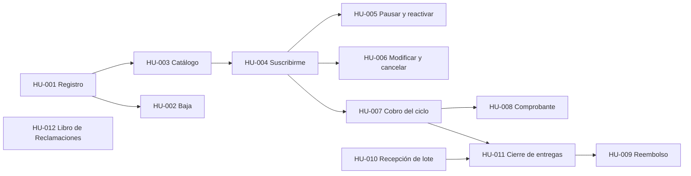

# Historias de Usuario — Muuvi
**Versión:** 1.0.0 (borrador)
**Fecha:** 14/11/2026
**Autor:** Agente PO (BMAD)
**Estado:** Pendiente de revisión humana
**Cambios en v0.2.0:** se incorporan las respuestas a P11, P12, P13, P15, P16 y P17 (14/11/2026); se quitan los ⛔ resueltos.
**Cambios en v0.3.0:** se incorporan P21 y P22 (importe a devolver con elección del cliente y reembolso a las 72 h, lote en revisión de 15 minutos, reactivación tras pago tardío). Ya no hay criterios bloqueados.
**Fuentes:** [`00-constitucion.md`](00-constitucion.md) · [`02-alcance.md`](02-alcance.md) v0.3.1 · [`03-reglas-de-negocio.md`](03-reglas-de-negocio.md) v0.6.0 · [`04-glosario.md`](04-glosario.md) v0.4.0 · [`adr/README.md`](adr/README.md)

> **Alcance de este documento**
> - Hay **12 HU**, todas **Must** y del PMV (F-M01 a F-M06). Las Should, Could y Won't de `02-alcance.md` no tienen HU en esta versión.
> - El término PMV y los demás términos siguen el glosario. Los montos van en S/ y las horas en hora de Lima.
> - Desde v0.3.0 ninguna HU tiene criterios bloqueados. Quedan abiertas P14 y P18, que no afectan a estas 12 HU.

---

## Índice
1. [Mapa de épicas](#mapa-de-épicas)
2. [Definición de Terminado (transversal)](#definición-de-terminado-transversal)
3. [E1 · Cuenta y consentimiento](#e1--cuenta-y-consentimiento-f-m01)
4. [E2 · Catálogo](#e2--catálogo-f-m02)
5. [E3 · Suscripción](#e3--suscripción-f-m03)
6. [E4 · Cobro, comprobantes y reembolsos](#e4--cobro-comprobantes-y-reembolsos-f-m04)
7. [E5 · Operación diaria](#e5--operación-diaria-f-m05)
8. [E6 · Libro de Reclamaciones](#e6--libro-de-reclamaciones-f-m06)
9. [Verificación INVEST](#verificación-invest)
10. [Trazabilidad](#trazabilidad)

---

## Mapa de épicas

| Épica | Funcionalidad | HU | Actor principal |
|---|---|---|---|
| E1 · Cuenta y consentimiento | F-M01 | HU-001, HU-002 | Cliente |
| E2 · Catálogo | F-M02 | HU-003 | Cliente |
| E3 · Suscripción | F-M03 | HU-004, HU-005, HU-006 | Cliente |
| E4 · Cobro, comprobantes y reembolsos | F-M04 | HU-007, HU-008, HU-009 | Cliente |
| E5 · Operación diaria | F-M05 | HU-010, HU-011 | Operador, Repartidor |
| E6 · Libro de Reclamaciones | F-M06 | HU-012 | Consumidor, Operador |

---

## Definición de Terminado (transversal)
Todas las HU cumplen además estas reglas y principios. No se repiten en cada historia:

| Tema | Exigencia | Fuente |
|---|---|---|
| Permisos | Cada acción respeta la matriz de permisos por rol | RN-099 |
| Montos y fechas | `S/ 1,250.50`, `-S/ 43.50` para negativos, `DD/MM/AAAA`, horas en `America/Lima`, timestamps en UTC, montos en `NUMERIC(12,2)` | RN-037 a RN-040, RN-110, PRINCIPIO-011 |
| Idioma | Todo texto visible sale de `src/locales/es-PE.json` | RN-041, ADR-002 |
| Datos personales | Cifrado AES-256-GCM a nivel de campo y sin datos personales en logs | RN-006, RN-007, PRINCIPIO-003 |
| Accesibilidad | WCAG 2.1 AA: contraste ≥ 4.5:1, áreas táctiles de 48×48 px, teclado, TalkBack y VoiceOver | PRINCIPIO-007 |
| Pruebas | Al menos 1 test por regla citada, con su ID en el nombre (por ejemplo `test_RN012_…`); cobertura ≥ 80 % en reglas de negocio | PRINCIPIO-009 |
| API | Cada endpoint nuevo figura en `docs/api/openapi.yaml` | PRINCIPIO-010 |
| Revisión | 1 aprobación humana por PR durante la etapa inicial | ADR-003 |

---

## E1 · Cuenta y consentimiento (F-M01)

### HU-001: Registrarme como cliente
**Prioridad:** Must

Como **persona que vive en Miraflores, San Isidro o La Molina**, quiero **crear mi cuenta en Muuvi**, para **poder suscribirme a la leche de finca**.

**Criterios de aceptación:**
- DADO QUE hoy es 12/11/2026, CUANDO me registro con fecha de nacimiento 13/11/2008 (17 años), ENTONCES el sistema rechaza el registro.
- DADO QUE hoy es 12/11/2026, CUANDO me registro con fecha de nacimiento 12/11/2008 (18 años) y marco el consentimiento principal, ENTONCES el sistema crea mi cuenta.
- DADO QUE abro el formulario, CUANDO se carga, ENTONCES las casillas del consentimiento principal y del envío a terceros aparecen separadas y desmarcadas.
- DADO QUE no marco el consentimiento principal, CUANDO envío el formulario, ENTONCES el sistema rechaza el registro.
- DADO QUE marco el consentimiento principal y no marco el de envío a terceros, CUANDO envío el formulario, ENTONCES el sistema crea mi cuenta igual.
- DADO QUE ingreso una dirección en Santiago de Surco, CUANDO envío el formulario, ENTONCES el sistema rechaza la dirección.

**Reglas de negocio relacionadas:** RN-001, RN-002, RN-003, RN-004, RN-005, RN-006, RN-114, RN-115, RN-116
**Notas:**
- El texto de cada consentimiento lo redacta y aprueba un humano (PRINCIPIO-008.9). El agente solo implementa las casillas y su lógica.
- El consentimiento principal nombra a Culqi, Yape, Plin, el OSE/PSE y el proveedor de correo (RN-115).
- **Dependencia operativa:** antes de salir a producción, el banco de datos debe estar inscrito ante la ANPDP (D6) y los encargados deben figurar en `proveedores-datos.md` con su DPA vigente (RN-118).

---

### HU-002: Darme de baja
**Prioridad:** Must

Como **cliente**, quiero **dar de baja mi cuenta**, para **que Muuvi deje de tratar mis datos personales**.

**Criterios de aceptación:**
- DADO QUE tengo una entrega en estado `en_ruta`, CUANDO pido la baja, ENTONCES el sistema la rechaza y muestra "Tienes una entrega en curso".
- DADO QUE no tengo suscripción activa, entregas `programada` o `en_ruta` ni reclamos sin respuesta, pero tengo 2 botellas sin devolver, CUANDO pido la baja, ENTONCES el sistema la acepta.
- DADO QUE pedí la baja el 12/11/2026 a las 10:00, CUANDO llega el 12/12/2026 a las 10:00 (2 592 000 s después), ENTONCES mis datos personales ya están anonimizados y mis boletas siguen guardadas.
- DADO QUE tengo S/ 14.50 de saldo a favor, CUANDO se acepta mi baja a las 10:00, ENTONCES antes de las 11:00 se solicita el reembolso de S/ 14.50 al medio de pago con que pagué el ciclo que generó ese saldo.

**Reglas de negocio relacionadas:** RN-008, RN-098, RN-111, RN-124
**Notas:** la anonimización es un proceso automático y no requiere doble confirmación (aclaración de QA-010).

---

## E2 · Catálogo (F-M02)

### HU-003: Ver la leche disponible y su finca de origen
**Prioridad:** Must

Como **cliente**, quiero **ver la leche disponible, su precio y la finca certificada de la que viene**, para **decidir si me suscribo**.

**Criterios de aceptación:**
- DADO QUE `precio_litro = 14.50` en la configuración, CUANDO abro el catálogo, ENTONCES veo "Leche fresca 1 L · S/ 14.50 por litro".
- DADO QUE un producto tiene `registro_digesa` vacío, CUANDO el operador intenta publicarlo, ENTONCES el sistema lo rechaza y el producto no aparece en el catálogo.
- DADO QUE la certificación SENASA de la finca vence el 30/11/2026, CUANDO abro el catálogo el 01/12/2026, ENTONCES la etiqueta "Orgánico" no aparece en esa finca ni en sus productos.
- DADO QUE abro la ficha de la finca, CUANDO se carga, ENTONCES veo su nombre, su provincia (Cañete o Huaral) y su certificación SENASA.

**Reglas de negocio relacionadas:** RN-009, RN-010, RN-011
**Notas:** ningún proceso automático cambia el precio (RN-011). Su cambio requiere doble confirmación del administrador titular (RN-032) y no se aplica a ciclos ya cortados (RN-102).

---

## E3 · Suscripción (F-M03)

### HU-004: Suscribirme a una entrega semanal
**Prioridad:** Must

Como **cliente**, quiero **suscribirme para recibir cierta cantidad de litros cada semana**, para **no tener que acordarme de comprar leche**.

**Criterios de aceptación:**
- DADO QUE elijo 3 litros los sábados, CUANDO confirmo la suscripción, ENTONCES el sistema me muestra un importe por ciclo de S/ 43.50 (3 × S/ 14.50) y la franja "07:00–10:00".
- DADO QUE elijo el lunes como día de entrega, CUANDO confirmo, ENTONCES el sistema rechaza la suscripción e indica que los días de reparto son martes, jueves y sábado.
- DADO QUE ingreso 0 litros o 1.5 litros, CUANDO confirmo, ENTONCES el sistema rechaza la suscripción.
- DADO QUE creo una suscripción de los sábados el viernes 13/11/2026 a las 19:00, CUANDO se guarda, ENTONCES mi primera entrega es el sábado 21/11/2026 y mi primer cobro es el viernes 20/11/2026 a las 18:00:00.
- DADO QUE recibo los martes y el martes 08/12/2026 es feriado nacional, CUANDO se acerca esa semana, ENTONCES mi entrega pasa al jueves 10/12/2026, con corte y cobro el miércoles 09/12/2026 a las 18:00:00.

**Reglas de negocio relacionadas:** RN-015, RN-016, RN-017, RN-018, RN-061, RN-084, RN-123
**Notas:** en el PMV no hay un máximo de litros por suscripción (RN-017, decisión P4). Avisar al cliente del traslado por feriado es parte de F-S02 (Should); en el PMV lo avisa el operador.

---

### HU-005: Pausar y reactivar mi suscripción
**Prioridad:** Must

Como **cliente**, quiero **pausar mi suscripción por un número de entregas o de forma indefinida, y reactivarla cuando quiera**, para **no recibir leche cuando viajo**.

**Criterios de aceptación:**
- DADO QUE mi entrega es el sábado 14/11/2026, CUANDO pauso el viernes 13/11/2026 a las 17:59:59, ENTONCES no se programa la entrega del sábado.
- DADO QUE mi entrega es el sábado 14/11/2026, CUANDO pauso el viernes 13/11/2026 a las 18:00:00, ENTONCES la entrega del sábado se mantiene.
- DADO QUE pido una pausa de 2 entregas el viernes 13/11/2026 a las 10:00, CUANDO pasan los sábados 14/11 y 21/11, ENTONCES la suscripción vuelve a `activa` y se programa la entrega del sábado 28/11/2026.
- DADO QUE mi suscripción está en pausa indefinida, CUANDO la reactivo el viernes 20/11/2026 a las 11:00, ENTONCES se programa la entrega del sábado 21/11/2026.

**Reglas de negocio relacionadas:** RN-012, RN-013, RN-062, RN-063, RN-064
**Notas:** el sistema nunca reanuda por su cuenta una pausa indefinida (RN-063).

---

### HU-006: Modificar o cancelar mi suscripción
**Prioridad:** Must

Como **cliente**, quiero **cambiar mis litros, mi día o mi dirección, o cancelar la suscripción**, para **ajustarla a lo que consume mi hogar**.

**Criterios de aceptación:**
- DADO QUE recibo 2 L los sábados, CUANDO cambio a 3 L el viernes 13/11/2026 a las 19:00, ENTONCES la entrega del 14/11/2026 sale con 2 L y la del 21/11/2026 con 3 L.
- DADO QUE cancelo el viernes 13/11/2026 a las 16:00, CUANDO llega el corte, ENTONCES no se crean entregas el 14/11/2026 ni después.
- DADO QUE cancelo el viernes 13/11/2026 a las 20:00, CUANDO llega el sábado, ENTONCES recibo la entrega del 14/11/2026, la suscripción queda `cancelada` y no se crea la del 21/11/2026.
- DADO QUE cambio mi dirección a una en Barranco, CUANDO guardo el cambio, ENTONCES el sistema rechaza la dirección durante el PMV.

**Reglas de negocio relacionadas:** RN-005, RN-014, RN-081, RN-082, RN-083
**Notas:** la entrega que se mantiene después de una cancelación tardía ya fue cobrada en el corte (RN-045).

---

## E4 · Cobro, comprobantes y reembolsos (F-M04)

### HU-007: Pagar cada ciclo automáticamente
**Prioridad:** Must

Como **cliente**, quiero **que cada ciclo se cobre solo a mi tarjeta, Yape o Plin**, para **recibir mi leche sin hacer nada cada semana**.

**Criterios de aceptación:**
- DADO QUE tengo una suscripción activa de S/ 43.50 con entrega el sábado 14/11/2026, CUANDO llega el viernes 13/11/2026 a las 18:00:00, ENTONCES el sistema ejecuta el cobro con la clave de idempotencia `ciclo-{id}-cliente-{id}`.
- DADO QUE el proceso de cobro de las 18:00 se ejecuta dos veces por error, CUANDO termina, ENTONCES tengo un solo cargo de S/ 43.50.
- DADO QUE el primer cobro se rechaza a las 18:00:00, CUANDO pasan 60 s, ENTONCES el sistema hace 1 reintento a las 18:01:00 y no hace ningún otro en ese ciclo.
- DADO QUE el cobro y el reintento se rechazan, CUANDO termina el reintento, ENTONCES la entrega del 14/11/2026 pasa a `suspendida` con motivo `pago`, mi suscripción pasa a `suspendida_por_pago` y recibo en 300 s como máximo un correo para actualizar mi medio de pago.
- DADO QUE mi suscripción está en `suspendida_por_pago`, CUANDO registro una tarjeta nueva el miércoles 18/11/2026, ENTONCES vuelve a `activa` y el siguiente cobro se hace el viernes 20/11/2026 a las 18:00:00.
- DADO QUE pago con Yape y a las 18:30:00 (1 800 s) el pago sigue pendiente, CUANDO se cumple el plazo, ENTONCES la entrega pasa a `suspendida` con motivo `pago`.
- DADO QUE un pago pendiente se confirma a las 18:40:00, después de suspender la entrega, CUANDO llega la confirmación, ENTONCES la entrega sigue `suspendida`, mi suscripción vuelve a `activa` sin pedirme otro medio de pago y a las 18:45:00 como máximo recibo un correo para elegir entre reembolso y saldo a favor.
- DADO QUE elijo reembolso, CUANDO confirmo mi elección, ENTONCES se solicita el reembolso íntegro en 3 600 s como máximo; DADO QUE elijo saldo a favor, ENTONCES el importe se suma a mi saldo.
- DADO QUE recibí el aviso el 13/11/2026 a las 18:42:00 y no elijo ninguna opción, CUANDO llega el 16/11/2026 a las 18:42:00 (72 h), ENTONCES se solicita automáticamente el reembolso íntegro a mi medio de pago original.

**Reglas de negocio relacionadas:** RN-019, RN-020, RN-021, RN-045, RN-046, RN-047, RN-048, RN-049, RN-050, RN-051, RN-072, RN-073, RN-074, RN-075, RN-080, RN-094, RN-095, RN-119, RN-120, RN-121, RN-129, RN-130, RN-131
**Notas:**
- El backend nunca recibe número de tarjeta, CVV ni vencimiento (RN-020). Una tarjeta se guarda como token más los últimos 4 dígitos; un pago con Yape o Plin, como su referencia (RN-021 y RN-094).
- **Validación previa:** probar en el sandbox de Culqi, Yape y Plin el cobro recurrente y la idempotencia antes de cerrar la HU.
- Es la HU más grande; ver la nota de INVEST.

---

### HU-008: Recibir mi comprobante electrónico
**Prioridad:** Must

Como **cliente**, quiero **recibir mi boleta o factura electrónica por cada pago**, para **tener el respaldo tributario de lo que pagué**.

**Criterios de aceptación:**
- DADO QUE no elegí factura, CUANDO se confirma mi pago de S/ 43.50, ENTONCES se emite una boleta electrónica de S/ 43.50.
- DADO QUE elegí factura con el RUC `20123456789`, CUANDO se confirma mi pago, ENTONCES se emite una factura electrónica.
- DADO QUE ingreso el RUC `2012345678` (10 dígitos), CUANDO lo guardo, ENTONCES el sistema lo rechaza.
- DADO QUE mi pago con Plin quedó `pendiente`, CUANDO todavía no se confirma, ENTONCES no se emite ningún comprobante.
- DADO QUE el OSE/PSE falla al emitir a las 18:00:05, CUANDO pasan los reintentos (18:01:05, 18:03:05, 18:07:05, 18:15:05 y 18:31:05) y todos fallan, ENTONCES el operador recibe una alerta crítica en 60 s como máximo.

**Reglas de negocio relacionadas:** RN-022, RN-023, RN-058, RN-059, RN-060, RN-104, RN-106
**Notas:** un RUC que empieza con `10` contiene el DNI y se guarda cifrado (RN-060).

---

### HU-009: Recibir un reembolso cuando Muuvi falla
**Prioridad:** Must

Como **cliente**, quiero **que me devuelvan lo pagado si Muuvi no me entrega la leche**, para **no pagar por algo que no recibí**.

**Criterios de aceptación:**
- DADO QUE mi entrega de S/ 43.50 queda `fallida` con causa `imputable_muuvi` a las 09:40:00, CUANDO se registra, ENTONCES a las 09:45:00 como máximo recibo un correo y un aviso en la PWA para elegir entre reembolso y saldo a favor por S/ 43.50.
- DADO QUE elijo reembolso a las 10:00, CUANDO confirmo, ENTONCES el reembolso de S/ 43.50 se solicita antes de las 11:00 y se emite una nota de crédito que referencia la boleta original; DADO QUE elijo saldo a favor, ENTONCES mi saldo sube en S/ 43.50.
- DADO QUE mi entrega de 2 L (S/ 29.00) queda `suspendida` porque su lote se invalidó y no elijo nada, CUANDO pasan 72 h desde el aviso, ENTONCES se me reembolsan automáticamente S/ 29.00.
- DADO QUE mi entrega reprogramada vuelve a fallar por mi causa y queda `cancelada`, CUANDO se cancela, ENTONCES se me reembolsa su importe íntegro sin pedirme que elija.
- DADO QUE elegí saldo a favor, tengo S/ 14.50 de saldo y mi ciclo es de S/ 43.50, CUANDO llega el corte, ENTONCES se me cobran S/ 29.00.
- DADO QUE la pasarela rechaza un reembolso a las 09:45:00, CUANDO falla, ENTONCES se reintenta a las 09:46:00 con backoff exponencial, y si se agotan los 5 reintentos el operador recibe una alerta crítica.
- DADO QUE tengo S/ 58.00 de saldo y mi ciclo es de S/ 43.50, CUANDO llega el corte, ENTONCES no se envía cobro a la pasarela, se registra un pago confirmado de S/ 43.50 con origen `saldo_favor`, recibo una boleta de S/ 43.50 que dice "Forma de pago: aplicación de saldo a favor" y me quedan S/ 14.50 de saldo.

**Reglas de negocio relacionadas:** RN-053, RN-054, RN-055, RN-056, RN-057, RN-079, RN-092, RN-096, RN-097, RN-105, RN-106, RN-108, RN-125, RN-126, RN-129, RN-130
**Notas:** el reembolso va siempre al medio de pago original. Solo los reembolsos por reprogramación agotada (RN-108) y por baja o cancelación con saldo (RN-124) se hacen sin preguntarle al cliente. Hay que confirmar en el sandbox que Yape y Plin admiten reembolsos (QA-048). ⚠️ El comprobante con saldo a favor (RN-125 y RN-126) está pendiente de validación por el contador.

---

## E5 · Operación diaria (F-M05)

### HU-010: Recibir los lotes de la finca con control de temperatura
**Prioridad:** Must

Como **operador**, quiero **saber cuántos litros pedir a la finca y registrar cada lote que llega con su temperatura**, para **repartir solo leche que cumple la cadena de frío**.

**Criterios de aceptación:**
- DADO QUE el viernes 13/11/2026 a las 18:00:00 hay entregas `programada` que suman 96 L, más 2 reprogramadas de 4 L, CUANDO se cumple el corte, ENTONCES el sistema calcula una demanda de 100 L para el sábado 14/11/2026 y la registra como litros comprometidos del pedido a la finca.
- DADO QUE registro un lote sin temperatura, CUANDO lo guardo, ENTONCES el sistema rechaza el registro.
- DADO QUE registro un lote a 4.5 °C, CUANDO lo guardo, ENTONCES queda en estado `recibido`; DADO QUE lo registro a 4.6 °C a las 06:10:00, ENTONCES queda `en_revision`, el operador y el administrador reciben una alerta crítica en 60 s como máximo y sus botellas no se asignan a entregas nuevas.
- DADO QUE el lote L-2026-1114-01 pasó a `en_revision` a las 06:10:00 y nadie lo revierte, CUANDO llegan las 06:25:00 (900 s), ENTONCES queda `invalidado` y sus entregas `programada` pasan al lote L-2026-1114-02, que tiene 30 L libres.
- DADO QUE quiero corregir una lectura de 5.1 °C, CUANDO intento sobrescribirla, ENTONCES el sistema lo rechaza; CUANDO registro una corrección a 4.1 °C con la justificación "error de digitación", ENTONCES quedan los dos registros con mi usuario y la hora.
- DADO QUE llegan 5 L para tres entregas (A, alta 01/10/2026, 3 L; B, alta 05/10/2026, 3 L; C, alta 10/10/2026, 2 L), CUANDO registro el lote, ENTONCES se cubren A y C, y B queda `fallida` con motivo `falla_abastecimiento_finca`.
- DADO QUE soy el operador y corrijo a 4.1 °C la lectura de un lote `en_revision`, CUANDO guardo la corrección, ENTONCES queda registrada pero el lote sigue `en_revision`.
- DADO QUE el lote pasó a `en_revision` a las 05:50:00, CUANDO el administrador titular corrige la lectura a 3.8 °C con justificación a las 05:58, ENTONCES el lote vuelve a `recibido` y sus entregas siguen su curso.
- DADO QUE el lote pasó a `en_revision` a las 05:50:00, CUANDO el administrador intenta revertirlo a las 06:10 (después de los 900 s), ENTONCES el lote ya está `invalidado` y el sistema rechaza la reversión.

**Reglas de negocio relacionadas:** RN-024, RN-026, RN-027, RN-028, RN-085, RN-087, RN-088, RN-089, RN-090, RN-091, RN-092, RN-093, RN-122, RN-127, RN-128, RN-134
**Notas:** el umbral de 4.5 °C está pendiente de validación por un especialista sanitario. Las lecturas llevan exactamente 1 decimal (RN-087).

---

### HU-011: Cerrar mis entregas del día en ruta
**Prioridad:** Must

Como **repartidor**, quiero **registrar cada entrega con su temperatura y las botellas que recojo**, para **que Muuvi sepa qué se entregó y en qué condiciones**.

**Criterios de aceptación:**
- DADO QUE entrego 3 L a 4.1 °C y recojo 2 botellas de un cliente con saldo de 2, CUANDO cierro la entrega como `entregada`, ENTONCES el saldo del cliente queda en 3 botellas (2 − 2 + 3).
- DADO QUE intento cerrar una entrega como `entregada` sin temperatura, CUANDO la envío, ENTONCES el sistema rechaza el cierre.
- DADO QUE el cliente tiene saldo de 2 botellas, CUANDO registro 3 devueltas, ENTONCES el sistema rechaza el registro.
- DADO QUE registro 5.1 °C en la puerta del cliente a las 08:20:00, CUANDO lo guardo, ENTONCES no puedo cerrar la entrega como `entregada`, la botella no se entrega, el lote pasa a `en_revision` y los demás repartidores con entregas de ese lote reciben en 60 s como máximo el aviso "Lote en revisión, no entregar".
- DADO QUE el lote sigue `en_revision` a las 08:35:00 (900 s), CUANDO se invalida, ENTONCES mis entregas `en_ruta` de ese lote pasan a `suspendida` y los clientes que ya recibieron leche de ese lote reciben un aviso de disculpa por correo en 3 600 s como máximo; DADO QUE el administrador lo revierte antes, ENTONCES puedo seguir entregando.
- DADO QUE el cliente no estaba el sábado 14/11/2026, CUANDO marco la entrega como `fallida` con causa `imputable_cliente`, ENTONCES se reprograma para el martes 17/11/2026, 07:00–10:00, sin un cobro nuevo y con botellas de un lote de ese día.
- DADO QUE la entrega reprogramada del 17/11/2026 vuelve a fallar por causa del cliente, CUANDO la marco, ENTONCES pasa a `cancelada` y no se reprograma de nuevo.
- DADO QUE marco una entrega como `fallida` sin causa, CUANDO la envío, ENTONCES el sistema rechaza el registro.

**Reglas de negocio relacionadas:** RN-025, RN-029, RN-030, RN-031, RN-052, RN-065, RN-066, RN-067, RN-068, RN-070, RN-071, RN-076, RN-077, RN-078, RN-086, RN-107, RN-113, RN-132, RN-133, RN-134
**Notas:** el repartidor solo ve la dirección y el nombre de los clientes de sus entregas del día (matriz de permisos, RN-099). Supuesto S11: tiene un smartphone Android 9+ o iOS 15+ con datos móviles.

---

## E6 · Libro de Reclamaciones (F-M06)

### HU-012: Registrar un reclamo y recibir respuesta a tiempo
**Prioridad:** Must

Como **consumidor, tenga o no cuenta**, quiero **registrar un reclamo o una queja en el Libro de Reclamaciones virtual**, para **que Muuvi me responda dentro del plazo legal**.

**Criterios de aceptación:**
- DADO QUE no he iniciado sesión, CUANDO abro "Libro de Reclamaciones" desde el menú principal, ENTONCES puedo registrar mi reclamo sin que me pida iniciar sesión.
- DADO QUE registro un reclamo, CUANDO se guarda, ENTONCES recibe un código correlativo (por ejemplo `LR-2026-000017`) y me llega la constancia con ese código al correo que indiqué.
- DADO QUE un reclamo se registra el lunes 16/11/2026, CUANDO el operador lo abre, ENTONCES ve como fecha límite de respuesta el lunes 07/12/2026 (15 días hábiles).
- DADO QUE el reclamo del 16/11/2026 sigue sin respuesta, CUANDO llega el lunes 30/11/2026 (10.º día hábil), ENTONCES el operador recibe una alerta.
- DADO QUE el plazo cruza un feriado nacional cargado en el calendario, CUANDO se calcula la fecha límite, ENTONCES ese feriado no se cuenta como día hábil.

**Reglas de negocio relacionadas:** RN-033, RN-034, RN-035, RN-036, RN-100, RN-101, RN-109, RN-112
**Notas:** el plazo de 15 días hábiles es improrrogable (Ley 31435). El registro y el envío de la respuesta formal al reclamo todavía no tienen una regla propia (lo señaló QA-028).

---

## Verificación INVEST

| HU | I | N | V | E | S | T | Observación |
|---|---|---|---|---|---|---|---|
| HU-001 | ✅ | ✅ | ✅ | ✅ | ✅ | ✅ | Base de las demás HU del cliente. |
| HU-002 | ✅ | ✅ | ✅ | ✅ | ✅ | ✅ | Sin bloqueos. |
| HU-003 | ✅ | ✅ | ✅ | ✅ | ✅ | ✅ | Necesita datos de fincas y productos cargados por el operador; se pueden sembrar para la prueba. |
| HU-004 | ⚠️ | ✅ | ✅ | ✅ | ✅ | ✅ | Depende de HU-001 (cliente registrado). |
| HU-005 | ⚠️ | ✅ | ✅ | ✅ | ✅ | ✅ | Depende de HU-004 (suscripción existente). |
| HU-006 | ⚠️ | ✅ | ✅ | ✅ | ✅ | ✅ | Depende de HU-004. |
| HU-007 | ⚠️ | ✅ | ✅ | ⚠️ | ⚠️ | ✅ | Depende de HU-004. Es la más grande: si no cabe en un sprint, partir en **HU-007a** (cobro e idempotencia) y **HU-007b** (rechazo, pendiente y regularización). Estimación sujeta al sandbox. |
| HU-008 | ⚠️ | ✅ | ✅ | ⚠️ | ✅ | ✅ | Depende de HU-007 (pago confirmado). Estimación sujeta a la elección del OSE/PSE. |
| HU-009 | ⚠️ | ✅ | ✅ | ⚠️ | ⚠️ | ⚠️ | Depende de HU-007 y HU-011. Puede partirse en reembolso y saldo a favor. El comprobante con saldo espera la validación del contador. |
| HU-010 | ✅ | ✅ | ✅ | ✅ | ⚠️ | ✅ | Independiente del flujo del cliente. Puede partirse en recepción y temperatura, y en demanda y reasignación. |
| HU-011 | ⚠️ | ✅ | ✅ | ✅ | ⚠️ | ✅ | Depende de HU-010 (lotes recibidos). Puede partirse en entrega normal y en excepciones (temperatura, fallida, reprogramación). |
| HU-012 | ✅ | ✅ | ✅ | ✅ | ✅ | ✅ | Independiente del resto. |

**Lectura de la tabla:** las ⚠️ en **I** son dependencias naturales del flujo (no se puede pausar una suscripción que no existe). Para desarrollarlas en paralelo basta con datos de prueba sembrados. La única ⚠️ en **T** es HU-009: su criterio de boleta con saldo a favor depende de que lo valide el contador. Las ⚠️ en **S** y **E** tienen propuesta de partición.

### Orden sugerido de sprints
| Sprint | HU | Por qué |
|---|---|---|
| 1 | HU-001, HU-003, HU-012 | Registro, catálogo y obligación legal; sin dependencias externas de pago. |
| 2 | HU-004, HU-005, HU-006, HU-010 | Suscripción completa y recepción de lotes. |
| 3 | HU-007, HU-008 | Cobro y comprobantes, después de la prueba en sandbox y de elegir el OSE/PSE. |
| 4 | HU-011, HU-009, HU-002 | Reparto, reembolsos y baja, que dependen de todo lo anterior. |

---

## Trazabilidad

### Reglas MUST de producto sin HU propia
Estas reglas se cumplen a través de la **Definición de Terminado** o de procesos no visibles para el usuario:

| Regla | Dónde se cubre |
|---|---|
| RN-007 | DoD · datos personales |
| RN-032 | Transversal: anulaciones y cambio de precio con doble confirmación (P18 pendiente) |
| RN-037 a RN-041, RN-110 | DoD · montos, fechas e idioma |
| RN-069 | Implícita en HU-004, HU-005 y HU-007 (la entrega se crea en el corte) |
| RN-099 | DoD · permisos |
| RN-102, RN-103 | Cambio de precio: falta una HU del operador o del administrador, que conviene agregar cuando se responda P14 |
| RN-118 | Requisito previo de salida a producción (HU-001, notas) |

### Reglas SHOULD sin HU en esta versión
RN-042, RN-043 y RN-044 (avisos y trazabilidad, F-S02 y F-S03) y RN-117 (consentimiento comercial). Se escribirán cuando se planifique la fase posterior al PMV.

### Preguntas abiertas
Ninguna pregunta abierta bloquea criterios de estas 12 HU.

| Pregunta | Afecta a |
|---|---|
| P14 · Antelación del aviso de cambio de precio | HU de cambio de precio (todavía no escrita) |
| P18 · Mecanismo de la doble confirmación | Transversal (RN-032) |
