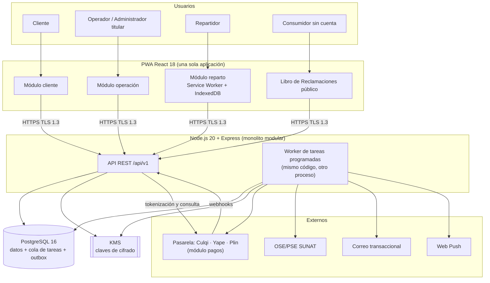
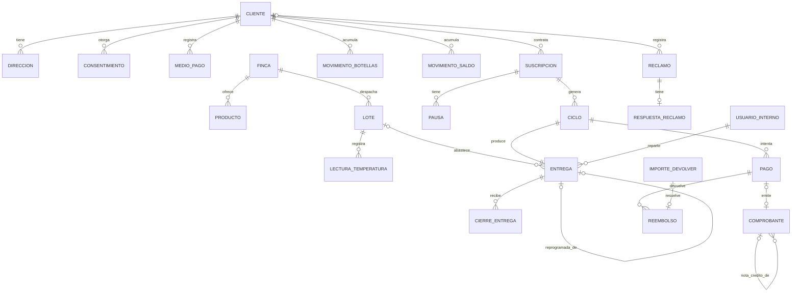

# Arquitectura técnica inicial — Muuvi
**Versión:** 1.2.1 (borrador del contrato §4.14)
**Fecha:** 14/11/2026
**Autor:** Agente Architect (BMAD)
**Historial:** 0.1.0 (14/11/2026) borrador · 1.0.0 (14/11/2026) aprobación de los ADR-005 a ADR-009 y de las dependencias · 1.1.0 (14/11/2026) correcciones de la auditoría de trazabilidad (QA-C2-002, 004, 005, 013, 014, 015 y 016): nuevos endpoints, doble confirmación (RN-151 y RN-152), proveedores habilitados (RN-118), dependencias de desarrollo y §6.6 de despliegue · 1.2.0 (14/11/2026) validación del prototipo (`10-validation-log.md`): hoja de ruta impresa (K9), varias suscripciones por cliente, recuperación de contraseña, aviso de aprobación de Yape y Plin, recepción del día y pedido por finca, lectura alta en la puerta, vistas previas, direcciones, alertas internas con estado y retiro de feriados (§4.14). **Sin dependencias nuevas**
**Estado:** Aprobado por el fundador titular el 14/11/2026: los ADR-005 a ADR-009 están aceptados y las dependencias de la [sección 6.3](#63-dependencias-de-software-aprobadas) están aprobadas (PRINCIPIO-002 y PRINCIPIO-008.1). Los cambios de la v1.2.0 (tablas nuevas y §4.14) amplían el contrato de la API y **esperan la aprobación humana del contrato** (D-04 de `10-validation-log.md`). Las reglas que implementan se aprobaron el 14/11/2026 (G7 liberada); RN-168 a RN-172 esperan además la validación del contador.
**Fuentes:** [`00-constitucion.md`](00-constitucion.md) · [`02-alcance.md`](02-alcance.md) · [`03-reglas-de-negocio.md`](03-reglas-de-negocio.md) v0.9.0 · [`10-validation-log.md`](10-validation-log.md) · [`04-glosario.md`](04-glosario.md) v0.7.0 · [`06-user-stories-refinadas.md`](06-user-stories-refinadas.md) v0.2.0 · [`adr/README.md`](adr/README.md)

---

## 1. Overview del sistema

### 1.1 Descripción
Muuvi es una **PWA en React** que permite a hogares de Miraflores, San Isidro y La Molina suscribirse a una entrega semanal de leche fresca de fincas de Cañete y Huaral. Un **backend monolítico modular en Node.js con Express**, sobre **PostgreSQL**, gestiona cuentas, suscripciones, cobros (Culqi, Yape y Plin), comprobantes SUNAT, la operación diaria (lotes, cadena de frío, entregas y botellas) y el Libro de Reclamaciones. Un **proceso de tareas programadas** (worker) ejecuta todo lo que depende del reloj de Lima: el corte de las 18:00, los 900 s de revisión de lotes, las 72 h para elegir entre reembolso y saldo, los 30 días de anonimización y los reintentos con backoff. La misma PWA ofrece un **módulo de operación** para el operador y el administrador titular, y un **módulo de reparto que funciona sin conexión** para los repartidores.

### 1.2 Diagrama de alto nivel

**Descripción textual.** El cliente, el operador, el administrador y el repartidor usan una única PWA servida por HTTPS (TLS 1.3). La PWA llama a la API REST de Express. La API guarda los datos en PostgreSQL y pide a un KMS externo las claves de cifrado de los datos personales. El worker, que comparte el código y la base de datos con la API, toma las tareas de una cola en PostgreSQL y se comunica con los servicios externos: la pasarela de pagos (a través del módulo `pagos`), el OSE/PSE (a través del módulo `comprobantes`) y el proveedor de correo y Web Push (a través del módulo `notificaciones`). Las pasarelas avisan del resultado de los cobros a la API mediante webhooks. El módulo de reparto guarda los cierres en el dispositivo cuando no hay señal y los sincroniza al recuperarla.



### 1.3 Principios de diseño
| # | Principio de diseño | Origen |
|---|---|---|
| D1 | **Stack fijo:** React 18 PWA, Node.js 20 con Express y PostgreSQL 16. Ningún otro motor de base de datos, cola o framework sin un ADR aprobado. | PRINCIPIO-002 |
| D2 | **Monolito modular:** un solo despliegue con módulos de dominio separados por carpeta y por interfaz. Un módulo no accede a las tablas de otro, sino a su servicio. | [ADR-005](adr/ADR-005-monolito-modular.md) |
| D3 | **Las pasarelas solo se tocan desde `pagos`** y el OSE/PSE solo desde `comprobantes`, mediante adaptadores con interfaz común. | PRINCIPIO-002, ADR-001 |
| D4 | **Cifrado de campo por defecto:** todo dato personal se guarda en columnas `*_cifrado` con AES-256-GCM y claves del KMS. Los logs usan solo identificadores. | PRINCIPIO-003, RN-006, RN-007 |
| D5 | **Sin datos de tarjeta:** los DTO rechazan cualquier propiedad no declarada, y un test falla si aparece `numero_tarjeta`, `cvv` o `pan`. | PRINCIPIO-004, RN-020 |
| D6 | **Reloj de Lima, almacenamiento en UTC:** las reglas horarias se evalúan en `America/Lima`, los timestamps se guardan en `timestamptz` y los montos en `NUMERIC(12,2)`. En JSON, los montos viajan como **texto decimal** (`"43.50"`) para evitar errores de punto flotante. | PRINCIPIO-011, RN-039, RN-040 |
| D7 | **Idempotencia en todo lo que mueve dinero o estado:** cobros, webhooks, reembolsos y sincronización de cierres. | RN-072, RN-073, RN-144 |
| D8 | **Máquinas de estado explícitas** para suscripción, entrega, lote, pago y reclamo; toda transición no prevista se rechaza. | RN-070, RN-071 |
| D9 | **Textos fuera del código:** la API devuelve **claves de traducción** y códigos de regla, y la PWA los resuelve con `es-PE.json`. | PRINCIPIO-001, ADR-002, RN-041 |
| D10 | **Pensado para Android de gama baja y conectividad intermitente:** presupuesto de peso por pantalla, carga diferida y módulo de reparto sin conexión. | PRINCIPIO-007, RN-141 a RN-145 |
| D11 | **Contrato primero:** cada endpoint existe en `docs/api/openapi.yaml` antes de implementarse, y el CI valida que coincidan. | PRINCIPIO-010 |

---

## 2. Componentes principales

### 2.1 Catálogo de componentes
| # | Componente | Responsabilidad | Tecnología | HU que implementa |
|---|---|---|---|---|
| C1 | **PWA · módulo cliente** | Registro, catálogo, suscripción, pagos, elección de reembolso y baja. | React 18, Service Worker (caché de recursos estáticos) | HU-001 a HU-009 |
| C2 | **PWA · módulo operación** | Lotes, temperaturas, lista de entregas, precio, anulaciones, feriados y respuesta a reclamos. | React 18 (carga diferida por rol) | HU-010, HU-011 (asignación), HU-013, HU-014, HU-015, HU-016, HU-017 |
| C3 | **PWA · módulo reparto (sin conexión)** | Lista del día, cierre de entregas, temperatura y botellas, con o sin señal. | React 18, Service Worker, IndexedDB nativo | HU-011 |
| C4 | **PWA · Libro de Reclamaciones público** | Formulario accesible sin iniciar sesión. | React 18 (ruta pública) | HU-012 |
| C5 | **API REST** | Expone `/api/v1`, autentica, autoriza por rol, valida DTO y orquesta los módulos de dominio. | Node.js 20, Express | Todas |
| C6 | **Módulos de dominio** (dentro de C5 y C7) | `cuentas`, `catalogo`, `suscripciones`, `operacion` (lotes y entregas), `pagos`, `comprobantes`, `devoluciones` (importes, reembolsos y saldo), `reclamos`, `calendario`, `configuracion`, `notificaciones`, `auditoria`, `cifrado`, `permisos`. | Node.js 20 | Todas |
| C7 | **Worker de tareas programadas** | Ejecuta las tareas que dependen del tiempo y los reintentos con backoff. | Node.js 20 (mismo código que C5, otro proceso) | HU-002, HU-004, HU-005, HU-007 a HU-012, HU-016 |
| C8 | **Base de datos** | Datos del negocio, cola de tareas, outbox de eventos y auditoría. | PostgreSQL 16 | Todas |
| C9 | **Módulo `cifrado` + KMS** | Cifra y descifra campos con AES-256-GCM (cifrado de sobre) y calcula índices ciegos para buscar sin descifrar. | `crypto` nativo de Node.js + KMS del proveedor de hosting | HU-001, HU-002, HU-008 |
| C10 | **Adaptadores externos** | `pagos/adaptadores/{culqi,yape,plin}`, `comprobantes/adaptadores/{ose}`, `notificaciones/adaptadores/{correo,webpush}`. | Node.js 20 (HTTPS) | HU-007, HU-008, HU-009, HU-012, HU-016 |

### 2.2 Tareas del worker (C7)
| Tarea | Cuándo | Reglas |
|---|---|---|
| `corte_dia_reparto` | 18:00:00 (Lima) del día previo a cada día de reparto, o al nuevo día si hay traslado por feriado | Crear entregas (RN-069), cobrar (RN-045), calcular la demanda (RN-090 y RN-091), trasladar por feriado (RN-123) |
| `reintento_cobro` | 60 s después del primer rechazo | RN-046, RN-080 |
| `vencer_pago_pendiente` | 1 800 s después de iniciar el cobro | RN-074 |
| `consultar_pago_en_verificacion` | Al entrar en `en_verificacion` (intervalo ❓ P23) | RN-137, RN-138 |
| `cerrar_revision_lote` | 900 s después de la alerta | RN-134 |
| `reembolso_automatico_72h` | 259 200 s después del aviso de elección | RN-130 |
| `reintento_ose` y `reintento_reembolso` | Backoff de 60, 120, 240, 480 y 960 s | RN-104 a RN-106 |
| `alerta_reclamo_dia_10` | Diaria, 08:00 (Lima) | RN-036 |
| `anonimizar_bajas` | Diaria, 03:00 (Lima) | RN-008, RN-111 |
| `enviar_outbox` | Continua | Entrega de correos, push y eventos a los adaptadores con reintento |
| `aviso_aprobacion_billetera` | Al iniciar el cobro de un ciclo con Yape o Plin (v1.2.0) | RN-164 |
| `alerta_recepcion_abierta` | 06:45:00 (Lima) de cada día de reparto (v1.2.0) | RN-158 |
| `alerta_calendario_anual` | Diaria desde el 01/12, 08:00 (Lima), mientras falten los feriados del año siguiente (v1.2.0) | RN-175 |

Todas las tareas se encolan en la tabla `tarea_programada` y se toman con `SELECT … FOR UPDATE SKIP LOCKED` (ADR-007). Cada tarea tiene una clave única que impide crearla dos veces.

### 2.3 Interfaces entre componentes
| Llamador | Llamado | Medio | Para qué |
|---|---|---|---|
| C1, C2, C3, C4 | C5 API | HTTPS JSON, JWT Bearer (salvo C4) | Todas las operaciones de usuario |
| C3 | C5 `POST /reparto/cierres` | HTTPS JSON, lote de cierres | Sincronizar cierres guardados sin conexión |
| C5 | C6 módulos | Llamada en proceso (servicios) | Lógica de negocio |
| C6 `pagos` | Pasarela | HTTPS, a través del adaptador | Tokenizar, cobrar, consultar y reembolsar |
| Pasarela | C5 `POST /webhooks/pagos/{pasarela}` | HTTPS, firma verificada | Confirmar o rechazar cobros y reembolsos |
| C7 | C6 módulos | Llamada en proceso | Ejecutar tareas programadas |
| C6 `notificaciones` | Correo y Web Push | HTTPS, a través del adaptador | Avisos al cliente (ventana de 09:00 a 20:00 para push, RN-042) y alertas internas (cualquier hora, RN-150) |
| C6 `comprobantes` | OSE/PSE | HTTPS, a través del adaptador | Emitir boletas, facturas y notas de crédito |
| C6 `cifrado` | KMS | HTTPS (SDK del KMS) | Obtener y rotar las claves de datos |
| C5, C7 | C8 PostgreSQL | Protocolo de PostgreSQL con TLS | Persistencia, cola y outbox |

**Regla de dependencias entre módulos:** `suscripciones` → `pagos` → `comprobantes` y `devoluciones`; `operacion` → `devoluciones` y `notificaciones`. Ningún módulo conoce a una pasarela concreta (D3).

---

## 3. Modelo de datos

### 3.1 Convenciones
- **Claves primarias:** `id BIGINT GENERATED ALWAYS AS IDENTITY`, salvo los cierres sin conexión, que usan `UUID` generado en el dispositivo (RN-144).
- **Montos:** `NUMERIC(12,2) CHECK (>= 0)`. **Timestamps:** `TIMESTAMPTZ` en UTC. **Fechas de calendario** (día de entrega, feriado): `DATE`, interpretada en `America/Lima`.
- **Datos personales:** `BYTEA` con el sufijo `_cifrado`, en formato `{versión de clave | IV de 12 bytes | texto cifrado | tag de 16 bytes}`.
- **Índice ciego:** `*_hmac BYTEA`, un HMAC-SHA-256 con clave del KMS, para buscar por correo o RUC sin descifrar (ADR-006).
- **Estados:** tipos `ENUM` de PostgreSQL, con las transiciones validadas en el servicio de dominio (RN-071).
- **Nada se borra físicamente** en ventas, pedidos, pagos, comprobantes, suscripciones, entregas ni auditoría; solo se anula con doble confirmación (RN-032, PRINCIPIO-008.2).

### 3.2 Entidades principales

**Cuentas y consentimiento**
| Entidad | Atributos clave | Restricciones |
|---|---|---|
| `cliente` | `id`, `nombre_cifrado`, `correo_cifrado`, `correo_hmac`, `telefono_cifrado`, `fecha_nacimiento_cifrado`, `dni_cifrado` (opcional, ver QA-044), `ruc_cifrado`, `ruc_tipo ENUM('10','20','otro')`, `tipo_comprobante ENUM('boleta','factura')`, `contrasena_hash` (argon2id), `estado ENUM('activa','baja_solicitada','anonimizada')`, `fecha_baja`, `creado_en` | `UNIQUE(correo_hmac)`; la edad ≥ 18 se valida antes de cifrar (RN-001) |
| `direccion` | `id`, `cliente_id`, `linea_cifrado`, `referencia_cifrado`, `coordenadas_cifrado`, `distrito ENUM('miraflores','san_isidro','la_molina')`, `vigente BOOLEAN` | El distrito queda en claro, porque no identifica a la persona y se usa para la cobertura (RN-005) y las rutas |
| `consentimiento` | `id`, `cliente_id`, `tipo ENUM('principal','terceros','comercial')`, `otorgado BOOLEAN`, `version_texto`, `registrado_en` | Una fila por tipo y por versión del texto; `principal` es obligatorio (RN-114) |
| `usuario_interno` | `id`, `nombre_cifrado`, `correo_cifrado`, `correo_hmac`, `rol ENUM('operador','administrador_titular','repartidor')`, `contrasena_hash`, `activo BOOLEAN` | `UNIQUE(correo_hmac)`. El segundo paso de la doble confirmación es un código por correo (RN-151), así que no se guarda un secreto de segundo factor. Se crea solo con el comando de administración `npm run usuarios`, que ejecuta un humano (RN-176) |
| `recuperacion_contrasena` (v1.2.0) | `id`, `usuario_tipo ENUM('cliente','interno')`, `usuario_id`, `token_hash` (HMAC-SHA-256), `enviado_en`, `vence_en`, `usado_en NULL` | RN-165 a RN-167. `vence_en = enviado_en + 1 800 s`. El token nunca se guarda en claro ni se registra en los logs |

**Catálogo y operación**
| Entidad | Atributos clave | Restricciones |
|---|---|---|
| `finca` | `id`, `nombre`, `provincia ENUM('canete','huaral')`, `senasa_codigo`, `senasa_vence DATE` | La etiqueta "orgánico" se calcula como `senasa_vence >= hoy_lima` (RN-010) |
| `producto` | `id`, `finca_id`, `nombre`, `volumen_ml INT DEFAULT 1000`, `registro_digesa`, `publicado BOOLEAN` | `CHECK (NOT publicado OR registro_digesa IS NOT NULL)` (RN-009) |
| `recepcion_dia` (v1.2.0) | `fecha DATE PRIMARY KEY`, `demanda_litros INT`, `cerrada_en TIMESTAMPTZ NULL`, `cerrada_por NULL` | RN-157. Hasta `cerrada_en`, la escasez es solo una advertencia |
| `pedido_finca` (v1.2.0) | `fecha DATE`, `finca_id`, `litros_comprometidos INT CHECK (> 0)`, `cargado_por`, `cargado_en` | `PRIMARY KEY(fecha, finca_id)`; la suma del día debe ser igual a `recepcion_dia.demanda_litros` (RN-159) |
| `lote` | `id`, `codigo UNIQUE`, `finca_id`, `producto_id`, `fecha_ordeno DATE`, `fecha_reparto DATE`, `litros_comprometidos INT` (desde v1.2.0, el del `pedido_finca` de su finca), `litros_recibidos INT`, `estado ENUM('recibido','en_revision','invalidado')`, `revision_vence_en TIMESTAMPTZ` | `litros_*` y la temperatura son obligatorios (RN-028, RN-085) |
| `lectura_temperatura` | `id`, `lote_id`, `entrega_id NULL`, `origen ENUM('recepcion','entrega')`, `valor NUMERIC(4,1)`, `corrige_a_id NULL`, `justificacion`, `usuario_id`, `registrada_en` | Solo se insertan filas; un *trigger* rechaza `UPDATE` y `DELETE` (RN-088). Una corrección es una fila nueva con `corrige_a_id` (RN-089) |

**Suscripción, ciclo y entrega**
| Entidad | Atributos clave | Restricciones |
|---|---|---|
| `suscripcion` | `id`, `cliente_id`, `producto_id` (v1.2.0, RN-161), `direccion_id`, `medio_pago_id`, `litros INT CHECK (litros >= 1)`, `dia_entrega ENUM('martes','jueves','sabado')`, `estado ENUM('activa','pausada','suspendida_por_pago','cancelada')`, `creada_en` | RN-016, RN-017, RN-061 |
| `pausa` | `id`, `suscripcion_id`, `tipo ENUM('con_plazo','indefinida')`, `entregas_a_omitir INT CHECK (>= 1)`, `entregas_omitidas INT`, `solicitada_en`, `terminada_en` | RN-062 a RN-064 |
| `cambio_suscripcion` | `id`, `suscripcion_id`, `campo`, `valor_nuevo`, `aplica_desde_ciclo_id`, `solicitado_en` | RN-083 |
| `ciclo` | `id`, `suscripcion_id`, `fecha_entrega DATE`, `corte_en TIMESTAMPTZ`, `litros INT`, `precio_litro NUMERIC(12,2)`, `importe NUMERIC(12,2)`, `saldo_aplicado NUMERIC(12,2)` | `UNIQUE(suscripcion_id, fecha_entrega)`; el precio se congela en el corte (RN-102) |
| `entrega` | `id`, `ciclo_id`, `lote_id NULL`, `repartidor_id NULL`, `fecha DATE`, `franja TEXT DEFAULT '07:00-10:00'`, `estado ENUM('programada','en_ruta','entregada','fallida','reprogramada','cancelada','suspendida')`, `motivo_suspension ENUM('pago','lote_invalidado')`, `causa_fallo ENUM('imputable_muuvi','imputable_cliente')`, `motivo_fallo TEXT`, `reprogramada_de_id NULL`, `temperatura_entrega NUMERIC(4,1)`, `cerrada_en TIMESTAMPTZ`, `retenida_desde TIMESTAMPTZ NULL` (v1.2.0, RN-156), `entregada_durante_revision BOOLEAN DEFAULT false` (v1.2.0, RN-185) | RN-029, RN-052, RN-070; una reprogramación como máximo (RN-107) |
| `cierre_entrega` | `id UUID` (del dispositivo), `entrega_id`, `repartidor_id`, `payload JSONB`, `registrado_en`, `recibido_en`, `resultado ENUM('aplicado','duplicado','rechazado')` | `PRIMARY KEY(id)` evita la doble aplicación (RN-144) |
| `movimiento_botellas` | `id`, `cliente_id`, `entrega_id`, `entregadas INT`, `devueltas INT`, `registrado_en` | El saldo es la suma y nunca es negativo (RN-030, RN-031, RN-065) |

**Pagos, comprobantes y devoluciones**
| Entidad | Atributos clave | Restricciones |
|---|---|---|
| `medio_pago` | `id`, `cliente_id`, `tipo ENUM('tarjeta','yape','plin')`, `token_pasarela`, `ultimos_4 CHAR(4) NULL`, `activo BOOLEAN` | Sin columnas de PAN, CVV ni vencimiento; un test del esquema lo verifica (RN-020, RN-021, RN-095) |
| `pago` | `id`, `ciclo_id`, `medio_pago_id NULL`, `origen ENUM('pasarela','saldo_favor')`, `intento SMALLINT`, `clave_idempotencia`, `estado ENUM('iniciado','pendiente','en_verificacion','confirmado','rechazado')`, `importe NUMERIC(12,2)`, `referencia_pasarela`, `iniciado_en`, `resuelto_en` | `UNIQUE(clave_idempotencia, intento)`; **índice único parcial** `ON pago(ciclo_id) WHERE estado = 'confirmado'`, que impide dos cobros confirmados (RN-073) |
| `evento_pasarela` | `id`, `pasarela`, `evento_id_externo`, `tipo`, `payload JSONB`, `recibido_en` | `UNIQUE(pasarela, evento_id_externo)` hace idempotentes los webhooks |
| `comprobante` | `id`, `pago_id NULL`, `tipo ENUM('boleta','factura','nota_credito')`, `referencia_id NULL`, `serie`, `numero`, `importe NUMERIC(12,2)`, `forma_pago`, `estado ENUM('pendiente','emitido','fallido')`, `intentos SMALLINT` | Se conserva tras la anonimización (RN-111) |
| `importe_devolver` | `id`, `cliente_id`, `origen ENUM('entrega_fallida','lote_invalidado','pago_tardio')`, `entrega_id NULL`, `pago_id NULL`, `importe NUMERIC(12,2)`, `eleccion ENUM('reembolso','saldo_favor') NULL`, `avisado_en`, `vence_en`, `resuelto_en` | `vence_en = avisado_en + 72 h` (RN-129, RN-130) |
| `reembolso` | `id`, `pago_id`, `importe_devolver_id NULL`, `importe NUMERIC(12,2)`, `estado ENUM('solicitado','confirmado','fallido')`, `intentos SMALLINT`, `solicitado_en` | RN-055, RN-105 |
| `movimiento_saldo` | `id`, `cliente_id`, `importe NUMERIC(12,2)` (positivo o negativo), `motivo`, `ciclo_id NULL`, `registrado_en` | El saldo es la suma de los movimientos (RN-056, RN-096, RN-097) |

**Reclamos, calendario, configuración y auditoría**
| Entidad | Atributos clave | Restricciones |
|---|---|---|
| `reclamo` | `id`, `codigo UNIQUE` (`LR-AAAA-NNNNNN`), `tipo ENUM('reclamo','queja')`, `cliente_id NULL`, `nombre_cifrado`, `correo_cifrado`, `detalle_cifrado`, `estado ENUM('abierto','respondido')`, `fecha_limite DATE`, `registrado_en` | El código sale de una secuencia por año (RN-034) |
| `respuesta_reclamo` | `id`, `reclamo_id UNIQUE`, `texto_cifrado`, `usuario_id`, `respondido_en`, `enviado_en` | RN-146 a RN-149 |
| `feriado` | `fecha DATE PRIMARY KEY`, `descripcion`, `norma`, `cargado_por`, `retirado_en NULL`, `retirado_por NULL` (v1.2.0) | RN-100. Un retiro (RN-174) no borra la fila: la marca como retirada |
| `alerta_interna` (v1.2.0) | `id`, `tipo`, `nivel ENUM('critica','alta','media','info')`, `rol_destino`, `entidad`, `entidad_id`, `creada_en`, `resuelta_en NULL`, `resuelta_por NULL`, `nota` | La crea `alertarInterno` junto con su mensaje del outbox; P-041 muestra las abiertas y las resueltas. Las de RN-106 nacen con nivel `critica` |
| `impresion_hoja_ruta` (v1.2.0) | `id`, `fecha`, `repartidor_id`, `impresa_por`, `impresa_en` | RN-155: registro de cada impresión, sin datos personales |
| `configuracion` | `clave PRIMARY KEY`, `valor`, `vigente_desde`, `propuesto_por`, `confirmado_por` | `precio_litro` solo cambia con doble confirmación (RN-011, RN-032, RN-153) |
| `confirmacion_doble` | `id`, `accion ENUM('cambiar_precio','anular_pago','anular_comprobante','anular_suscripcion','anular_entrega')`, `entidad_id NULL`, `payload JSONB` (por ejemplo `{ "precio_litro": "15.00" }`), `propuesto_por`, `contrasena_verificada_en`, `codigo_hash` (HMAC-SHA-256), `codigo_enviado_en`, `intentos SMALLINT`, `estado ENUM('pendiente_contrasena','pendiente_codigo','ejecutada','cancelada')`, `resuelta_en` | RN-151 y RN-152. El código nunca se guarda en claro; vence a los 300 s y se cancela al tercer intento fallido. Cada transición queda en `auditoria` |
| `proveedor_habilitado` | `proveedor PRIMARY KEY` (por ejemplo `culqi`, `yape`, `plin`, `ose`, `correo`), `dpa_vigente_hasta DATE`, `registrado_por`, `registrado_en` | RN-118. La carga un humano a partir de `docs/proveedores-datos.md`; ningún adaptador real envía datos personales si su proveedor no está o tiene el DPA vencido |
| `auditoria` | `id`, `actor_tipo`, `actor_id`, `accion`, `entidad`, `entidad_id`, `detalle JSONB` (sin datos personales), `registrado_en` | Solo inserción |
| `tarea_programada` | `id`, `tipo`, `clave_unica UNIQUE`, `ejecutar_en`, `intentos`, `estado`, `payload JSONB` | Cola del worker (ADR-007) |
| `outbox` | `id`, `canal ENUM('correo','push','pasarela','ose')`, `destino_ref`, `plantilla`, `datos JSONB`, `no_antes_de`, `estado` | `no_antes_de` aplica la ventana de 09:00 a 20:00 para el push al cliente (RN-042, RN-043) |

### 3.3 Relaciones



| Relación | Cardinalidad | Nota |
|---|---|---|
| cliente → suscripción | 1:N | Decidido el 14/11/2026 (RN-160): un cliente puede tener varias suscripciones no canceladas |
| suscripción → ciclo | 1:N | Un ciclo por semana y por día de entrega |
| ciclo → entrega | 1:1 | La entrega reprogramada cuelga de la original (`reprogramada_de_id`), no de un ciclo nuevo (RN-067) |
| ciclo → pago | 1:N (intentos) | Como máximo 1 confirmado, por el índice único parcial |
| lote → entrega | 1:N | Una entrega puede cambiar de lote al reasignarse (RN-093) |
| pago → comprobante | 1:0..1 | La nota de crédito referencia al comprobante original (RN-057) |
| reclamo → respuesta | 1:0..1 | RN-146 |

### 3.4 Notas de seguridad
| Campo | Tratamiento | Regla |
|---|---|---|
| Nombre, correo, teléfono, fecha de nacimiento, DNI, dirección, referencia, coordenadas | AES-256-GCM por campo, con clave de datos protegida por el KMS (cifrado de sobre) | PRINCIPIO-003, RN-006 |
| Correo | Además, `correo_hmac` para el login y la unicidad, sin descifrar | ADR-006 |
| RUC que empieza con `10` | Cifrado (contiene el DNI) | RN-060 |
| RUC de empresa (`20…`) | Puede quedar en claro: no es un dato personal | RN-060 |
| Datos del consumidor y texto del reclamo y de su respuesta | Cifrados (pueden contener datos personales) | PRINCIPIO-003 |
| Token de tarjeta, últimos 4 dígitos y referencia de billetera | En claro: no son datos de tarjeta según PCI-DSS SAQ-A | PRINCIPIO-004, RN-021, RN-094 |
| `contrasena_hash` | argon2id; nunca se cifra de forma reversible | Buena práctica |
| Logs y `auditoria.detalle` | Solo identificadores (`cliente_id`, `entrega_id`); un filtro rechaza los patrones de datos personales | RN-007 |
| Almacenamiento local de la PWA de reparto | Lista cerrada: `entrega_id`, orden, litros, estado y saldo de botellas, más los cierres y lecturas; sin datos personales. La dirección va en la hoja de ruta impresa | RN-145, RN-155 (K9 resuelto) |
| Hoja de ruta impresa | Se genera en el módulo de operación con la vista de impresión del navegador (`window.print()` y CSS `@media print`), sin librería de PDF y sin guardar archivo; cada impresión queda en `impresion_hoja_ruta` | RN-155 |
| Anonimización | Sobrescribe las columnas `*_cifrado` con un valor nulo o un marcador y destruye la clave de datos del cliente. Conserva los comprobantes | RN-008, RN-111 |

---

## 4. API Contracts

### 4.1 Convenciones comunes
- **Base:** `https://api.muuvi.pe/api/v1` *(dominio ilustrativo)*. Solo TLS 1.3.
- **Autenticación:** `Authorization: Bearer <JWT de acceso>` (15 min) más un token de renovación en una *cookie* `HttpOnly`, `Secure`, `SameSite=Strict`. El JWT lleva `sub`, `rol` y `exp`.
- **Montos:** texto decimal con 2 decimales (`"43.50"`). **Fechas:** `YYYY-MM-DD` (en hora de Lima). **Instantes:** ISO 8601 en UTC (`2026-11-13T23:00:00Z`). La PWA les da el formato `S/ 43.50` y `DD/MM/AAAA` (RN-037, RN-038).
- **DTO estrictos:** cualquier propiedad no declarada devuelve **400** (D5).
- **Errores** (sin texto visible, solo claves de traducción):
```json
{ "error": { "codigo": "RN-017", "clave_mensaje": "errores.suscripcion.litros_invalidos", "campo": "litros" } }
```
- **Idempotencia:** los POST que crean recursos aceptan el encabezado `Idempotency-Key` (UUID); repetirlo devuelve la misma respuesta.

| Código | Significado común |
|---|---|
| 400 | DTO inválido o con propiedades no permitidas |
| 401 | Sin token, o token vencido |
| 403 | El rol no tiene permiso (RN-099) |
| 404 | El recurso no existe o no pertenece al usuario |
| 409 | Conflicto de estado o transición no permitida (RN-071) |
| 422 | Viola una regla de negocio (`codigo` = ID de la regla) |
| 429 | Se superó el límite de peticiones |
| 503 | Servicio externo no disponible |

---

### 4.2 `POST /clientes` — Registro de cliente (HU-001)
**Autenticación:** no. **Rate limit:** 5 por minuto y 20 por hora, por IP.

**Request**
```json
{
  "nombre": "Ana Torres",
  "correo": "ana@example.com",
  "telefono": "+51987654321",
  "fecha_nacimiento": "1990-03-15",
  "contrasena": "••••••••••••",
  "direccion": { "linea": "Calle Ficticia 123", "referencia": "Puerta verde", "distrito": "san_isidro" },
  "consentimientos": { "principal": true, "terceros": false, "version_texto": "2026-11-01" },
  "tipo_comprobante": "boleta"
}
```
**Response 201**
```json
{ "cliente_id": 4821, "estado": "activa", "creado_en": "2026-11-12T15:00:00Z" }
```
| Código | Cuándo |
|---|---|
| 201 | Cuenta creada |
| 400 | Falta un campo obligatorio, incluida la fecha de nacimiento (RN-002) |
| 422 `RN-001` | Menor de 18 años a la fecha de hoy en Lima |
| 422 `RN-114` | `consentimientos.principal` no es `true` |
| 422 `RN-005` | `distrito` fuera de Miraflores, San Isidro y La Molina |
| 409 `RN-154` | Correo ya registrado (comparado por `correo_hmac`): `clave_mensaje: "errores.cuenta.correo_registrado"`. El fundador aceptó el 14/11/2026 que esto revela qué correos tienen cuenta; el límite de peticiones de esta ruta reduce la enumeración |
| 429 | Límite superado |

---

### 4.3 `POST /medios-pago` — Registrar un medio de pago (HU-007)
**Autenticación:** sí (rol `cliente`). **Rate limit:** 10 por hora por cliente.
La PWA tokeniza la tarjeta con el formulario o SDK de Culqi **antes** de llamar a este endpoint; el backend nunca ve el PAN.

**Request**
```json
{ "tipo": "tarjeta", "token_pasarela": "tkn_8f2a1c", "ultimos_4": "4242" }
```
```json
{ "tipo": "yape", "token_pasarela": "yp_autoriz_77c1" }
```
**Response 201**
```json
{ "medio_pago_id": 310, "tipo": "tarjeta", "ultimos_4": "4242", "activo": true }
```
| Código | Cuándo |
|---|---|
| 201 | Registrado. Si la suscripción estaba `suspendida_por_pago`, vuelve a `activa` (RN-051) |
| 400 `RN-020` | El cuerpo trae `numero_tarjeta`, `cvv`, `pan` o `fecha_vencimiento`; se rechaza sin guardar nada |
| 422 `RN-019` | `tipo` distinto de `tarjeta`, `yape` o `plin` |
| 503 | La pasarela no valida el token |

---

### 4.4 `POST /suscripciones` — Crear una suscripción (HU-004)
**Autenticación:** sí (rol `cliente`). **Rate limit:** 10 por hora por cliente.

**Request**
```json
{ "litros": 3, "dia_entrega": "sabado", "direccion_id": 77, "medio_pago_id": 310 }
```
**Response 201** *(creada el viernes 13/11/2026 a las 19:00 en Lima)*
```json
{
  "suscripcion_id": 912,
  "estado": "activa",
  "litros": 3,
  "dia_entrega": "sabado",
  "precio_litro": "14.50",
  "importe_ciclo": "43.50",
  "franja": "07:00-10:00",
  "primera_entrega": "2026-11-21",
  "primer_corte_y_cobro": "2026-11-20T23:00:00Z"
}
```
| Código | Cuándo |
|---|---|
| 201 | Creada; primera entrega según RN-084 |
| 422 `RN-017` | `litros` no es un entero ≥ 1 |
| 422 `RN-061` | `dia_entrega` no es `martes`, `jueves` ni `sabado` |
| 422 `RN-005` | La dirección no está en un distrito atendido |
| 404 | La dirección o el medio de pago no son del cliente |

---

### 4.5 `POST /suscripciones/{id}/pausas` — Pausar una suscripción (HU-005)
**Autenticación:** sí (rol `cliente`, dueño de la suscripción).

**Request**
```json
{ "tipo": "con_plazo", "entregas_a_omitir": 2 }
```
**Response 201** *(pedida el viernes 13/11/2026 a las 10:00)*
```json
{ "pausa_id": 55, "estado_suscripcion": "pausada", "entregas_omitidas": ["2026-11-14", "2026-11-21"], "reanuda_el": "2026-11-28" }
```
| Código | Cuándo |
|---|---|
| 201 | Pausa creada. Si se pide a partir de las 18:00:00 del día previo, la entrega inmediata se mantiene (RN-013) y no figura en `entregas_omitidas` |
| 422 `RN-062` | `entregas_a_omitir` < 1 cuando `tipo = con_plazo` |
| 409 | La suscripción está `cancelada` o `suspendida_por_pago` (`409 RN-180`, antes SR-07) |

---

### 4.6 `POST /webhooks/pagos/{pasarela}` — Notificación de la pasarela (HU-007, HU-009)
**Autenticación:** firma HMAC de la pasarela en el encabezado (por ejemplo `X-Firma`), verificada con el secreto del KMS. **Rate limit:** no aplica. Sí hay lista de IP permitidas, si la pasarela la publica.

**Request** *(forma normalizada por el adaptador)*
```json
{ "evento_id": "evt_123", "tipo": "cargo.confirmado", "clave_idempotencia": "ciclo-7781-cliente-4821", "referencia": "chr_9a1", "importe": "43.50" }
```
**Response 200**
```json
{ "recibido": true }
```
| Código | Cuándo |
|---|---|
| 200 | Procesado, o ya procesado antes (`evento_id` repetido, RN-073) |
| 401 | Firma inválida; se registra en la auditoría sin el payload |
| 422 | Tipo de evento desconocido; se guarda para revisión |

**Efectos:** `cargo.confirmado` emite el comprobante (RN-022). Un cargo confirmado después de suspender la entrega genera un importe a devolver y reactiva la suscripción (RN-119, RN-131).

---

### 4.7 `POST /operacion/lotes` — Registrar un lote recibido (HU-010)
**Autenticación:** sí (rol `operador` o `administrador_titular`).

**Request**
```json
{
  "codigo": "L-2026-1114-01",
  "finca_id": 3,
  "producto_id": 8,
  "fecha_ordeno": "2026-11-14",
  "fecha_reparto": "2026-11-14",
  "litros_recibidos": 94,
  "temperatura_recepcion": "4.6"
}
```
**Response 201**
```json
{
  "lote_id": 120,
  "estado": "en_revision",
  "litros_comprometidos": 100,
  "litros_recibidos": 94,
  "revision_vence_en": "2026-11-14T11:25:00Z",
  "entregas_sin_cubrir": [ { "entrega_id": 9931, "motivo": "falla_abastecimiento_finca" } ]
}
```
| Código | Cuándo |
|---|---|
| 201 | Registrado. `litros_comprometidos` sale de la demanda calculada en el corte (RN-091). Con más de 4.5 °C queda `en_revision` (RN-024) y la alerta sale en 60 s (RN-026) |
| 400 `RN-085` / `RN-028` | Falta la temperatura o los litros |
| 422 `RN-087` | La temperatura no tiene exactamente 1 decimal |
| 403 | El rol `repartidor` no puede registrar lotes |

---

### 4.8 `POST /operacion/lotes/{id}/correcciones-temperatura` — Corregir una lectura (HU-010)
**Autenticación:** sí (rol `operador` o `administrador_titular`).

**Request**
```json
{ "lectura_id": 4410, "valor": "3.8", "justificacion": "Termómetro descalibrado" }
```
**Response 201**
```json
{ "correccion_id": 4411, "lote_estado": "recibido", "reversion": "aplicada" }
```
| Código | Cuándo |
|---|---|
| 201 | Corrección registrada como fila nueva (RN-089). `reversion` vale `aplicada` solo si la hace el administrador titular antes de los 900 s (RN-127). Si la hace el operador, vale `no_aplica` (RN-128); si ya pasó el plazo, vale `fuera_de_plazo` (RN-134) |
| 400 | Falta la justificación |
| 409 `RN-088` | Se intenta modificar la lectura original en lugar de corregirla |

---

### 4.9 `POST /reparto/cierres` — Sincronizar cierres de entrega (HU-011)
**Autenticación:** sí (rol `repartidor`). **Rate limit:** 60 por minuto por repartidor.
Acepta los cierres hechos en línea y los guardados sin conexión, en un solo lote y **en orden de registro** (RN-142).

**Request**
```json
{
  "cierres": [
    { "cierre_id": "5b0e6a5e-1c1a-4c1e-9a8e-0d2f4a7b1c10", "entrega_id": 9930, "estado": "entregada", "temperatura": "4.1", "botellas_devueltas": 2, "registrado_en": "2026-11-14T13:15:00Z" },
    { "cierre_id": "c2a9f1e4-7d3b-4b8a-a1f0-3e5d6c7b8a90", "entrega_id": 9931, "estado": "fallida", "causa_fallo": "imputable_cliente", "registrado_en": "2026-11-14T13:25:00Z" }
  ]
}
```
**Response 200**
```json
{
  "resultados": [
    { "cierre_id": "5b0e6a5e-1c1a-4c1e-9a8e-0d2f4a7b1c10", "resultado": "aplicado", "saldo_botellas": 3 },
    { "cierre_id": "c2a9f1e4-7d3b-4b8a-a1f0-3e5d6c7b8a90", "resultado": "aplicado", "reprogramada_para": "2026-11-17" }
  ]
}
```
| Código | Cuándo |
|---|---|
| 200 | Lote procesado. Cada cierre informa `aplicado`, `duplicado` (mismo `cierre_id`, RN-144) o `rechazado` con su `codigo` (por ejemplo `RN-086` sin temperatura, `RN-031` devueltas mayores que el saldo, `RN-052` fallida sin causa, `RN-132` lote en revisión, `RN-099` entrega de otro repartidor) |
| 400 | Lote vacío o mal formado |
| 413 | Más de 200 cierres en un solo lote |

**✅ K8 (resuelto el 14/11/2026, RN-185):** un cierre `entregada` registrado sin conexión cuya hora real es posterior al paso de su lote a `en_revision` se responde `aplicado` con `marca: "entregada_durante_revision"` y genera una alerta crítica.

**Desde v1.2.0 (RN-156)** el lote también acepta elementos `{ "tipo": "lectura_alta", "evento_id": "<uuid>", "entrega_id", "temperatura": "5.1", "registrado_en" }`. No cierran la entrega: la dejan `en_ruta` con `retenida_desde` y pasan el lote a `en_revision` (RN-025). Se procesan en el mismo orden que los cierres y se deduplican por `evento_id`.

---

### 4.10 `POST /importes-devolver/{id}/eleccion` — Elegir reembolso o saldo a favor (HU-007, HU-009)
**Autenticación:** sí (rol `cliente`, dueño del importe).

**Request**
```json
{ "opcion": "saldo_favor" }
```
**Response 200**
```json
{ "importe_devolver_id": 301, "opcion": "saldo_favor", "importe": "43.50", "saldo_actual": "43.50" }
```
| Código | Cuándo |
|---|---|
| 200 | Elección aplicada (RN-120 o RN-121) |
| 422 | `opcion` distinta de `reembolso` o `saldo_favor` |
| 409 `RN-181` (antes SR-10) | Ya vencieron las 72 h y el reembolso automático está en curso |

---

### 4.11 `POST /reclamos` — Registrar un reclamo sin cuenta (HU-012)
**Autenticación:** no (RN-109). **Rate limit:** 5 por hora por IP, más protección contra bots que **no** dependa de servicios de terceros sin DPA (RN-118).

**Request**
```json
{ "tipo": "reclamo", "nombre": "Luis Pérez", "correo": "luis@example.com", "detalle": "La leche llegó tibia.", "pedido": "Reembolso" }
```
**Response 201** *(registrado el lunes 16/11/2026)*
```json
{ "codigo": "LR-2026-000017", "fecha_limite_respuesta": "2026-12-07", "constancia_enviada_a": "l***@example.com" }
```
| Código | Cuándo |
|---|---|
| 201 | Registrado, con código correlativo (RN-034) y constancia por correo (RN-112) |
| 400 ❓ SR-15 | Falta el correo |
| 429 | Límite superado |

---

### 4.12 Otros endpoints (resumen; se detallan en `openapi.yaml`)
| Método y ruta | HU | Rol |
|---|---|---|
| `POST /sesiones`, `POST /sesiones/renovar`, `DELETE /sesiones` | Todas | Público / autenticado |
| `POST /clientes/me/baja` | HU-002 | cliente |
| `GET /catalogo` | HU-003 | público |
| `PATCH /suscripciones/{id}` y `POST /suscripciones/{id}/cancelacion` | HU-006 | cliente |
| `POST /suscripciones/{id}/reactivacion` | HU-005 | cliente |
| `GET /comprobantes` | HU-008 | cliente |
| `GET /operacion/dias/{fecha}/entregas` | HU-010, HU-011 | operador, repartidor (solo las suyas) |
| `POST /operacion/configuracion/precio` | HU-013 | operador o administrador titular (propone; crea una `confirmacion_doble`) |
| `POST /operacion/anulaciones` | HU-014 | administrador titular (crea una `confirmacion_doble`) |
| `POST /operacion/confirmaciones/{id}/contrasena` y `POST /operacion/confirmaciones/{id}/codigo` | HU-013, HU-014 | administrador titular (ver §4.13) |
| `POST /operacion/feriados` y `GET /operacion/feriados?anio=AAAA` | HU-015 | operador, administrador titular |
| `POST /operacion/reclamos/{codigo}/respuesta` | HU-016 | operador |

### 4.13 Endpoints agregados en la versión 1.1.0 (auditoría de trazabilidad)
Se detallan en `openapi.yaml` con las convenciones de la §4.1. Todos validan el rol con la matriz de permisos (RN-099) y registran la acción en `auditoria`.

| Método y ruta | HU | Rol | Request (resumen) | Respuestas | Hallazgo |
|---|---|---|---|---|---|
| `POST /operacion/fincas` | HU-017 | operador, administrador titular | `{ "nombre", "provincia": "canete" \| "huaral", "senasa_codigo", "senasa_vence": "AAAA-MM-DD" }` | 201 · 400 · 422 (provincia fuera de alcance) · 403 | QA-C2-004 |
| `PATCH /operacion/fincas/{id}` | HU-017 | operador, administrador titular | `{ "senasa_codigo"?, "senasa_vence"? }` | 200 · 404 · 403 | QA-C2-004 |
| `POST /operacion/productos` | HU-017 | operador, administrador titular | `{ "finca_id", "nombre", "volumen_ml": 1000, "registro_digesa"? }` | 201 (`publicado: false`) · 404 · 403 | QA-C2-004 |
| `POST /operacion/productos/{id}/publicacion` y `POST /operacion/productos/{id}/despublicacion` | HU-017 | operador, administrador titular | — | 200 · 422 `RN-009` (sin registro DIGESA) · 403 | QA-C2-004 |
| `POST /operacion/confirmaciones/{id}/contrasena` | HU-013, HU-014 | administrador titular | `{ "contrasena" }` | 200 (envía el código por correo y pasa a `pendiente_codigo`) · 401 · 409 (ya resuelta) | P18 |
| `POST /operacion/confirmaciones/{id}/codigo` | HU-013, HU-014 | administrador titular | `{ "codigo": "482913" }` | 200 (`ejecutada`) · 422 `RN-152` (código incorrecto, con intentos restantes) · 409 `RN-152` (vencido o cancelado) | P18 |
| `POST /operacion/dias/{fecha}/asignaciones` | HU-010, HU-011 | operador, administrador titular | `{ "asignaciones": [ { "entrega_id", "lote_id", "repartidor_id", "orden" } ] }` | 200 · 422 `RN-027` o `RN-132` (lote invalidado o en revisión) · 422 `RN-068` o `RN-113` (lote de otro día o lote original en una reprogramada) · 409 (entrega que ya no está `programada`) | QA-C2-005 |
| `POST /reparto/salidas` | HU-011 | repartidor | `{ "salida_id": "<uuid>", "fecha": "AAAA-MM-DD", "registrado_en" }` | 200: pasa a `en_ruta` sus entregas `programada` de esa fecha cuyo lote está `recibido`, con `salida_id` como clave de idempotencia. Funciona sin conexión, con la misma cola de cierres (ADR-008) | QA-C2-005 |
| `PATCH /clientes/me/facturacion` | HU-008 | cliente | `{ "tipo_comprobante": "boleta" \| "factura", "ruc"? }` | 200 · 422 `RN-058` (RUC sin 11 dígitos numéricos). Un RUC que empieza con `10` se cifra (RN-060) | QA-C2-013 |
| `GET /operacion/lotes?fecha=AAAA-MM-DD` | HU-010 | operador, administrador titular | — | 200: lotes del día con estado, litros comprometidos, recibidos y libres, y `revision_vence_en` | QA-C2-006 |
| `GET /operacion/fincas` | HU-017 | operador, administrador titular | — | 200: fincas con sus productos y estado de publicación | QA-C2-006 |
| `GET /operacion/reclamos?estado=abierto` | HU-012, HU-016 | operador, administrador titular | — | 200: reclamos con su fecha límite (RN-035), ordenados por fecha límite | QA-C2-006 |

**Algoritmo de asignación de lotes (QA-C2-005).** La asignación la propone el sistema y la confirma el operador con `POST /operacion/dias/{fecha}/asignaciones`. Se asignan las entregas `programada` del día por orden de antigüedad de la suscripción (RN-122) a los lotes `recibido` del mismo día con litros libres. Las entregas reprogramadas nunca van al lote de su entrega original (RN-068 y RN-113). Los lotes `en_revision` o `invalidado` no reciben entregas (RN-027 y RN-132).

### 4.14 Endpoints agregados en la versión 1.2.0 (validación del prototipo)
Las convenciones son las de la §4.1. Todos validan el rol con la matriz de permisos (RN-099) y registran la acción en `auditoria`. Las reglas que implementan se aprobaron el 14/11/2026; ⚠️ marca las que esperan al contador.

| Método y ruta | HU | Rol | Request (resumen) | Respuestas | Origen |
|---|---|---|---|---|---|
| `POST /suscripciones/simulacion` | HU-004 | cliente | El mismo cuerpo que `POST /suscripciones` | 200 `{ "importe_ciclo", "franja", "primera_entrega", "primer_corte_y_cobro", "traslado_feriado"? }` sin guardar nada · 422 con los mismos códigos que la creación | RN-184, OBS-04 |
| `POST /suscripciones/{id}/simulaciones` | HU-005, HU-006 | cliente (dueño) | `{ "accion": "pausa" \| "reactivacion" \| "modificacion" \| "cancelacion", ...datos de la acción }` | 200 `{ "entregas_omitidas"?, "reanuda_el"?, "aplica_desde"?, "entrega_mantenida"?, "reembolso_saldo"?: { "importe", "medio" } }` sin guardar nada · 409 RN-180 | RN-184, OBS-04 y OBS-29 |
| `GET /suscripciones` | HU-004 a HU-007 | cliente | — | 200: lista de suscripciones con estado, producto, próxima entrega, `cobro_estimado` (importe menos saldo, RN-096, RN-097 y RN-162), estado del último pago y entrega reprogramada o cancelada, si la hay | RN-160, OBS-12 a OBS-14 |
| `POST /suscripciones` (cambio) | HU-004 | cliente | Agrega `producto_id` | 422 `RN-179` sin medio de pago activo · 422 si el producto no está publicado | RN-161, RN-179 |
| `GET /direcciones` y `POST /direcciones` | HU-004, HU-006 | cliente | `{ "linea", "referencia"?, "distrito" }` | 201 · 422 `RN-005` | OBS-05 |
| `POST /sesiones/recuperacion` | HU-018 | público | `{ "correo" }` | 202 siempre, con o sin cuenta (RN-165) · 429 (5 por hora por IP) | RN-165 |
| `POST /sesiones/recuperacion/confirmacion` | HU-018 | público | `{ "token", "contrasena_nueva" }` (el token viaja en el cuerpo, nunca en la URL de la API) | 200: cierra las sesiones y cancela las confirmaciones dobles pendientes (RN-167) · 410 `RN-166` (vencido o usado) · 422 (menos de 10 caracteres) | RN-165 a RN-167 |
| `PUT /operacion/dias/{fecha}/pedidos-finca` | HU-010 | operador, administrador titular | `{ "pedidos": [ { "finca_id", "litros_comprometidos" } ] }` | 200 · 422 `RN-159` (la suma no es igual a la demanda) · 409 (recepción ya cerrada) | RN-159 |
| `POST /operacion/dias/{fecha}/recepcion/cierre` | HU-010 | operador, administrador titular | — | 200 `{ "litros_recibidos", "faltan", "entregas_sin_cubrir": [ ... ] }`; recién aquí se aplican RN-092 y RN-122 · 409 (ya cerrada) | RN-157 |
| `GET /operacion/dias/{fecha}/hoja-ruta?repartidor_id=` | HU-010, HU-011 | operador, administrador titular (nunca el repartidor) | — | 200: orden, número de entrega, litros, dirección y referencia descifradas, con `Cache-Control: no-store`; registra la impresión · 409 (asignación sin confirmar) · 403 al rol `repartidor` | RN-155 |
| `GET /operacion/alertas?estado=abierta` y `POST /operacion/alertas/{id}/resolucion` | HU-008 a HU-012 | operador, administrador titular | `{ "nota" }` | 200 | OBS-11 |
| `POST /operacion/comprobantes/{id}/reintento` | HU-008 | operador, administrador titular | — | 202: vuelve a encolar la emisión de un comprobante `fallido` | OBS-11 |
| `POST /operacion/reembolsos/{id}/reintento` | HU-009 | operador, administrador titular | — | 202: vuelve a encolar un reembolso `fallido` | OBS-11 |
| `POST /operacion/feriados/{fecha}/retiro` | HU-015 | administrador titular | `{ "motivo" }` | 200: devuelve las entregas trasladadas y avisa a los clientes (RN-174) · 422 `RN-173` (el corte ya ocurrió) · 403 al operador | RN-173 y RN-174 |
| `POST /operacion/feriados/simulacion` | HU-015 | operador, administrador titular | `{ "fecha" }` | 200 `{ "entregas_trasladadas", "nueva_fecha" }` sin guardar nada · 422 `RN-173` | OBS-21 |
| `POST /operacion/anulaciones/simulacion` | HU-014 | administrador titular | `{ "tipo", "id" }` | 200 `{ "efectos": [ ... ] }`, la lista que muestra P-036 | RN-168 a RN-171 ⚠️ contador |
| `POST /operacion/productos/{id}/despublicacion` (cambio) | HU-017 | operador, administrador titular | — | Agrega 409 `RN-163` con `suscripciones_activas` | RN-163 |
| `POST /operacion/configuracion/precio` (cambio) | HU-013 | operador, administrador titular | — | Agrega 409 `RN-177` si ya hay una propuesta pendiente | RN-177 |

**Vistas previas (RN-184).** Las simulaciones llaman a las mismas funciones de reglas que la acción real (`primeraEntrega`, `trasladarPorFeriado`, aplicación del saldo), dentro de una transacción que siempre se revierte. Un test compara, para cada acción, la respuesta de la simulación con la de la acción confirmada en el mismo instante simulado.

---

## 5. Decisiones técnicas (ADRs)

Los ADR **vigentes** son el ADR-001 (pasarelas), el ADR-002 (idioma), el ADR-003 (aprobaciones por PR) y el ADR-004 (horario de alertas internas). Los ADR-005 a ADR-009 de esta arquitectura fueron **aceptados por el fundador el 14/11/2026** y tienen su archivo en `docs/adr/`. El resumen de cada uno queda a continuación.

### ADR-005 (aceptado el 14/11/2026): Monolito modular en lugar de microservicios
Archivo: [`adr/ADR-005-monolito-modular.md`](adr/ADR-005-monolito-modular.md)

- **Contexto:** hay un fundador, un PMV de 50 suscriptores y ningún equipo de plataforma. El stack fija Express y PostgreSQL.
- **Decisión:** un repositorio, un servicio Express y un proceso worker, con módulos de dominio aislados por carpeta e interfaz (D2).
- **Alternativas:** microservicios por dominio (descartados: costo operativo y despliegues múltiples), funciones *serverless* (descartadas: el reloj de Lima y las tareas largas complican los tiempos de arranque y los límites de ejecución).
- **Consecuencias:** ➕ despliegue simple, transacciones locales para cobro, entrega y comprobante, y bajo costo. ➖ hay que vigilar el acoplamiento entre módulos; escalar por módulo requerirá separar procesos más adelante.

### ADR-006 (aceptado el 14/11/2026): Cifrado de sobre con AES-256-GCM e índices ciegos
Archivo: [`adr/ADR-006-cifrado-sobre-indice-ciego.md`](adr/ADR-006-cifrado-sobre-indice-ciego.md)

- **Contexto:** el PRINCIPIO-003 exige cifrado de campo con claves en un KMS, pero el login por correo y la unicidad necesitan buscar sin descifrar.
- **Decisión:** una clave de datos por cliente, protegida por una clave maestra del KMS. AES-256-GCM con el módulo `crypto` nativo de Node.js y un IV aleatorio de 12 bytes por valor. Para buscar, un HMAC-SHA-256 del correo y del RUC con otra clave del KMS. La anonimización destruye la clave de datos del cliente (borrado criptográfico).
- **Alternativas:** cifrado transparente de toda la base (no cumple "a nivel de campo"), `pgcrypto` dentro de PostgreSQL (la clave pasaría por la base y los logs del servidor).
- **Consecuencias:** ➕ cumple el PRINCIPIO-003 sin librerías nuevas, y la baja es rápida y verificable. ➖ no se puede buscar ni ordenar por texto en los campos cifrados; hay que cachear las claves de datos con un tiempo de vida corto para no llamar al KMS en cada petición.

### ADR-007 (aceptado el 14/11/2026): Cola de tareas y outbox en PostgreSQL, sin Redis
Archivo: [`adr/ADR-007-cola-outbox-postgresql.md`](adr/ADR-007-cola-outbox-postgresql.md)

- **Contexto:** hay muchas tareas con hora exacta (18:00:00, 900 s, 72 h, backoff) y avisos que no pueden perderse. Agregar Redis o un *broker* sería un componente nuevo del stack (PRINCIPIO-002).
- **Decisión:** las tablas `tarea_programada` y `outbox`, tomadas con `FOR UPDATE SKIP LOCKED` por el worker, con claves únicas por tarea. El outbox se escribe en la misma transacción que el cambio de negocio.
- **Alternativas:** Redis con BullMQ (requiere ADR y otro servicio), `cron` del sistema operativo (no es transaccional ni reintenta).
- **Consecuencias:** ➕ consistencia transaccional (si se confirma el pago, el comprobante queda encolado sí o sí) y nada nuevo que operar. ➖ con mucho volumen, la cola compite con las consultas; alcanza holgadamente para 600 suscriptores (mes 12).

### ADR-008 (aceptado el 14/11/2026): Módulo de reparto sin conexión, con API nativas del navegador
Archivo: [`adr/ADR-008-reparto-sin-conexion.md`](adr/ADR-008-reparto-sin-conexion.md)

- **Contexto:** los repartidores usan Android de gama baja con señal intermitente en ruta (SR-13). El PRINCIPIO-003 impide guardar datos personales en el teléfono (K9).
- **Decisión:** un Service Worker y IndexedDB **nativos**, sin librerías nuevas. En el dispositivo solo se guardan la lista del día (identificadores, orden y litros) y la cola de cierres, cada uno con un UUID propio. La sincronización se hace en lote y en orden (`POST /reparto/cierres`), cada cierre con su hora real y deduplicado por UUID.
- **Alternativas:** Workbox o Dexie (facilitan el trabajo, pero requieren aprobar la dependencia), una app nativa (descartada por F-W04).
- **Consecuencias:** ➕ funciona sin señal, sin dependencias nuevas y sin datos personales en el dispositivo. ➖ el repartidor no ve la dirección sin conexión hasta que se resuelva K9; un repartidor sin señal no recibe el aviso de lote en revisión (K8). Web Push no existe en iOS 15 y solo funciona en PWA instaladas a partir de iOS 16.4, así que en esos equipos el aviso "no entregar" depende de consultar la API al abrir la app o al sincronizar.
- **Nota del 14/11/2026 (sin cambiar el ADR aceptado):** el fundador resolvió K9 con la opción (a): la dirección va en una hoja de ruta impresa desde el módulo de operación (RN-155), y el teléfono sigue sin datos personales. La consecuencia ➖ sobre la dirección queda resuelta.

### ADR-009 (aceptado el 14/11/2026): Adaptadores de pago con idempotencia de extremo a extremo
Archivo: [`adr/ADR-009-adaptadores-pago-idempotencia.md`](adr/ADR-009-adaptadores-pago-idempotencia.md)

- **Contexto:** hay tres medios (Culqi, Yape y Plin), webhooks que pueden repetirse, respuestas tardías y *timeouts* (SR-09). Un cobro duplicado es el peor fallo posible.
- **Decisión:** una interfaz `PasarelaPago` con `tokenizar`, `cobrar`, `consultar` y `reembolsar`, y un adaptador por medio. Clave de idempotencia `ciclo-{id}-cliente-{id}` en cada cobro (RN-072). Índice único parcial de un solo pago confirmado por ciclo. Tabla `evento_pasarela` con `UNIQUE(evento_id)`. Un *timeout* o un 5xx deja el pago en `en_verificacion`, que se resuelve consultando y nunca reintentando a ciegas (RN-135 a RN-138).
- **Alternativas:** depender solo de la idempotencia de la pasarela (no todas la ofrecen igual), reintentar con un *timeout* corto (riesgo de doble cargo).
- **Consecuencias:** ➕ ningún doble cobro, aunque falle la red o la pasarela, y agregar Niubiz, Izipay o Mercado Pago es solo un adaptador nuevo (F-S05). ➖ más estados que probar; hay que confirmar en el sandbox que cada medio permite consultar un cargo por la clave de idempotencia o por su referencia.

---

## 6. Restricciones técnicas y dependencias externas

### 6.1 Restricciones (constitución y ADR)
| Restricción | Cómo se cumple en la arquitectura |
|---|---|
| Stack React 18 PWA, Node.js 20 con Express, PostgreSQL 16 (PRINCIPIO-002) | Todos los componentes; cola y outbox en PostgreSQL (ADR-007) |
| Código, tablas y endpoints en español (PRINCIPIO-001) | `suscripciones`, `importe_devolver`, `/reparto/cierres`, `calcularDemanda()` |
| Interfaz solo es-PE en el PMV (ADR-002) | `src/locales/es-PE.json`; la API devuelve claves de mensaje |
| Cifrado de campo y TLS 1.3 (PRINCIPIO-003) | ADR-006, proxy inverso configurado solo con TLS 1.3 |
| PCI-DSS SAQ-A (PRINCIPIO-004) | Tokenización en la PWA con el formulario o SDK de Culqi; DTO estrictos; test del esquema |
| Anonimización en 30 días y ANPDP (PRINCIPIO-005) | Tarea `anonimizar_bajas`; inscribir el banco de datos antes de producción |
| Comprobante por pago confirmado (PRINCIPIO-006) | Outbox transaccional hacia el OSE/PSE (ADR-007) |
| WCAG 2.1 AA, Android 9+ y iOS 15+ (PRINCIPIO-007) | Pruebas automatizadas de accesibilidad en el CI; ver 6.4 |
| Ventana de 09:00 a 20:00 para el cliente (PRINCIPIO-008.4), salvo alertas internas (ADR-004) | `outbox.no_antes_de` para el push al cliente; RN-150 para el personal interno |
| Sin push ni merge directo a `main`; 1 aprobación humana (ADR-003) | Protección de rama y CI obligatorio |
| Cobertura ≥ 80 % en reglas y ≥ 60 % general (PRINCIPIO-009) | Tests con el ID de la regla en el nombre (`test_RN045_cobrar_en_el_corte`) |
| OpenAPI 3.x validado en el CI (PRINCIPIO-010) | `docs/api/openapi.yaml` generado a partir de la sección 4 |

### 6.2 Servicios externos
| Servicio | Uso | Estado | Bloquea el PMV |
|---|---|---|---|
| Culqi | Tokenización y cobro con tarjeta; consulta y reembolso | Elegido (ADR-001); DPA ⏳ | Sí |
| Yape y Plin | Cobro de cada ciclo con aprobación del cliente en su app (RN-164) y reembolso | Elegidos (ADR-001); DPA ⏳; **validar en el sandbox** que Muuvi puede iniciar el cobro y el cliente aprobarlo, y el reembolso (S13, QA-048) | Sí |
| OSE/PSE autorizado por SUNAT | Boletas, facturas y notas de crédito | ❓ Por elegir; DPA ⏳ | Sí |
| Correo transaccional | Verificación, comprobantes, avisos y constancias | ❓ Por elegir; DPA ⏳ | Sí |
| Web Push (VAPID) | Alertas internas y avisos al cliente dentro de la ventana | Estándar del navegador, sin proveedor propio | No |
| KMS | Claves maestras de cifrado y del índice ciego | ❓ Depende del hosting | Sí |
| Hosting con PostgreSQL 16 gestionado | API, worker y base de datos | ❓ Por elegir | Sí |
| WhatsApp Business | Avisos al cliente (F-S02) | Fuera del PMV | No |

Todos los encargados deben figurar en `docs/proveedores-datos.md` con su DPA vigente antes de recibir datos (RN-118).

**Cómo se hace cumplir RN-118 (QA-C2-015).** Cada adaptador real de C10 consulta `proveedor_habilitado` antes de enviar datos personales. Si su proveedor no figura, o tiene el DPA vencido, el adaptador falla con el error `PROVEEDOR_NO_HABILITADO`, la operación queda en el outbox para reintento y se envía una alerta interna. Los adaptadores simulados no consultan la tabla. La tabla la carga un humano (PRINCIPIO-008.9) y nunca un agente ni una migración.

### 6.3 Dependencias de software aprobadas
Aprobadas por el fundador titular el 14/11/2026 (PRINCIPIO-008.1). Agregar, quitar o cambiar cualquiera de ellas sigue requiriendo aprobación humana.

| Capa | Propósito | Dependencia aprobada | Nota |
|---|---|---|---|
| Backend | Framework HTTP | `express` | Parte del stack (PRINCIPIO-002) |
| Backend | Driver de PostgreSQL | `pg` | |
| Backend | Validación estricta de DTO | `ajv` | JSON Schema, reutilizable con OpenAPI |
| Backend | Hash de contraseñas | `argon2` | argon2id |
| Backend | JWT | `jsonwebtoken` | |
| Backend | Migraciones SQL | `node-pg-migrate` | Opcional: el backlog (T-005) usa un ejecutor propio de SQL versionado con `pg` |
| Backend | Web Push | `web-push` | |
| Backend | SDK del KMS | El del proveedor que se elija | Aprobado en principio; queda atado a la elección del hosting y el KMS (compuerta G3) |
| Frontend | Biblioteca de interfaz | `react`, `react-dom` | Parte del stack (PRINCIPIO-002) |
| Frontend | Empaquetador y servidor de desarrollo | `vite` | Agregada en el backlog: la §6.3 original no la listaba |
| Frontend | Traducciones | `react-i18next` | |
| Frontend | Rutas | `react-router` | |
| Pruebas | Tests del backend | `node:test` | Incluido en Node.js 20; no es una dependencia nueva |
| Pruebas | Tests del frontend | `vitest` | Elegido frente a `jest` por integrarse con `vite` |
| Pruebas | E2E | `playwright` | |
| Pruebas | Accesibilidad | `axe-core` | |
| CI | Validación de OpenAPI | `@redocly/cli` | Agregada en el backlog: la §6.3 original no la listaba |
| CI | Lint del código | `eslint` | Aprobada el 14/11/2026 (QA-C2-002) |
| Pruebas | Cobertura del frontend | `@vitest/coverage-v8` | Aprobada el 14/11/2026 (QA-C2-002) |
| Pruebas | DOM simulado para tests de componentes | `jsdom` | Aprobada el 14/11/2026 (QA-C2-002) |
| Pruebas | Tests de componentes React | `@testing-library/react` | Aprobada el 14/11/2026 (QA-C2-002) |
| Pruebas | Cobertura con umbrales en el backend | `c8` | Aprobada el 14/11/2026 (QA-C2-002); mide los tests de `node:test` y falla bajo el umbral |

Las migraciones **nunca** incluyen `DROP`, `TRUNCATE`, ni `DELETE` o `UPDATE` sin `WHERE` sin aprobación humana (PRINCIPIO-008.7).

### 6.4 Consideraciones para el contexto peruano
| Tema | Consideración | Medida |
|---|---|---|
| **Android de gama baja** (Android 9 y Chrome) | CPU y memoria limitadas, pantallas pequeñas | Presupuesto de **≤ 170 KB de JavaScript comprimido** en la carga inicial del módulo cliente, carga diferida de los módulos de operación y reparto, sin librerías de gráficos en el PMV, imágenes en WebP con `srcset` y prueba en un equipo real con Android 9 |
| **Conectividad intermitente** en ruta y en datos móviles | Cortes y latencia alta | Módulo de reparto sin conexión (ADR-008), reintentos con backoff en la PWA, respuestas de la API compactas y caché de recursos estáticos con el Service Worker |
| **iOS 15** soportado por la constitución | Web Push no existe en iOS 15 y solo funciona en PWA instaladas a partir de iOS 16.4 | Ningún flujo crítico depende solo del push: el estado se consulta al abrir la app, y el correo es el canal garantizado para el cliente |
| **Hora de Lima** (UTC-5, sin horario de verano) | Los cortes, la franja y la ventana dependen de la hora local | Toda regla horaria usa `America/Lima` explícitamente; el servidor corre en UTC; hay tests con relojes simulados en los bordes (17:59:59 y 18:00:00) |
| **Feriados nacionales** | Cambian por norma y a veces se agregan días no laborables | Tabla `feriado` cargada por el operador desde El Peruano (HU-015), con alerta si falta el calendario del año siguiente (❓ propuesta HU-015) |
| **Ley 29733 y ubicación de los datos** | Si el hosting o un encargado guarda los datos fuera del Perú, hay un flujo transfronterizo | Elegir el hosting sabiendo dónde quedan los datos; **validar con el asesor legal** si corresponde declarar el flujo ante la ANPDP |
| **SUNAT** | La emisión depende de un OSE/PSE | Outbox con reintentos y alerta (RN-104 a RN-106); el comprobante nunca bloquea la entrega |
| **Latencia hacia la nube** | Los centros de datos más cercanos pueden estar fuera del Perú | Medir la latencia desde Lima antes de elegir la región; servir los recursos estáticos con caché del Service Worker |

### 6.5 Decisiones pendientes que afectan a la arquitectura
| # | Pendiente | Afecta a |
|---|---|---|
| ~~K8~~ | ✅ Resuelto el 14/11/2026 (RN-185) | `POST /reparto/cierres`, ADR-008 |
| ~~K9~~ | ✅ Resuelto el 14/11/2026: hoja de ruta impresa (RN-155) | ADR-008, módulo de reparto |
| K10 | Alcance del ADR-004 para los avisos transaccionales al cliente | `outbox.no_antes_de` |
| P14 | Antelación del aviso de cambio de precio | HU-013, `configuracion` |
| P23 | Intervalo y plazo de consulta de los pagos en verificación | Tarea `consultar_pago_en_verificacion` |
| SR-15 | Reclamo sin correo (SR-07 y SR-10 se resolvieron con RN-180 y RN-181; SR-02 se resolvió con RN-154 y P18 con RN-151 y RN-152) | Respuestas de los endpoints 4.5, 4.10 y 4.11 |
| ~~G7~~ | ✅ Reglas aprobadas el 14/11/2026. Falta la validación del contador de RN-168 a RN-172 | `POST /operacion/anulaciones/simulacion` y efectos de las anulaciones |
| ~~K8~~ | ✅ Resuelto el 14/11/2026 (RN-185) | `POST /reparto/cierres` |
| — | Elegir el hosting, el KMS, el OSE/PSE y el proveedor de correo | Despliegue, cifrado en producción, comprobantes, correo y el código de la doble confirmación (RN-151) |

### 6.6 Despliegue y operación (QA-C2-016)
El hosting está pendiente (compuerta G3), así que esta sección fija **qué** debe existir sin elegir el proveedor.

| Necesidad | Definición | Regla o principio |
|---|---|---|
| Entornos | `desarrollo` (local, adaptadores simulados), `staging` (sandbox de pasarelas, datos sintéticos) y `produccion`. Ningún dato real fuera de `produccion` | PRINCIPIO-008.7 |
| Despliegue continuo | Cada merge a `main` despliega a `staging`; el pase a `produccion` lo aprueba un humano. Las migraciones corren antes que el código y son solo aditivas | ADR-003, PRINCIPIO-008.7 |
| TLS | Proxy inverso que acepta solo TLS 1.3; un test de humo rechaza una conexión TLS 1.2 | PRINCIPIO-003 |
| Respaldo | Respaldo diario cifrado de PostgreSQL, con retención según la obligación de SUNAT de conservar comprobantes, y una prueba de restauración mensual documentada | RN-111, PRINCIPIO-006 |
| Monitoreo | Métricas y alertas internas: tareas `agotadas`, outbox con más de 300 s de atraso, corte de las 18:00:00 sin ejecutar a las 18:05:00, y errores 5xx de la API | RN-106, RN-150 |
| Secretos | Gestor de secretos del hosting; los carga un humano y el código los lee por nombre | PRINCIPIO-008.6 |
