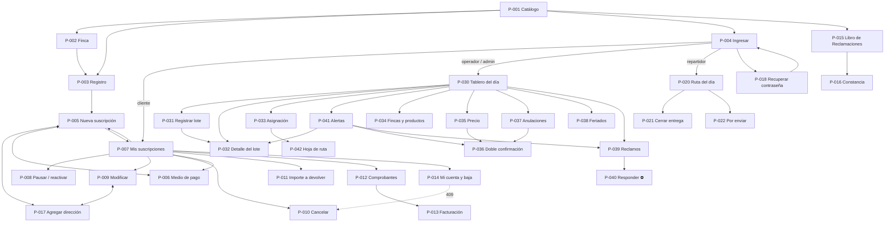

# UI Specification — Muuvi
**Versión:** 0.2.1 (borrador)
**Fecha:** 14/11/2026
**Autor:** Agente UI Designer (BMAD)
**Estado:** Pendiente de revisión humana
**Fuentes:** [`00-constitucion.md`](00-constitucion.md) · [`06-user-stories-refinadas.md`](06-user-stories-refinadas.md) v0.4.0 · [`07-architecture.md`](07-architecture.md) v1.2.0 · [`02-alcance.md`](02-alcance.md) · [`03-reglas-de-negocio.md`](03-reglas-de-negocio.md) v0.9.0 · [`10-validation-log.md`](10-validation-log.md) · [`adr/ADR-002-excepcion-idioma-mvp.md`](adr/ADR-002-excepcion-idioma-mvp.md)
**Cambios en v0.2.0:** subsanación de OBS-01 a OBS-34 de `10-validation-log.md` (14/11/2026).
- Pantallas nuevas: **P-017** Agregar dirección, **P-018** Recuperar contraseña y **P-042** Hoja de ruta imprimible.
- Varias suscripciones por cliente en P-005 y P-007.
- Vistas previas calculadas por el backend.
- Estados de pago y de entrega en P-007.
- Recepción del día y pedido por finca en P-030 y P-031.
- Lectura alta en la puerta en P-021.
- Efectos de la anulación en P-036 y P-037.
- Nueva §8, de plantillas de correo.

La copia que circuló como «1.0.0» corresponde a la v0.1.0 sin las secciones 6 y 7; esta versión es la vigente.
**Cambios en v0.2.1:** el fundador aprobó el 14/11/2026 las reglas propuestas (G7) y resolvió K8 con RN-185, así que se retiran sus marcas ⏳. Desde ahora ⏳ solo marca lo que depende de una HU aún no aprobada (HU-017 y HU-018), y ⚠️, lo que espera al contador (RN-168 a RN-172).

> **Supuestos de diseño (sin necesidad de preguntar, porque los resuelve el Spec Pack):**
> - **Idioma:** el PRINCIPIO-001 pide una interfaz bilingüe, pero el **ADR-002** (aceptado) limita el PMV a **es-PE**. Todo texto visible sale de `src/locales/es-PE.json` mediante claves (`t('…')`), de modo que agregar `en.json` después no obliga a tocar componentes. En esta especificación, los textos se escriben en español junto a su clave, por ejemplo `«Suscribirme»` `[t: suscripcion.cta]`.
> - **Textos legales:** los consentimientos, el texto del Libro de Reclamaciones y las condiciones los redacta un humano (PRINCIPIO-008.9). Aquí figuran como `[TEXTO LEGAL: clave]`.
> - **Formatos:** montos `S/ 1,250.50`, negativos `-S/ 43.50`, fechas `DD/MM/AAAA` y horas en `America/Lima` (PRINCIPIO-011, RN-037, RN-038 y RN-110). La API entrega los montos como texto decimal y la PWA solo les da formato, sin calcular.
> - **Dispositivos:** el diseño parte del móvil, a 360 × 640 px (Android 9 con Chrome, iOS 15 con Safari). El módulo de operación también se diseña para tableta y escritorio (≥ 768 px).
> - **Pendientes que afectan a pantallas:**
>   - **K10** (avisos transaccionales fuera de la ventana horaria);
>   - **P14** (aviso de cambio de precio, P-035);
>   - la **HU-016** (bloqueada por el asesor legal, P-040).
>
>   Además faltan aprobar dos HU: la **HU-017** (P-002 y P-034) y la **HU-018** (P-018). K9 se resolvió el 14/11/2026 con la hoja de ruta impresa (P-042). Cada pantalla afectada lo marca con ⛔ o ⏳.

---

## Índice
1. [Inventario de pantallas](#1-inventario-de-pantallas)
2. [User flows](#2-user-flows)
3. [Screen specs](#3-screen-specs)
4. [Design tokens](#4-design-tokens)
5. [Navigation map](#5-navigation-map)
6. [Componentes comunes](#6-componentes-comunes)
7. [Pendientes y trazabilidad](#7-pendientes-y-trazabilidad)
8. [Plantillas de correo](#8-plantillas-de-correo)

---

## 1. Inventario de pantallas

Todas las HU del PMV son Must, así que las 34 pantallas también lo son. Las funciones Should y Could del alcance (F-S01 a F-S05 y F-C01 a F-C04) no tienen HU, por lo que **no se especifican pantallas para ellas** (restricción: cada pantalla traza al menos a una HU). Se listan al final de la sección como pantallas futuras.

### 1.1 Módulo cliente y público (C1 y C4)
| ID | Pantalla | Ruta | Actor principal | HU | MoSCoW |
|---|---|---|---|---|---|
| P-001 | Catálogo (inicio) | `/` | Visitante, cliente | HU-003 | Must |
| P-002 | Ficha de la finca | `/fincas/:id` | Visitante, cliente | HU-003, HU-017 | Must |
| P-003 | Registro de cuenta | `/registro` | Visitante | HU-001 | Must |
| P-004 | Iniciar sesión | `/ingresar` | Cliente, personal interno | HU-001, HU-018 (acceso a todas) | Must |
| P-005 | Nueva suscripción (3 pasos) | `/suscripcion/nueva` | Cliente | HU-004 | Must |
| P-006 | Medio de pago | `/cuenta/medio-de-pago` | Cliente | HU-007 | Must |
| P-007 | Mis suscripciones (panel) | `/cuenta` | Cliente | HU-004, HU-005, HU-006, HU-007, HU-009 | Must |
| P-008 | Pausar o reactivar | `/cuenta/suscripciones/:id/pausa` | Cliente | HU-005 | Must |
| P-009 | Modificar suscripción | `/cuenta/suscripciones/:id/editar` | Cliente | HU-006 | Must |
| P-010 | Cancelar suscripción | `/cuenta/suscripciones/:id/cancelar` | Cliente | HU-006 | Must |
| P-011 | Importe a devolver | `/cuenta/devoluciones/:id` | Cliente | HU-009, HU-007 | Must |
| P-012 | Mis comprobantes | `/cuenta/comprobantes` | Cliente | HU-008 | Must |
| P-013 | Datos de facturación | `/cuenta/facturacion` | Cliente | HU-008 | Must |
| P-014 | Mi cuenta y baja | `/cuenta/datos` | Cliente | HU-002 | Must |
| P-015 | Libro de Reclamaciones | `/libro-de-reclamaciones` | Consumidor, con o sin cuenta | HU-012 | Must |
| P-016 | Constancia del reclamo | `/libro-de-reclamaciones/constancia` | Consumidor | HU-012 | Must |
| P-017 | Agregar dirección (v0.2.0) | `/cuenta/direcciones/nueva` | Cliente | HU-004, HU-006 | Must |
| P-018 | Recuperar contraseña (v0.2.0) | `/recuperar` y `/recuperar/nueva` | Cliente, personal interno | HU-018 ⏳ | Must |

### 1.2 Módulo reparto (C3, funciona sin conexión)
| ID | Pantalla | Ruta | Actor principal | HU | MoSCoW |
|---|---|---|---|---|---|
| P-020 | Ruta del día | `/reparto` | Repartidor | HU-011 | Must |
| P-021 | Cerrar entrega | `/reparto/entregas/:id` | Repartidor | HU-011 | Must |
| P-022 | Sincronización pendiente | `/reparto/sincronizacion` | Repartidor | HU-011 | Must |

### 1.3 Módulo operación (C2, carga diferida por rol)
| ID | Pantalla | Ruta | Actor principal | HU | MoSCoW |
|---|---|---|---|---|---|
| P-030 | Tablero del día | `/operacion` | Operador, administrador titular | HU-010 | Must |
| P-031 | Registrar lote | `/operacion/lotes/nuevo` | Operador, administrador titular | HU-010 | Must |
| P-032 | Detalle del lote y corrección | `/operacion/lotes/:id` | Operador, administrador titular | HU-010 | Must |
| P-033 | Asignación del día | `/operacion/dias/:fecha/asignacion` | Operador, administrador titular | HU-010, HU-011 | Must |
| P-034 | Fincas y productos | `/operacion/fincas` | Operador, administrador titular | HU-017 ⏳ | Must |
| P-035 | Precio por litro | `/operacion/precio` | Operador, administrador titular | HU-013 | Must |
| P-036 | Doble confirmación | `/operacion/confirmaciones/:id` | Administrador titular | HU-013, HU-014 | Must |
| P-037 | Anulaciones | `/operacion/anulaciones` | Administrador titular | HU-014 | Must |
| P-038 | Feriados | `/operacion/feriados` | Operador, administrador titular | HU-015 | Must |
| P-039 | Bandeja de reclamos | `/operacion/reclamos` | Operador, administrador titular | HU-012, HU-016 | Must |
| P-040 | Responder reclamo | `/operacion/reclamos/:codigo` | Operador, administrador titular | HU-016 ⛔ | Must |
| P-041 | Alertas internas | `/operacion/alertas` (y panel en `/reparto`) | Operador, administrador titular, repartidor | HU-010, HU-011, HU-008, HU-009, HU-012, HU-015 | Must |
| P-042 | Hoja de ruta imprimible (v0.2.0) | `/operacion/dias/:fecha/hoja-ruta/:repartidor` | Operador, administrador titular | HU-010, HU-011 | Must |

**Sin pantalla, a propósito:** el alta de usuarios internos (operadores, administradores y repartidores) la hace un humano con el comando de administración del backend (RN-176, OBS-25).

### 1.4 Pantallas futuras (sin HU: no se especifican)
| Función del alcance | MoSCoW | Qué falta para diseñarla |
|---|---|---|
| F-S01 Pedido puntual y plan mensual | Should | HU y reglas de cobro mensual |
| F-S02 Avisos por WhatsApp o push (preferencias de aviso) | Should | HU; decisión K10 |
| F-S03 Trazabilidad por lote para el cliente (RN-044) | Should | HU |
| F-S04 Depósito de garantía por botella | Should | Monto de la garantía y HU |
| F-S05 Pasarelas adicionales | Should | Solo cambia P-006: se agregan opciones a la misma pantalla |
| F-C01 a F-C04 (portal de la finca, referidos, bienestar animal, encuesta) | Could | HU |
| Consulta pública del estado de un reclamo por código y correo (OBS-34) | Mejora | HU futura |
| Rectificación de datos y retiro del consentimiento de terceros desde la PWA (OBS-26) | Must legal por confirmar | Dictamen del asesor legal sobre los derechos de la Ley 29733 y su HU; mientras tanto, P-014 muestra un canal de contacto |

---

## 2. User flows

Notación: `P-NNN` es una pantalla, `→` es la acción que lleva a la siguiente, y `⟂` es una salida de error o alternativa.

### F-01 · Conocer la leche y suscribirse (HU-003, HU-001, HU-004, HU-007)
| # | Pantalla | Acción del usuario | Resultado |
|---|---|---|---|
| 1 | P-001 Catálogo | Mira el producto, el precio `S/ 14.50 por litro` y la finca; toca «Ver la finca» | Va a P-002 |
| 2 | P-002 Ficha de la finca | Lee la provincia y la certificación SENASA; toca «Suscribirme» | Sin sesión: va a P-003 con `?volver=/suscripcion/nueva?producto=8`. Con sesión: va a P-005 con ese producto elegido (OBS-27) |
| 3 | P-003 Registro (o P-004 si ya tiene cuenta) | Completa sus datos, marca el consentimiento principal (y, si quiere, el de terceros) y elige un distrito; si elige factura, escribe su RUC | 201: se inicia la sesión y va al destino `volver` (P-005). ⟂ 422 RN-001, RN-005 o RN-114, o 409 RN-154: el error se muestra en el campo |
| 4 | P-005 Paso 1 | Elige el producto (si hay más de uno), los litros (entero ≥ 1) y el día (martes, jueves o sábado) | Ve el importe estimado que devuelve `POST /suscripciones/simulacion` (RN-184) |
| 5 | P-005 Paso 2 | Elige la dirección (o «Agregar dirección» → P-017) y el medio de pago; si no tiene medio, toca «Agregar medio de pago» | Va a P-017 o a P-006 y vuelve al paso 2 |
| 6 | P-006 Medio de pago | Tarjeta (formulario de Culqi, que tokeniza) o autorización de Yape o Plin | Vuelve a P-005 con el medio elegido |
| 7 | P-005 Paso 3 | Revisa el resumen de la simulación (importe, franja 07:00–10:00, primera entrega y primer cobro) y toca «Confirmar suscripción» | 201: va a P-007 con el aviso «Tu primera entrega es el sábado 21/11/2026». ⟂ 422 RN-179: vuelve al paso 2 con «Agrega un medio de pago» |

### F-02 · Pausar y reactivar (HU-005)
P-007 → tarjeta de una suscripción → «Pausar» → P-008. Ahí elige «Por entregas» (N ≥ 1) o «Indefinida», ve qué entregas se omiten (`POST /suscripciones/{id}/simulaciones`, que aplica el corte de las 18:00:00) y toca «Confirmar pausa» → P-007, con el estado «Pausada hasta el 28/11/2026». Para reactivar: P-007 → «Reactivar» → P-008 (modo reactivación), donde ve la primera entrega, y toca «Reactivar» → P-007.

### F-03 · Modificar o cancelar (HU-006)
P-007 → tarjeta de una suscripción → «Cambiar litros, día o dirección» → P-009, donde ve desde qué entrega aplica el cambio (simulación del backend), y toca «Guardar cambio» → P-007. Para otra dirección: P-009 → «Agregar dirección» → P-017 → vuelve a P-009 con la dirección nueva elegida.
P-007 → «Cancelar suscripción» → P-010, donde ve qué pasa con la próxima entrega y con su saldo a favor, y toca «Sí, cancelar» → P-007, en estado «Cancelada».

### F-04 · Cobro rechazado (HU-007)
El cliente recibe el correo (RN-049) y abre P-007, que muestra el banner de error «No pudimos cobrar tu entrega del 14/11/2026». Toca «Actualizar medio de pago» → P-006 → registra el medio → P-007, con el banner de éxito «Tu suscripción está activa. Próximo cobro: viernes 20/11/2026, 18:00».

### F-05 · Elegir qué hacer con un importe a devolver (HU-009, HU-007)
El cliente recibe un correo o ve en P-007 el banner «Tienes S/ 43.50 por devolver». Toca «Elegir» → P-011, elige «Reembolso» o «Saldo a favor» y confirma. Vuelve a P-007 con el aviso del resultado.
⟂ Si ya pasaron las 72 h, P-011 muestra «El reembolso automático ya está en curso» (`409 RN-181`).

### F-06 · Comprobantes y facturación (HU-008)
P-007 → «Mis comprobantes» → P-012 → descarga el PDF.
P-012 → «Datos de facturación» → P-013 → elige factura, ingresa el RUC y toca «Guardar» → P-012.

### F-07 · Darse de baja (HU-002)
P-007 → «Mi cuenta» → P-014 → «Dar de baja mi cuenta». El sistema puede responder de dos formas:
- **409:** P-014 muestra cada pendiente que bloquea la baja (los 4 de RN-098), con su acción o con la fecha en que se libera (por ejemplo, «Cancelar suscripción» → P-010, o «Podrás darte de baja después de tu entrega del sábado 14/11/2026»).
- **200:** P-014 confirma la baja, informa el plazo de anonimización y el reembolso del saldo, y cierra la sesión → P-001.

### F-08 · Registrar un reclamo (HU-012)
Desde cualquier pantalla, menú → «Libro de Reclamaciones» → P-015, sin sesión. El consumidor completa el formulario y toca «Enviar» → P-016, que muestra el código `LR-2026-000017`, la fecha límite `07/12/2026` y el correo enmascarado.

### F-09 · Mañana de operación (HU-010, HU-011)
| # | Pantalla | Acción | Resultado |
|---|---|---|---|
| 0 | P-030 Tablero (viernes, después del corte de las 18:00) | Ve la demanda del sábado (100 L) y la reparte entre las fincas: 70 L a Santa Rosa y 30 L a La Ponderosa | `PUT …/pedidos-finca`. ⟂ 422 RN-159 si la suma no es 100 L |
| 1 | P-030 Tablero del día | Ve la demanda, los pedidos por finca y los lotes esperados; toca «Registrar lote» | Va a P-031 |
| 2 | P-031 Registrar lote | Ingresa el código, la finca (lo comprometido sale de su pedido), el producto, los litros recibidos y la temperatura con 1 decimal | 201 `recibido` → P-030. 201 `en_revision` → P-032 con la cuenta regresiva de 15:00. Si faltan litros, solo una **advertencia** (RN-157). ⟂ 422 RN-087: el error se muestra en el campo |
| 2b | P-030 | Cuando llegaron todos los lotes, toca «Cerrar recepción del día» y confirma en E-08 | Recién ahora las entregas sin leche pasan a `fallida` por escasez (RN-092 y RN-122). A las 06:45 sin cierre llega una alerta crítica (RN-158) |
| 3 | P-032 Detalle del lote | Si está en revisión: el operador registra una corrección con justificación (no revierte); el administrador titular corrige y revierte antes de los 900 s | Lote `recibido` o, a los 900 s, `invalidado`, con su resumen de efectos |
| 4 | P-033 Asignación | Revisa la propuesta (lote, repartidor y orden), la ajusta y toca «Confirmar asignación» | Las entregas quedan listas para salir a ruta |
| 5 | P-033 → P-042 | Toca «Imprimir hoja de ruta» por cada repartidor y le entrega la hoja impresa | La impresión queda en la auditoría (RN-155) |

### F-10 · Ruta del repartidor, con o sin señal (HU-011)
| # | Pantalla | Acción | Resultado |
|---|---|---|---|
| 0 | (fuera de la PWA) | Recibe del operador la hoja de ruta impresa (P-042) | La dirección y la referencia de cada parada están en papel (RN-155) |
| 1 | P-020 Ruta del día | Toca «Salir a ruta» | Sus entregas pasan a `en_ruta`; sin señal, la salida queda en la cola |
| 2 | P-020 | Toca la entrega n.º 1 | Va a P-021 |
| 3 | P-021 Cerrar entrega | Mide la temperatura. Si es ≤ 4.5 °C, elige «Entregada» (con botellas devueltas) o «Fallida» (con causa) y toca «Guardar cierre» | Vuelve a P-020 con la entrega marcada. Sin señal, el cierre queda «Pendiente de enviar». ⟂ Con más de 4.5 °C solo puede tocar «Registrar temperatura alta»: no entrega la botella y la entrega queda «Retenida» en P-020 (RN-156) |
| 4 | P-022 Sincronización | Al volver la señal, la cola se envía en orden; puede tocar «Enviar ahora» | Cada elemento muestra `aplicado`, `duplicado` o `rechazado`, con su motivo |

### F-11 · Cambiar el precio con doble confirmación (HU-013)
P-035: el operador propone `S/ 15.00` y toca «Enviar para confirmar». El administrador titular recibe una alerta (P-041) y abre P-036. Ahí reingresa su contraseña, recibe el código por correo y lo ingresa dentro de los 300 s. P-035 muestra entonces el precio vigente nuevo.
⟂ Si el código vence o se ingresa mal 3 veces, P-036 muestra «Solicitud cancelada» y el precio no cambia.

### F-12 · Anular un registro (HU-014)
P-037: el administrador busca el pago `5521`, ve la lista de **efectos** de la anulación (RN-168 a RN-172, de `POST /operacion/anulaciones/simulacion`), escribe el motivo y toca «Continuar» → P-036, que repite los efectos antes de los dos pasos → P-037 muestra «Anulado» con el enlace a la auditoría.

### F-13 · Fincas y productos (HU-017 ⏳)
P-034 → «Nueva finca» (nombre, provincia y SENASA) → «Nuevo producto» (nombre y DIGESA) → «Publicar». ⟂ Sin registro DIGESA, el botón «Publicar» queda deshabilitado, con su explicación (RN-009).

### F-14 · Feriados (HU-015)
P-038 → «Agregar feriado» (fecha, descripción y norma de El Peruano) → **vista previa** «Trasladará 14 entregas al jueves 10/12/2026» → «Guardar». ⟂ 422 RN-173 si el corte de esa fecha ya ocurrió. Para corregir un error, el administrador titular toca «Retirar» → E-08 → las entregas vuelven a su fecha y se avisa a los clientes (RN-174).

### F-15 · Atender un reclamo (HU-012, HU-016 ⛔)
P-041 (alerta del día 10) o P-039 → abre un reclamo → P-040 → escribe la respuesta → «Enviar respuesta». ⛔ El envío queda deshabilitado hasta que el asesor legal valide RN-146 a RN-149.

### F-16 · Recuperar la contraseña (HU-018 ⏳)
P-004 → «¿Olvidaste tu contraseña?» → P-018 (modo solicitar) → escribe su correo → «Enviar enlace» → siempre ve «Si el correo tiene una cuenta, te enviamos un enlace» (RN-165). Abre el correo CO-16 → P-018 (modo nueva contraseña) → escribe la nueva dos veces → «Guardar» → P-004 con «Tu contraseña cambió. Cerramos tus otras sesiones» (RN-167). ⟂ Enlace vencido o usado: «El enlace venció. Pide uno nuevo» (RN-166).

### F-17 · Aprobar el cobro semanal con Yape o Plin (HU-007)
Viernes 18:00:00: se inicia el cobro → a las 18:00:30 llega el correo CO-02 y P-007 muestra el banner «Aprueba tu pago de S/ 43.50 en Yape antes de las 18:30» (RN-164) → el cliente aprueba en su app → P-007 pasa a «Pago confirmado». ⟂ Sin aprobación a las 18:30, la entrega se suspende (RN-074) y P-007 muestra el banner de error con «Actualizar medio de pago».

---

## 3. Screen specs

**Convenciones de todos los wireframes:**
- `[ Botón ]` es un botón de 48 px de alto; `( ) Opción` es una opción de radio; `[x]` y `[ ]` son casillas; `▼` es un selector; `____` es un campo de texto.
- `«…»` es un texto visible, con su clave de traducción `[t: …]` la primera vez que aparece. `⓵ ⓶ ⓷` marcan zonas del layout.
- Ancho de referencia: **360 px en móvil**, con márgenes de 16 px. En el módulo de operación, **1024 px**, con columnas que se apilan por debajo de 768 px.
- Cada pantalla tiene los estados **carga** (esqueleto, sin spinner bloqueante), **error de red** (componente E-06) y **sin conexión** (E-07). Solo se detallan cuando cambian algo.
- Orden de tabulación = orden visual. Cada pantalla tiene un `<h1>` único y regiones con `<header>`, `<nav>`, `<main>` y `<footer>`.

### 3.1 Módulo cliente y público

#### P-001 · Catálogo (inicio)
| Campo | Detalle |
|---|---|
| **Propósito** | Mostrar la leche disponible, su precio y su finca de origen, y llevar a la suscripción |
| **Actor** | Visitante sin cuenta y cliente |
| **HU** | HU-003 |
| **Datos (API)** | `GET /catalogo`: productos publicados, con nombre, volumen, finca, provincia, `precio_litro` (texto decimal) y `organico` |
| **Acciones** | «Ver la finca» → P-002 · «Suscribirme» → P-005 con ese producto (sin sesión, pasa antes por P-003 o P-004 con `?volver=`) · menú → P-015 |
| **Reglas** | RN-009 (solo productos con DIGESA), RN-010 (la etiqueta "Orgánico" solo aparece con SENASA vigente), RN-011 (precio de la configuración), RN-033 (Libro de Reclamaciones en el menú), RN-037 (formato de monto), RN-178 (catálogo vacío) |

```text
┌──────────────────────────────────────┐ 360 px
│ ⓵ E-01 ENCABEZADO                    │
│ [☰ Menú]   MUUVI (logo, alt="Muuvi") │
│                          [Ingresar]  │
├──────────────────────────────────────┤
│ ⓶ HERO                               │
│ <h1> «Leche fresca de finca, cada    │
│      semana en tu puerta»            │
│      [t: catalogo.titulo]            │
│ «Miraflores · San Isidro · La Molina»│
│      [t: catalogo.cobertura]         │
├──────────────────────────────────────┤
│ ⓷ LISTA DE PRODUCTOS (1 tarjeta      │
│    por producto, en columna)         │
│ ┌──────────────────────────────────┐ │
│ │ [imagen botella 1 L]             │ │
│ │  alt=«Botella de vidrio de 1 L»  │ │
│ │ <h2> «Leche fresca 1 L»          │ │
│ │ [Orgánico] ← etiqueta, solo si   │ │
│ │             organico = true      │ │
│ │ «Finca Santa Rosa · Huaral»      │ │
│ │ «S/ 14.50 por litro» (texto L)   │ │
│ │ «Entrega martes, jueves o sábado │ │
│ │  de 07:00 a 10:00»               │ │
│ │ [ Ver la finca ] (secundario)    │ │
│ │ [ Suscribirme ]  (primario, 100%)│ │
│ └──────────────────────────────────┘ │
├──────────────────────────────────────┤
│ ⓸ CÓMO FUNCIONA (3 pasos con ícono   │
│    decorativo aria-hidden)           │
│ 1 «Elige litros y día»               │
│ 2 «Pagamos cada semana a las 18:00   │
│    del día previo»                   │
│ 3 «Recibes tu leche y devuelves      │
│    las botellas»                     │
├──────────────────────────────────────┤
│ ⓹ E-02 PIE: Libro de Reclamaciones · │
│    Privacidad · Términos             │
└──────────────────────────────────────┘
```
**Estados:**
- **Sin productos** (RN-178, antes SR-04): `«Por ahora no hay leche disponible. Vuelve pronto.»` `[t: catalogo.vacio]`, sin botón «Suscribirme».
- **503 sin precio configurado:** `«Estamos preparando el catálogo.»` `[t: errores.catalogo.precio_no_configurado]`. Nunca se muestra un precio inventado.

**Accesibilidad:** la tarjeta no es un enlace entero (evita anuncios redundantes); la etiqueta «Orgánico» es texto, no solo color; el precio se anuncia como «14 soles con 50 céntimos por litro» mediante `aria-label`.

---

#### P-002 · Ficha de la finca
| Campo | Detalle |
|---|---|
| **Propósito** | Dar confianza: de dónde viene la leche y con qué certificaciones |
| **Actor** | Visitante y cliente |
| **HU** | HU-003, HU-017 ⏳ (los datos los registra el operador) |
| **Datos** | Nombre, provincia (Cañete o Huaral), código y vencimiento SENASA, productos publicados y registro DIGESA de cada uno |
| **Acciones** | «Suscribirme» · «Volver al catálogo» |
| **Reglas** | RN-010: si el vencimiento SENASA es anterior a hoy en Lima, no se muestra "Orgánico" y la certificación aparece como «No vigente» |

```text
┌──────────────────────────────────────┐
│ E-01 ENCABEZADO   [← Volver]         │
├──────────────────────────────────────┤
│ <h1> «Finca Santa Rosa»              │
│ «Provincia de Huaral, Lima»          │
│ [Orgánico] (solo si SENASA vigente)  │
├──────────────────────────────────────┤
│ <h2> «Certificaciones»               │
│ ┌──────────────────────────────────┐ │
│ │ SENASA  «PE-ORG-0123»            │ │
│ │ «Vigente hasta 30/11/2026»       │ │
│ │  ó «No vigente desde 01/12/2026» │ │
│ └──────────────────────────────────┘ │
│ <h2> «Productos de esta finca»       │
│ • «Leche fresca 1 L · DIGESA         │
│    N.º A1234567N»                    │
├──────────────────────────────────────┤
│ [ Suscribirme ] (primario, 100 %)    │
└──────────────────────────────────────┘
```

---

#### P-003 · Registro de cuenta
| Campo | Detalle |
|---|---|
| **Propósito** | Crear la cuenta de un mayor de 18 años de un distrito atendido, con consentimientos separados |
| **Actor** | Visitante |
| **HU** | HU-001 |
| **Datos que envía** | `POST /clientes`: nombre, correo, teléfono, fecha de nacimiento, contraseña, dirección (línea, referencia y distrito), consentimientos (`principal`, `terceros`, `version_texto`) y tipo de comprobante |
| **Acciones** | «Crear cuenta» · «Ya tengo cuenta» → P-004 (conserva `?volver=`) |
| **Reglas** | RN-001 (≥ 18 años en Lima), RN-002 (fecha de nacimiento obligatoria), RN-003 y RN-004 (casillas separadas y **desmarcadas**), RN-005 (3 distritos), RN-114 (el principal es obligatorio), RN-115 (el texto nombra a los encargados), RN-116 (el de terceros es opcional), RN-154 (correo ya registrado) |

```text
┌──────────────────────────────────────┐
│ E-01 ENCABEZADO   [← Volver]         │
├──────────────────────────────────────┤
│ <h1> «Crea tu cuenta»                │
│ E-05 resumen de errores (aparece     │
│      arriba si el envío falla; recibe│
│      el foco y enlaza a cada campo)  │
├──────────────────────────────────────┤
│ ⓵ DATOS PERSONALES  <fieldset>       │
│ «Nombre completo» ________________   │
│ «Correo» __________________ (email)  │
│ «Celular» +51 _____________ (tel)    │
│ «Fecha de nacimiento»                │
│   [DD]/[MM]/[AAAA]  (3 campos        │
│   numéricos, ayuda: «Debes ser mayor │
│   de 18 años»)                       │
│ «Contraseña» ___________ [👁 Mostrar]│
│   ayuda: «Mínimo 10 caracteres»      │
├──────────────────────────────────────┤
│ ⓶ DIRECCIÓN DE ENTREGA  <fieldset>   │
│ «Distrito» ▼ (Miraflores |           │
│   San Isidro | La Molina) — lista    │
│   cerrada                            │
│ «Dirección» ______________________   │
│ «Referencia (opcional)» __________   │
│ nota: «Por ahora solo repartimos en  │
│   estos 3 distritos»                 │
├──────────────────────────────────────┤
│ ⓷ COMPROBANTE                        │
│ ( ) Boleta (marcada por defecto)     │
│ ( ) Factura → aparece «RUC» ________ │
│     (11 dígitos; se guarda con PATCH │
│     /clientes/me/facturacion tras el │
│     201, RN-058)                     │
├──────────────────────────────────────┤
│ ⓸ CONSENTIMIENTOS  <fieldset>        │
│ [ ] [TEXTO LEGAL:                    │
│      consentimiento.principal]       │
│     «(Obligatorio)»                  │
│     [Ver texto completo] → panel     │
│      desplegable                     │
│ [ ] [TEXTO LEGAL:                    │
│      consentimiento.terceros]        │
│     «(Opcional)»                     │
├──────────────────────────────────────┤
│ [ Crear cuenta ] (primario, 100 %)   │
│ «¿Ya tienes cuenta?» [Ingresar]      │
└──────────────────────────────────────┘
```
**Errores por campo** (texto debajo del campo, en color de error y con ícono, enlazado con `aria-describedby`):

| Respuesta | Campo | Mensaje |
|---|---|---|
| 422 RN-001 | Fecha de nacimiento | `«Debes ser mayor de 18 años para registrarte.»` `[t: errores.cuenta.menor_de_edad]` |
| 400 RN-002 | Fecha de nacimiento | `«Ingresa tu fecha de nacimiento.»` |
| 422 RN-005 | Distrito | `«Aún no repartimos en ese distrito.»` |
| 422 RN-114 | Casilla principal | `«Necesitamos tu consentimiento para darte el servicio.»` |
| 409 RN-154 | Correo | `«Este correo ya tiene una cuenta.»` `[t: errores.cuenta.correo_registrado]`, con el enlace [Ingresar] |
| 422 RN-058 | RUC (si eligió factura) | `«El RUC debe tener 11 dígitos.»` La cuenta ya quedó creada: el RUC se puede corregir en P-013 |
| 429 | Formulario | `«Hiciste muchos intentos. Espera un minuto.»` |

**Tras el 201:** va al destino de `?volver=` (por ejemplo P-005 con el producto elegido) o, si no hay, a P-005. El parámetro solo acepta rutas internas de la PWA (OBS-27).

**Accesibilidad:** las casillas nunca vienen marcadas; cada una tiene un `label` propio que el lector de pantalla anuncia completo, y cada `<fieldset>` tiene `<legend>`. La fecha usa 3 campos numéricos (`inputmode="numeric"`) en lugar del selector nativo, que en Android 9 es poco accesible.

---

#### P-004 · Iniciar sesión
| Campo | Detalle |
|---|---|
| **Propósito** | Dar acceso al cliente y al personal interno, y redirigir según el rol |
| **Actor** | Cliente, operador, administrador titular, repartidor |
| **HU** | HU-001, HU-018 (y acceso a todas) |
| **Datos** | `POST /sesiones` con correo y contraseña → JWT de 900 s más una cookie de renovación |
| **Acciones** | «Ingresar» · «¿Olvidaste tu contraseña?» → P-018 · «Crear cuenta» → P-003 |
| **Reglas** | RN-099: la redirección depende del rol: `cliente` → `?volver=` si existe, si no P-007; `operador` o `administrador_titular` → P-030; `repartidor` → P-020 |

```text
┌──────────────────────────────────────┐
│ E-01 ENCABEZADO                      │
├──────────────────────────────────────┤
│ <h1> «Ingresa a Muuvi»               │
│ «Correo» __________________          │
│ «Contraseña» ______ [👁 Mostrar]     │
│ [ Ingresar ] (primario, 100 %)       │
│ E-05 error 401: «Correo o contraseña │
│   incorrectos.» (genérico)           │
│ [¿Olvidaste tu contraseña?] → P-018  │
│ [Crear cuenta]                       │
└──────────────────────────────────────┘
```

---

#### P-005 · Nueva suscripción (asistente de 3 pasos)
| Campo | Detalle |
|---|---|
| **Propósito** | Elegir producto, litros, día, dirección y medio de pago, y ver el importe y la primera entrega antes de confirmar. Un cliente puede tener varias suscripciones (RN-160) |
| **Actor** | Cliente |
| **HU** | HU-004 |
| **Datos** | `GET /catalogo` (productos y precio), `GET /direcciones` y medios de pago del cliente; **`POST /suscripciones/simulacion`** en los pasos 1 y 3 (`importe_ciclo`, `franja`, `primera_entrega`, `primer_corte_y_cobro`, `traslado_feriado`), sin guardar nada; `POST /suscripciones` al confirmar |
| **Acciones** | «Siguiente» · «Atrás» · «Agregar dirección» → P-017 · «Agregar medio de pago» → P-006 · «Confirmar suscripción» |
| **Reglas** | RN-015 (franja única), RN-016 (1 día), RN-017 (litros enteros ≥ 1, sin máximo), RN-018 (importe), RN-061 (martes, jueves y sábado), RN-084 (primera entrega: corte exclusivo a las 18:00:00), RN-123 (traslado por feriado), RN-160 (varias suscripciones), RN-161 (1 producto), RN-179 (medio obligatorio), RN-184 (vista previa del backend) |

```text
┌──────────────────────────────────────┐
│ E-01 ENCABEZADO   [✕ Salir]          │
│ Indicador de pasos: «Paso 1 de 3»    │
│ ●──○──○  (aria-current="step")       │
├──────────────────────────────────────┤
│ PASO 1 · <h1> «¿Cuánta leche y qué   │
│ día?»                                │
│ «Producto» (solo si hay más de 1     │
│  publicado) <fieldset>               │
│ (•) Leche fresca 1 L · Santa Rosa    │
│ ( ) Leche fresca 1 L · La Ponderosa  │
│ «Litros por semana»                  │
│ [ − ]  [  3  ]  [ + ]  (stepper,     │
│   mínimo 1, solo enteros; cada botón │
│   de 48×48)                          │
│ «Día de entrega» <fieldset>          │
│ ( ) Martes  ( ) Jueves  ( ) Sábado   │
│   (lunes, miércoles, viernes y       │
│    domingo no se ofrecen)            │
│ ┌ Resumen en vivo ───────────────┐   │
│ │ «S/ 43.50 por entrega» (lo da  │   │
│ │  la simulación; aria-live=     │   │
│ │  "polite")                     │   │
│ └────────────────────────────────┘   │
│ [ Siguiente ]                        │
├──────────────────────────────────────┤
│ PASO 2 · <h1> «Dirección y pago»     │
│ «Dirección» ( ) Calle Ficticia 123,  │
│   San Isidro                         │
│ [+ Agregar dirección] → P-017        │
│ «Medio de pago»                      │
│ ( ) Tarjeta •••• 4242                │
│ ( ) Yape                             │
│ [+ Agregar medio de pago] → P-006    │
│ [ Atrás ] [ Siguiente ]              │
├──────────────────────────────────────┤
│ PASO 3 · <h1> «Revisa y confirma»    │
│ ┌──────────────────────────────────┐ │
│ │ «3 litros cada sábado»           │ │
│ │ «Franja: 07:00 a 10:00»          │ │
│ │ «Importe por entrega: S/ 43.50»  │ │
│ │ «Primera entrega: sábado         │ │
│ │  21/11/2026»                     │ │
│ │ «Primer cobro: viernes           │ │
│ │  20/11/2026, 18:00»              │ │
│ │ «Pagas con: Tarjeta •••• 4242»   │ │
│ └──────────────────────────────────┘ │
│ ⓘ «Puedes pausar o cancelar antes de │
│   las 18:00 del día previo a cada    │
│   entrega.» [t: comun.antes_corte]   │
│ ⓘ (si eligió Yape o Plin) «Cada      │
│   viernes a las 18:00 te pediremos   │
│   aprobar el pago en tu app.»        │
│ [ Atrás ] [ Confirmar suscripción ]  │
└──────────────────────────────────────┘
```
**Reglas de la interfaz:**
- La PWA **no calcula** importes ni fechas: el paso 1 y el paso 3 muestran lo que devuelve `POST /suscripciones/simulacion`, que usa las mismas reglas que la creación (RN-184). Si la simulación y la confirmación difieren (por ejemplo, pasó el corte mientras el cliente revisaba), la respuesta del `201` manda y P-007 muestra las fechas reales.
- Sin medio de pago activo (RN-179, antes SR-05), el botón «Siguiente» del paso 2 queda deshabilitado con el texto `«Agrega un medio de pago para continuar»`; la API también lo rechaza con `422 RN-179`.
- Si el cliente ya tiene suscripciones, el paso 3 agrega `«Esta es una suscripción adicional. Tus otras suscripciones no cambian.»` (RN-160).
- Si la primera entrega se trasladó por feriado, el resumen agrega: `«Tu entrega del martes 08/12/2026 pasa al jueves 10/12/2026 por feriado.»`

**Accesibilidad:** al cambiar de paso, el foco va al `<h1>` del paso; el stepper usa `role="spinbutton"` con `aria-valuemin="1"`.

---

#### P-006 · Medio de pago
| Campo | Detalle |
|---|---|
| **Propósito** | Registrar una tarjeta (tokenizada por Culqi) o autorizar Yape o Plin, sin que el backend vea datos de tarjeta |
| **Actor** | Cliente |
| **HU** | HU-007 |
| **Datos que envía** | `POST /medios-pago` con `{ tipo, token_pasarela, ultimos_4 }` |
| **Acciones** | Elegir tipo · «Guardar medio de pago» |
| **Reglas** | RN-019 (solo tarjeta, Yape o Plin, ADR-001), RN-020 y PRINCIPIO-004 (los campos de la tarjeta viven **dentro del formulario o SDK de Culqi**, nunca en un `<input>` de Muuvi), RN-051 (registrar un medio reactiva una suscripción suspendida por pago), RN-094 (en las billeteras no se guarda el celular), RN-164 (aprobación en cada ciclo; ⚠️ el flujo exacto de vinculación se confirma en el sandbox, G5) |

```text
┌──────────────────────────────────────┐
│ E-01   [← Volver]                    │
│ <h1> «Medio de pago»                 │
├──────────────────────────────────────┤
│ «¿Cómo quieres pagar?» <fieldset>    │
│ ( ) Tarjeta de crédito o débito      │
│ ( ) Yape                             │
│ ( ) Plin                             │
├──────────────────────────────────────┤
│ SI TARJETA:                          │
│ ┌ ZONA DE CULQI (iframe o SDK) ────┐ │
│ │ campos propios de la pasarela;   │ │
│ │ Muuvi no los dibuja ni los lee   │ │
│ └──────────────────────────────────┘ │
│ «Tus datos de tarjeta los procesa    │
│  Culqi. Muuvi solo guarda los 4      │
│  últimos dígitos.»                   │
├──────────────────────────────────────┤
│ SI YAPE O PLIN:                      │
│ «Vincula tu Yape. Cada viernes a las │
│  18:00 te pediremos aprobar el pago  │
│  de la semana en tu app; tendrás     │
│  30 minutos.» (RN-164, RN-074)       │
│ [ Vincular Yape ]                    │
│ estado: «Esperando confirmación…»    │
│  (aria-live)                         │
├──────────────────────────────────────┤
│ [ Guardar medio de pago ]            │
└──────────────────────────────────────┘
```
**Estados:**
- **503:** `«No pudimos validar tu medio de pago. Intenta en unos minutos.»`
- **Éxito con una suscripción suspendida:** vuelve a P-007 con el banner de éxito `«Tu suscripción está activa otra vez.»`

---

#### P-007 · Mis suscripciones (panel del cliente)
| Campo | Detalle |
|---|---|
| **Propósito** | Ver el estado de cada suscripción, su próxima entrega y lo que de verdad se va a cobrar, y llegar a cualquier acción de autogestión |
| **Actor** | Cliente |
| **HU** | HU-004, HU-005, HU-006, HU-007, HU-009 |
| **Datos** | `GET /suscripciones`: una tarjeta por suscripción, con producto, litros, día, estado, próxima entrega (fecha y franja), entrega reprogramada o cancelada si la hay, próximo corte y `cobro_estimado` (importe menos el saldo que le toca, RN-162), estado del último pago (`pendiente`, `en_verificacion`, `confirmado` o `rechazado`). Además: saldo a favor, importes a devolver pendientes, saldo de botellas y tipo de comprobante elegido |
| **Acciones** | Por tarjeta: pausar o reactivar → P-008 · modificar → P-009 · cancelar → P-010. Generales: «Nueva suscripción» → P-005 · actualizar medio de pago → P-006 · elegir devolución → P-011 · comprobantes → P-012 · facturación → P-013 · mi cuenta → P-014 |
| **Reglas** | RN-012 a RN-014 y RN-081 a RN-083 (el corte decide qué entrega se afecta; lo informa la API), RN-047 a RN-051 (suspensión por pago), RN-056, RN-096, RN-097 y RN-162 (saldo a favor y cobro neto), RN-030 (saldo de botellas), RN-059 (factura sin RUC), RN-066 y RN-182 (reprogramación), RN-074 y RN-164 (aprobación de Yape o Plin), RN-075, RN-119 y RN-131 (pago tardío), RN-107, RN-108 y RN-183 (cancelación por reprogramación agotada), RN-129 (aviso de elección), RN-135 (pago en verificación), RN-140 (traslado por feriado), RN-160 (varias suscripciones) |

```text
┌──────────────────────────────────────┐
│ E-01 ENCABEZADO   [☰]  «Hola, Ana»   │
├──────────────────────────────────────┤
│ ⓵ ZONA DE AVISOS (E-04 banners, por  │
│   prioridad; aria-live="polite")     │
│ ┌ ALERTA ──────────────────────────┐ │
│ │ ⏱ «Aprueba tu pago de S/ 43.50   │ │
│ │ en Yape antes de las 18:30.»     │ │
│ │ (RN-164; solo viernes 18:00–18:30│ │
│ │  con pago pendiente)             │ │
│ └──────────────────────────────────┘ │
│ ┌ INFO ────────────────────────────┐ │
│ │ «Tienes S/ 43.50 por devolver.   │ │
│ │ Elige antes del 17/11/2026,      │ │
│ │ 09:42.» [ Elegir ]               │ │
│ └──────────────────────────────────┘ │
├──────────────────────────────────────┤
│ ⓶ <h1> «Tus suscripciones»           │
│ [ + Nueva suscripción ] (secundario) │
│ ┌ TARJETA (una por suscripción) ───┐ │
│ │ <h2> «3 L cada sábado»           │ │
│ │ «Leche fresca 1 L · Santa Rosa»  │ │
│ │ Estado: [Activa] (insignia)      │ │
│ │ «Próxima entrega: sábado         │ │
│ │  21/11/2026, 07:00–10:00»        │ │
│ │ «Cobro: viernes 20/11/2026,      │ │
│ │  18:00 · S/ 29.00                │ │
│ │  (S/ 43.50 − S/ 14.50 de saldo   │ │
│ │  a favor)»                       │ │
│ │ «Puedes cambiar o pausar antes   │ │
│ │  de las 18:00 del viernes        │ │
│ │  20/11/2026.»                    │ │
│ │ [Pausar] [Cambiar] [Cancelar]    │ │
│ ├──────────────────────────────────┤ │
│ │ <h2> «2 L cada martes»           │ │
│ │ Estado: [Activa]                 │ │
│ │ «Próxima entrega: martes         │ │
│ │  17/11/2026 · Reprogramada       │ │
│ │  (último intento)»               │ │
│ │ «Cobro: lunes 16/11/2026, 18:00 ·│ │
│ │  S/ 29.00»                       │ │
│ │ [Pausar] [Cambiar] [Cancelar]    │ │
│ └──────────────────────────────────┘ │
├──────────────────────────────────────┤
│ ⓷ MI CUENTA                          │
│ «Saldo a favor: S/ 14.50»            │
│ «Botellas por devolver: 3»           │
│ «Pago: Tarjeta •••• 4242» [Cambiar]  │
│ [Mis comprobantes] [Datos de         │
│  facturación] [Mi cuenta]            │
├──────────────────────────────────────┤
│ E-02 PIE                             │
└──────────────────────────────────────┘
```
**Banners de la zona ⓵** (E-04; varios a la vez se ordenan error → alerta → info → éxito):

| Situación | Variante | Texto | Acción | Regla |
|---|---|---|---|---|
| Cobro rechazado y reintento rechazado | Error (no se cierra) | `«No pudimos cobrar tu entrega del 14/11/2026.»` | [ Actualizar medio de pago ] → P-006 | RN-047 a RN-049 |
| Pago de Yape o Plin pendiente (viernes 18:00 a 18:30) | Alerta | `«Aprueba tu pago de S/ 43.50 en Yape antes de las 18:30.»` | — | RN-074, RN-164 |
| Pago `en_verificacion` | Info | `«Estamos verificando tu pago con el banco. No tienes que pagar de nuevo.»` | — | RN-135, RN-136 |
| Pago confirmado tarde, con la entrega ya suspendida | Info | `«Tu pago llegó tarde: la entrega del 14/11/2026 no saldrá. Tu suscripción sigue activa. Elige qué hacer con S/ 43.50.»` | [ Elegir ] → P-011 | RN-075, RN-119, RN-131 |
| Importe a devolver sin elegir | Info | `«Tienes S/ 43.50 por devolver. Elige antes del 17/11/2026, 09:42.»` | [ Elegir ] → P-011 | RN-129 |
| Entrega reprogramada por ausencia | Info | `«No te encontramos el sábado 14/11/2026. Te la llevamos el martes 17/11/2026, de 07:00 a 10:00. Si no podemos entregarla, la cancelaremos y te devolveremos S/ 43.50.»` | — | RN-066, RN-182 |
| Entrega trasladada por feriado | Info | `«Tu entrega del martes 08/12/2026 pasa al jueves 10/12/2026 por feriado.»` | — | RN-123, RN-139, RN-140 |
| Entrega cancelada por reprogramación agotada | Info | `«Cancelamos tu entrega del 17/11/2026 y te devolvemos S/ 43.50 a tu Tarjeta •••• 4242.»` | — | RN-107, RN-108, RN-183 |
| Eligió factura y no tiene RUC | Alerta | `«Elegiste factura, pero falta tu RUC. Mientras tanto emitimos boleta.»` | [ Completar ] → P-013 | RN-059 |
| Medio registrado tras una suspensión | Éxito | `«Tu suscripción está activa. Próximo cobro: viernes 20/11/2026, 18:00.»` | — | RN-051 |

**Variantes de cada tarjeta por estado:**

| Estado | Insignia | Cambios en la tarjeta |
|---|---|---|
| `activa` | «Activa» (éxito) | Como el wireframe. Si el saldo cubre todo el ciclo: `«Sin cargo: se paga con tu saldo a favor»` (RN-097) |
| `pausada` | «Pausada» (info) | La próxima entrega dice `«Vuelve el sábado 28/11/2026»` o `«Pausa indefinida»`; «Pausar» se cambia por «Reactivar» |
| `suspendida_por_pago` | «Suspendida por pago» (error) | Muestra el banner de error. Solo deja [Cancelar] y [Actualizar medio de pago]; pausar y modificar no se ofrecen (RN-180, antes SR-07) |
| `cancelada` | «Cancelada» (neutro) | Muestra la última entrega, si quedaba una ya cortada (RN-082). Las canceladas se agrupan al final, plegadas |
| Sin suscripciones | — | `«Aún no tienes una suscripción.»` [ Suscribirme ] → P-005 |

**Accesibilidad:** cada tarjeta es un `<article>` con su `<h2>`; los botones de la tarjeta incluyen la suscripción en su nombre accesible («Pausar la suscripción de 3 L de los sábados»).

---

#### P-008 · Pausar o reactivar
| Campo | Detalle |
|---|---|
| **Propósito** | Pausar por N entregas o de forma indefinida, o reactivar, sabiendo qué entregas se afectan |
| **Actor** | Cliente |
| **HU** | HU-005 |
| **Datos** | Vista previa: `POST /suscripciones/{id}/simulaciones` con `accion: "pausa"` o `"reactivacion"` (se vuelve a pedir al cambiar N) · Confirmación: `POST /suscripciones/{id}/pausas` → `entregas_omitidas` y `reanuda_el` · `POST /suscripciones/{id}/reactivacion` |
| **Reglas** | RN-012 (antes del corte se omite la entrega), RN-013 (a partir de las 18:00:00 se mantiene), RN-062 (N ≥ 1), RN-063 (la indefinida no se reanuda sola), RN-064 (reactivar antes del corte), RN-180 (no se pausa una suspendida), RN-184 (vista previa) |

```text
┌──────────────────────────────────────┐
│ E-01   [← Volver]                    │
│ <h1> «Pausar entregas»               │
├──────────────────────────────────────┤
│ <fieldset> «¿Cómo quieres pausar?»   │
│ ( ) «Por un número de entregas»      │
│     [ − ] [ 2 ] [ + ]  (mínimo 1)    │
│ ( ) «Hasta que yo la reactive»       │
├──────────────────────────────────────┤
│ ┌ VISTA PREVIA (simulación del     │ │
│ │  backend; aria-live) ────────────┤ │
│ │ «No recibirás: 14/11 y 21/11»    │ │
│ │ «Vuelves a recibir: sábado       │ │
│ │  28/11/2026»                     │ │
│ └──────────────────────────────────┘ │
│ ⚠ (solo después del corte) «Tu       │
│   entrega del sábado 14/11/2026 ya   │
│   se cobró y se mantiene.»           │
├──────────────────────────────────────┤
│ [ Confirmar pausa ]                  │
└──────────────────────────────────────┘
MODO REACTIVAR:
│ <h1> «Reactivar tu suscripción»      │
│ (fecha de la simulación)             │
│ «Tu primera entrega será el sábado   │
│  21/11/2026» (o 28/11 si ya pasó el  │
│  corte)                              │
│ [ Reactivar ]                        │
```
**Error:** `409 RN-180`: `«Tu suscripción está suspendida por un pago. Actualiza tu medio de pago para reactivarla.»` [ Actualizar medio de pago ] → P-006.

---

#### P-009 · Modificar suscripción
| Campo | Detalle |
|---|---|
| **Propósito** | Cambiar litros, día o dirección, sabiendo desde qué entrega aplica el cambio |
| **Actor** | Cliente |
| **HU** | HU-006 |
| **Datos** | `GET /direcciones` · vista previa con `POST /suscripciones/{id}/simulaciones` (`accion: "modificacion"`) · `PATCH /suscripciones/{id}` |
| **Reglas** | RN-005 (dirección dentro de los distritos), RN-017, RN-061, RN-083 (aplica desde el primer corte posterior), RN-180, RN-184 |

```text
┌──────────────────────────────────────┐
│ <h1> «Cambiar tu suscripción»        │
│ «Litros por semana» [ − ] [ 3 ] [ + ]│
│ «Día» ( ) Martes ( ) Jueves          │
│       (•) Sábado                     │
│ «Dirección» ▼ (direcciones vigentes) │
│   [+ Agregar dirección] → P-017      │
│ ┌ DESDE CUÁNDO APLICA (simulación; │ │
│ │  aria-live) ─────────────────────┤ │
│ │ «El cambio aplica desde el       │ │
│ │  sábado 21/11/2026. Tu entrega   │ │
│ │  del 14/11 sale con 2 L.»        │ │
│ └──────────────────────────────────┘ │
│ [ Guardar cambio ]                   │
└──────────────────────────────────────┘
```
**Error:** 422 RN-005: `«Aún no repartimos en Barranco.»`, junto al campo de dirección.

---

#### P-010 · Cancelar suscripción
| Campo | Detalle |
|---|---|
| **Propósito** | Confirmar la cancelación y explicar qué pasa con la próxima entrega y con el saldo |
| **Actor** | Cliente |
| **HU** | HU-006 |
| **Datos** | Vista previa con `POST /suscripciones/{id}/simulaciones` (`accion: "cancelacion"` → `entrega_mantenida` y `reembolso_saldo { importe, medio }`) · `POST /suscripciones/{id}/cancelacion` |
| **Reglas** | RN-014 (antes del corte: no hay más entregas), RN-081 y RN-082 (después del corte: se mantiene la entrega ya cobrada), RN-124 (el saldo a favor se reembolsa al medio del ciclo que lo generó), RN-160 (las otras suscripciones no cambian), RN-184 |

```text
┌──────────────────────────────────────┐
│ <h1> «¿Cancelar tu suscripción?»     │
│ «3 L cada sábado»                    │
│ • «No recibirás la entrega del       │
│    sábado 14/11/2026 ni las          │
│    siguientes.» ó «Recibirás tu      │
│    entrega del sábado 14/11/2026,    │
│    que ya se cobró. Después, ninguna │
│    más.»                             │
│ • «Te devolvemos tu saldo a favor de │
│    S/ 14.50 a tu Yape.» (medio que   │
│    indica la API; solo si saldo > 0) │
│ • «Tus otras suscripciones no        │
│    cambian.» (si tiene más de una)   │
│ [ Sí, cancelar ] (estilo peligro)    │
│ [ No, mantener ] (primario)          │
└──────────────────────────────────────┘
```

---

#### P-011 · Importe a devolver
| Campo | Detalle |
|---|---|
| **Propósito** | Que el cliente elija entre reembolso y saldo a favor dentro de las 72 h |
| **Actor** | Cliente |
| **HU** | HU-009, HU-007 |
| **Datos** | Importe, origen (entrega fallida, lote invalidado o pago tardío), entrega afectada, `vence_en` · `POST /importes-devolver/{id}/eleccion` |
| **Reglas** | RN-075 (motivo «pago tardío»: esa entrega no sale), RN-120 (reembolso en 3 600 s como máximo), RN-121 (saldo a favor), RN-129 (aviso), RN-130 (reembolso automático a las 72 h), RN-181 (elección tardía) |

```text
┌──────────────────────────────────────┐
│ <h1> «Tienes S/ 43.50 por devolver»  │
│ «Motivo: no pudimos entregar tu      │
│  leche del sábado 14/11/2026.»       │
│  ó «Tu pago llegó después de las     │
│  18:30 y la entrega del 14/11/2026   │
│  no salió.» (pago tardío, RN-075)    │
│ «Elige antes del martes 17/11/2026,  │
│  09:42. Si no eliges, te             │
│  reembolsamos automáticamente.»      │
├──────────────────────────────────────┤
│ <fieldset> «¿Qué prefieres?»         │
│ ( ) «Reembolso a mi Tarjeta •••• 4242│
│      (puede tardar según tu banco)»  │
│ ( ) «Saldo a favor para mis próximas │
│      entregas»                       │
│ [ Confirmar ]                        │
└──────────────────────────────────────┘
```
**Estados:**
- **Ya elegido:** `«Elegiste saldo a favor. Tu saldo ahora es S/ 43.50.»`
- **Vencido** (`409 RN-181`, antes SR-10): `«El reembolso automático ya está en curso.»`

---

#### P-012 · Mis comprobantes
| Campo | Detalle |
|---|---|
| **Propósito** | Consultar y descargar boletas, facturas y notas de crédito |
| **Actor** | Cliente |
| **HU** | HU-008 |
| **Datos** | `GET /comprobantes`: tipo, serie y número, fecha, importe (las notas de crédito, con signo negativo) y forma de pago |
| **Reglas** | RN-022 (comprobante por pago confirmado), RN-057 (nota de crédito), RN-110 (`-S/ 43.50`), RN-126 (forma de pago con saldo a favor) |

```text
┌──────────────────────────────────────┐
│ <h1> «Mis comprobantes»              │
│ [Datos de facturación] → P-013       │
│ LISTA (una fila por comprobante):    │
│ ┌──────────────────────────────────┐ │
│ │ «Boleta B001-00000123»           │ │
│ │ «13/11/2026 · S/ 43.50»          │ │
│ │ «Forma de pago: Tarjeta»         │ │
│ │ [ Descargar PDF ]                │ │
│ │  (aria-label incluye el número)  │ │
│ ├──────────────────────────────────┤ │
│ │ «Nota de crédito BC01-00000007»  │ │
│ │ «14/11/2026 · -S/ 43.50»         │ │
│ │ «Referencia: B001-00000123»      │ │
│ └──────────────────────────────────┘ │
│ Estado vacío: «Aún no tienes         │
│  comprobantes.»                      │
└──────────────────────────────────────┘
```

---

#### P-013 · Datos de facturación
| Campo | Detalle |
|---|---|
| **Propósito** | Elegir boleta o factura y registrar el RUC |
| **Actor** | Cliente |
| **HU** | HU-008 |
| **Datos** | `PATCH /clientes/me/facturacion` |
| **Reglas** | RN-058 (RUC de exactamente 11 dígitos), RN-059 (factura solo con RUC), RN-060 (un RUC que empieza con 10 se cifra; para el usuario no cambia nada) |

```text
┌──────────────────────────────────────┐
│ <h1> «Datos de facturación»          │
│ ( ) Boleta  ( ) Factura              │
│ SI FACTURA: «RUC» ___________        │
│   (inputmode=numeric, maxlength=11)  │
│   ayuda: «11 dígitos»                │
│ [ Guardar ]                          │
│ error 422 RN-058: «El RUC debe tener │
│   11 dígitos.»                       │
│ ⓘ «Aplica desde tu próximo pago.»    │
└──────────────────────────────────────┘
```

---

#### P-014 · Mi cuenta y baja
| Campo | Detalle |
|---|---|
| **Propósito** | Ver los datos de la cuenta y darla de baja |
| **Actor** | Cliente |
| **HU** | HU-002 |
| **Datos** | `POST /clientes/me/baja` → 200, o 409 con el pendiente |
| **Reglas** | RN-098 (bloquean la baja una suscripción no cancelada, una entrega `programada` o `en_ruta` o un reclamo sin respuesta; no la bloquean las botellas ni el saldo), RN-124 (reembolso del saldo), RN-008 (anonimización en 30 días), RN-111 (los comprobantes se conservan) |

```text
┌──────────────────────────────────────┐
│ <h1> «Mi cuenta»                     │
│ «Correo: a***@example.com»           │
│ «Celular: +51 9•• ••• 321»           │
│  (enmascarados)                      │
├──────────────────────────────────────┤
│ <h2> «Dar de baja mi cuenta»         │
│ «Borraremos tus datos personales en  │
│  un máximo de 30 días. Tus           │
│  comprobantes se conservan por       │
│  obligación tributaria.»             │
│ [ Dar de baja mi cuenta ] (peligro)  │
│  → diálogo E-08: «¿Seguro?»          │
│    [Sí, dar de baja] [No]            │
├──────────────────────────────────────┤
│ SI 409 (E-05): lista de pendientes,  │
│ cada uno con su salida:              │
│ «No podemos darte de baja todavía:»  │
│ • «Tienes 2 suscripciones activas.»  │
│   [Cancelar suscripciones] → P-010   │
│ • «Tienes una entrega programada     │
│   para el sábado 14/11/2026.»        │
│   «Podrás darte de baja cuando se    │
│   entregue.»                         │
│ • «Tienes una entrega en curso.»     │
│   «Podrás darte de baja cuando       │
│   termine, hoy antes de las 10:00.»  │
│ • «Tienes un reclamo sin respuesta   │
│   (LR-2026-000017).» «Podrás darte   │
│   de baja cuando te respondamos, a   │
│   más tardar el 07/12/2026.»         │
├──────────────────────────────────────┤
│ <h2> «Tus datos y consentimientos»   │
│ «Para corregir tus datos o retirar   │
│  tu consentimiento de envío a        │
│  terceros, escríbenos a              │
│  [TEXTO LEGAL: canal.datos]»         │
│  (⛔ el canal y los derechos que se  │
│  ejercen desde la PWA los define el  │
│  asesor legal, OBS-26)               │
└──────────────────────────────────────┘
```
**Datos del 409:** la API devuelve cada pendiente con su `clave_mensaje`, su fecha de liberación (`liberable_el`) y la acción que lo resuelve, si existe (OBS-22).
**Éxito:** `«Tu baja quedó registrada. Te devolveremos S/ 14.50 a tu Yape.»` (el medio lo indica la API, RN-124). Luego cierra la sesión y va a P-001.

---

#### P-015 · Libro de Reclamaciones
| Campo | Detalle |
|---|---|
| **Propósito** | Registrar un reclamo o una queja sin iniciar sesión, como exige la ley |
| **Actor** | Cualquier consumidor |
| **HU** | HU-012 |
| **Datos** | `POST /reclamos` con tipo, nombre, correo, detalle y pedido |
| **Reglas** | RN-033 (acceso desde el menú principal), RN-034 (código correlativo), RN-109 (sin sesión), RN-112 (constancia por correo), SR-15 (correo obligatorio, pendiente) |

```text
┌──────────────────────────────────────┐
│ E-01   <h1> «Libro de Reclamaciones» │
│ [TEXTO LEGAL: libro.encabezado]      │
│  (razón social, RUC y dirección de   │
│   Muuvi; los redacta un humano)      │
├──────────────────────────────────────┤
│ <fieldset> «Tipo»                    │
│ ( ) Reclamo  ( ) Queja               │
│   [¿Cuál es la diferencia?] →        │
│   desplegable                        │
│ «Nombre completo» ______________     │
│ «Correo» ______________              │
│  ayuda: «Te enviaremos la constancia │
│  aquí»                               │
│ «Detalle» [área de texto, 5 líneas]  │
│ «¿Qué solicitas?» [área de texto]    │
│ [ Enviar ]                           │
└──────────────────────────────────────┘
```
**Estado 429:** `«Recibimos muchos reclamos desde esta conexión. Intenta en una hora.»`

**⛔ Campos del formulario (OBS-24):** los campos obligatorios de la hoja de reclamación los fija la normativa del Libro de Reclamaciones, y ninguna regla los lista todavía. Los de este wireframe son provisionales hasta que el asesor legal los valide (D-07); después se escribe su RN y se ajusta la pantalla.

---

#### P-016 · Constancia del reclamo
| Campo | Detalle |
|---|---|
| **Propósito** | Confirmar el registro, con el código y la fecha límite |
| **Actor** | Consumidor |
| **HU** | HU-012 |
| **Reglas** | RN-034, RN-035 (15 días hábiles), RN-112 |

```text
┌──────────────────────────────────────┐
│ ✓ <h1> «Registramos tu reclamo»      │
│ «Código: LR-2026-000017» (texto      │
│  grande, seleccionable)              │
│ «Te responderemos a más tardar el    │
│  07/12/2026.»                        │
│ «Enviamos la constancia a            │
│  l***@example.com.»                  │
│ [ Volver al inicio ]                 │
└──────────────────────────────────────┘
```
**Accesibilidad:** el foco va al `<h1>` al cargar; el código va en un `<output>` para que el lector de pantalla lo lea completo.

---

#### P-017 · Agregar dirección (v0.2.0, OBS-05)
| Campo | Detalle |
|---|---|
| **Propósito** | Registrar otra dirección de entrega dentro de la cobertura, para una suscripción nueva o para cambiar la de una existente |
| **Actor** | Cliente |
| **HU** | HU-004, HU-006 |
| **Datos** | `POST /direcciones` con `{ linea, referencia?, distrito }` → `direccion_id` |
| **Acciones** | «Guardar dirección» → vuelve a la pantalla de origen (P-005 paso 2 o P-009) con la dirección nueva elegida · «Cancelar» |
| **Reglas** | RN-005 (solo Miraflores, San Isidro y La Molina), RN-006 (se guarda cifrada), RN-083 (si es para una suscripción, aplica desde el primer corte posterior) |

```text
┌──────────────────────────────────────┐
│ E-01   [← Volver]                    │
│ <h1> «Nueva dirección»               │
├──────────────────────────────────────┤
│ «Distrito» ▼ (Miraflores |           │
│   San Isidro | La Molina)            │
│ «Dirección» ______________________   │
│ «Referencia (opcional)» __________   │
│ nota: «Por ahora solo repartimos en  │
│   estos 3 distritos»                 │
├──────────────────────────────────────┤
│ [ Guardar dirección ] (primario)     │
│ [ Cancelar ] (terciario)             │
└──────────────────────────────────────┘
```
**Error:** `422 RN-005`: `«Aún no repartimos en ese distrito.»`, junto al campo.
**Accesibilidad:** al volver a la pantalla de origen, el foco va a la opción de la dirección nueva, que queda elegida.

---

#### P-018 · Recuperar contraseña (v0.2.0, OBS-08) ⏳ HU-018 propuesta
| Campo | Detalle |
|---|---|
| **Propósito** | Que el cliente o el personal interno vuelvan a entrar sin depender de soporte. Es crítica para el administrador titular, porque su contraseña es el primer paso de la doble confirmación (RN-151) |
| **Actor** | Cliente, operador, administrador titular, repartidor |
| **HU** | HU-018 |
| **Datos** | Modo solicitar: `POST /sesiones/recuperacion { correo }` → siempre 202. Modo nueva contraseña: `POST /sesiones/recuperacion/confirmacion { token, contrasena_nueva }`. El token llega en el enlace del correo CO-16; la PWA lo pasa al cuerpo de la petición y lo quita de la barra de direcciones al cargar la página |
| **Acciones** | «Enviar enlace» · «Guardar contraseña» · «Volver a ingresar» → P-004 |
| **Reglas** | RN-165 (enlace de un solo uso, 1 800 s, misma respuesta con o sin cuenta), RN-166 (enlace vencido o usado), RN-167 (cierra las sesiones y cancela las confirmaciones dobles pendientes) |

```text
MODO SOLICITAR (/recuperar)
┌──────────────────────────────────────┐
│ E-01   [← Volver]                    │
│ <h1> «Recupera tu contraseña»        │
│ «Correo» __________________          │
│ [ Enviar enlace ] (primario)         │
│ RESULTADO (role="status"):           │
│ «Si el correo tiene una cuenta, te   │
│  enviamos un enlace. Vence en 30     │
│  minutos.»                           │
└──────────────────────────────────────┘
MODO NUEVA CONTRASEÑA (/recuperar/nueva)
┌──────────────────────────────────────┐
│ <h1> «Crea tu nueva contraseña»      │
│ «Nueva contraseña» ______ [👁]       │
│   ayuda: «Mínimo 10 caracteres»      │
│ «Repítela» ______ [👁]               │
│ [ Guardar contraseña ] (primario)    │
└──────────────────────────────────────┘
```
**Estados:**
- **Éxito:** va a P-004 con `«Tu contraseña cambió. Cerramos tus otras sesiones.»`
- **410 RN-166**: `«El enlace venció o ya se usó. Pide uno nuevo.»` [ Pedir otro enlace ].
- **422:** `«La contraseña debe tener al menos 10 caracteres.»`
- **429:** `«Hiciste muchos intentos. Espera una hora.»`

---

### 3.2 Módulo reparto (sin conexión)

> **Reglas comunes de P-020 a P-022:**
> - Las tres funcionan **sin conexión** (ADR-008). El dispositivo guarda en IndexedDB **solo** la lista cerrada de RN-145: identificador, orden, litros, estado y saldo de botellas de cada entrega, más los cierres y lecturas.
> - ✅ **K9 resuelto (RN-155):** el repartidor lleva la **hoja de ruta impresa** (P-042), con la dirección y la referencia de cada parada. La PWA muestra en cada entrega el **número de parada** («Parada 3 de la hoja»). Con conexión puede mostrar además la dirección, que lee de la API y nunca guarda.
> - El indicador de conexión E-07 está siempre visible arriba. Cada elemento de la cola muestra su estado: `Pendiente de enviar`, `Enviado` o `Rechazado`.

#### P-020 · Ruta del día
| Campo | Detalle |
|---|---|
| **Propósito** | Ver las entregas asignadas, salir a ruta y elegir la siguiente entrega |
| **Actor** | Repartidor |
| **HU** | HU-011 |
| **Datos** | `GET /operacion/dias/{fecha}/entregas` (solo las suyas): `entrega_id`, orden, litros, estado y, con conexión, la dirección · `POST /reparto/salidas` |
| **Acciones** | «Salir a ruta» · abrir una entrega → P-021 · ver la cola → P-022 |
| **Reglas** | RN-099 (solo sus entregas), RN-071 (solo se cierran entregas `en_ruta`), RN-132 y RN-133 (aviso de lote en revisión), RN-141 y RN-142, RN-145 y RN-155 (dirección en la hoja impresa), RN-156 (entrega retenida), RN-107 (reprogramada: último intento) |

```text
┌──────────────────────────────────────┐
│ E-07 «● Sin conexión · 2 cierres por │
│  enviar» [Ver]                       │
├──────────────────────────────────────┤
│ E-03 ALERTA CRÍTICA (si hay lote en  │
│ revisión; role="alert")              │
│ ┌──────────────────────────────────┐ │
│ │ ⛔ «Lote L-2026-1114-01 en       │ │
│ │ revisión. NO ENTREGAR las        │ │
│ │ entregas marcadas.»              │ │
│ └──────────────────────────────────┘ │
├──────────────────────────────────────┤
│ <h1> «Ruta del sábado 14/11/2026»    │
│ «12 entregas · 31 L · 0 de 12        │
│  cerradas»                           │
│ [ Salir a ruta ] (primario; solo     │
│  antes de salir)                     │
├──────────────────────────────────────┤
│ LISTA <ol> (orden de visita)         │
│ ┌──────────────────────────────────┐ │
│ │ Parada 1 · «Entrega n.º 9930 ·   │ │
│ │  3 L»                            │ │
│ │ «Calle Ficticia 123, San Isidro» │ │
│ │  (solo con conexión; sin señal:  │ │
│ │  «Ver la parada 1 en tu hoja»)   │ │
│ │ [En ruta]          [ Abrir › ]   │ │
│ ├──────────────────────────────────┤ │
│ │ 2 · «Entrega n.º 9931 · 2 L»     │ │
│ │ [⛔ Lote en revisión] (deshab.)  │ │
│ ├──────────────────────────────────┤ │
│ │ Parada 3 · «Entrega n.º 9932 ·   │ │
│ │  1 L»                            │ │
│ │ [✓ Entregada · Pendiente de      │ │
│ │  enviar]                         │ │
│ ├──────────────────────────────────┤ │
│ │ Parada 4 · «Entrega n.º 9940 ·   │ │
│ │  2 L»                            │ │
│ │ [⏸ Retenida: 5.1 °C, lote en     │ │
│ │  revisión] (RN-156)             │ │
│ ├──────────────────────────────────┤ │
│ │ Parada 5 · «Entrega n.º 9944 ·   │ │
│ │  1 L» [Reprogramada · último     │ │
│ │  intento] (RN-107)               │ │
│ └──────────────────────────────────┘ │
└──────────────────────────────────────┘
```
**Estados:**
- **Sin entregas:** `«Hoy no tienes entregas asignadas.»`
- **Antes de la asignación:** `«Tu ruta aún no está lista. El operador la está asignando.»`
- **Sin hoja impresa:** el botón «Salir a ruta» muestra antes un diálogo E-08: `«¿Tienes tu hoja de ruta impresa? Sin conexión, las direcciones solo están en la hoja.»` [Sí, salir] [Todavía no].

---

#### P-021 · Cerrar entrega
| Campo | Detalle |
|---|---|
| **Propósito** | Registrar el resultado de una entrega, con su temperatura y las botellas devueltas, con o sin señal |
| **Actor** | Repartidor |
| **HU** | HU-011 |
| **Datos que guarda** | En la cola local, `{ cierre_id: UUID, entrega_id, estado, temperatura, botellas_devueltas, causa_fallo, registrado_en (UTC) }`, o una lectura alta `{ tipo: "lectura_alta", evento_id: UUID, entrega_id, temperatura, registrado_en }` (RN-156). Todo se envía en orden con `POST /reparto/cierres` |
| **Reglas** | RN-029 (solo «Entregada» o «Fallida»), RN-030 y RN-031 (las devueltas no superan el saldo), RN-052 (una entrega fallida exige causa), RN-065 (1 botella por litro), RN-076 y RN-086 (temperatura obligatoria; más de 4.5 °C impide «Entregada»), RN-087 (1 decimal), RN-143 (se guarda la hora real), RN-156 (lectura alta sin cierre), RN-107 y RN-182 (reprogramada: último intento) |

```text
┌──────────────────────────────────────┐
│ E-07 indicador de conexión           │
│ [← Ruta]  <h1> «Entrega n.º 9930 ·   │
│ 3 L»                                 │
│ «Parada 1 · dirección en tu hoja»    │
│ «Saldo de botellas del cliente: 2»   │
│  (dato de la lista descargada)       │
│ [Reprogramada · último intento]      │
│  (solo si lo es: «Si vuelve a        │
│  fallar, la entrega se cancela.»)    │
├──────────────────────────────────────┤
│ ⓵ «Temperatura en la puerta (°C)»    │
│ [ 4 . 1 ] E-10 (se mide primero)     │
├──────────────────────────────────────┤
│ <fieldset> «Resultado»               │
│ ( ) Entregada   ( ) Fallida          │
├──────────────────────────────────────┤
│ SI ENTREGADA:                        │
│ «Botellas devueltas»                 │
│ [ − ] [ 2 ] [ + ]  (máximo = saldo)  │
│ «Nuevo saldo: 3» (aria-live; 2−2+3)  │
├──────────────────────────────────────┤
│ SI FALLIDA:                          │
│ «¿Por qué?» <fieldset>               │
│ ( ) «El cliente no estaba o no       │
│     recibió»  → imputable_cliente    │
│ ( ) «Problema de Muuvi (vehículo,    │
│     producto…)» → imputable_muuvi    │
│ «Comentario (opcional)» _________    │
│  aviso: «No escribas datos           │
│  personales.»                        │
├──────────────────────────────────────┤
│ [ Guardar cierre ] (primario, 100 %) │
└──────────────────────────────────────┘
```
**Validaciones en la PWA**, además de las de la API:
- Con más de 4.5 °C (RN-156), las opciones «Entregada» y «Fallida» se ocultan, aparece la alerta E-03 `«Temperatura alta: no entregues esta botella. Avisamos al operador.»` y el único botón es **[ Registrar temperatura alta ]**. Eso guarda una **lectura alta**, que no es un cierre: la entrega queda `en_ruta` y **«Retenida»** en P-020, y la API pasa el lote a `en_revision` (RN-025). Después:
  - si el administrador revierte el lote, la entrega vuelve a «En ruta» y se cierra normalmente con una lectura nueva;
  - si el lote se invalida, la entrega aparece como «Suspendida: lote invalidado» (RN-077) y no se entrega.
- `3.52` o `4` (sin decimal) muestran `«Ingresa la temperatura con 1 decimal, por ejemplo 4.1.»`
- Un valor de devueltas mayor que el saldo deshabilita el botón [ + ].

**Respuesta rechazada al sincronizar** (por ejemplo RN-071 o RN-099): la entrega vuelve a aparecer en P-020 con el motivo, en lenguaje simple, y el botón [ Avisar al operador ], que crea una alerta en P-041 (OBS-10).

**Accesibilidad:** el campo de temperatura dice «grados Celsius» en su `label`; el resultado del guardado se anuncia con `role="status"`.

---

#### P-022 · Sincronización pendiente
| Campo | Detalle |
|---|---|
| **Propósito** | Mostrar la cola local y el resultado de cada envío |
| **Actor** | Repartidor |
| **HU** | HU-011 |
| **Reglas** | RN-142 (envío en orden), RN-144 (`duplicado` se toma como enviado), RN-145, RN-185 (K8: entregada durante la revisión) |

```text
┌──────────────────────────────────────┐
│ <h1> «Por enviar»                    │
│ «Se enviarán solos cuando vuelva la  │
│  señal.» [ Enviar ahora ]            │
│  (deshabilitado sin conexión)        │
│ <ol> en orden de registro            │
│ 1 «Salida a ruta · 07:02» ✓ Enviado  │
│ 2 «Entrega 9932 · Entregada · 08:15» │
│   ⏳ Pendiente                        │
│ 3 «Entrega 9933 · Fallida · 08:25»   │
│   ⏳ Pendiente                        │
│ 4 «Entrega 9931 · Entregada · 08:31» │
│   ⚠ Enviado con aviso: «El lote      │
│   estaba en revisión cuando la       │
│   entregaste. Avisamos al operador.» │
│   (RN-185, K8)                       │
│ 5 «Entrega 9940 · Temperatura alta   │
│   5.1 °C · 08:35» ✓ Enviado          │
│   (lectura, no cierre; RN-156)      │
│ 6 «Entrega 9945 · Entregada · 08:50» │
│   ✕ Rechazado: «Esta entrega no es   │
│   tuya.» [Avisar al operador]        │
└──────────────────────────────────────┘
```
**K8 resuelto (RN-185):** el ítem 4 se muestra como «Enviado con aviso»; el operador recibe la alerta crítica en P-041.

---

### 3.3 Módulo operación (tableta y escritorio; también funciona en móvil)

> **Layout común (≥ 1024 px):**
> - E-09 barra lateral fija de 240 px con la navegación del módulo;
> - contenido fluido con un ancho máximo de 1200 px;
> - E-03 franja de alertas críticas arriba, siempre visible.
>
> Por debajo de 768 px, la barra lateral se convierte en un menú [☰]. La insignia de rol («Operador» o «Administrador titular») está siempre visible. Las acciones que el rol no permite **no se muestran**; la API igual las rechaza (RN-099).

#### P-030 · Tablero del día
| Campo | Detalle |
|---|---|
| **Propósito** | Resumir la operación del día: demanda, lotes, asignación, entregas y alertas |
| **Actor** | Operador, administrador titular |
| **HU** | HU-010 |
| **Datos** | Demanda del corte, pedidos por finca (`PUT /operacion/dias/{fecha}/pedidos-finca`), `GET /operacion/lotes?fecha=`, estado de la recepción, conteos de entregas por estado, alertas abiertas y reclamos próximos a vencer |
| **Acciones** | «Repartir pedido entre fincas» · «Registrar lote» → P-031 · abrir un lote → P-032 · **«Cerrar recepción del día»** (con E-08) · «Asignar entregas» → P-033 · ver alertas → P-041 |
| **Reglas** | RN-090 y RN-091 (demanda), RN-159 (pedido por finca), RN-026 (alerta en 60 s), RN-157 (la escasez se aplica al cerrar la recepción), RN-158 (alerta a las 06:45), RN-092 y RN-122 (escasez) |

```text
┌──────────┬───────────────────────────────────────────────────────┐
│ E-09     │ E-03 ⛔ «Lote L-2026-1114-01 en revisión · quedan     │
│ MENÚ     │  14:12» [Ver lote]                                    │
│ Tablero  ├───────────────────────────────────────────────────────┤
│ Lotes    │ <h1> «Sábado 14/11/2026»   [◀ día] [día ▶]            │
│ Asignac. │ ┌─────────────┬─────────────┬─────────────┬──────────┐│
│ Fincas   │ │«Demanda»    │«Recibido»   │«Entregas»   │«Alertas» ││
│ Precio   │ │ 100 L       │ 94 L        │ 0/40        │ 1        ││
│ Anulac.* │ │ (corte vie  │ 2 lotes     │ cerradas    │ crítica  ││
│ Feriados │ │ 18:00)      │             │             │          ││
│ Reclamos │ └─────────────┴─────────────┴─────────────┴──────────┘│
│ Alertas  │ <h2> «Pedido a las fincas» (demanda 100 L)            │
│          │ «Finca Santa Rosa» [ 70 ] L · «La Ponderosa» [ 30 ] L │
│          │ «Suma: 100 L de 100 L» ✓   [ Guardar pedido ]         │
│          │  (editable hasta cerrar la recepción; 422 RN-159 si   │
│          │   la suma no coincide)                                │
│          │ <h2> «Lotes del día»          [ + Registrar lote ]    │
│          │ ┌───────────────────────────────────────────────────┐ │
│ *solo    │ │ Código       │Finca     │Recib.│Temp. │Estado     │ │
│  admin   │ │ L-…1114-01   │Sta. Rosa │ 64 L │ 4.6 °C│[En revis.]│ │
│          │ │ L-…1114-02   │La Ponder.│ 30 L │ 3.9 °C│[Recibido] │ │
│ [Salir]  │ └───────────────────────────────────────────────────┘ │
│          │ ⚠ ADVERTENCIA (recepción abierta): «Por ahora faltan  │
│          │   6 L. Si no llega más leche, 2 entregas quedarán     │
│          │   fallidas al cerrar la recepción.» [Ver detalle]     │
│          │ «Recepción: abierta» [ Cerrar recepción del día ]     │
│          │  → E-08: «¿Ya llegaron todos los lotes? Las 2         │
│          │   entregas sin leche pasarán a fallidas y sus         │
│          │   clientes recibirán el aviso de devolución.»         │
│          │ <h2> «Entregas»                                       │
│          │ «Programadas 34 · En ruta 0 · Entregadas 0 · Fallidas │
│          │   2 · Suspendidas 4»                                  │
│          │ [ Asignar entregas ] → P-033                          │
└──────────┴───────────────────────────────────────────────────────┘
```
**Accesibilidad:** la tabla es una `<table>` con `<caption>`; los estados son insignias de texto (no solo color); la cuenta regresiva se anuncia cada minuto, no cada segundo.

---

#### P-031 · Registrar lote
| Campo | Detalle |
|---|---|
| **Propósito** | Registrar un lote recibido, con sus litros y su temperatura |
| **Actor** | Operador, administrador titular |
| **HU** | HU-010 |
| **Datos** | `POST /operacion/lotes` |
| **Reglas** | RN-024 (más de 4.5 °C → `en_revision`), RN-028 (litros obligatorios), RN-085 (temperatura obligatoria), RN-087 (1 decimal), RN-091 y RN-159 (litros comprometidos: el pedido de la finca elegida, solo lectura), RN-157 (la escasez es solo advertencia hasta el cierre) |

```text
┌──────────┬───────────────────────────────────────────────┐
│ E-09     │ <h1> «Registrar lote»                         │
│          │ «Código del lote» ______  ej. L-2026-1114-01  │
│          │ «Finca» ▼   «Producto» ▼                      │
│          │ «Fecha de ordeño» [DD]/[MM]/[AAAA]            │
│          │ «Fecha de reparto» 14/11/2026 (precargada)    │
│          │ «Litros comprometidos» 70 (solo lectura: el   │
│          │   pedido a la finca elegida)                  │
│          │ «Litros recibidos» ______                     │
│          │ «Temperatura de recepción (°C)» [ _ . _ ]     │
│          │ ⓘ «Más de 4.5 °C pone el lote en revisión     │
│          │   15 minutos.»                                │
│          │ [ Guardar lote ]                              │
└──────────┴───────────────────────────────────────────────┘
```
**Resultado:**
- `recibido` → vuelve a P-030 con la confirmación.
- `en_revision` → va a P-032 con E-03.
- Si con lo recibido hasta ahora faltan litros, se muestra **solo una advertencia**: `«Por ahora faltan 6 L. Nada cambia hasta que cierres la recepción del día.»` (RN-157). Las entregas pasan a `fallida` recién al cerrar la recepción en P-030.

---

#### P-032 · Detalle del lote y corrección
| Campo | Detalle |
|---|---|
| **Propósito** | Ver el estado del lote, gestionar la revisión de 15 minutos y corregir lecturas sin borrar la original |
| **Actor** | Operador (registra correcciones), administrador titular (corrige y **revierte**) |
| **HU** | HU-010 |
| **Datos** | Lote, lecturas (la original y sus correcciones), `revision_vence_en`, entregas asignadas · `POST /operacion/lotes/{id}/correcciones-temperatura` |
| **Reglas** | RN-088 (no se sobrescribe), RN-089 (la corrección es un registro nuevo con justificación), RN-127 (solo el administrador revierte, antes de 900 s), RN-128 (la corrección del operador no revierte), RN-134 (invalidación a los 900 s), RN-093 y RN-054 (efectos) |

```text
┌──────────┬───────────────────────────────────────────────┐
│ E-09     │ <h1> «Lote L-2026-1114-01»  [En revisión]     │
│          │ ┌ CUENTA REGRESIVA ─────────────────────────┐ │
│          │ │ «Se invalida a las 06:25:00 · quedan      │ │
│          │ │  14:12» (role="timer", aria-live="off";   │ │
│          │ │  anuncio cada 60 s en una región aparte)  │ │
│          │ └───────────────────────────────────────────┘ │
│          │ <h2> «Lecturas de temperatura»                │
│          │ ┌───────────────────────────────────────────┐ │
│          │ │ Hora     │ Valor  │ Tipo       │ Usuario   │ │
│          │ │ 06:10:00 │ 4.6 °C │ Recepción  │ operador1 │ │
│          │ │ 06:13:20 │ 4.1 °C │ Corrección │ operador1 │ │
│          │ │          │        │ «error de digitación» │ │
│          │ └───────────────────────────────────────────┘ │
│          │ <h2> «Registrar corrección»                   │
│          │ «Valor correcto (°C)» [ _ . _ ]               │
│          │ «Justificación (obligatoria)» [___________]   │
│          │ OPERADOR: [ Registrar corrección ]            │
│          │   ⓘ «Tu corrección queda registrada, pero solo│
│          │   el administrador titular puede revertir la  │
│          │   revisión.»                                  │
│          │ ADMIN: [ Corregir y revertir revisión ]       │
│          │ <h2> «Entregas de este lote» (12)             │
└──────────┴───────────────────────────────────────────────┘
```
**Estados finales:**
- **Revertido:** `«Lote recibido. Sus entregas siguen su curso.»`
- **Invalidado:** `«Lote invalidado a las 06:25:00.»`, con el resumen de sus 12 entregas: `«7 reasignadas al lote L-2026-1114-02 · 0 fallidas · 3 en ruta suspendidas · 2 ya entregadas, con aviso de disculpa.»` La suma (7 + 0 + 3 + 2) siempre es igual al total de entregas del lote (RN-077, RN-078 y RN-093).
- **Corrección fuera de plazo:** `«La revisión ya terminó; la corrección se registró sin revertir.»`

---

#### P-033 · Asignación del día
| Campo | Detalle |
|---|---|
| **Propósito** | Revisar y confirmar a qué lote, repartidor y orden va cada entrega |
| **Actor** | Operador, administrador titular |
| **HU** | HU-010, HU-011 |
| **Datos** | `GET /operacion/dias/{fecha}/asignaciones/propuesta` · `POST /operacion/dias/{fecha}/asignaciones` · saldo de botellas de cada cliente |
| **Reglas** | RN-027 y RN-132 (lotes invalidados o en revisión no disponibles), RN-068 y RN-113 (la reprogramada nunca va a su lote original), RN-122 (orden por antigüedad), RN-030 (saldo de botellas), RN-155 (hoja de ruta impresa), RN-157 (se confirma con la recepción cerrada) |

```text
┌──────────┬────────────────────────────────────────────────────────┐
│ E-09     │ <h1> «Asignación · sábado 14/11/2026»                  │
│          │ Filtros: «Repartidor» ▼  «Distrito» ▼  «Estado» ▼      │
│          │ ┌────────────────────────────────────────────────────┐ │
│          │ │Orden│Entrega│Cliente*│Distrito  │L│Botellas│Lote ▼│Rep.▼│
│          │ │ 1   │ 9930  │ A. T.  │San Isidro│3│ 2      │…-02  │Juan │
│          │ │ 2   │ 9931  │ L. P.  │Miraflores│2│ 0      │…-02  │Juan │
│          │ │ 3   │ 9944  │ R. Q.  │La Molina │1│ 1      │…-02  │Rosa │
│          │ │     │ (reprogramada: el lote …-01 no se ofrece)     │
│          │ └────────────────────────────────────────────────────┘ │
│          │ *iniciales; nombre completo solo en el detalle         │
│          │ «Litros libres: …-02 · 4 L» (se actualiza al editar)   │
│          │ [↑][↓] reordenar (también con teclado: Alt+↑/↓)        │
│          │ [ Confirmar asignación ] (se habilita con la recepción │
│          │   cerrada; si no: «Cierra primero la recepción»)       │
│          │ Tras confirmar, por repartidor:                        │
│          │ «Juan · 12 paradas» [ Imprimir hoja de ruta ] → P-042  │
│          │ «Rosa · 9 paradas»  [ Imprimir hoja de ruta ] → P-042  │
└──────────┴────────────────────────────────────────────────────────┘
```
**Errores:**
- 422 RN-132: `«Ese lote está en revisión.»`
- 422 RN-113: `«Una entrega reprogramada no puede usar su lote original.»`

**Accesibilidad:** el reordenamiento no depende de arrastrar: hay botones visibles, y se anuncia la nueva posición.

---

#### P-034 · Fincas y productos ⏳ HU-017 propuesta
| Campo | Detalle |
|---|---|
| **Propósito** | Registrar fincas y sus certificaciones, y publicar productos con registro DIGESA |
| **Actor** | Operador, administrador titular |
| **HU** | HU-017 |
| **Datos** | `GET /operacion/fincas` · `POST` y `PATCH /operacion/fincas` · `POST /operacion/productos` · publicación y despublicación |
| **Reglas** | RN-009 (no se publica sin DIGESA), RN-010 (vigencia SENASA), RN-163 (no se despublica con suscriptores), alcance §5.3 (solo Cañete y Huaral) |

```text
┌──────────┬───────────────────────────────────────────────┐
│ E-09     │ <h1> «Fincas y productos»   [ + Nueva finca ] │
│          │ ┌ FINCA ────────────────────────────────────┐ │
│          │ │ «Finca Santa Rosa · Huaral»               │ │
│          │ │ «SENASA PE-ORG-0123 · vence 30/11/2026»   │ │
│          │ │ [Vigente] ó [Vence en 16 días] ó [Vencida]│ │
│          │ │ [Editar certificación]                    │ │
│          │ │ Productos:                                │ │
│          │ │ • «Leche fresca 1 L · DIGESA A1234567N»   │ │
│          │ │   [Publicado] [ Despublicar ]             │ │
│          │ │ • «Leche fresca 1 L (lote 2)» · sin DIGESA│ │
│          │ │   [No publicado] [ Publicar ] (deshab.)   │ │
│          │ │   «Necesita registro DIGESA para          │ │
│          │ │    publicarse.»                           │ │
│          │ │ [ + Nuevo producto ]                      │ │
│          │ └───────────────────────────────────────────┘ │
└──────────┴───────────────────────────────────────────────┘
```
**Despublicar con suscriptores** (RN-163): [ Despublicar ] responde `409 RN-163` y la pantalla muestra `«40 suscripciones usan este producto. No se puede despublicar mientras tenga suscripciones activas.»`

**Formulario de finca:** nombre · provincia ▼ (Cañete | Huaral) · código SENASA · vencimiento SENASA [DD]/[MM]/[AAAA].
**Formulario de producto:** finca ▼ · nombre · volumen (1 000 ml, fijo) · registro DIGESA (opcional al crear, obligatorio para publicar).

---

#### P-035 · Precio por litro
| Campo | Detalle |
|---|---|
| **Propósito** | Proponer el precio por litro, que no se aplica hasta la doble confirmación, y ver el vigente y el historial |
| **Actor** | Operador, administrador titular (ambos proponen) |
| **HU** | HU-013 |
| **Datos** | Precio vigente, propuestas pendientes e historial (de `configuracion` y `confirmacion_doble`) · `POST /operacion/configuracion/precio` |
| **Reglas** | RN-011 (lo fija un humano), RN-102 (no afecta ciclos ya cortados), RN-153 (es una propuesta hasta confirmarse), RN-177 (una sola propuesta pendiente; la cancelada queda descartada), ⛔ RN-103 y P14 (aviso a los suscriptores, pendiente) |

```text
┌──────────┬───────────────────────────────────────────────┐
│ E-09     │ <h1> «Precio por litro»                       │
│          │ «Precio vigente: S/ 14.50 desde 14/11/2026»   │
│          │  ó «Sin precio configurado: el catálogo no se │
│          │  muestra hasta confirmar uno.»                │
│          │ <h2> «Proponer nuevo precio»                  │
│          │ «Nuevo precio (S/)» [ __.__ ]                 │
│          │ ⓘ «No afecta entregas ya cobradas. Si se      │
│          │   confirma hoy, rige desde el cobro del       │
│          │   lunes 16/11/2026, 18:00.» (el próximo corte │
│          │   lo da la API) «El administrador titular     │
│          │   debe confirmarlo.»                          │
│          │ ⛔ «El aviso a los suscriptores está pendiente│
│          │   de definir (P14).» (solo si hay             │
│          │   suscriptores)                               │
│          │ [ Enviar para confirmar ] (deshabilitado si   │
│          │   ya hay una pendiente: «Ya hay una propuesta │
│          │   pendiente de S/ 15.00»)                     │
│          │ <h2> «Propuestas»                             │
│          │ «S/ 15.00 · propuesto por operador1 · 09:00 · │
│          │  Pendiente» [Confirmar] (solo admin → P-036)  │
│          │ «S/ 14.80 · Descartada (el código venció)»    │
│          │ <h2> «Historial»                              │
└──────────┴───────────────────────────────────────────────┘
```

---

#### P-036 · Doble confirmación
| Campo | Detalle |
|---|---|
| **Propósito** | Ejecutar una acción crítica (cambio de precio o anulación) solo con contraseña más un código por correo |
| **Actor** | Administrador titular |
| **HU** | HU-013, HU-014 |
| **Datos** | `confirmacion_doble` (acción, detalle y estado) · `POST …/contrasena` · `POST …/codigo` |
| **Reglas** | RN-032, RN-151 (2 pasos; código de 6 dígitos, 300 s, un solo uso), RN-152 (vence o se cancela al tercer intento fallido) |

```text
┌──────────┬───────────────────────────────────────────────┐
│ E-09     │ <h1> «Confirmar acción crítica»               │
│          │ ┌ QUÉ VAS A CONFIRMAR ──────────────────────┐ │
│          │ │ «Cambiar el precio por litro de S/ 14.50  │ │
│          │ │  a S/ 15.00»                              │ │
│          │ │  ó «Anular el pago 5521 · S/ 43.50 ·      │ │
│          │ │  motivo: …»                               │ │
│          │ │ «Solicitado por operador1 · 14/11/2026    │ │
│          │ │  09:00»                                   │ │
│          │ │ <h2> «Qué va a pasar» (anulaciones,       │ │
│          │ │  RN-168 a RN-172; ⚠️ contador):          │ │
│          │ │ • «Se devuelven S/ 43.50 a la Tarjeta     │ │
│          │ │   •••• 4242»                              │ │
│          │ │ • «Se emite la nota de crédito de la      │ │
│          │ │   boleta B001-00000123»                   │ │
│          │ │ • «La entrega del 14/11/2026 se cancela»  │ │
│          │ │ • «Avisamos al cliente por correo»        │ │
│          │ │ (cambio de precio: «Rige desde el cobro   │ │
│          │ │  del lunes 16/11/2026, 18:00»)            │ │
│          │ └───────────────────────────────────────────┘ │
│          │ Indicador: «Paso 1 de 2»                      │
│          │ PASO 1 «Tu contraseña» ______ [ Continuar ]   │
│          │ PASO 2 «Código enviado a a***@muuvi.pe»       │
│          │   [ _ _ _ _ _ _ ] (6 campos de 1 dígito;      │
│          │    autocomplete="one-time-code")              │
│          │   «Vence en 4:12» (role="timer")              │
│          │   «Intentos restantes: 3»                     │
│          │   [ Confirmar ]   [Cancelar solicitud]        │
└──────────┴───────────────────────────────────────────────┘
```
**Estados:**
- **Ejecutada:** `«Listo. Quedó registrado en la auditoría.»`
- **Código incorrecto** (422): `«Código incorrecto. Te quedan 2 intentos.»`
- **Vencida o cancelada** (409 RN-152): `«La solicitud se canceló. No se hizo ningún cambio.»` [Volver]

**Accesibilidad:** los 6 campos se agrupan en un solo `<fieldset>` y admiten pegar el código completo; el contador avisa a los 60 s y a los 10 s.

---

#### P-037 · Anulaciones
| Campo | Detalle |
|---|---|
| **Propósito** | Solicitar la anulación de un pago, comprobante, suscripción o entrega, sin borrar nada |
| **Actor** | Administrador titular (el operador no ve esta pantalla) |
| **HU** | HU-014 |
| **Datos** | Búsqueda por tipo e ID · `POST /operacion/anulaciones` |
| **Reglas** | RN-032, RN-099, RN-151. Nada se borra: el registro queda marcado como anulado (PRINCIPIO-008.2). Efectos por tipo: RN-168 (pago), RN-169 (comprobante, ⛔ G4), RN-170 (suscripción), RN-171 (entrega `programada`), RN-172 (aviso al cliente), aprobadas por el fundador; ⚠️ falta la validación del contador (G8). Mientras tanto, la anulación solo marca el registro, y la pantalla lo dice |

```text
┌──────────┬───────────────────────────────────────────────┐
│ E-09     │ <h1> «Anulaciones»                            │
│          │ «Tipo» ▼ (Pago | Comprobante | Suscripción |  │
│          │   Entrega)                                    │
│          │ «Número» ______ [ Buscar ]                    │
│          │ ┌ RESULTADO ────────────────────────────────┐ │
│          │ │ «Pago 5521 · 13/11/2026 · S/ 43.50 ·      │ │
│          │ │  Confirmado»                              │ │
│          │ └───────────────────────────────────────────┘ │
│          │ <h2> «Efectos» (de la simulación)             │
│          │ • «Se devuelven S/ 43.50 a la Tarjeta •••• 4242» │
│          │ • «Nota de crédito de la boleta B001-00000123»│
│          │ • «La entrega del 14/11/2026 se cancela»      │
│          │ • «El cliente recibe un aviso por correo»     │
│          │ (Entrega ya `entregada`: «No se puede anular»,│
│          │  RN-171)                                      │
│          │ «Motivo (obligatorio)» [_______________]      │
│          │ ⚠ «La anulación no borra el registro: lo      │
│          │   marca como anulado y queda en la            │
│          │   auditoría.»                                 │
│          │ [ Continuar a confirmación ] → P-036          │
└──────────┴───────────────────────────────────────────────┘
```

---

#### P-038 · Feriados
| Campo | Detalle |
|---|---|
| **Propósito** | Cargar los feriados nacionales desde la norma oficial y ver su efecto en los repartos |
| **Actor** | Operador, administrador titular |
| **HU** | HU-015 |
| **Datos** | `GET /operacion/feriados?anio=` · `POST /operacion/feriados` |
| **Reglas** | RN-100 (fuente oficial: El Peruano), RN-101 (días hábiles), RN-123 y RN-139 (traslado de entregas), RN-173 (no después del corte), RN-174 (retiro solo por el administrador titular), RN-175 (alerta anual) |

```text
┌──────────┬───────────────────────────────────────────────┐
│ E-09     │ <h1> «Feriados»  «Año» ▼ 2026                 │
│          │ ⚠ «Aún no cargas los feriados de 2027.»       │
│          │   (desde el 01/12, RN-175)                    │
│          │ ┌───────────────────────────────────────────┐ │
│          │ │ Fecha      │ Descripción     │ Norma      │ │
│          │ │ 08/12/2026 │ Inmaculada      │ (enlace)   │ │
│          │ │            │ Concepción      │            │ │
│          │ │            │ «Traslada 14 entregas al     │ │
│          │ │            │  jueves 10/12/2026»          │ │
│          │ │            │ [Retirar] (solo admin, antes │ │
│          │ │            │  del corte → E-08)           │ │
│          │ └───────────────────────────────────────────┘ │
│          │ [ + Agregar feriado ] → formulario: fecha ·   │
│          │   descripción · norma (texto o URL) →         │
│          │   VISTA PREVIA: «Trasladará 14 entregas al    │
│          │   jueves 10/12/2026» → [ Guardar ]            │
│          │ error 409: «Esa fecha ya está cargada.»       │
│          │ error 422 RN-173: «El corte de esa fecha ya   │
│          │   ocurrió: sus entregas ya se cobraron.»      │
└──────────┴───────────────────────────────────────────────┘
```

---

#### P-039 · Bandeja de reclamos
| Campo | Detalle |
|---|---|
| **Propósito** | Ver los reclamos abiertos, ordenados por fecha límite, para responder a tiempo |
| **Actor** | Operador, administrador titular |
| **HU** | HU-012, HU-016 |
| **Datos** | `GET /operacion/reclamos?estado=abierto` |
| **Reglas** | RN-035 (fecha límite de 15 días hábiles), RN-036 (alerta al día 10), RN-149 |

```text
┌──────────┬───────────────────────────────────────────────┐
│ E-09     │ <h1> «Reclamos»  [Abiertos (3)] [Respondidos] │
│          │ ┌───────────────────────────────────────────┐ │
│          │ │ Código        │Tipo   │Registrado│Límite  │Días háb.│
│          │ │LR-2026-000017 │Reclamo│16/11/2026│07/12/2026│[5 quedan]│
│          │ │LR-2026-000018 │Queja  │24/11/2026│16/12/2026│[11]      │
│          │ └───────────────────────────────────────────┘ │
│          │ insignia de alerta (texto + ícono) cuando     │
│          │  pasó el día 10                               │
└──────────┴───────────────────────────────────────────────┘
```

---

#### P-040 · Responder reclamo ⛔ bloqueada por el asesor legal
| Campo | Detalle |
|---|---|
| **Propósito** | Leer el reclamo y enviar la respuesta al consumidor |
| **Actor** | Operador, administrador titular |
| **HU** | HU-016 |
| **Datos** | Reclamo descifrado (solo para estos roles) · `POST /operacion/reclamos/{codigo}/respuesta` |
| **Reglas** | RN-146 a RN-149 (borrador; necesitan la validación del asesor legal); ⛔ P24 (qué es la "derivación") |

```text
┌──────────┬───────────────────────────────────────────────┐
│ E-09     │ <h1> «Reclamo LR-2026-000017»                 │
│          │ «Registrado: 16/11/2026 · Límite: 07/12/2026» │
│          │ «Consumidor: Luis Pérez · l***@example.com»   │
│          │ «Detalle: La leche llegó tibia.»              │
│          │ «Solicita: Reembolso»                         │
│          │ <h2> «Respuesta»                              │
│          │ [área de texto, obligatoria]                  │
│          │ [ Enviar respuesta ] — DESHABILITADO hasta    │
│          │   la validación legal, con el aviso:          │
│          │   «Función en revisión legal.»                │
└──────────┴───────────────────────────────────────────────┘
```

---

#### P-041 · Alertas internas
| Campo | Detalle |
|---|---|
| **Propósito** | Centralizar las alertas internas (lote en revisión, fallas de servicios externos, reclamos al día 10, corte no ejecutado) |
| **Actor** | Operador, administrador titular; el repartidor ve solo las suyas, como banner en P-020 |
| **HU** | HU-010, HU-011, HU-008, HU-012 |
| **Datos** | `GET /operacion/alertas?estado=` · `POST /operacion/alertas/{id}/resolucion` · `POST /operacion/comprobantes/{id}/reintento` · `POST /operacion/reembolsos/{id}/reintento` |
| **Reglas** | RN-026, RN-036, RN-106 (nivel **crítica**), RN-133, RN-150 (a cualquier hora, ADR-004), RN-158, RN-175, RN-185 |

```text
┌──────────┬───────────────────────────────────────────────┐
│ E-09     │ <h1> «Alertas»  [Abiertas] [Resueltas]        │
│          │ ┌───────────────────────────────────────────┐ │
│          │ │ ⛔ CRÍTICA · 06:10:20 · «Lote             │ │
│          │ │ L-2026-1114-01 en revisión (4.6 °C)»      │ │
│          │ │   [Ver lote]                              │ │
│          │ │ ⛔ CRÍTICA · 18:31:20 · «No se emitió la  │ │
│          │ │ boleta del pago 5530 tras 5 reintentos»   │ │
│          │ │   [Reintentar emisión] [Ver pago]         │ │
│          │ │   [Marcar resuelta…]                      │ │
│          │ │ ⛔ CRÍTICA · 10:01:00 · «El reembolso de  │ │
│          │ │ S/ 43.50 del pago 5521 falló tras 5       │ │
│          │ │ reintentos» [Reintentar reembolso]        │ │
│          │ │   [Marcar resuelta…]                      │ │
│          │ │ ⛔ CRÍTICA · 06:45:00 · «La recepción del │ │
│          │ │ sábado 14/11/2026 sigue abierta» [Ir al   │ │
│          │ │ tablero] (RN-158)                         │ │
│          │ │ ⚠ MEDIA · 08:00 · «Reclamo LR-2026-000017:│ │
│          │ │ día hábil 10 sin respuesta»               │ │
│          │ │ ⓘ «Propuesta de precio pendiente de tu    │ │
│          │ │ confirmación» (solo admin) [Revisar]      │ │
│          │ └───────────────────────────────────────────┘ │
└──────────┴───────────────────────────────────────────────┘
```
**[Marcar resuelta…]** abre un diálogo que pide una nota obligatoria; la alerta pasa a la pestaña «Resueltas», con usuario y hora. Los reintentos manuales vuelven a encolar la tarea con el mismo backoff de RN-104 y RN-105.

**Accesibilidad:** cada nivel usa texto, ícono y color a la vez. Solo una alerta crítica nueva interrumpe al lector de pantalla (`role="alert"`); las demás usan `role="status"`.

---

#### P-042 · Hoja de ruta imprimible (v0.2.0, K9 y OBS-01)
| Campo | Detalle |
|---|---|
| **Propósito** | Que el repartidor lleve en papel la dirección y la referencia de cada parada, para trabajar sin señal sin guardar datos personales en el teléfono |
| **Actor** | Operador, administrador titular (el repartidor **no** tiene acceso) |
| **HU** | HU-010, HU-011 |
| **Datos** | `GET /operacion/dias/{fecha}/hoja-ruta?repartidor_id=` (`Cache-Control: no-store`); cada impresión queda en la auditoría |
| **Acciones** | [ Imprimir ] → `window.print()` · [ Volver a la asignación ] |
| **Reglas** | RN-155 (solo desde el módulo de operación, con auditoría), RN-145 (nada se guarda en el teléfono), RN-099 |

```text
VISTA DE IMPRESIÓN (A4 vertical, @media print; sin encabezado
ni menú de la PWA)
┌───────────────────────────────────────────────────────────┐
│ MUUVI · Hoja de ruta · sábado 14/11/2026 · franja 07:00–10:00│
│ Repartidor: Juan · 12 paradas · 31 L                       │
│ «Documento con datos personales: devuélvelo al terminar    │
│  la ruta.» [TEXTO LEGAL: hoja.custodia]                   │
├──────┬─────────┬────┬───────────────────────┬─────────────┤
│Parada│ Entrega │ L  │ Dirección              │ Referencia  │
├──────┼─────────┼────┼───────────────────────┼─────────────┤
│  1   │ 9930    │ 3  │ Calle Ficticia 123,    │ Puerta verde│
│      │         │    │ San Isidro             │             │
│  2   │ 9931    │ 2  │ Av. Ejemplo 45,        │ Dpto. 302   │
│      │         │    │ Miraflores             │             │
│ …    │         │    │                        │             │
├──────┴─────────┴────┴───────────────────────┴─────────────┤
│ Impresa por operador1 el 14/11/2026 a las 06:42           │
└───────────────────────────────────────────────────────────┘
```
**Reglas de la interfaz:**
- La hoja no muestra el nombre completo ni el teléfono del cliente; solo lo necesario para entregar.
- La página no se guarda en la caché del Service Worker ni se ofrece como descarga.
- Si la asignación cambia después de imprimir, P-033 marca la hoja como desactualizada («Reimprime la hoja de Juan») y la reimpresión queda también en la auditoría.
- La custodia, la devolución y la destrucción de la hoja las define un humano; el texto `[TEXTO LEGAL: hoja.custodia]` lo redacta él.

**Accesibilidad:** en pantalla es una `<table>` con `<caption>` y encabezados de columna; la impresión usa al menos 12 pt.

---

## 4. Design tokens

> Propuesta del agente, a validar por un humano, que es quien decide la marca. Los contrastes se **calcularon** con la fórmula de luminancia relativa de WCAG 2.1. Se publican como variables CSS en `frontend/src/estilos/tokens.css`, sin librerías nuevas.

### 4.1 Color
| Token | Valor | Uso | Contraste sobre `#FFFFFF` | Contraste sobre `--color-fondo` |
|---|---|---|---|---|
| `--color-primario` | `#1E5B3A` (verde pasto) | Botón primario, enlaces, insignia "Activa" | 8.04:1 | 7.57:1 |
| `--color-primario-hover` | `#174A2F` | Hover y pulsado del primario | 10.21:1 | 9.62:1 |
| `--color-secundario` | `#1D4E89` (azul lácteo) | Botón secundario, información, foco | 8.39:1 | 7.90:1 |
| `--color-acento` | `#9A4A0B` (ámbar terroso) | Destacados, "Orgánico", ilustraciones | 6.25:1 | 5.89:1 |
| `--color-fondo` | `#FAF8F3` (crema) | Fondo de la aplicación | — | — |
| `--color-superficie` | `#FFFFFF` | Tarjetas, formularios, tablas | — | — |
| `--color-texto` | `#1F2328` | Texto principal | 15.80:1 | 14.88:1 |
| `--color-texto-secundario` | `#4B5563` | Ayudas, metadatos | 7.56:1 | 7.12:1 |
| `--color-borde` | `#8A8F98` | Bordes de campos y separadores (componente ≥ 3:1) | 3.25:1 | 3.06:1 |
| `--color-deshabilitado-texto` | `#6B7280` | Texto de controles deshabilitados (más la explicación) | 4.83:1 | 4.56:1 |
| `--color-exito` / `--color-exito-tenue` | `#166534` / `#E8F3EC` | Confirmaciones, "Entregada" | 7.13:1 | texto sobre tenue: 6.27:1 |
| `--color-alerta` / `--color-alerta-tenue` | `#92400E` / `#FEF3C7` | Avisos, "En revisión", plazos | 7.09:1 | texto sobre tenue: 6.37:1 |
| `--color-error` / `--color-error-tenue` | `#B91C1C` / `#FEE2E2` | Errores, alertas críticas, acciones peligrosas | 6.47:1 | texto sobre tenue: 5.30:1 |
| `--color-info` / `--color-info-tenue` | `#1D4E89` / `#E0ECF8` | Información, "Pausada" | 8.39:1 | texto sobre tenue: 7.00:1 |
| `--color-foco` | `#1D4E89` | Anillo de foco | 8.39:1 | 7.90:1 |

Todos los botones con fondo de color usan texto blanco: primario 8.04:1, secundario 8.39:1, error 6.47:1, éxito 7.13:1 y alerta 7.09:1. **Ningún estado se comunica solo con color**: siempre hay texto y, en las alertas, también un ícono.

### 4.2 Tipografía
| Token | Valor | Uso |
|---|---|---|
| `--fuente-base` | `system-ui, -apple-system, "Segoe UI", Roboto, "Noto Sans", sans-serif` | Toda la interfaz. Se usan las fuentes del sistema, sin descargar fuentes web, para cumplir el presupuesto de 170 KB y cargar rápido en Android de gama baja |
| `--fuente-mono` | `ui-monospace, "Roboto Mono", monospace` | Códigos (`LR-2026-000017`, lotes, códigos de confirmación) |
| `--texto-xs` | 0.875 rem (14 px) | Metadatos. Nunca se usa para información crítica |
| `--texto-base` | 1 rem (16 px) | Cuerpo y campos de formulario (16 px evita el zoom automático de iOS) |
| `--texto-lg` | 1.125 rem (18 px) | Montos y fechas destacadas |
| `--texto-xl` | 1.375 rem (22 px) | `<h2>` |
| `--texto-2xl` | 1.75 rem (28 px) | `<h1>` |
| `--interlineado` | 1.5 (cuerpo), 1.25 (títulos) | |
| `--peso-normal` / `--peso-fuerte` | 400 / 600 | |

Todos los tamaños van en `rem` y los contenedores no tienen alto fijo, para que el texto escale al **200 %** sin cortarse (PRINCIPIO-007). Se prueba con zoom del 200 % a 360 px de ancho.

### 4.3 Espaciado, tamaños y forma
| Token | Valor | Uso |
|---|---|---|
| `--espacio-1` … `--espacio-8` | 4, 8, 12, 16, 24, 32, 48, 64 px | Retícula de 4 px. Márgenes de página: 16 px en móvil, 32 px en escritorio |
| `--tactil-min` | 48 px | Alto y ancho mínimos de **todo** control interactivo, incluidos los íconos, el stepper y las opciones de radio con su etiqueta (PRINCIPIO-007) |
| `--boton-alto` | 48 px (estándar) · 56 px (acción principal de P-021 en ruta) | |
| `--campo-alto` | 48 px | Campos de texto y selectores |
| `--radio-borde` | 8 px (controles) · 12 px (tarjetas) | |
| `--borde-ancho` | 1 px (separadores) · 2 px (campos con error) | |
| `--foco-anillo` | `outline: 3px solid var(--color-foco); outline-offset: 2px` | Siempre visible con teclado (`:focus-visible`) |
| `--sombra-tarjeta` | `0 1px 3px rgba(31,35,40,.12)` | |
| `--ancho-contenido` | 640 px (cliente) · 1200 px (operación) | |
| `--barra-lateral` | 240 px | Módulo de operación ≥ 1024 px |
| Puntos de quiebre | 360 (base) · 768 (tableta) · 1024 (escritorio) | Se diseña primero para móvil |
| Movimiento | Animaciones de 150 ms o menos; con `prefers-reduced-motion: reduce`, ninguna | |

### 4.4 Botones
| Variante | Fondo / texto | Uso |
|---|---|---|
| Primario | `--color-primario` / blanco | 1 por pantalla: la acción principal |
| Secundario | blanco / `--color-secundario`, con borde de 2 px | Acciones alternativas |
| Terciario | transparente / `--color-primario`, subrayado | Navegación y acciones menores |
| Peligro | `--color-error` / blanco | Cancelar suscripción, dar de baja, anular. Siempre con diálogo de confirmación (E-08) |
| Deshabilitado | `#E5E7EB` / `--color-deshabilitado-texto` | Siempre acompañado de un texto que explica por qué |

---

## 5. Navigation map

### 5.1 Árbol de navegación
```text
/  P-001 Catálogo  (público)
├── /fincas/:id                         P-002 Ficha de la finca
├── /registro                           P-003 Registro
├── /recuperar (y /recuperar/nueva)      P-018 Recuperar contraseña ⏳
├── /ingresar                           P-004 Iniciar sesión ──┬─► rol cliente     → /cuenta (o ?volver=)
│                                                              ├─► rol operador
│                                                              │   o administrador → /operacion
│                                                              └─► rol repartidor  → /reparto
├── /libro-de-reclamaciones             P-015 Libro de Reclamaciones (público, en E-01 y E-02)
│   └── /constancia                     P-016 Constancia
│
├── /suscripcion/nueva                  P-005 Nueva suscripción [cliente]
│
├── /cuenta                             P-007 Mis suscripciones [cliente]
│   ├── /suscripciones/:id/pausa        P-008 Pausar o reactivar
│   ├── /suscripciones/:id/editar       P-009 Modificar
│   ├── /suscripciones/:id/cancelar     P-010 Cancelar
│   ├── /direcciones/nueva              P-017 Agregar dirección
│   ├── /medio-de-pago                  P-006 Medio de pago
│   ├── /devoluciones/:id               P-011 Importe a devolver
│   ├── /comprobantes                   P-012 Mis comprobantes
│   ├── /facturacion                    P-013 Datos de facturación
│   └── /datos                          P-014 Mi cuenta y baja
│
├── /reparto                            P-020 Ruta del día [repartidor] (sin conexión)
│   ├── /entregas/:id                   P-021 Cerrar entrega
│   └── /sincronizacion                 P-022 Por enviar
│
└── /operacion                          P-030 Tablero del día [operador, administrador]
    ├── /lotes/nuevo                    P-031 Registrar lote
    ├── /lotes/:id                      P-032 Detalle del lote
    ├── /dias/:fecha/asignacion         P-033 Asignación del día
    ├── /dias/:fecha/hoja-ruta/:rep     P-042 Hoja de ruta imprimible
    ├── /fincas                         P-034 Fincas y productos
    ├── /precio                         P-035 Precio por litro
    ├── /confirmaciones/:id             P-036 Doble confirmación [solo administrador]
    ├── /anulaciones                    P-037 Anulaciones [solo administrador]
    ├── /feriados                       P-038 Feriados
    ├── /reclamos                       P-039 Bandeja de reclamos
    │   └── /:codigo                    P-040 Responder reclamo ⛔
    └── /alertas                        P-041 Alertas internas
```

### 5.2 Diagrama (Mermaid)


### 5.3 Menú principal por rol (E-01 y E-09)
| Rol | Ítems del menú, en orden |
|---|---|
| Visitante | Catálogo · Ingresar · Crear cuenta · **Libro de Reclamaciones** |
| Cliente | Mis suscripciones · Comprobantes · Mi cuenta · **Libro de Reclamaciones** · Salir |
| Repartidor | Ruta del día · Por enviar · Salir |
| Operador | Tablero · Lotes · Asignación · Fincas · Precio · Feriados · Reclamos · Alertas · Salir |
| Administrador titular | Lo mismo que el operador, más **Anulaciones** y las confirmaciones pendientes, con un contador |

El enlace al **Libro de Reclamaciones** está en el menú principal y en el pie de todas las pantallas del cliente y del público (RN-033, PRINCIPIO-006).

---

## 6. Componentes comunes
| ID | Componente | Especificación | Se usa en |
|---|---|---|---|
| E-01 | Encabezado del cliente | 56 px de alto: [☰ Menú] (48×48, `aria-label` «Abrir menú»), logo con `alt` «Muuvi» y enlace a `/`, y a la derecha «Ingresar» o el nombre del usuario. El menú es un panel lateral con trampa de foco y cierre con `Esc` | P-001 a P-016 |
| E-02 | Pie | Enlaces a Libro de Reclamaciones, Privacidad y Términos, y la razón social [TEXTO LEGAL] | Cliente y público |
| E-03 | Alerta crítica | Franja de `--color-error-tenue` con borde izquierdo de 4 px `--color-error`, ícono ⛔ con `aria-hidden` y texto en negrita. Usa `role="alert"` solo la primera vez que aparece | P-020, P-021, P-030, P-032 |
| E-04 | Banner | Variantes éxito, info, alerta y error, con un título, un texto y un botón opcional. Se puede cerrar, salvo los de error de cobro y los de pago pendiente. Varios a la vez se ordenan error → alerta → info → éxito (catálogo en P-007) | P-007 y otras |
| E-05 | Resumen de errores | Caja al inicio del formulario con la lista de errores enlazados a sus campos; recibe el foco tras un envío fallido. Muestra el texto de `clave_mensaje` y nunca el código técnico | Todos los formularios |
| E-06 | Error de red | `«No pudimos conectarnos. Revisa tu conexión.»` [Reintentar]. No borra lo que el usuario escribió | Todas |
| E-07 | Indicador de conexión | Píldora fija arriba: `«● Con conexión»` o `«● Sin conexión · N por enviar»`, con `role="status"` | Módulo reparto y, cuando no hay red, todas las demás |
| E-08 | Diálogo de confirmación | `role="alertdialog"`, foco inicial en la opción **segura** («No»), cierre con `Esc` | Acciones peligrosas |
| E-09 | Barra lateral de operación | 240 px, ítems de 48 px, insignia del rol y contador de alertas. Por debajo de 1024 px se colapsa en [☰] | P-030 a P-041 |
| E-10 | Campo de temperatura | `inputmode="decimal"` y máscara `N.N`, con validación de exactamente 1 decimal (RN-087), etiqueta «°C» como texto y ayuda «Más de 4.5 °C pone el lote en revisión» | P-021, P-031, P-032 |
| E-13 | Vista previa de una acción (v0.2.0) | Caja con `aria-live="polite"` que muestra lo que devuelve la simulación del backend (RN-184). Mientras carga, muestra «Calculando…» y deshabilita el botón de confirmar; si falla, usa E-06. Nunca calcula fechas ni importes en el teléfono | P-005, P-008, P-009, P-010, P-037, P-038 |
| E-11 | Monto | Componente `<Monto valor="43.50">`, que formatea el texto decimal de la API como `S/ 43.50` o `-S/ 43.50` sin convertirlo a `float`, con `aria-label` en palabras | Todas |
| E-12 | Fecha | Componente `<Fecha iso="2026-11-21">` → `21/11/2026`, y `<FechaHora>` en hora de Lima | Todas |

---

## 7. Pendientes y trazabilidad

### 7.1 Pantallas afectadas por decisiones abiertas
| Pendiente | Pantallas | Qué cambia cuando se decida |
|---|---|---|
| ✅ K9 resuelto el 14/11/2026 | P-020, P-021, P-033, P-042 | Hoja de ruta impresa (RN-155), ya diseñada |
| ✅ K8 resuelto el 14/11/2026 (RN-185) | P-022 | «Enviado con aviso», ya diseñado |
| ✅ G7: reglas RN-156 a RN-185 aprobadas el 14/11/2026 | — | Sin cambios pendientes |
| ⚠️ Contador (G8): RN-168 a RN-172 | P-036, P-037 | Los efectos de cada anulación |
| ⛔ Asesor legal: campos de la hoja de reclamación y derechos sobre los datos (OBS-24 y OBS-26) | P-014, P-015 | Campos obligatorios de P-015 y el canal de P-014 |
| ⏳ HU-018 propuesta | P-004, P-018 | Si no se aprueba, P-004 muestra un canal de soporte en lugar del enlace |
| K10: avisos transaccionales fuera de la ventana horaria | P-007, P-011 | Si los avisos en la PWA se muestran como push o solo dentro de la app |
| ⛔ P14: aviso de cambio de precio | P-035 | El texto de la antelación y la vista previa del aviso |
| ⛔ HU-016 y P24: validación legal y "derivación" | P-040 | Habilitar el envío; agregar «Derivar» si P24 lo define |
| ⏳ HU-017 propuesta | P-002, P-034 | Si no se aprueba, el catálogo no se puede cargar en producción (QA-C2-004) |
| SR-15 (SR-04, SR-05, SR-07 y SR-10 se resolvieron con RN-178 a RN-181) | P-015 | El campo de correo como obligatorio u opcional |
| Textos legales | P-003, P-006, P-014, P-015, P-042, E-02 y §8 | Los redacta y aprueba un humano (PRINCIPIO-008.9) |

### 7.2 Matriz HU → pantallas
| HU | Pantallas |
|---|---|
| HU-001 Registro | P-003, P-004 |
| HU-002 Baja | P-014 |
| HU-003 Catálogo | P-001, P-002 |
| HU-004 Suscripción | P-005, P-007, P-017 |
| HU-005 Pausa | P-007, P-008 |
| HU-006 Modificar y cancelar | P-007, P-009, P-010, P-017 |
| HU-007 Cobro | P-006, P-007, P-011 |
| HU-008 Comprobantes | P-012, P-013, P-041 |
| HU-009 Reembolso | P-007, P-011, P-041 |
| HU-010 Lotes | P-030, P-031, P-032, P-033, P-041, P-042 |
| HU-011 Reparto | P-020, P-021, P-022, P-033, P-041, P-042 |
| HU-012 Reclamo | P-015, P-016, P-039, P-041 |
| HU-013 Precio | P-035, P-036 |
| HU-014 Anulaciones | P-036, P-037 |
| HU-015 Feriados | P-038, P-041 |
| HU-016 Respuesta a reclamos | P-039, P-040 ⛔ |
| HU-017 Fincas y productos | P-002, P-034 ⏳ |
| HU-018 Recuperar contraseña | P-004, P-018 ⏳ |

Las 18 HU tienen al menos una pantalla, y las 34 pantallas trazan al menos a una HU.

### 7.3 Lista de verificación de accesibilidad e idioma (para cada pantalla)
- [ ] Ningún texto visible está escrito en el JSX: todo sale de `es-PE.json` (PRINCIPIO-001, ADR-002, RN-041).
- [ ] Contraste ≥ 4.5:1 para texto y ≥ 3:1 para componentes, con los tokens de la §4.
- [ ] Todo control mide 48×48 px o más y tiene un nombre accesible.
- [ ] Se puede navegar con teclado, el foco es visible y el orden de tabulación coincide con el visual.
- [ ] El texto escala al 200 % sin cortarse a 360 px.
- [ ] Probado con TalkBack (Android 9 y Chrome) y VoiceOver (iOS 15 y Safari).
- [ ] `axe-core` no reporta violaciones WCAG 2.1 AA (tests de T-034 a T-037 y de T-063 a T-066).
- [ ] Montos con E-11, fechas con E-12 y horas en America/Lima (PRINCIPIO-011).
- [ ] Ningún dato personal en la URL, en los mensajes de error ni en el almacenamiento local del repartidor (PRINCIPIO-003, RN-145).

---

## 8. Plantillas de correo

> **v0.2.0, por OBS-16.** El correo también es interfaz: varias reglas se cumplen solo si el mensaje llega con la información correcta.
> - Cada plantilla vive en `es-PE.json` (`correo.*`) y la envía el outbox (ADR-007) a través del proveedor de correo, que todavía falta elegir (G6, RN-118).
> - Los textos definitivos, el pie legal y la razón social los redacta un humano (PRINCIPIO-008.9); aquí solo se fija el **contenido mínimo**.
> - Hasta que se decida K10, el correo transaccional sale sin ventana horaria.
> - Ningún correo lleva datos personales distintos del nombre de pila. Los montos usan E-11 y las fechas, E-12.

| ID | Disparador | Asunto (clave) | Contenido mínimo | Enlace a | Regla |
|---|---|---|---|---|---|
| CO-01 | Cobro y reintento rechazados | «No pudimos cobrar tu entrega» `[t: correo.cobro_rechazado.asunto]` | Fecha de la entrega afectada, importe y que no saldrá | P-006 | RN-049 |
| CO-02 | Inicio del cobro con Yape o Plin | «Aprueba tu pago de S/ 43.50 en Yape» | Importe, billetera y hora límite (18:30) | App de la billetera y P-007 | RN-164 |
| CO-03 | Nuevo importe a devolver | «Elige: reembolso o saldo a favor» | Importe, motivo (entrega fallida, lote invalidado o pago tardío), fecha y hora límite de las 72 h, y qué pasa si no elige | P-011 | RN-129 |
| CO-04 | Reembolso automático a las 72 h | «Te devolvimos S/ 43.50» | Importe y medio de destino | P-012 | RN-130 |
| CO-05 | Lote invalidado con entregas ya hechas | «Una disculpa por tu entrega del 14/11/2026» | Que la leche no debe consumirse, y la devolución que corresponda [TEXTO LEGAL: correo.disculpa] | P-011 | RN-078 |
| CO-06 | Reprogramación por ausencia | «Te llevamos tu leche el martes 17/11/2026» | Nueva fecha y franja, y que un segundo fallo cancela la entrega | P-007 | RN-182 |
| CO-07 | Reprogramada trasladada por feriado | «Tu entrega cambia al jueves 10/12/2026» | Fecha original, fecha nueva y motivo (feriado) | P-007 | RN-140 |
| CO-08 | Cancelación por reprogramación agotada | «Cancelamos tu entrega y te devolvemos S/ 43.50» | Fecha, importe y medio de destino | P-012 | RN-183 |
| CO-09 | Comprobante emitido | «Tu boleta B001-00000123» | Tipo, serie y número, importe, forma de pago y PDF adjunto o enlace | P-012 | RN-022, RN-126 |
| CO-10 | Reclamo registrado | «Constancia de tu reclamo LR-2026-000017» | Código, fecha de registro, fecha límite de respuesta y copia del detalle [TEXTO LEGAL: correo.constancia] | P-016 | RN-112 |
| CO-11 | Reclamo respondido ⛔ | «Respuesta a tu reclamo LR-2026-000017» | Texto de la respuesta, fecha y responsable [TEXTO LEGAL] | — | RN-148 (asesor legal) |
| CO-12 | Doble confirmación, paso 1 | «Tu código de confirmación» | Código de 6 dígitos, acción a confirmar, vigencia de 5 minutos y aviso «Si no lo pediste, cambia tu contraseña» | P-036 | RN-151 |
| CO-13 | Anulación que afecta a un cliente | «Anulamos tu pago del 13/11/2026» | Qué se anuló y qué se devuelve | P-012 | RN-172 (contador) |
| CO-14 | Retiro de un feriado | «Tu entrega vuelve al martes 15/12/2026» | Fecha anterior y fecha restituida | P-007 | RN-174 |
| CO-15 | Cambio de precio ⛔ | «Nuevo precio desde el …» | Precio anterior y nuevo, y primer cobro con el precio nuevo | P-007 | RN-103 (P14) |
| CO-16 | Recuperación de contraseña | «Recupera tu contraseña de Muuvi» | Enlace de un solo uso, vigencia de 30 minutos y aviso «Si no lo pediste, ignora este correo» | P-018 | RN-165 |

**Prueba:** cada plantilla tiene un test que la renderiza con datos sintéticos y verifica que no contiene correos, teléfonos ni direcciones (RN-007) y que todos sus textos salen de claves de `es-PE.json` (RN-041).
